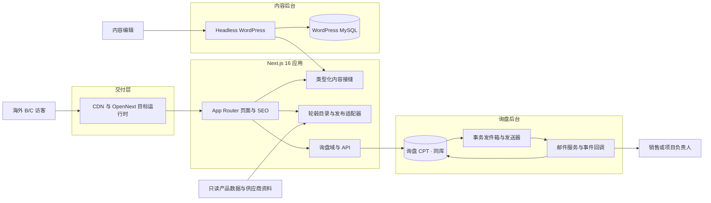
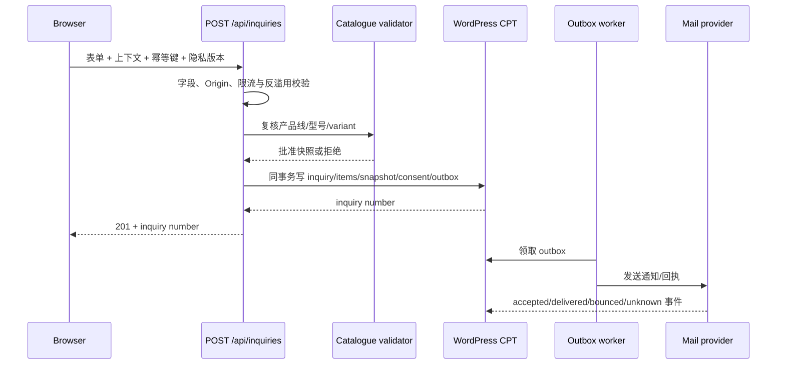

# 峰徊独立站现行架构总纲

更新：2026-10-05。本文是系统结构正本，描述模块、接缝、数据流和不可破坏的约束。

- 业务范围与目标：[`PROJECT.md`](PROJECT.md)
- 当前完成度与阻断项：[`STATUS.md`](STATUS.md)
- 决策理由：[`DECISIONS.md`](DECISIONS.md)
- 页面施工：[`PAGE-SPECS/README.md`](PAGE-SPECS/README.md)
- 架构阅读导航：[`ARCHITECTURE/README.md`](ARCHITECTURE/README.md)

本文使用三种状态：**已实现**表示代码或数据当前存在；**已设计**表示契约已定但尚未完整接线；**待确认**表示依赖业务事实、授权或运行时验证。规划不得写成现成功能。

## 1. 系统目标与业务边界

网站是深圳峰徊科技有限公司面向海外 B/C 客户的英文优先询盘站。四条产品线平行：

1. 轮毂：旋压轮毂、锻造轮毂和经过审核的真实型号；
2. 新能源三电铝制品；
3. 定制铝制品；
4. 自密封轮胎。

深圳峰徊承担网站品牌、项目接洽和协调角色。蓝辉与两家供应商是不同资料主体。共同股东或合作关系不能自动转移工厂、专利、证书、图片、车型适配、测试结果或售后承诺。每项公开主张都要绑定实际主体和证据。

站点完成内容展示、真实产品浏览、项目询盘和技术文章发布。首期不做在线支付、订单管理、客户账户、自研 CRM、AI 客服、公开工程文件上传或未经核准的车型适配保证。

## 2. 系统全景



图中 WordPress、询盘 CPT（同库）与事务发件箱已经在本地 Docker 运行并通过集成验收；OpenNext、生产基础设施、邮件事件回调、可靠调度、监控和恢复仍属于目标生产架构。页面内容仍只有部分模块接入 WordPress。

## 3. 模块与接缝

模块应在小接口后隐藏复杂实现。页面组件只知道稳定视图模型，不知道数据来自本地 TypeScript、WordPress、供应商 JSON 或数据库。

| 模块 | 接缝/接口 | 当前适配器 | 目标适配器 | 状态 |
|---|---|---|---|---|
| 站点内容 | `src/content/*.ts` 与 `src/content/types.ts` | 本地类型化对象 | WordPress 响应适配为相同类型 | 接缝已实现，页面仍以本地内容为主 |
| WordPress 读取 | `wpCollection` / `wpItem` | mock fallback + 本地 live REST | 受认证的 REST 读取、缓存与重验证 | 读取模块已实现，部分页面媒体已接入 |
| Insights 内容 | `InsightGuideDocument` → 既有 `GuideEntry` | WordPress 结构化文章与媒体；失败时回退本地已审核内容 | 同左，逐步扩展到其他页面正文 | 6 篇文章已迁移并接管；预览、撤回与标签失效已验收 |
| 轮毂事实 | `WheelCatalogue` / `WheelModel` / `WheelVariant` | WordPress 可编辑规格/媒体正本 + 最后有效静态快照 | 同左，生产环境补监控与备份 | 138 型号已迁移并接管；页面公共接口与类型保持不变 |
| 发布资格 | 公开 `WheelCatalogueCard/Detail` 视图 | 图片、发布状态与实际 variant 的 fail-closed 判定 | 再补图权、供货和业务签字 | 技术门槛已实现，首发集合待业务签字 |
| 询盘写入 | `POST /api/inquiries` | WordPress CPT `fh_inquiry` + 事务 outbox（DEC-055） | 同一适配器接生产 WordPress | 本地持久化、幂等、回滚与权限矩阵已验收 |
| 邮件投递 | WordPress outbox worker | accepted、租约、退避与放弃 | delivered/bounced 事件回调 + 平台可靠调度 | 本地 worker 已验收，生产事件闭环待实现 |
| 国际化 | `src/lib/i18n` 语言契约 + 请求级 locale | 英文保留根 URL，中文使用 `/zh/*` 独立 URL；页头页脚已双语 | 页面正文按内容接缝逐模块提供中英版本 | URL/SEO/站点框架接缝实施中，未翻译正文不得伪装为中文 |
| 部署 | Next.js 服务端能力 | `output: "standalone"` | OpenNext 目标平台 | 当前可本地 Node 运行，OpenNext 未配置 |

新增第二个数据来源时，在既有接缝增加适配器。不得让多个页面分别理解 WordPress 字段、供应商 JSON 或邮件服务响应。

## 4. 依赖方向

```text
项目事实与证据
      ↓
类型化内容 / 产品视图 / 询盘契约
      ↓
页面组件与 SEO
      ↓
Next.js 路由与运行时适配器
      ↓
WordPress / 数据库 / 邮件 / 部署平台
```

允许的依赖：

- 页面从 `src/content`、目录查询模块和服务端用例读取数据；
- 内容适配器依赖 WordPress 客户端；
- 询盘路由依赖验证、仓储和邮件接口；
- sitemap 与目录、详情使用同一个公开产品集合。

禁止的依赖：

- React 展示组件直接读取 WordPress 原始响应或供应商文件；
- 客户端组件导入服务端存储、密钥或邮件实现；
- 页面绕过公开集合直接使用全部 1349 个型号；
- 询盘表单根据客户端 URL 自行认定型号/variant 合法；
- 邮件结果反向决定询盘是否成功保存。

## 5. 内容、证据与媒体架构

### 5.1 事实来源

```text
assets/ 只读原件
  → resources/ 提取、核验、截图与来源记录
  → WordPress 草稿：主体、来源、图权、alt、caption、批准状态
  → src/content 视图契约
  → 页面公开模块
```

`assets/` 不就地修改。`resources/` 保存过程证据；`outputs/` 保存可评审成果；批准后的公开派生图片进入 `public/` 或未来媒体 CDN。用户已批准当前 WordPress 媒体库 157 张图片作为可读取选图候选；它们只有在 PageSpec/内容对象明确映射后才实际进入页面。图片可读取不等于图片关联的性能、认证、产能或法律主张已经批准。

每项媒体至少需要：来源文件/页码、哈希或稳定标识、实际主体、产品线、允许用途、图权状态、替代文本、说明文字和批准状态。

### 5.2 内容接缝

所有营销文案和页面数据进入 `src/content/*.ts` 的稳定接口，组件不硬编码。切换到 WordPress 时，适配器返回同样的视图模型，页面和组件无需修改。

首页、About 与 Capabilities 已实现 live 媒体接缝：共用 `src/lib/wordpress/media.ts` 把 WordPress 的图片 URL、alt 与 caption 归一化为 `MediaAsset`；页面适配器分别组装稳定的 `HomepageContent`、`AboutContent` 与 `WheelManufacturingCapabilities`。CMS 未启用或临时不可用时，回退到同一张批准媒体的 `public/` 派生版本。其他页面仍待接入，不能据此声称全站已经由 WordPress 驱动。

生产 `WP_MODE=live` 后：

- CMS 配置不完整应阻止发布或明确失败；
- CMS 临时故障可以使用最后一次成功且仍有效的批准内容；
- 撤回、过期或安全相关状态必须立即失效，不能被旧缓存继续标成可供；
- 预览内容与公开内容分离，草稿不能进入 sitemap。

轮毂与 Insights 的 WordPress 公开接口必须返回项目自有稳定契约，而不是让页面理解
core REST 响应。轮毂 live 读取失败时只能回退到仓库中最后一次核验通过的公开集合；
WordPress 明确返回“权威且为空”时代表全部撤回，不得误用旧快照重新上架。规格与媒体
迁移采用 expand–migrate–contract：迁移期间旧事实层只作兜底与对账，完成后不再作为
运营录入点。

### 5.3 主体和主张

工厂照片只证明照片中可见场景及已核准主体。用户已确认相关制造公司属于同一实际控制人体系，因此品牌层公开页面可以使用“我们的制造基地 / our manufacturing bases”；合同、发票、认证、专利和测试报告仍按实际法人主体与适用范围展示。About、Capabilities 和四产品线页面复用同一主体与证据记录，避免同一事实出现不同口径。

## 6. 产品目录与发布架构

### 6.1 原始事实与公开集合

轮毂基线为 1349 个型号、3485 条变体。当前 1073 个型号匹配到图片，276 个无图。
`hasImage` 只表示技术匹配，不等于获得销售和发布批准。历史导入数据继续保留作来源
证据；新的运营入口由 WordPress 管理型号、规格和已批准媒体。

公开资格必须同时满足：

```text
hasImage = true
AND publicationStatus = approved
AND imageRightsStatus = approved
AND supplyStatus = confirmed
AND specificationStatus = verified
AND 至少一个 approved variant
```

无图、无权、未确认、撤回或没有批准 variant 的型号不生成详情页，不进入目录、筛选、
相关推荐或 sitemap；猜中 URL 返回真实 404。数据继续保留在只读事实层作为迁移兜底和
审计证据；WordPress 中新建或更新的型号只有在规格、媒体和四项人工门槛全部通过后才
进入公开集合。

三电、定制铝制品和自密封轮胎在没有完整型号数据时发布能力页，不渲染空产品卡或占位详情页。

### 6.2 变体纪律

规格行只能来自同一条实际 `WheelVariant`。尺寸、PCD、ET、中心孔和 finish 不允许跨变体拼接。系列或型号级汇总只用于筛选摘要，不能代替具体配置。

目录、详情、询盘上下文和 sitemap 必须调用同一个公开集合：

```text
WordPress 可编辑型号/规格/媒体正本
  → 稳定 `/fh/v1/wheels` 发布视图
  → Next.js 适配器（失败时读取最后有效静态快照）
  → publishedWheelModels
  ├─ 目录与筛选
  ├─ 详情与相关型号
  ├─ sitemap
  └─ 询盘服务端上下文复核与快照
```

后台保存、撤回、移入回收站或删除轮毂/Insights 时，通过 HMAC-SHA256 请求体签名的 webhook 触发
Next.js 标签与路径失效。缓存失效是发布流程的一部分，不依赖运营手工运行同步脚本；
生产运行时仍须配置回调 URL、密钥与失败监控。

## 7. 页面与路由架构

### 7.1 首发页面族

| 页面族 | 主要路由 | 职责 |
|---|---|---|
| 公司入口 | `/`、`/about`、`/capabilities` | 四线定位、项目组织、制造关系和证据 |
| 产品中心 | `/products` | 四条产品线入口 |
| 轮毂 | `/products/wheels`、`/products/wheels/[model]`、`/products/wheels/flow-formed`、`/products/wheels/forged` | 真实目录、真实变体、工艺能力和型号询盘 |
| 三条能力线 | `/products/ev-components`、`/products/custom-aluminum`、`/products/safety-tires` | 有范围和证据边界的能力页 |
| 项目流程 | `/custom-development`、`/request-a-quote`、`/thank-you` | 项目准备、统一询盘和服务端确认 |
| 内容与政策 | `/resources`、`/resources/[slug]`、`/support/*` | 技术内容、隐私和交易政策 |

现有仓库还保留 gallery、fitment、dealers、tools、insights 等克隆阶段路由。它们属于待审计或暂缓范围；未进入首发导航不代表可以安全公开。上线前必须逐路由决定保留、重定向、`noindex` 或关闭。

### 7.2 页面设计接口

页面由 Page SPEC 定义的视口模块组成。一个主要视口回答一个核心问题，最多一个主行动。询盘步骤必须在正常基准视口中显示完整主按钮；移动键盘、放大和辅助设备允许自然滚动。

页面规格负责“这一页展示什么”；本文负责“数据从哪里来、模块如何依赖”。页面文案不复制到架构总纲。

### 7.3 SEO

- 每条公开 URL 有唯一 title、description、H1、canonical 和 OG 数据；
- sitemap 只读取批准页面和公开产品集合；
- `/thank-you`、预览、草稿、未确认产品和无效型号不索引；
- `NEXT_PUBLIC_APP_URL` 在构建时固化，构建与发布必须核对其实际值；
- 英文保留根路由以维持既有链接，中文使用 `/zh/*` 独立 URL；语言选择 cookie 只用于
  记忆与入口跳转，不作为页面语言的唯一事实源；
- 每个已完成中文正文的公开页面才可输出 `hreflang=zh` 并进入中文 sitemap。只有站点
  框架翻译、正文仍为英文的页面不得被标成完整中文页面，也不得进入中文索引集合；
- 语言切换必须保留当前路径、查询参数和片段，不得把用户无条件送回首页。

## 8. 询盘架构

### 8.1 产品上下文

首页、产品线、目录和详情都进入同一询盘模块。客户端可以携带产品线、型号、生产代码和显示规格，但这些值只用于体验。服务端根据当前公开集合重新解析并保存不可变快照。

### 8.2 目标写入流程



数据库事务成功是询盘成功的唯一条件。邮件服务商接受请求、邮件送达和销售已阅读是不同状态。

### 8.3 当前实现与缺口

当前 `POST /api/inquiries` 已有两步四线/B-C 表单、服务端字段与产品上下文复核、浏览器
幂等键、隐私版本双重门槛、Origin、蜜罐、时间陷阱、窗口限流和请求体上限；WordPress
在同一事务写 CPT、幂等键、上下文/同意 meta 与 outbox。`GET` 恒返 404，权威读取只在
WordPress 最小权限后台。Docker 已对回滚、201/200 重放、租约、退避、5 次放弃与权限
矩阵完成 69 项验收。

生产前仍需增加：批准的隐私文本与正式版本、平台边缘限流/人机验证取舍、邮件提供商
签名事件回调、平台可靠调度、法务批准的保留天数、备份内删除策略、异常/积压告警和
预发布故障演练。应用层已有默认关闭的保留候选与同事务级联删除接口，但不得替代法务
决定具体期限。

## 9. 运行时与部署架构

### 9.1 当前

- Next.js 16 App Router，`next.config.ts` 使用 `output: "standalone"`；
- 本地 Node 可运行页面和 `/api/inquiries`；
- 本地 WordPress Docker 实验场已存在，读取客户端默认 mock；
- 仓库没有 `@opennextjs/*`、Wrangler 或目标云配置；
- 根 `Dockerfile` / `docker-compose.yml` 等模板文件已归档（DEC-060）；**仓库中没有生产部署文件**，待 OpenNext 平台确定后新写。

2026-10-09 用户指定 `119.91.205.130:7080` 作为第一阶段 Headless WordPress 公网入口。
该端口原为旧 Next.js 预览，由 nginx 代理到 `127.0.0.1:3200`；切换时保留旧应用目录和
systemd 单元作为回滚点，只停止服务并替换 nginx 代理。WordPress 与 MySQL 运行在独立
Docker Compose 项目中，数据库不映射公网，WordPress 仅绑定 `127.0.0.1:7081`，公网
继续由 nginx 的 `7080` 入口转发。该地址在没有 HTTPS 前只属于受控预发布后台，不是
正式商用管理入口。

同日用户追加 `9080` 作为询盘联调前端入口。该入口只用于腾讯云单机上的端到端测试：
nginx `9080` → 回环端口 `9081` → Node 24 Next.js 容器，容器经 WordPress Compose
内部网络访问 CMS。它验证真实 `/api/inquiries`、内容读取、回执和缓存回调，但不替代
DEC-009 的 OpenNext 正式部署决策；没有域名、TLS、CDN 和正式监控时不得标记为生产。

### 9.2 目标

- 静态和缓存页面由 CDN 提供；需要运行时的 API、预览和重验证由 OpenNext 支持；
- WordPress/PHP/MySQL 与前端独立备份和升级；
- 询盘与内容同库（WordPress CPT `fh_inquiry`），但经 WP REST 端点写入而非直接读写表；
- 邮件发送器和回调拥有独立重试、监控和告警；
- 本地、预发布和正式环境使用相同构建流程和明确环境变量；
- 发布具备回滚、数据库备份恢复和缓存失效方案。

禁止把 Next.js 改为 `output: "export"`，该模式会移除询盘 API。目标 OpenNext 平台仍需通过本地样机和月度预算验证后决定。

## 10. 安全、隐私与运维

- 浏览器不接触 WordPress 凭据、数据库连接串、邮件密钥或管理 token；
- 匿名访问只能创建询盘，不能读取客户列表；
- 日志不得输出邮箱、电话、完整消息、图纸名或请求体；
- 工程文件不进入 WordPress 公共媒体库；首发不开放上传；
- 询盘使用 Origin/CSRF 防护、honeypot、限流、幂等和服务端长度/枚举校验；
- 隐私同意记录政策版本与时间；营销订阅独立且默认不选；
- 内容、数据库、媒体和构建产物分别备份，并实际演练恢复；
- canonical、OG、sitemap、关键表单和邮件状态纳入发布后监控。

## 11. 仓库结构与职责

| 路径 | 职责 |
|---|---|
| `src/app/` | App Router 页面、metadata、sitemap 与运行时路由 |
| `src/components/` | 只消费稳定接口的展示和交互模块 |
| `src/content/` | 类型化内容与产品视图接缝 |
| `src/lib/wordpress/` | WordPress 读取适配器 |
| `src/lib/inquiry/` | 询盘验证、仓储和邮件接口的当前实现 |
| `deploy/wordpress/` | 远程 Headless WordPress Compose、nginx 模板、备份与回滚说明 |
| `deploy/frontend/` | 腾讯云 9080 询盘联调前端的容器、nginx 与测试部署说明 |
| `assets/` | 只读产品数据、图片和语料 |
| `public/` | 已批准或构建产生的公开资源 |
| `PAGE-SPECS/` | 页面逐视口施工规格 |
| `resources/` | 调研、来源和核验过程 |
| `outputs/` | 可评审交付物 |
| `work/` | queued / active / completed 任务记录 |
| `archive/` | 被现行正本替代的完整历史 |

## 12. 当前差距与实施顺序

| 优先级 | 差距 | 完成判据 |
|---:|---|---|
| 1 | 业务事实与发布授权未冻结 | 正式英文名/域名/邮箱、供应关系、图权和首发型号签字 |
| 2 | 138 个验收型号未收窄为首发集合 | 销售、工程、供应与图权共同签字，低清或未确认型号同步退出所有公开面 |
| 3 | WordPress 未接入页面 | 编辑、预览、发布、撤回和缓存失效完整通过 |
| 4 | 询盘生产事件闭环未完成 | 平台 cron、delivered/bounced 回调、积压/退信告警、保留删除与预发布故障测试通过 |
| 5 | OpenNext 尚未落地 | 本地/预发布运行时、环境变量、canonical、回滚和费用验证通过 |
| 6 | 旧路由可能仍可公开访问 | 每条路由完成保留、重定向、noindex 或关闭决策 |

实施顺序以 [`outputs/site-launch-plan/04-task-cards.md`](outputs/site-launch-plan/04-task-cards.md) 为准。不得为了展示完成度跳过事实、发布或持久化门槛。

## 13. 架构变更规则

以下改动先更新本文和 `DECISIONS.md`，再改代码：

- 新增或移除产品线、页面族、数据源或运行时；
- 修改 `src/content/types.ts`、产品公开资格或询盘契约；
- 改变 WordPress、产品事实、数据库和邮件的职责；
- 改变部署平台、缓存、预览、重验证或 URL 语言策略；
- 引入客户文件上传、账户、支付、CRM 或管理后台。

文档与代码不一致时，先在 `STATUS.md` 记录差距。架构文档不能把目标状态伪装成已经实现。
