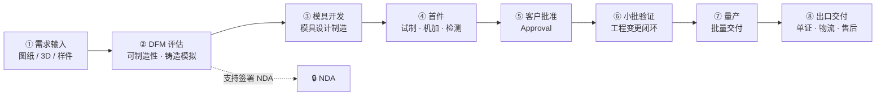

# `/products/custom-aluminum` 页面规格（铝制品定制 —— 输入 · 边界 · 流程）

> **路由**：`/products/custom-aluminum`（⚠️ **路由尚不存在，需新建**）
> **目标文件**：`src/app/products/custom-aluminum/page.tsx`
> **渲染**：静态（**唯一交互是 `<FaqAccordion>` 手风琴**；流程图是静态渲染，不加客户端逻辑）
> **数据**：**需新建** `src/content/custom-aluminum.ts`（`AnswerBlock` + `InputType[]` + `BoundaryRow[]` + `Capability[]` + `FaqEntry[]` + `RouteStep[]`）
> **设计依据**：`../../ARCHITECTURE/page-architecture/custom-aluminum-page.md`（**八段式 + 完整证据链，本规格只翻译成施工口径**）
> **分工交叉核对**：`../custom-development.md`（**已存在** —— 已采纳 `custom-aluminum-page.md` §8 的「分开做强」裁定）

---

## 0. 一句话

**这页卖的不是零件，是「把我的图变成件」这件事本身。**
语料库里「铝制品」类别**只有 4 条术语** → **撑不起产品目录** →
**必须走「流程 + 边界」路线，核心资产是一张图（开发流程），不是一份清单。**

**🔴 三条施工级纪律**：
1. **④ 能力边界是本页最重要的一段** —— 它要**「划掉」东西**（与全站其它页写法相反）。
   **`<BoundaryTable>` 的「不做」栏现在是空的 → 空着就不上线**（设计文档 §7.2）。
2. **② 定义段必须含「与 ev-components 的分流框」** —— 判定线：
   **有名字的件（壳体/端板/水冷板）→ ev-components；只有一张图 → 本页。**
3. **⑦ 开发流程用 `<ProcessDiagram>`（建议 mermaid 围栏）** —— 八环节**全部有峰徊自有语料来源**。

**⚠️ 结构判定**：本页在 `index.md` §2 里属「三条能力线」→ 需要 **`<BoundaryTable>` + `<ProcessDiagram>`**。

---

<!-- VIEWPORT-SPEC-INJECTED -->
## 0.5 ★ 视口切分（全页第一原则）

> 判据来自 `../../DESIGN.md` §0.5.1 / §0.5.2 / §0.5.4。
> 本节由 `scripts/inject-viewport-specs.py` 从 `_viewport-audit.md` §14 生成 —— **不复制结论，只搬事实**。

### 0.5.1 实测现状 vs 规格要求

**代码事实**：`src/app/products/custom-aluminum/page.tsx` 实测 **8 个 `<section>`**（2026-10-02）。

> 审计原文：`PageHero` → ② Definition + `CrossLink`（分流框）→ ③ `#inputs`（4 卡）→ ④ `#boundary`（`BoundaryTable` + 条件 `DataNotice`）→ ⑤ capability（6 项）→ ⑥ typical parts（`PartGroupCards`）→ ⑦ `#development-flow`（`ProcessDiagram` + `CrossLink`）→ ⑧ FAQ + `DataNotice` → ⑨ `RouteBlock` → ⑨b `DealerCta`。 规格要求九段（`PAGE-SPECS/products/custom-aluminum.md` §1）。

**⚠️ 本规格 §1 的「N 段式」是内容块清单，不是视口切分。** 施工时先按 §0.5.2 定视口，再往视口里放段。

### 0.5.2 视口切分（来自审计）

| 视口 | 核心问题 | 含哪些段 | 主要信息 | 主要视觉 | 主要行动 | 次要行动 | 判定 |
|---|---|---|---|---|---|---|---|
| **01** | 这条线是什么？ | ① `PageHero` | `caHero` | 深色径向橙光 | 主 CTA | 无 | ✅ 合规 |
| **02** | 铝制品定制 ≠ 卖标准铝件（与 EV 页怎么分？） | ② Definition + **`CrossLink` 分流框** | `caDefinition` + 3 卡 + `caSplit` | 左文 + 3 卡 + **橙色分流框** | `CrossLink` → EV 页 | 无 | ✅ 合规 |
| **03** | 项目怎么开始？ | ③ `#inputs` | `Four ways a project starts` + `InputTypeCards` 4 卡 | 4 卡 | 无 | 无 | ✅ 合规 |
| **04** | 你们不做什么？ | ④ `#boundary` | `Where the boundary is` + `BoundaryTable` + 条件 DataNotice | 三态表 | 无 | 无 | ✅ 合规 |
| **05** | 你们有哪些能力？ | ⑤ capability | 6 项 | `CapabilityGrid` | 无 | 无 | ✅ 合规 |
| **06** | 典型件是什么样？ | ⑥ typical parts | `Where this capability lands` + 2 组 | `PartGroupCards` | 无 | 无 | ⚠️ **拥挤**（见 B-1） |
| **07** | 图纸怎么变成件？ | ⑦ `#development-flow` | `ProcessDiagram` 8 环节 + NDA + `CrossLink` | 流程图 | `CrossLink` → `/custom-development#cooperation-models` | 无 | ✅ 合规 |
| **08** | 常见问题？ | ⑧ FAQ + `DataNotice` | `caFaqs` 3 条 + `caFaqNotice` | 手风琴 | 无 | 无 | ✅ 合规 |
| **09** | 接下来去哪？ | ⑨ `RouteBlock` | `caRoutes` 3 出口 | 3 列卡 | 卡内链接 | 无 | 🗑️ **建议删除** |
| **10** | 怎么询盘？ | ⑨b `DealerCta` | `caCta` | 橙底 | `Request a quote` | email | ✅ 合规 |

**判定统计**：✅ 8 ｜ ⚠️ 拥挤 1 ｜ 🔴 违规 0 ｜ 🗑️ 建议合并/删除 1

### 0.5.3 审计给出的处置

| # | 判定 | 审计发现（原文标题） |
|---|---|---|
| B-1 | ⚠️ | 视口 05（⑤ capability）与 06（⑥ typical parts）：能力与典型件被拆成两屏 |
| B-2 | 🗑️ | 视口 09（⑨ RouteBlock）：答案是重复的 |

> 逐条理由与建议见 `_viewport-audit.md` §14 的 B 小节 —— **本文件不复制理由，只登记落点**。

### 0.5.4 高度预算与询盘整屏

| 项 | 要求 |
|---|---|
| 每视口 | ≈ 1 屏（`min-h-svh` 不强制，但一屏一个核心问题） |
| 🔴 询盘整屏 | 结尾 CTA **必须完整落在一个视口内** （`DESIGN.md` §0.5.4 硬规则），不得让按钮落在折线下 |
| 深色段 | 深色视口 ≤ 3；深色是入口，不是背景（`DESIGN.md` §1.2） |

---

<!-- ASSET-REALIGNMENT-2026-10-02 -->
## 0.6 ★ 真实图片资产重排（2026-10-02）

| 视口 | 图片资产 | 模块用途 |
|---|---|---|
| Hero | `/images/custom-aluminum/hero.webp` | 说明从图纸、3D 数据或样件进入开发 |
| 代表件 | `/images/custom-aluminum/product-overview.webp`、`machined-part.webp` | 展示定制铝件与机加工结果 |

**处置**：本页采用「图纸/样件输入 → 工艺路线 → 机加工结果」的内容顺序；不补造不存在的型号目录，也不把轮毂图片作为铝制品案例。

## 1. 页面骨架（八段式）

| 序 | 内容块 | 必须性 | 说明什么 | 就绪度 |
|---|---|---|---|---|
| ① | Hero（深色） | 必须有 | 定位：按图纸或样件开发 | ✅ |
| ② | 这条线是什么（定义 + **▲ 分流框**） | 必须有 | 铝制品定制 ≠ 卖标准铝件 + **与 ev-components 分流** | ✅ |
| ③ | **★ 四类输入** | 必须有 | 图纸 / 3D / 样件 / 逆向 —— **本页差异化段之一** | ✅ |
| ④ | **★★ 能力边界** | 必须有 | **我们做什么、不做什么** —— **本页最重要的一段** | ❌ |
| ⑤ | 我们能做什么（能力） | 必须有 | 材料 / 成形 / 精加工 / 热处理 / 表面 / 工程前置 | ⚠️ |
| ⑥ | 典型件举例 | 必须有 | 动力与传动 · 底盘与车身（4 条术语的落点） | ⚠️ |
| ⑦ | **★ 开发流程** | 必须有 | 图纸→DFM→模具→首件→小批→量产（**8 环节**） | ✅ |
| ⑧ | 常见问题 FAQ | 必须有 | 工程口径 5–6 条 | ❌ |
| ⑨ | 路由 + CTA | 必须有 | → `/custom-development` `/capabilities` `/contact` | ✅ |
| ~~⑤b~~ | ~~型号 / 规格~~ | **留空** | ❌ **无数据 → 不渲染**（预留位，见 §6） | — |

**⚠️ 兑现上架门槛**（`README.md` §3.1）：本线 ⑤ 型号/规格留空 → **9 段模板实际落成 8 段**。

```
/products/custom-aluminum
├── ① <HeroDark>                     eyebrow CUSTOM ALUMINUM · H1 + 副标 + CTA
├── ② <AnswerBlock>                  定义三段
│      └── <CrossLink>  ★★            ▲ 与 ev-components 的分流框（有名字的件 vs 只有一张图）
├── ③ <InputTypeCards>  ★★            → <InputTypeCard> × 4（图纸 / 3D / 样件 / 逆向）
├── ④ <BoundaryTable>  ★★★          三态：能做 / 不做 / 需评估 —— **「不做」栏空 → 不上线**
├── ⑤ <CapabilityGrid>               六能力块 + 峰徊 P7 收尾句
├── ⑥ <PartGroupCards>               两组典型件（复用 ev-components ③ 同一组件）
├── ⑦ <ProcessDiagram>  ★            八环节流程图（**mermaid 围栏**）+ NDA 说明
│      └── <CrossLink>  ★             → /custom-development#cooperation-models（商业条款）
├── ⑧ <FaqAccordion>  ★              5–6 条（**4 条待确认**）
├── ⑨ <RouteBlock>                   三出口（T7）
│      └── <DealerCta>               （本页可用——CTA 语义仍属「发图纸/询盘」）
└──    <DataNotice>
```

**⚠️ 锚点契约（跨页稳定锚，不得改）**：

| 页 | 锚点 id | 由谁链接过来 |
|---|---|---|
| **本页 ⑦ 段** | **`#development-flow`** | **`/custom-development` ③ 段**（`custom-development.md` §1.1 ①）|
| `/custom-development` ② 段 | `#cooperation-models` | **本页 ⑦ 段**（`custom-development.md` §1.1 ②）|

---

## 2. 逐块规格

### ① Hero（深色）

| 项 | 内容 |
|---|---|
| 结构 | `.eyebrow` + `<h1>` + 副标 + 一句定位 + 主 CTA |
| eyebrow | `CUSTOM ALUMINUM` |
| H1 | **铝制品定制** / Custom Aluminum Components |
| 副标 | **图纸、3D 数据或样件，都能进入开发流程** / Start with a Drawing, 3D Data or Physical Sample |
| 定位句 | 按图纸或样件开发 |
| 主 CTA | **把你的图发过来，先做一次 DFM** → `/contact`（`.btn-pill-solid`） |
| 容器 | `.container-fh`（1180） |
| 背景图 | ⚠️ **无图** —— `assets/preview-media/custom.webp` 存在但**代码零引用**；registry `08-custom-aluminum` 7 条**全部 `public:false`** → 走**深色纯底版式** |

**禁止项**：
- ❌ 不得出现「我们可以做任何铝件」（**本页全篇在反驳这句**，见 ④）
- ❌ 不得用轮毂工艺图充门面（设计文档 §0）

**就绪度**：✅ 文案齐（峰徊 P1/4/15）；⚠️ 主图授权（`custom-aluminum-user-provided-*` 虽 `altReviewed:true`，仍 `draft`）

---

### ② 这条线是什么（定义段 + ★★ 分流框）

| 项 | 规格 |
|---|---|
| 结构 | 3 小节：**定制≠卖标准件** / **▲ 分流框** / **我们的落点** |
| 组件（主） | **`<AnswerBlock>`**（`types.ts:123` 复用） |
| 组件（分流） | **`<CrossLink>`**（★ **`custom-development.md` §3.2 已规划此组件** → **必须复用，不另起名**） |
| 配比 | 60/30/10 —— **「10% 数据」同样降到 ~0**（缺口 1/2/3） |

**★★ 分流框文案（本段的存在理由 —— 不写清，客户会走错页）**：

```
┌─ 走错页了吗？ ──────────────────────────────────────┐
│ 如果你要的是 新能源三电壳体（电机壳 / 逆变器壳 /      │
│ 电池箱体…），那类件在 /products/ev-components        │
│ 有专门说明。                                        │
│                                                     │
│ 本页处理的是「有图纸但没有现成名字」的铝件。          │
│                              [去看三电壳体 →]        │
└─────────────────────────────────────────────────────┘
```

**判定线（原句照抄，设计文档 §1）**：
> **如果客户要的东西「有名字」（壳体、端板、水冷板）→ 走 ev-components；
> 如果客户要的东西「只有一张图」→ 走本页。**

**props 契约**：

```ts
// ②a 定义 —— 复用已有类型
type AnswerBlock = {                 // types.ts:123
  eyebrow: string;                   // "这条线是什么"
  heading: string;                   // "铝制品定制 ≠ 卖标准铝件"
  body: string;                      // 「按你的输入做出一件东西」
  points: string[];                  // 落点三条（6061/镁合金 · 铸造锻造 · CNC 精加工）
};

// ②b 分流框 —— ★ 复用 <CrossLink>（custom-development.md §3.2 已定义此契约）
type CrossLinkProps = {
  eyebrow: string;      // "走错页了吗"
  title: string;        // "要找新能源三电壳体？"
  body: string;         // "电机壳 / 逆变器壳 / 电池箱体那类件，在 ev-components 有专门说明。本页处理「有图纸但没有现成名字」的铝件。"
  href: string;         // "/products/ev-components"
  linkLabel: string;    // "去看三电壳体"
  className?: string;
};
```

**🔴 硬规则**：
1. **分流框必须放在 ② 段内、且视觉上是个「框」**（不是一行小字）—— 判错页的代价是双向下游浪费。
2. **`<CrossLink>` 是跨页分工链接**，与 `<ResourceLink>`（同页路由卡）不同（`custom-development.md` §3.2 已明确区分）。
   **若判定两者视觉同构 → 复用 `ResourceLink` 的数据形状，只新建渲染组件。**

**禁止项**：
- ❌ 不得在分流框里说「两页都可以」 —— 分流必须是**二选一**
- ❌ 不得引用 6061/镁合金原句（**原文限 "wheel programs"**，需改写为「我们具备 6061 铝合金成形能力」）

**就绪度**：✅ 定义 + 分流全就绪（P1/4 定位 + 判定线为业务归纳）

---

### ③ ★★ 四类输入（本页差异化段之一）

**核心句（峰徊 P15）**：
> **图纸、3D 数据或样件，都能进入开发流程** / Start with a Drawing, 3D Data or Physical Sample

| 项 | 规格 |
|---|---|
| 结构 | **4 张卡**，每卡：序号 + 输入名（中/英）+ **「我们要客户提供什么」** |
| 组件 | **`<InputTypeCards>`**（**需新建**）→ 内含 `<InputTypeCard>` |
| 栅格 | ≥1024 → **4 列等高**；768 → 2 列；390 → 1 列 |
| 锚点 | `id="inputs"` |

**四类内容**：

| # | 输入 | 英文 | 我们要客户提供什么 |
|---|---|---|---|
| 1 | **2D 图纸** | 2D Drawing | 三视图 + 关键尺寸 + 公差要求 |
| 2 | **3D 数据** | 3D Data | STEP / IGES 等中性格式 |
| 3 | **实物样件** | Physical Sample | 寄样 + 使用条件说明 |
| 4 | **只有参考件**（逆向） | Reverse Engineering | **我们有逆向工程能力**（峰徊 P3/7） |

**props 契约**：

```ts
// src/components/input-type-cards.tsx（★ 需新建）
type InputType = {
  index: string;         // "01"…"04"
  name: string;          // "2D 图纸"
  nameEn: string;        // "2D Drawing"
  /** ★ 我们要客户提供什么 —— 每卡必有，这是本段的实用价值 */
  requirements: string[];   // ["三视图", "关键尺寸", "公差要求"]
  /** ★ 第 4 类（逆向）的强调标记 */
  highlight?: boolean;
};

type InputTypeCardsProps = {
  inputs: InputType[];       // ★ 固定 4 条
  /** ★ 段末统一说明 —— 强约束 */
  note: string;              // "第 4 类：没有图纸也能开始"
  className?: string;
};
```

**🔴 硬规则**：
1. **第 4 类必须高亮** —— 「很多采购手里只有竞品的一个件，没有图。
   明确写出这一条，**能接住一批客户**」（设计文档 §4③）。
2. **每卡必须有 `requirements`** —— 只说「接受图纸」是空话，**说清要什么图纸才有价值**。

**禁止项**：
- ❌ 不得给第 4 类加「高精度扫描」等具体设备描述（**无设备语料**，缺口 7）
- ❌ 不得承诺「任何格式都行」（未确认，见 §6）

**就绪度**：✅ **P15 一句撑起全部四类** —— 本页最就绪的一段

---

### ④ ★★★ 能力边界（本页最重要的一段）

**⚠️ 这一段的写法与全站其它页相反：它要「划掉」东西。**

**为什么（原句照抄，设计文档 §4④）**：
> 铝制品定制的最大成本事故是「**走完评估才发现做不了**」。
> **主动划边界 = 减少双方浪费 = 建立专业感。**

| 项 | 规格 |
|---|---|
| 结构 | **三态表**：✅ 能做 / ❌ **不做** / ⚠️ 需评估 |
| 组件 | **`<BoundaryTable>`**（**需新建 ★ 三条能力线共用件**） |
| 锚点 | `id="boundary"` |
| 段末 | ✅ **收尾句直接用峰徊 P7 原文** |

**三态内容**：

| 态 | 内容 | 状态 |
|---|---|---|
| ✅ **能做** | 铝合金 / 镁合金 · 铸造与锻造路线 · CNC 精加工 · 表面处理 · 可按项目组合工艺（峰徊 P7） | ✅ 有来源 |
| ❌ **不做** | ⚠️ **待丰怀确认后填写** —— 例如超小件？超大批量？纯钣金？非铝材质？ | ❌ **🔴 空** |
| ⚠️ **需评估** | 尺寸 / 重量 / 复杂度上限之外的件（**边界数字待确认**） | ⚠️ 半 |

**★ 收尾句（峰徊 P7，自有口径，不带轮毂字样）**：
> **根据尺寸、载荷、重量、成本和项目规模，我们匹配合适的成形路线。**
> Process selection is based on size, load, weight, cost and program volume.
>
> **三种工艺不是概念介绍，而是可按项目组合的真实制造能力。**

**props 契约**：

```ts
// src/components/boundary-table.tsx（★ 需新建）
type BoundaryRow = {
  /** 三态之一 */
  state: "included" | "excluded" | "assess";
  label: string;            // "超小件（< 50 g）"
  /** ⚠️ 该行是否已确认。false 的行不允许渲染成确定结论 */
  confirmed: boolean;
  note?: string;            // 补充说明
};

type BoundaryTableProps = {
  rows: BoundaryRow[];      // ✅能做的行 + ❌不做的行 + ⚠️需评估的行
  /** ★ 段末收尾句（峰徊 P7） */
  closingLine: string;
  /** ★ 「不做」栏为空时的开关 —— 见下方 🔴 */
  excludedConfirmed: boolean;
  className?: string;
};
```

**🔴🔴 硬规则（本页上线门槛）**：

> **「不做」这一栏现在是空的 —— 不能编，但也不能省掉这一栏。**
> **它是本页结构的骨架，等丰怀给答案就能填。**（设计文档 §4④）
>
> **④ 不填则不上线** —— 「空着上线等于告诉客户『什么都做』，
> **这正好是我们最想避免的印象**。」（设计文档 §7.2）

**施工实现：`excludedConfirmed: boolean` 是页面级开关，直接改渲染方式**：

| 值 | 页面行为 |
|---|---|
| `false`（当前） | ④ 段渲染为**「边界待确认」态** —— 只显示 ✅ 能做 + ⚠️ 需评估，**并显示一行 `DataNotice` 级声明**：「具体能做与不做的范围正在核实」 |
| `false` + 发布级 | ⚠️ **整页禁止 index** —— 走 **`noindex` 预览版**（设计文档 §7.2 明写） |
| `true` | ④ 段渲染完整三态表 + 正式发布 |

```ts
// ★ 与 custom-development.md §4.2 的 mooTerms.confirmed 同思路：
// "未确认的数据不进 DOM，而不是进了再隐藏"
export const boundaryTerms: {
  excludedConfirmed: boolean;   // ⚠️ 默认 false
  rows: BoundaryRow[];
} = { excludedConfirmed: false, rows: [] };
```

**禁止项**：
- ❌ **不得编造「不做」清单**（哪些件我们不接 —— 这是商业承诺）
- ❌ 不得省略 ❌ 栏（**空栏也要在结构里占位，只是不渲染内容**）
- ❌ 收尾句不得改写成营销腔（P7 是**工程技术口径**，照抄）

**就绪度**：❌ **「不做」栏为空**（缺口 1/13，🔴 本页核心）→ **阻塞上线**

---

### ⑤ 我们能做什么（能力段）

| 项 | 规格 |
|---|---|
| 结构 | **6 张能力卡** + 峰徊 P7 收尾句 |
| 组件 | **`<CapabilityGrid>`**（**与 ev-components ⑤ 同一组件**，`highlightLast` 不用） |
| 栅格 | ≥1024 → 3 列（6 卡 = 2 行整）；768 → 2 列；390 → 1 列 |

**6 张卡**（照设计文档 §4⑤）：

| 卡 | 标题 | 内容 | 来源 | 语料风险 |
|---|---|---|---|---|
| 1 | **材料** | 6061 铝合金 · 镁合金 | 峰徊 P9 | ⚠️ **原轮毂语境，需改写** |
| 2 | **成形路线** | 低压铸造 · 高压压铸 · 重力铸造 · 锻造 | 峰徊 P7/14 | ✅ |
| 3 | **精加工** | CNC 精密加工 · 关键接口精加工 | 峰徊 P6/9 | ✅ |
| 4 | **热处理** | 热处理 | 峰徊 P6 | ✅ |
| 5 | **表面** | 表面处理 · 涂装 | 峰徊 P3/6/14 | ✅ |
| 6 | **工程前置** | 3D 设计 · 有限元 · 铸造模拟 · 逆向工程 · 模具开发 | 峰徊 P3/7 | ✅ |

**props 契约**：**复用 `<CapabilityGrid>`**（契约同 `ev-components.md` §2⑤，`Capability[]` + `columns` + `className`）。

**🔴 硬规则**：
1. **第 1 卡（材料）必须标注语料改写** —— 施工时不得直接引用 P9 原句（"6061-aluminum and magnesium **wheel programs**"）。
2. **收尾句 = 峰徊 P7 原文**（与 ④ 段收尾**同一句** —— 设计文档 §2.4 明确说这是「本页最合适的能力段收尾句」）。
   ⚠️ **若 ④⑤ 两段都用同一句 → 只保留在 ④ 段末**（避免重复），⑤ 段末改用过渡句。

**禁止项**：
- ❌ 不得写模具费 / 公差 / 产能（缺口 3/5/7）
- ❌ 不得出现轮毂的「一体锻造成形」原句（P9 限轮毂）

**就绪度**：⚠️ 部分 —— 工艺名齐，**材料牌号 / 公差缺**（缺口 2/3）

---

### ⑥ 典型件举例（4 条术语的落点）

**⚠️ 决策（设计文档 §3）**：铝制品只有 4 条术语 → **不做成产品网格**，
改做成**「典型件」举例，按应用场景分 2 组**。

| 项 | 规格 |
|---|---|
| 结构 | **2 张卡**（**第 3 组「通用机加件」语料库无 → 不写**） |
| 组件 | **`<PartGroupCards>`**（★ **复用 `ev-components` ③ 同一组件** —— 同形态！） |
| 栅格 | ≥1024 → **2 列等高**（不是 3 列）；768 → 2 列；390 → 1 列 |

**两组内容**（照设计文档 §3.1）：

| 卡 | 组名 | 举例零件 | 场景描述（要新写） |
|---|---|---|---|
| 1 | **动力与传动** | 端盖 · 支架 | 与三电 / 传动配套的铝合金机加件 |
| 2 | **底盘与车身** | 控制臂 · 转向节 · 连接件 · 轻量化结构件 | 底盘与车身用轻量化铝合金结构件 |
| ~~3~~ | ~~通用机加件~~ | ❌ **语料库无 → 暂不写**（无来源不写） | — |

**props 契约**：**复用 `<PartGroupCards>`**，改用本页语义：

```ts
// 同一组件，不同数据（★ 复用优先律）
// src/components/part-group-cards.tsx —— 与 ev-components ③ 同一个文件
type PartGroup = {
  slug: string;              // "drivetrain" | "chassis"
  name: string;              // "动力与传动"
  nameEn: string;
  difficulty: string;        // ★ 本页语义 = 「场景描述」
  parts: { name: string; nameEn: string; process?: string }[];
};

// 本页调用（groups 只有 2 条 → 组件需支持 2/3 列自适应）
<PartGroupCards
  groups={typicalParts}                 // ★ 2 条 → columns={2}
  boundaryNote="以上为典型件举例，实际按图评估。"
  className={undefined}
/>
```

**🔴 硬规则**：
1. **卡下必有「实际按图评估」** —— 同 ev-components ③ 的边界句纪律，**组件层强约束**。
2. **组件必须支持 groups 长度 2 或 3** —— 本页 2 条、ev-components 3 条 →
   **`columns` 由 `groups.length` 派生，不得硬编码**。

**禁止项**：
- ❌ 不得补第 3 组（无来源不写）
- ❌ 不得加零件图（registry 7 条全 `public:false`，缺口 11）

**就绪度**：⚠️ 仅 2 组有语料；缺案例与图片（缺口 11）

---

### ⑦ ★★ 开发流程（本页主体段 · mermaid 围栏）

**★ 这是本页最值得出图的一段** —— 八环节**全部有峰徊自有语料来源**。

| 项 | 规格 |
|---|---|
| 结构 | **8 环节流程图** + NDA 说明 + 商业条款交叉链接 |
| 组件 | **`<ProcessDiagram>`**（**需新建 ★ 三条能力线共用件**） |
| **渲染方式** | **★ 建议 mermaid 围栏**（按 `content-design-and-new-pages.md` 图例规范：**流程/顺序类首选 mermaid，档 A**） |
| 锚点 | **`id="development-flow"`** ← ★ **跨页稳定锚，`/custom-development` ③ 段链过来** |
| 栅格 | 桌面横向 8 步 / 移动纵向连接线 |

**八环节（照设计文档 §4⑦，全部有语料来源）**：

| # | 环节 | 内容 | 来源 |
|---|---|---|---|
| ① | **需求输入** | 图纸 / 3D / 样件 | 峰徊 P15 |
| ② | **DFM 评估** | 可制造性设计 · 铸造模拟 · 工艺路线与报价 | 峰徊 P15 |
| ③ | **模具开发** | 模具设计制造 | 峰徊 P3 |
| ④ | **首件** | 试制 · 机加工 · 尺寸与性能检测 | 峰徊 P15 |
| ⑤ | **客户批准** | 首件与测试 → Approval | 峰徊 P22 |
| ⑥ | **小批验证** | 样品确认 · 工程变更闭环 | 峰徊 P15 |
| ⑦ | **量产** | 批量交付 | 峰徊 P11/22 |
| ⑧ | **出口交付** | 单证 · 物流 · 售后支持 | 峰徊 P2/3 |

**mermaid 围栏（施工时直接把这段放进 content 模块的 `diagram` 字段）**：

````md

````

**props 契约**：

```ts
// src/components/process-diagram.tsx（★ 需新建）
type FlowStep = { step: string; title: string; body: string };   // types.ts:163 复用

type ProcessDiagramProps = {
  stages: FlowStep[];         // ★ 8 条（不硬编码步数）
  /** ★ mermaid 源码 —— 首选渲染路径（档 A） */
  diagram?: string;           // mermaid 围栏内容
  /** ★ mermaid 不可用时降级为 CSS 步骤条 */
  fallback?: "steps";
  /** ★ NDA 说明 —— 本页必填 */
  ndaNote?: string;
  /** ★ 段末交叉链接（→ /custom-development#cooperation-models） */
  crossLink?: React.ReactNode;
  anchorId?: string;          // "development-flow"
  className?: string;
};
```

**🔴 硬规则**：
1. **NDA 必须在 ② DFM 评估之前或并列说明** —— 「客户发图纸前的第一个顾虑就是保密」（设计文档 §7）。
2. **锚点 `id="development-flow"` 是硬契约** —— `custom-development.md` §1.1 ② 的链接目标就是它。
3. **8 步不得压缩成 5 步** —— 那是 `/custom-development` 的商业口径版本（5 步）。

**交叉链接（★ 必须写，规则来自 `custom-development.md` §1.1 ②）**：

```tsx
// 本页 ⑦ 段末尾
<CrossLink
  eyebrow="合作模式"
  title="OEM / ODM / 贴牌怎么选"
  body="模具归属、起订量、打样费与交期的商务条款，见定制开发页。"
  href="/custom-development#cooperation-models"
  linkLabel="看合作模式"
/>
```

**🔴 分工纪律（三条禁止项，来自 `custom-development.md` §1.1，本页必须遵守）**：
- ❌ **本页 ⑦ 段不得出现 `MOQ` 明细 / `模具归属` / `打样费` 商务条款** —— 那是 `/custom-development` 的领地
- ❌ 不得与 `/custom-development` 各自写一份完整五步叙述 —— **同一形态只做一次，第二页只做交叉链接**
- ✅ 本页做**「技术流程」为主**（DFM/首件/FAIR 的工程细节）；`/custom-development` 做**「合作模式」为主**

**就绪度**：✅ **八环节全部有峰徊自有来源** —— 本页最就绪、最有价值的一段

---

### ⑧ 常见问题 FAQ（工程口径）

| 项 | 规格 |
|---|---|
| 结构 | 手风琴 **5–6 条** |
| 组件 | **`<FaqAccordion>`**（复用，契约同 `ev-components.md` §2⑦） |
| 数据 | `FaqEntry[]`（`types.ts:77` 复用） |

**6 条题目（照设计文档 §4⑧）**：

| # | 问题 | 可用性 | 回答要点 |
|---|---|---|---|
| 1 | 我只有样件没有图纸，能做吗？ | ✅ **能** | 我们有逆向工程能力（峰徊 P3/7） |
| 2 | 你们能做哪些铝合金牌号？ | ❌ **空** | 语料只有轮毂语境 6061/镁合金 |
| 3 | 最大能做多大 / 多重？ | ❌ **空** | 无尺寸包络 |
| 4 | 公差能到多少？ | ❌ **空** | 仅「关键接口精加工」一句 |
| 5 | 要签 NDA 吗？ | ✅ **支持** | 峰徊 P15 |
| 6 | 打样和量产各要多久？ | ❌ **空** | 无天数 |

**🔴 施工纪律**：**上线放 2 条**（#1 逆向 + #5 NDA），
**#6 改写为开放问法**（「打样周期怎么评估？」→「按图纸复杂度评估」），
**#2/#3/#4 不渲染**（无数据不留占位条目）。

**就绪度**：❌ **6 条里 4 条空**（缺口 2/3/6）

---

### ⑨ 路由 + CTA

**⑨a 路由段（T7 三出口）** —— **`<RouteBlock>`**（`RouteStep[]`，`columns={3}`）

```ts
// 三出口（照设计文档 §4⑨）
const routes: RouteStep[] = [
  { step: "01", title: "通用定制开发流程与合作模式", body: "想看 OEM / ODM / 贴牌怎么选",
    href: "/custom-development", linkLabel: "看合作模式" },
  { step: "02", title: "全厂工艺与设备全景", body: "想看整厂的产线与设备",
    href: "/capabilities", linkLabel: "看能力全景" },
  { step: "03", title: "直接发图纸开始评估", body: "有图就能开始",
    href: "/contact", linkLabel: "发图纸" },
];
```

**⑨b CTA**（照设计文档 §4⑨）：

| 项 | 内容 |
|---|---|
| 组件 | **`<DealerCta>`**（**复用已有，`sections/dealer-cta.tsx`，21 处在用**）|
| 文案 | **主**：**有一张图，就能开始。**<br>**副**：支持签署 NDA。图纸、3D 数据或实物样件，都能进入开发流程。 |
| 字数 | **≤80 字** |
| 按钮 | `.btn-pill-solid`「发图纸做 DFM」→ `/contact`　`.btn-pill-outline`「看合作模式」→ `/custom-development` |

**⚠️ 与 ev-components 的差异（重要）**：`ev-components.md` §2⑧ 明确**不得复用 `<DealerCta>`**；
**本页可以复用** —— 因为本页受众是「有图纸的采购 / 产品公司」，询盘语义成立。
**→ CTA 语义判定表**：

| 页 | 是否用 `<DealerCta>` | 理由 |
|---|---|---|
| `/products/ev-components` | ❌ | 项目制 + 报价过早 |
| **`/products/custom-aluminum`（本页）** | ✅ | 询盘语义成立（发图纸就是询盘） |
| `/products/safety-tires` | ⚠️ | 视归属（见该页规格 §2⑨） |

**就绪度**：✅ 文案齐

---

## 3. 组件清单

### 3.1 复用已有

| 组件 | 路径 | 本页用途 | 备注 |
|---|---|---|---|
| **`<DealerCta>`** | `src/components/sections/dealer-cta.tsx` | ⑨b 收尾 | ✅ 21 处在用 |

**⚠️ 本页可复用的已有组件 = 仅 1 个** —— 与 `/custom-development` 规格 §3.1 结论一致。
**这正是 ⑦ 段必须与 `/custom-development` 分工的现实原因：没有现成资产，必须共用形态。**

### 3.2 需新建

| 组件 | 建议路径 | 职责 | 复用度 | 优先级 |
|---|---|---|---|---|
| **`<BoundaryTable>`** | `src/components/boundary-table.tsx` | ④ 三态边界表 | **三条能力线** | 🔴 **本页核心** |
| **`<ProcessDiagram>`** | `src/components/process-diagram.tsx` | ⑦ 八环节流程图（mermaid + 降级） | **三条能力线** | 🔴 **本页主体** |
| **`<InputTypeCards>`** | `src/components/input-type-cards.tsx` | ③ 四类输入卡 | 仅本页（**形态可复用**） | 🟠 |
| **`<PartGroupCards>`** | `src/components/part-group-cards.tsx` | ⑥ 典型件两组 | **ev-components ③ 共用** ★ | 🔴 |
| **`<CapabilityGrid>`** | `src/components/capability-grid.tsx` | ⑤ 六能力卡 | **ev-components ⑤ 共用** ★ | 🟠 |
| **`<CrossLink>`** | `src/components/cross-link.tsx` | ② 分流框 + ⑦ 商业条款链接 | **2 页**（本页 + `/custom-development` ★） | 🔴 |
| **`<FaqAccordion>`** | `src/components/faq-accordion.tsx` | ⑧ FAQ | **3 页** | 🟠 #5 |
| **`<RouteBlock>`** | `src/components/route-block.tsx` | ⑨a 三出口 | **8+ 页** | 🔴 #2 |
| **`<DataNotice>`** | `src/components/data-notice.tsx` | ④ 待确认声明 + ⑨ 底部 | **6 页** | 🔴 #1 |

**★ 四个强制提取**（不能写在页面文件里）：
1. **`<PartGroupCards>`** —— 本页 ⑥ 与 ev-components ③ **同一个形态** → 必须是同一文件
2. **`<CapabilityGrid>`** —— 本页 ⑤ 与 ev-components ⑤ 同形态
3. **`<CrossLink>`** —— `custom-development.md` §3.2 已定为强制提取（两页互指，样式不能漂移）
4. **`<RouteBlock>` / `<DataNotice>`** —— 全站共用件

**⚠️ 命名纪律核对**（`index.md` §2.1）：
`FaqAccordion` / `RouteBlock` / `ProcessSteps` / `DataNotice` / `StatStrip` / `CapabilityGrid` 六个公共名**不得起别名**。
**⚠️ `<ProcessDiagram>` vs `<ProcessSteps>` 命名冲突提示**：
`index.md` §2.1 已登记 **`ProcessSteps`**（4 页用：`/` · `/custom-development` · `/capabilities` · 能力线）。
**→ 本页 ⑦ 段应优先核对**：若 `ProcessSteps` 已覆盖「竖直/横向步骤条」，则
**`<ProcessDiagram>` 只是它的「mermaid 图变体」** → **不要新建第二个组件**，而是给
`ProcessSteps` 加一个 `variant: "steps" | "diagram"` prop。**见 §6 阻塞 #3。**

**⚠️ 本页新增的名字**：`BoundaryTable`（`index.md` §2 已登记 ✓）、
`ProcessDiagram`（`index.md` §2 已登记 ✓）、`InputTypeCards`（**本规格首次提出** —— 形态同 `PartGroupCards`，
**建议先并入 `<PartGroupCards>` 的 `variant`，不新建**，见 §6 阻塞 #4）。

---

## 4. 数据契约

### 4.1 类型（全部复用 `types.ts` 已有类型）

```ts
// src/content/custom-aluminum.ts —— ★ 需新建
import type {
  AnswerBlock,   // types.ts:123 —— ② 定义
  Capability,    // types.ts:16  —— ⑤ 能力
  FaqEntry,      // types.ts:77  —— ⑧ FAQ
  FlowStep,      // types.ts:163 —— ⑦ 流程（★ 已定义）
  RouteStep,     // types.ts:105 —— ⑨a 路由
  ResourceLink,  // types.ts:114 —— <CrossLink> 可复用其形状
} from "./types";

// ★ 本页新增 3 个类型
export type InputType = {        // ③
  index: string; name: string; nameEn: string;
  requirements: string[]; highlight?: boolean;
};

export type BoundaryRow = {      // ④
  state: "included" | "excluded" | "assess";
  label: string; confirmed: boolean; note?: string;
};

export type PartGroup = {        // ⑥（与 ev-components ③ 共用形状）
  slug: string; name: string; nameEn: string;
  difficulty: string;            // 本页语义 = 场景描述
  parts: { name: string; nameEn: string; process?: string }[];
};

export const customAluminumHero = { eyebrow, heading, subheading, lede, ctaLabel } as const;
export const caDefinition: AnswerBlock = { /* ② */ };
export const caSplit: ResourceLink = { /* ②b 分流框 */ };
export const inputTypes: InputType[] = [ /* ③ —— 4 条 */ ];
export const inputNote = "第 4 类：没有图纸也能开始。";
export const boundaryTerms: { excludedConfirmed: boolean; rows: BoundaryRow[] } =
  { excludedConfirmed: false, rows: [] };            // ⚠️ 默认未确认
export const boundaryClosingLine = "根据尺寸、载荷、重量、成本和项目规模，我们匹配合适的成形路线。";
export const caCapabilities: Capability[] = [ /* ⑤ —— 6 条 */ ];
export const typicalParts: PartGroup[] = [ /* ⑥ —— 2 条 */ ];
export const developmentFlow: FlowStep[] = [ /* ⑦ —— 8 条 */ ];
export const developmentDiagram = "```mermaid\nflowchart LR\n…\n```";   // ★ 档 A
export const developmentNda = "支持签署 NDA。";      // 峰徊 P15
export const caFaqs: FaqEntry[] = [ /* ⑧ —— 上线导 2 条 */ ];
export const caRoutes: RouteStep[] = [ /* ⑨a —— 3 条 */ ];
```

### 4.2 字段来源与缺口

| 段 | 字段 | 来源 | 缺口 |
|---|---|---|---|
| ① | H1 / 副标 / CTA | ✅ 峰徊 P1/4/15 | 主图授权 |
| ② | 定义 + 分流 | ✅ P1/4 + 判定线 | 无 |
| ③ | 四类输入 | ✅ **P15 一句撑起全部** | 无（格式细节待确认） |
| ④ | 三态边界 | ❌ **「不做」栏空** | **缺口 1/13（🔴 核心）** |
| ⑤ | 6 能力块 | ⚠️ 材料卡需改写 | 缺口 2/3 |
| ⑥ | 2 组典型件 | ⚠️ 仅 2 组 | 缺口 11 |
| ⑦ | 8 环节 | ✅ **全部有来源** | 缺口 6（周期数字） |
| ⑧ | 6 条 FAQ | ❌ 4 条空 | 缺口 2/3/6 |
| ⑨ | 3 出口 + CTA | ✅ | 无 |

### 4.3 ★ 图片从哪来（**施工前置**）

| 段 | 需要图？ | 现状 | 搬运步骤 |
|---|---|---|---|
| ① Hero | 想要 | ❌ `public/images/` 只有 `.gitkeep` | `assets/preview-media/custom.webp` → `public/images/products/custom-aluminum/hero.webp`（**目录不存在，需 mkdir**） |
| ③④⑤⑥ | 不请求图 | ✅ 纯文字/表格/卡 | — |
| ⑦ | **mermaid（不请求图）** | ✅ **档 A 路径零图片依赖** | — |
| ⑥ 典型件图库（预留位） | 未来 | ⚠️ registry `08-custom-aluminum` **7 条全部 `public:false`** | **须逐条核实后才能搬** |

**🔴 施工结论**：**本页图依赖极低** —— ⑦ 用 mermaid、③④⑤⑧ 纯文字，
**仅 ① 段想要主图**。**→ 图片未接入前，① 走深色纯底版式即可，不阻塞整页。**

**⚠️ 预留位不渲染空模块**（设计文档 §7.3）：
「典型件图库 / 材料-公差对照表 / 在售标准件」三个预留位**在页面上不存在**，只在本规格记录。

---

## 5. 布局与响应式

| 项 | 规格 |
|---|---|
| 容器 | `.container-fh`（1180）—— 文本页不用宽容器 |
| ① Hero | 深色 `--color-ink`，全宽出血底 + `.container-fh` 内容 |
| ② 分流框 | 全宽卡（`--color-forge-soft` `#fdf3e7` 底 + 左侧 forge 色粗边），**视觉上必须是个框** |
| ③ 四输入卡 | ≥1024 → 4 列 `items-stretch` 等高；768 → 2 列；390 → 1 列 |
| ④ 边界表 | 桌面三列表格（态 / 内容 / 说明）；**390 → 转卡片，绝不横向滚动** |
| ⑤ 六能力卡 | ≥1024 → 3 列（2 行整）；768 → 2 列；390 → 1 列 |
| ⑥ 典型件 2 卡 | ≥1024 → **2 列等高**；768 → 2 列；390 → 1 列 |
| ⑦ 流程图 | 桌面 mermaid 横向 LR；**768 必测**（8 步横向最易溢出）；390 → 纵向 `flowchart TD` |
| ⑧ FAQ | 最大宽 `720px` 居中 |
| ⑨ 路由 + CTA | 三卡同行 → 390 纵向；CTA 居中双按钮 |
| **深色段** | **仅 ① Hero**（与 ev-components 同 —— 工程文档调性） |
| 动效 | ③④⑤⑥ 用 `[data-reveal-group]`（80ms 错峰）；**⑦ 流程图不加 reveal**（mermaid 自带渲染，加了会闪） |
| 🔴 fail-visible | 组件内**不得**自加 `opacity-0` |
| 断点 | **768 必测两处**：四输入卡（4→2）+ 流程图（8 步横向溢出） |
| 锚点 | **`#development-flow`**（跨页契约）+ `#inputs` + `#boundary`，均需 `scroll-margin-top` |
| 图标 | 仅 `lucide-react`；**无图表库**（mermaid 围栏由 content 层渲染，不引入 chart 库） |

**⚠️ mermaid 渲染方式施工注记**：
项目**无 mermaid 依赖**（`_components.md` §4：无任何图表库）。
**→ 两条实现路径（施工方选一，见 §6 阻塞 #5）**：
| 路径 | 做法 | 代价 |
|---|---|---|
| A1 | 引入 `mermaid` 包 + 客户端渲染组件 | 新增依赖（**与「不引图表库」纪律冲突**） |
| A2 | **mermaid 源码只作为「图例文档」，实际用 CSS/SVG 步骤条渲染** | 零依赖，但图与文档不同源 |
| **A3（推荐）** | **`<ProcessDiagram>` 内联手绘 SVG 流程条**（同 `<WheelSketch>` 数据驱动线稿思路） | 零依赖，且视觉与品牌一致 |

---

## 6. 待补与阻塞

### 6.1 数据缺口（设计文档 §5，施工侧排序）

| # | 缺口 | 阻塞哪段 | 严重度 |
|---|---|---|---|
| 1 | **可定制范围边界**（最大件尺寸 / 最大单重 / 复杂度上限） | ④ FAQ#3 | 🔴 **高（本页核心）** |
| 13 | **「不做」的清单** | ④ | 🔴 **高（本页核心 —— 阻塞上线）** |
| 2 | 材料可选清单（7075 / 6063 / A356 / ADC12…） | ⑤ FAQ#2 | 🔴 |
| 3 | 公差 / 精度能力（如 ±0.02 mm） | ⑤ FAQ#4 | 🔴 |
| 5 | **MOQ / 打样费 / 模具费 / 单价逻辑**（商务） | ⑦ FAQ | 🔴 |
| 6 | **交期**（打样 / 量产） | ⑦ FAQ#6 | 🔴 |
| 8 | NDA / DFM / 首件的时限与交付物（DFM 报告、FAIR） | ⑦ | 🟡 |
| 4 | 表面处理选项与颜色 | ⑤ | 🟡 |
| 7 | 年产能 / 设备清单 | ⑤ | 🟡 |
| 9 | 本线专属质量与检测标准 | ⑤ | 🟡 |
| 10 | 本线认证（若有） | ⑤ | 🟡 |
| 11 | 代表件案例（图号 / 客户） | ⑥ | 🟡 |
| 12 | 交付模式（FOB/CIF）/ 单证 / 包装 | ⑦ | 🟢 |

**📌 缺口 1 与 13 是本页独有的、也是最致命的** ——
**「没有边界的能力页，等于没有能力页。」**

### 6.2 施工阻塞（本规格新增）

| # | 事项 | 阻塞 | 归属 |
|---|---|---|---|
| 1 | 🔴 **路由 `/products/custom-aluminum` 不存在，需新建** | 整页 | 施工方 |
| 2 | 🔴 **④ 段是否走 `noindex` 预览版上线**（设计文档 §7.2 建议：③⑤⑦⑨+⑥ 先预览） | ④ · 全页发布 | **需求方 + 技术** |
| 3 | **`<ProcessDiagram>` vs `<ProcessSteps>`**（`index.md` §2.1 已登记 `ProcessSteps`，4 页用）→ **是否合并为 `variant` prop** | ⑦ 实现 | 施工方（**先 grep `ProcessSteps` 规格**） |
| 4 | **`<InputTypeCards>` 是否并入 `<PartGroupCards>` 的 `variant`**（形态高度相似） | ③ 实现 | 施工方（**复用优先律**） |
| 5 | **mermaid 渲染路径 A1/A2/A3 三选一**（项目零图表库） | ⑦ 视觉 | 施工方 + 技术 |
| 6 | **⑦ 与 ④ 是否共用峰徊 P7 收尾句**（重复则只留 ④） | ④⑤ 文案 | 内容 |
| 7 | `<CrossLink>` 是否已由 `/custom-development` 建立（提取顺序） | ②⑦ 实现 | 施工方 |
| 8 | `assets/preview-media/custom.webp` → `public/` 搬运 + 授权 | ① 视觉 | 施工 + 法务 |
| 9 | **`#development-flow` 锚点契约的跨页验证**（`/custom-development` 已写死此锚） | 跨页链接 | 施工方 |

### 6.3 待确认（设计文档 §6，归施工影响排序）

| # | 事项 | 阻塞 | 谁回答 |
|---|---|---|---|
| 1 | **尺寸/重量/复杂度上限** | ④ | 丰怀工程 |
| 2 | **明确「不做」的类别** | ④ | 丰怀 |
| 3 | 可做铝牌号清单 | ⑤ FAQ#2 | 丰怀工程 |
| 4 | 可达公差 | ⑤ FAQ#4 | 丰怀工程 |
| 5 | 打样周期 / 量产周期 | ⑦ FAQ#6 | 丰怀 |
| 6 | 打样费与模具费政策（收不收 / 能否量产返还） | ⑦ | 丰怀商务 |
| 7 | MOQ | ⑦ | 丰怀商务 |
| 8 | DFM 报告与首件报告（FAIR）是否标准交付物 | ⑦ | 丰怀工程 |
| 9 | **6061 / 镁合金是否真用于非轮毂件**（P9 限轮毂语境） | ⑤ | 丰怀工程 |
| 10 | 典型件是否可公开（7 条全 `public:false`） | ⑥ | 丰怀 + 法务 |

**⚠️ 上线判断（设计文档 §7.2，**与 ev-components 不同**）**：
ev-components **可薄版上线**；**本页不行** ——
③⑦⑨ 已就绪，但 **④ 边界段空着上线 = 告诉客户「什么都做」，正好是我们最想避免的印象**。
**→ 建议：③⑤⑦⑨ + ⑥ 先上线做预览版（`noindex`），④ 的边界数据到手再正式发布。**

---

## 附：与设计文档的对应

| 本规格的段 | 设计依据 |
|---|---|
| 八段式（Hero / 定义+分流 / 四类输入 / 能力边界 / 能力 / 典型件 / 开发流程 / FAQ / 路由+CTA） | `custom-aluminum-page.md` §4 |
| ② 分流框（有名字的件 → ev-components；只有一张图 → 本页） | 同上 §1 ★ 判定线 |
| ④ 边界段要「划掉」东西 + 「不做」栏空 | 同上 §4④ + §7.2 |
| ⑦ 八环节 + mermaid 围栏（档 A） | 同上 §4⑦ + `content-design-and-new-pages.md` 图例规范 |
| ⑥ 4 条术语不做产品网格，改按场景分 2 组 | 同上 §3 |
| ⑤ 收尾用峰徊 P7 原文 | 同上 §2.4 |
| 型号/规格留空 → 8 段 | 同上 §4 开头 + `README.md` §3.1 上架门槛 |
| **⑦ 与 `/custom-development` 的分工（技术流程 vs 合作模式）** | 同上 **§8 ⚠️ 必须二选一做强** |
| **两页交叉链接用稳定锚点 `#development-flow` / `#cooperation-models`** | `../../../PAGE-SPECS/custom-development.md` **§1.1 ②③** |
| **③ 段禁止出现 MOQ / 模具归属 / 打样费**（本页 ⑦ 的领地边界） | 同上 **§1.1 🔴 禁止项** |
| `<CrossLink>` 强制提取（两页互指） | 同上 §3.2 |
| 预留位不渲染空模块 | 同上 §7.3（用户 2026-10-01 定案 B） |
| 材料卡需改写（6061 原文限轮毂） | 同上 §2.3 |
| 与 `/capabilities`、`/dealers/private-label` 的边界 | 同上 §8 |
| `<BoundaryTable>` / `<ProcessDiagram>` / `<PartGroupCards>` 归属 | `../../index.md` §2 组件复用矩阵 |
| `<FaqAccordion>` `<RouteBlock>` `<DataNotice>` 命名与优先级 | `../index.md` §2.1 |
| `FlowStep` 类型（`types.ts:163`） | `../../../ARCHITECTURE/page-architecture/README.md` §3.1 |
| 结尾 CTA ≤80 字 | `content-design-and-new-pages.md` §1.3 |
| 设计 token / 按钮类 / 无图表库 / fail-visible | `../_components.md` §1 §4 |
| 图片资产真相（`public/images/` 零图） | `../_components.md` §5 |
