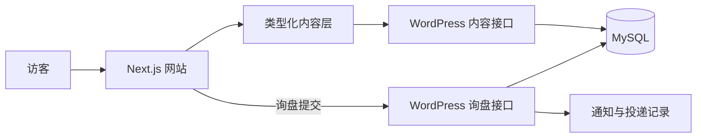

# 丰怀科技独立站

基于 **Next.js 16 + Headless WordPress** 的企业网站。前端负责产品展示、内容页面、多语言路由、搜索元数据和询盘入口；WordPress 负责内容编辑、发布资格、询盘持久化与通知。

[访问网站](https://fenghuaitech.store/) · [项目文档](docs/README.md) · [当前任务](docs/implementation/TASKS.md) · [部署说明](docs/architecture/DEPLOYMENT.md)


> **当前阶段（2026-10-21）**：网站已通过 HTTPS 临时公开，仍处于内容审定与生产验收阶段。全站暂不开放搜索收录；页面可访问不代表产品规格、图片权利、法律文案和交易政策已获最终批准。最新进度与待办以[任务清单](docs/implementation/TASKS.md)为准。

## 项目如何工作



- **网站**：Next.js App Router、React、TypeScript；提供产品目录、内容页面、SEO 元数据和询盘交互。
- **内容**：WordPress 管理正文、媒体与批准状态；`src/content/` 为前端提供稳定的类型化内容契约。
- **多语言**：采用项目内的语言路由与字典；未批准的译文不会因为语言路径存在就自动公开或进入站点地图。
- **询盘**：Next.js 接收请求，由 WordPress 在数据库事务中持久化；通知通过 WordPress 的投递记录处理。缺少真实后端配置时不模拟提交成功。
- **运行形态**：保留服务端 API、预览与缓存失效能力，不能改为纯静态导出。架构边界见[目标架构](docs/architecture/TARGET_ARCHITECTURE.md)。

## 本地启动

需要 **Node.js 24 或更高版本**、npm。默认使用模拟内容模式，可先运行前端并浏览页面。

```bash
npm ci
cp .env.example .env.local
WP_MODE=mock NEXT_PUBLIC_APP_URL=http://localhost:3000 npm run dev
```

打开 <http://localhost:3000>。模拟模式不连接真实 WordPress，询盘提交也不会写入数据库；需要联调 CMS 与询盘时，按[环境变量模板](.env.example)和[部署说明](docs/architecture/DEPLOYMENT.md)配置私有凭据。不要把 `.env.local` 或真实密钥提交到仓库。

| 命令 | 用途 |
|---|---|
| `npm run check` | 主题、契约、单测、lint、类型检查与生产构建 |
| `npm run test:e2e` | Playwright 端到端测试 |
| `npm run audit:prod` | 生产依赖漏洞检查 |
| `npm run build` | 构建生产产物 |

`NEXT_PUBLIC_APP_URL` 会在构建时写入 canonical、robots 和 sitemap。构建部署前必须设置为目标域名，并核对实际输出；仅修改运行时环境变量不会更新已构建产物。

## 仓库结构

| 路径 | 职责 |
|---|---|
| `src/app/`、`src/components/`、`src/content/` | 页面路由、展示组件、类型化内容层 |
| `src/lib/wordpress/`、`src/lib/inquiry/` | CMS 接入与询盘服务 |
| `local-wp/mu-plugins/` | WordPress 内容及询盘契约的服务端实现 |
| `deploy/` | 前端、WordPress 与边缘服务的部署配置 |
| `tests/`、`e2e/` | 单元、契约与浏览器测试 |
| `PAGE-SPECS/` | 页面施工规格 |
| `docs/` | 架构、审计、实施与运维文档 |
| `outputs/`、`resources/` | 交付成果与调研证据 |

## 文档与协作

[`docs/README.md`](docs/README.md) 是唯一文档地图。初次了解项目可从[当前架构](docs/audit/CURRENT_ARCHITECTURE.md)、[目标架构](docs/architecture/TARGET_ARCHITECTURE.md)和[任务清单](docs/implementation/TASKS.md)进入；页面改动查阅 [`PAGE-SPECS/`](PAGE-SPECS/README.md)。已公开页面的商业表达问题记录在[审定台账](outputs/project-audit/2026-10-21-live-commercial-copy-register.md)。

修改前请阅读 [`AGENTS.md`](AGENTS.md)。产品事实、适配信息、图片和法律文案须有可追溯的批准依据；`assets/` 中的原始资料按项目规则只读。仓库未提供开源许可证，代码及素材的再使用需取得授权。
