# 询盘系统架构方案（V1）

> **2026-10-04 后续规格**：本文件保留原设计依据。此次用户确认四产品线、B/C、英文首发；生产落地以 [数据库与询盘设计](../../outputs/site-launch-plan/02-data-and-inquiry-design.md) 的事务发件箱、幂等、权限与投递状态为补充。多产品询价清单、附件与客户回执不作为一个月首发门槛。原文“未开工/纯 B2B”及部署选型例子不再代表当前状态，见根 STATUS。

> **记录日期**：2026-10-01
> **对应项目**：WordpressWheelSIte（风华 Fenghuai 轮毂 B2B 独立站）
> **状态**：架构定案，未开工。本文是给 Codex / 开发者实现的**权威依据**。
> **相关**：[`docs/research/tbr8-headless-wordpress-tutorial.md`](../research/tbr8-headless-wordpress-tutorial.md)（Headless WP 接入教程）｜ [`docs/research/next-wp/`](../research/next-wp/README.md)（next-wp 源码研究）

---

## 〇、一句话定义

> **WordPress 管"卖什么"**：轮毂、规格、图片、内容
> **Next.js 管"客户怎么看、怎么询"**：展示 + Inquiry Cart + 提交
> **业务数据库管"谁询了什么、谁负责、进展到哪"**：唯一业务真相
> **Resend 管"把询盘送到业务员邮箱，并给客户回执"**

不是 `WordPress → Contact Form 7 → 邮件`，而是：

```
WordPress = CMS
      ↓
Next.js  = Website + Inquiry Engine
      ↓
Database = Business Truth
      ↓
Resend   = Delivery
      ↓
Sales    = Follow-up
```

---

## 一、这套方案为什么成立（依赖的官方能力）

| 能力 | 依据 |
|---|---|
| CPT 可通过 `show_in_rest => true` 暴露给 REST API | [WordPress REST API 扩展 CPT](https://developer.wordpress.org/rest-api/extending-the-rest-api/adding-rest-api-support-for-custom-content-types/) |
| 自定义产品字段同样可用 `show_in_rest` 暴露 | 同上 |
| Next.js App Router 可承担服务端业务逻辑 | [Next.js Docs](https://nextjs.org/docs) |
| Resend 官方支持从 App Router 的 Route Handler 服务端发信 | [Resend Docs](https://resend.com/docs) |

**关键判断**：Next.js 本身是 Full-stack Framework，**不需要额外引入一个后端服务**（不必上 NestJS / 独立 API 服务）。

---

## 二、整套系统总架构

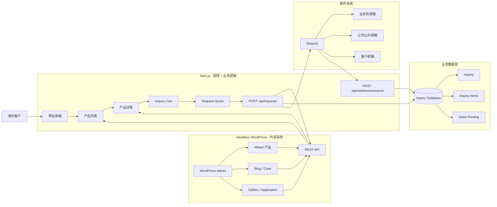

**最核心的一点**：

```
WordPress
      │
      └── 不处理询盘

Next.js
      │
      ├── 获取 WordPress 产品
      ├── 管 Inquiry Cart
      ├── 接收询盘
      ├── 保存询盘
      └── 发邮件
```

---

## 三、客户视角的实际使用流程

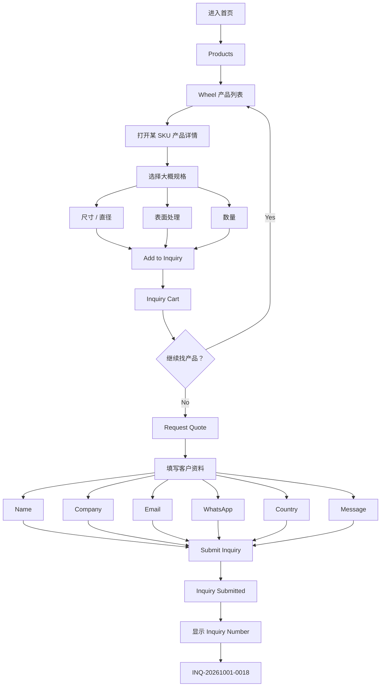

### 🔴 产品原则：不要求客户填完技术参数

**不要把 PCD / CB / ET / Brake Clearance / VIN 做成必填。**

客户知道多少填多少。真正的技术确认交给业务员 —— 这是 B2B 轮毂询盘的现实：海外 dealer 通常只报"我大概要 19 寸、枪灰、100 个"这么粗。

> ⚠️ **本项目现状恰好支持这个判断**：`src/content/types.ts` 里的 `WheelSku` **没有任何 PCD / CB / ET / 直径 / 宽度字段**，只有 `sku / name / family / spokes / construction / finishes / summary / description / applications`。
> 所以 V1 **做不到"让客户选 PCD/ET"**，也不该做。规格选择器只能给 `finishes`（已有真实数据）+ 自由填写的尺寸/数量。
> 真正的 PCD/CB/ET 结构化数据，需要先补进 WordPress 的 ACF 字段组（见第九节）。

---

## 四、点击 Submit 后发生什么（**这张图就是要实现的**）

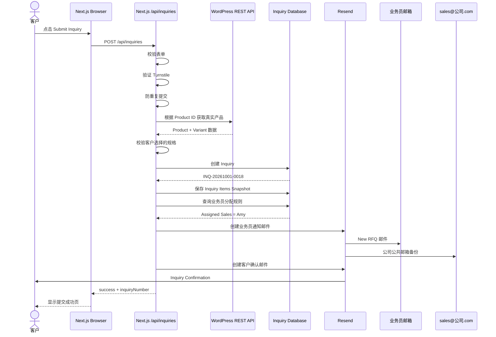

**这就是「网站收到询盘 → 自动转发给负责业务员」，比单纯的"表单发邮件"可靠得多。**

---

## 五、为什么提交时要回查 WordPress

假设前端提交：

```json
{
  "productId": 152,
  "variantId": "FH102-19",
  "quantity": 100
}
```

**Next.js 不应该相信浏览器传来的** `Product Name` / `Diameter` / `PCD` / `ET` / `Image` / `Product URL` —— 这些全部可被篡改。

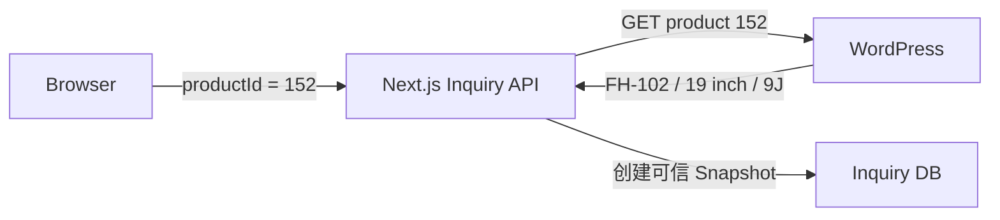

| 角色 | 含义 |
|---|---|
| WordPress | **Current Product Truth**（当前产品真相） |
| 数据库 | **Inquiry-time Snapshot**（询盘时刻快照） |

---

## 六、为什么要做 Snapshot

客户今天询的是：

```
FH-102 / 19 × 9J / ET35 / Gunmetal / 100 PCS
```

两个月后运营在 WordPress 把它改成：

```
19 × 9.5J / ET38 / Satin Gunmetal
```

**历史询盘不能跟着变。**

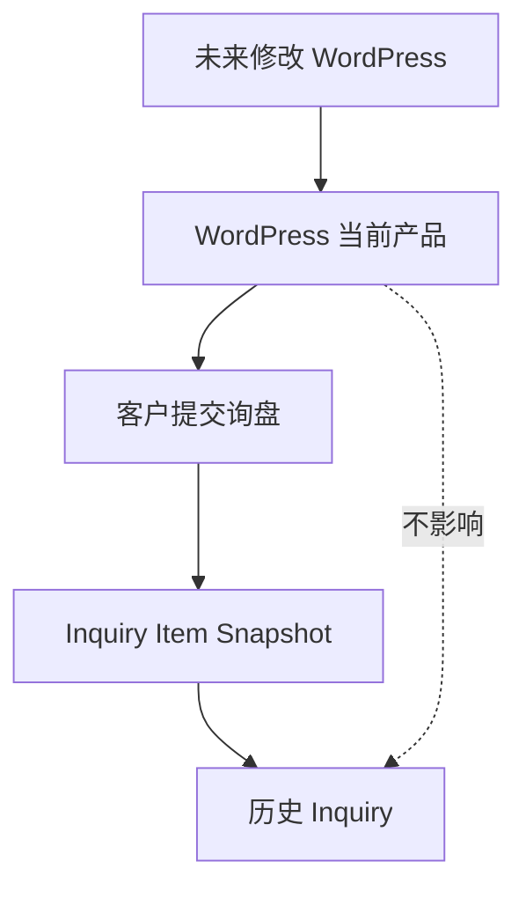

### `inquiry_items` 建议字段

```
-- 恒定字段（所有 SKU 都有）
product_id          -- WP 里的 ID
product_code        -- sku，e.g. "N-100RS"
product_name
family              -- 对应 productFamilies slug
construction        -- WheelConstruction
spokes

-- 客户提交时填的（可空）
requested_diameter
requested_width
requested_finish
quantity

-- 规格快照（V1 大多为空 —— 见第九节）
pcd
cb
et

-- 溯源
image_url
product_url
```

> ⚠️ **与最初设想的差异**：原方案列的是 `diameter / width / pcd / cb / et / finish`。
> 但核查 `src/content/types.ts` 后确认：**这些字段在当前数据层里不存在**。
> 强行加会让 `inquiry_items` 出现大量 NULL 列。**正确顺序是先把规格补进 WordPress（第九节 P0-a），再加这些列**；在那之前，V1 只快照 `sku / name / family / construction / spokes / finishes` 这些**真实存在**的字段 + 客户自填值。

---

## 七、询盘怎么自动分配业务员

第一版**不用做复杂 CRM**，先做一个 Routing。

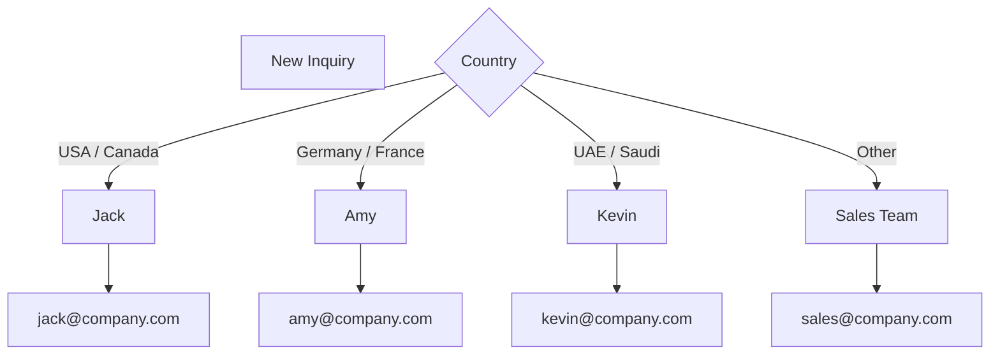

```sql
-- sales_routing
region
country
product_category
sales_rep
sales_email
priority
```

以后可以升级成"先按客户类型再按国家"：

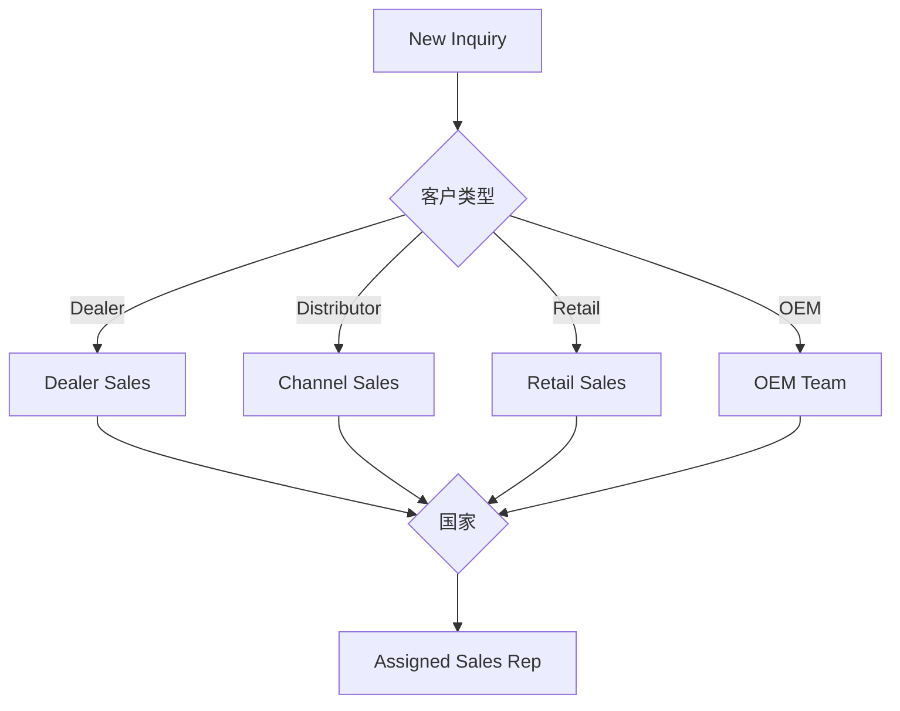

**但 V1 不用做到这么复杂。**

---

## 八、邮件设计

### 8.1 业务员收到的邮件

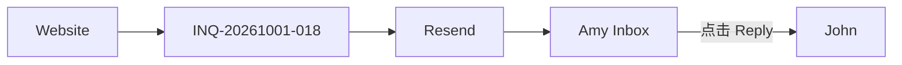

**关键邮件 Header**：

```text
From:
Fenghuai Website <inquiry@notify.fenghuai.com>

To:
amy@fenghuai.com

Reply-To:
john@abcwheels.de

BCC:
sales@fenghuai.com
```

→ Amy 收到后直接点 **Reply**，就是回复 `john@abcwheels.de`。
**业务员甚至不需要进入网站后台。这对第一版特别重要。**

> 🔑 `Reply-To` 是整个设计的支点：它让「系统发的通知」变成「业务员可以自然回复的对话」。

### 8.2 🔴 先存数据库，再发邮件

**不要这样**：

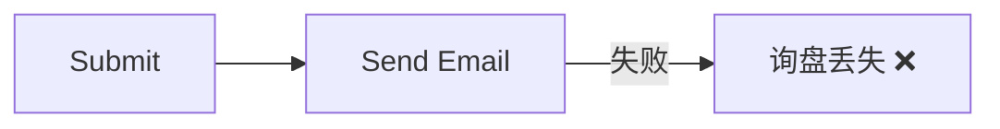

**而要这样**：

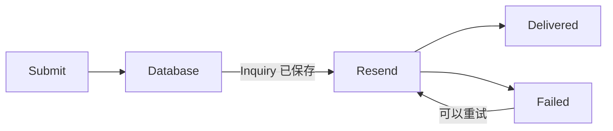

即使 `Resend down` / DNS 出问题 / 业务员邮箱拒收 / 网络异常，数据库里仍然有：

```
INQ-20261001-018
Customer: John
Status: NEW
Email Notification: FAILED
```

**不丢客户。** 这是本方案与"Contact Form 7 直发邮件"的本质区别。

### 8.3 Resend Webhook 回同步投递状态

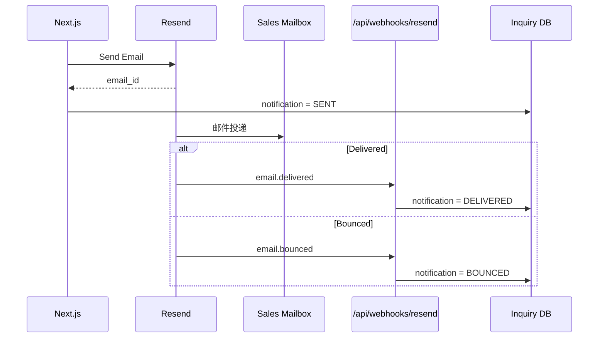

---

## 九、责任边界（**建议存档**）

```mermaid
flowchart LR

    subgraph WORDPRESS["WordPress"]
        P1["Products"]
        P2["Variants"]
        P3["Categories"]
        P4["Blog"]
        P5["Gallery"]
        P6["SEO Content"]
    end

    subgraph NEXTJS["Next.js"]
        N1["Frontend"]
        N2["Inquiry Cart"]
        N3["Request Quote"]
        N4["Validation"]
        N5["Business Logic"]
        N6["Sales Routing"]
        N7["Email Trigger"]
    end

    subgraph DATABASE["Business Database"]
        D1["Customers"]
        D2["Inquiries"]
        D3["Inquiry Items"]
        D4["Sales Rep"]
        D5["Status"]
        D6["Email Events"]
    end

    WORDPRESS --> NEXTJS
    NEXTJS --> DATABASE
```

### 🔴 WordPress 里**不应该**放

```
Inquiry
Customer
Sales assignment
Email delivery status
Lead status
```

**这些属于业务系统，不属于 CMS。**

---

## 十、推荐目录结构

```text
src/

app/
├── products/
│   └── wheels/
│       ├── page.tsx                  # 已有：SKU 索引
│       └── [sku]/
│           └── page.tsx              # 已有：单 SKU 页
│
├── inquiry/
│   ├── page.tsx                      # Inquiry Cart + Request Quote
│   └── success/
│       └── page.tsx                  # 显示 INQ 号
│
├── admin/
│   └── inquiries/
│       └── page.tsx                  # V1.5，受保护
│
└── api/
    ├── inquiries/
    │   └── route.ts                  # POST 接询盘
    │
    └── webhooks/
        └── resend/
            └── route.ts              # 投递状态回写


components/
├── wheels/
│   ├── WheelCard.tsx
│   ├── WheelDetail.tsx
│   └── VariantSelector.tsx           # 规格选择（受第九节约束）
│
├── inquiry/
│   ├── AddToInquiry.tsx
│   ├── InquiryDrawer.tsx
│   ├── InquiryItem.tsx
│   ├── InquiryForm.tsx
│   └── InquirySuccess.tsx
│
└── email/
    ├── SalesInquiryEmail.tsx
    └── CustomerConfirmationEmail.tsx


lib/
├── wordpress/
│   ├── client.ts                     # GraphQL/REST 客户端单一出口
│   └── wheels.ts                     # 产品取数
│
├── inquiry/
│   ├── create.ts
│   ├── routing.ts
│   └── validation.ts                 # zod schema
│
├── database/
│   └── index.ts
│
└── email/
    └── resend.ts
```

> 📌 **本项目已有的对应物**：
> - `src/content/wheel-skus.ts`（16 个 SKU）+ `src/app/products/wheels/[sku]/page.tsx` **已存在**
> - `src/app/contact/page.tsx` **已有表单但无后端**（README 第 141 行明写 *"no backend — submission is not wired anywhere"*）
> - `src/lib/` 目前只有 `utils.ts` → `lib/wordpress/`、`lib/inquiry/` 是新增
> - `src/app/api/` **整个目录不存在** → 需要新建

---

## 十一、V1 真正需要开发的只有这些

**不要一开始开发完整 CRM。**

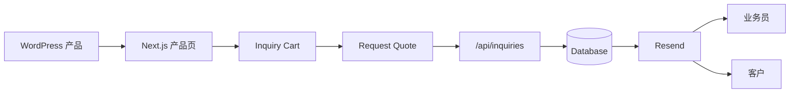

**把这条链路跑通，就已经可以正式做业务了。**

---

## 十二、V1 需求定义（可直接交给 Codex）

> **WordPress Headless CMS 提供轮毂、规格、图片和内容；Next.js 获取并展示这些数据。客户可在产品详情页将产品和规格加入 Inquiry Cart。提交询盘后，由 Next.js Route Handler 校验产品数据并将询盘及产品快照保存到业务数据库，生成唯一 Inquiry Number。系统根据国家/区域分配业务员，通过 Resend 自动将完整询盘发送到业务员邮箱和公司公共邮箱，同时向客户发送确认邮件。业务员直接 Reply 即可回复客户。**

这就是这个网站目前应该实现的**完整询盘闭环**。

---

## 十三、开工前的六个前置问题（**必须先拍板**）

| # | 问题 | 为什么现在必须定 |
|---|---|---|
| **1** | **V1 到底跑不跑 WordPress？** | 项目现在 `src/content/*.ts` 是纯静态 TS，**还没有任何 WP fetcher**（README known gaps 明写）。若 V1 先跑静态数据，`/api/inquiries` 的"回查产品"就得从 `src/content/` 读，而不是 WordPress → 接口形状会不一样。**两条路都可行，但必须现在选** |
| **2** | **业务数据库用什么？** | 项目**零 DB 依赖**（无 prisma/drizzle/neon）。跑 Vercel → 建议 Neon/Postgres；跑自托管 → 可 SQLite。**选型决定 ORM 与迁移方案** |
| **3** | **产品规格结构化了吗？** | `WheelSku` **无 PCD/CB/ET/尺寸字段**。要么先补 ACF 字段组（P0-a），要么 V1 只做 `finishes` + 自由填写。**不做决定就会写出空列或假字段** |
| **4** | **`reply-to` 用客户邮箱会不会被判垃圾？** | 从 `notify.` 子域发信但 `Reply-To` 是外部地址，**部分收件方会因此降权**。建议先小范围实测送达率 |
| **5** | **拒收/退信怎么处理？** | 必须接 `email.bounced` webhook，否则"发给业务员了"是假承诺 |
| **6** | **防滥用手段？** | 原方案提了 Turnstile + 防重复。**Turnstile 需要新开 Cloudflare 服务**；也可先用 honeypot + rate limit 起步。**README 已叮嘱"keep it honest about spam handling"** |

### ⚠️ 一个必须点破的前提冲突

本项目 `next.config.ts` 当前是：

```ts
output: "standalone"
```

但仓库有**静态导出基因**。而 `/api/inquiries`、`/api/webhooks/resend` 是**运行时路由** —— **纯静态导出（`output: "export"`）下 API Route 完全不可用**。

所以上询盘系统前，**必须先确认部署形态是 Node runtime**（standalone 可以，Vercel 也可以）。这与我在 next-wp 研究里发现的问题同源（分册四 · 问题 1）。

---

## 十四、实施顺序建议

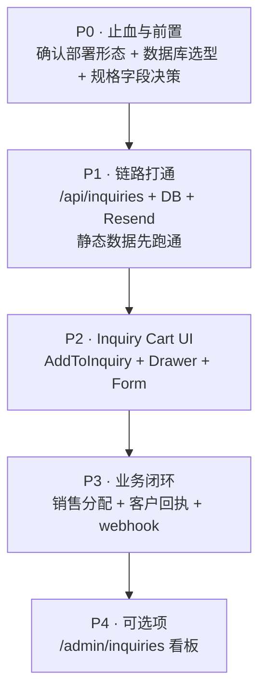

**P1 完成即可开始接真实询盘。P4 可以很久以后再做。**

---

## 十五、与"不做后台"既有结论的衔接

本项目此前已评估过「要不要做通用后台」，结论是：

> **不做通用后台**（无业务对象 / 会绕开构建门禁 / 内容层才是真需求）

本方案**与那个结论一致**：

- 询盘系统**不是后台**，它是一个**单向的数据管道**（收 → 存 → 发）
- `/admin/inquiries` 被刻意放在 P4，且只做**只读列表**，不做 CRUD
- 真正的"内容编辑面"仍是 WordPress（P3 可选：飞书当编辑面）
- 业务员的工作面是**邮箱**，不是任何后台 —— 这是本方案最省事的地方

---

**记录人**：Alma ｜ **记录日期**：2026-10-01 ｜ **状态**：待拍板第十三节的 6 个问题
