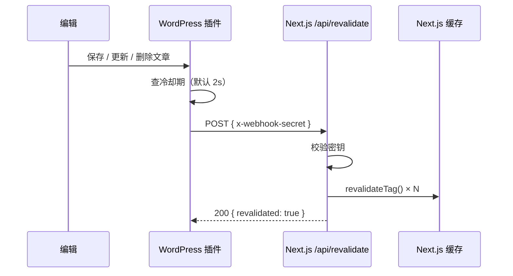

# next-wp 源码研究：一套用 Next.js App Router 做的 Headless WordPress 起手项目

> **研究对象**：[9d8dev/next-wp](https://github.com/9d8dev/next-wp)
> **版本**：HEAD `4a2caeb1`（2026-08-06，`fix(railway): harden WordPress deploy for 1-click`）
> **规模**：92 个文件（不含 `.git`）｜ 核心库 `lib/wordpress.ts` 483 行 ｜ 测试 613 行
> **许可**：MIT
> **本篇定位**：系列文章的总目录 + 全局判断。四篇分册各管一件事。

---

## 一、它到底是什么

一句话：**它不是一个 WordPress 插件，也不是一个主题，而是一套"前端 + 后端 + 部署"三件套的完整可跑骨架。**

仓库里有三样东西，缺一不可：

```mermaid
flowchart LR
  subgraph FE["① Next.js 前端（仓库主体）"]
    A["app/ · components/ · lib/"]
  end
  subgraph BE["② WordPress 侧"
    "web/plugin/ + web/theme/"]
    B["next-revalidate 插件<br/>+ nextjs-headless 主题"]
  end
  subgraph INFRA["③ 部署编排"]
    C["Dockerfile ×2<br/>railway.json · vercel.json"]
  end
  A <-->|REST API + Webhook| B
  C -.->|构建| A
  C -.-->|构建| B
```

绝大多数同类项目只给第 ① 部分，然后让你"自己去找个 WordPress"。next-wp 把 ② 和 ③ 都给了 —— **这才是它的差异点**。

### 技术栈（实测自 `package.json`）

| 层 | 选型 |
|---|---|
| 框架 | Next.js **16.3.0** + React **19.2.4** |
| 语言 | TypeScript ^5.9.3（strict） |
| 样式 | Tailwind CSS **v4.2.1** + `@tailwindcss/postcss` |
| 组件 | shadcn/ui（Radix primitives 10 个包） |
| 布局原语 | `craft-ds`（`Section` / `Container` / `Article` / `Prose`） |
| 主题 | `next-themes` ^0.4.6 |
| 表单 | react-hook-form ^7.71.2 + zod ^3.25.76 |
| 搜索 | `use-debounce` ^10.1.0（300ms 防抖） |
| 测试 | Vitest ^4.1.10 |
| 包管理 | pnpm 11.20.0（`packageManager` 字段锁死） |
| 运行时 | Node **>= 22.13** |

---

## 二、四个必须知道的全局判断

### 判断一：它用的是 REST API，不是 GraphQL

这是本项目与"另一个流派"最根本的分野。

| | next-wp（本仓库） | GraphQL 流派 |
|---|---|---|
| 数据源 | WordPress 内置 **REST API** `/wp-json/wp/v2/*` | WPGraphQL 插件 `/graphql` |
| 依赖插件 | **零**（REST 是 WP 4.7+ 内置） | 必须装 WPGraphQL |
| 数据形状 | 服务端返回什么就收什么 | 客户端声明要什么字段 |
| 过度获取 | **存在**（要 `_embed` 才能拿到作者/特色图） | 基本避免 |

**它的取舍很清楚**：REST 的代价是"多取字段"和"`_embed` 的嵌套解析更笨重"，换来的是**后端零改造**——不装任何数据层插件，一个原生 WordPress 就能当 CMS 用。

> 📌 这意味着：如果你已经因为别的理由上了 WPGraphQL，这个项目的 `lib/wordpress.ts` 需要被替换掉（不过它的函数签名设计得比较干净，替换面是可控的，见分册二）。

### 判断二：TypeScript 类型是手写的，不是生成的

`lib/wordpress.d.ts` **253 行**，全是手写 interface（`Post` / `Page` / `Category` / `Tag` / `Author` / `FeaturedMedia` / `EditorBlock` / `TemplatePart` / `SearchResult`…）。

- ✅ 好处：零构建步骤、类型可读、IDE 提示准
- ⚠️ 代价：**WordPress 改字段，类型不会自动跟进**。你装一个改了 REST 响应的插件，编译期不会报错，运行时才会

这个取舍没有对错，但要心里有数：**类型给你的是"开发者以为的形状"，不是"服务端真实的形状"。**

### 判断三：核心设计是"双通道取数 + 缓存标签"

整份 `lib/wordpress.ts` 的灵魂是这两件事：

```
① 双通道              wordpressFetch（出错就抛）  ← 关键路径用
                      wordpressFetchGraceful（出错给 fallback）← 可降级路径用

② 缓存标签            next: { tags, revalidate: 3600 }
                      → 让 WordPress 能精准"点杀"某一类缓存
```

② 是整套实时更新机制的基石：**没有标签，就只能全站重刷。**

### 判断四：它的 Real-time 方案是"插件主动推"，不是"前端定时拉"



这比"`revalidate: 60` 定时再生"精确得多。代价是需要**前后端各配一个共享密钥**，且**两端的数据契约必须严格对齐** —— 而这正是我在源码里挖出问题的地方，详见分册三与分册四。

---

## 三、分册导读

四篇分册，建议按顺序读；只想解决具体问题可直接跳。

| 分册 | 内容 | 你会得到 |
|---|---|---|
| **[一 · 架构与数据层](next-wp-01-architecture.md)** | 双通道取数、缓存标签体系、分页、优雅降级、类型层 | 看懂 `lib/wordpress.ts` 每一行为什么这么写 |
| **[二 · 页面与渲染](next-wp-02-pages-and-seo.md)** | App Router 路由矩阵、ISR 策略、Metadata、动态 OG 图、sitemap | 知道每个路由的取数与缓存策略，以及 SEO 层怎么接 |
| **[三 · 后端与实时更新](next-wp-03-wordpress-backend.md)** | 空白主题、`next-revalidate` 插件、冷却/重试/日志、`entrypoint.sh` | 看懂 WordPress 侧怎么改造成纯 API，以及 Webhook 全链路 |
| **[四 · 部署、测试与真实缺口](next-wp-04-deploy-and-gaps.md)** | 双 Dockerfile、Railway/Vercel、613 行测试、**以及源码里的 6 个实证问题** | 能照抄部署，且知道哪里会踩坑 |

---

## 四、我做了什么验证

本系列不是读 README 转述，而是**把仓库 clone 下来逐文件读的**。关键结论都有实测支撑：

| 结论 | 验证方式 |
|---|---|
| 两套插件版本不同 | `diff` 两个 `next-revalidate.php` + 读文件头 `Version:` |
| 前后端 Webhook 契约不一致 | 对读 PHP 的 `$payload` 与 TS 的 `requestBody` 解构 |
| 测试没抓到这个不一致 | `grep` 测试文件里的 `contentType` |
| setup.sh 写的 option 名 | `grep "wp option update"` |
| Dockerfile 拷的是哪个插件 | `grep "COPY next-revalidate"` |
| 缓存标签写入/清除清单 | 分别 `grep` 两端的 `revalidateTag` / `cacheTags` |

具体结论与证据在分册四集中给出。

---

## 五、要不要用它

**适合你的场景**：
- 想要一个**能跑起来**的 headless WordPress 起点，而不是一堆散落的博客教程
- 团队主力是 React / Next.js，不想碰 PHP 主题
- 内容模型就是标准的"文章 + 页面 + 分类 + 标签 + 作者"
- 希望一键部署（Railway 模板把 MySQL + WordPress + Next.js 全包了）

**不适合你的场景**：
- 内容模型复杂（大量自定义字段 / 自定义文章类型）→ REST 手写类型的负担会迅速上升，该上 GraphQL + ACF
- 需要精细的权限与登录态 → 本项目的 JWT / 认证面基本为零
- 要服务多端（App + 小程序 + Web）→ 可以，但要自己补一层稳定的 API 契约
- 想直接拿它当生产站 → 分册四的问题清单必须先处理

---

## 附：仓库文件全貌（92 文件）

```
next-wp/
├── app/                          # Next.js App Router
│   ├── api/
│   │   ├── og/route.tsx          # 动态 OG 图（ImageResponse）
│   │   └── revalidate/route.ts   # Webhook 接收端
│   ├── pages/[slug]/             # WordPress 静态页
│   ├── posts/
│   │   ├── [slug]/               # 文章详情
│   │   ├── authors/              # 作者档案
│   │   ├── categories/           # 分类档案
│   │   └── tags/                 # 标签档案
│   ├── layout.tsx · page.tsx · sitemap.ts · robots.txt
│   └── not-found.tsx · globals.css
├── components/
│   ├── posts/                    # post-card · filter · search-input
│   ├── nav/ · theme/ · ui/       # shadcn/ui（badge button dropdown-menu
│   │                             #  form input label navigation-menu
│   │                             #  pagination scroll-area select separator sheet）
│   ├── craft.tsx · archive-list.tsx · back.tsx
├── lib/
│   ├── wordpress.ts       (483)  # ★ 核心数据层
│   ├── wordpress.d.ts     (253)  # ★ 手写类型
│   ├── metadata.ts        (56)   # SEO 助手
│   └── utils.ts           (6)    # cn()
├── __tests__/             (613)  # Vitest × 4 文件
├── web/next-revalidate/          # ★ 插件正本 v1.1.0（CI 从这里发布）
├── web/theme/                    # nextjs-headless 空白主题
├── web/{Dockerfile,setup.sh,entrypoint.sh}
├── plugin/                       # ⚠️ 2025-05 陈旧副本，勿用（见分册四）
├── .github/workflows/            # docker-wordpress.yml · release-plugin.yml
├── Dockerfile                    # Next.js 三阶段构建
├── site.config.ts · menu.config.ts · next.config.ts
└── railway.json · vercel.json · vitest.config.ts · CLAUDE.md
```

> 分册三会讲清楚：`web/next-revalidate/` 是唯一正本（CI 发布链路证明），`plugin/` 只是 2025-05 的残留副本，**不要用**。

---

**下一篇** → [分册一：架构与数据层](next-wp-01-architecture.md)
