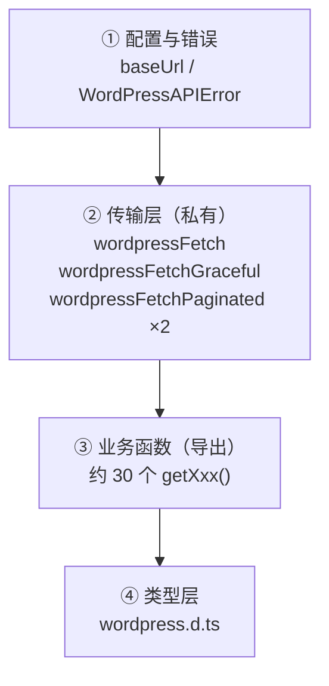

# 分册一 · 架构与数据层

> 本篇讲 `lib/wordpress.ts`（483 行）与 `lib/wordpress.d.ts`（253 行）。
> 读完之后，你应该能回答：**为什么要有两个 fetch 函数？缓存标签是谁在用？分页为什么绕了一圈？**

---

## 一、数据层的整体形状

`lib/wordpress.ts` 是**唯一的 WordPress 出口**。`CLAUDE.md` 里写死了这条纪律：

> *"All WordPress REST API interactions centralized here"*

文件结构分四层：



关键观察：**② 层是私有的（没有 `export`），③ 层才导出。** 组件只能调用语义化函数（`getPostBySlug`），不能直接拼 URL —— 这是个好设计，它保证了所有 URL 拼装和缓存标签都在一处。

---

## 二、配置：一个环境变量决定生死的"半降级"模式

文件开头：

```ts
const baseUrl = process.env.WORDPRESS_URL;
const isConfigured = Boolean(baseUrl);

if (!isConfigured) {
  console.warn(
    "WORDPRESS_URL environment variable is not defined - WordPress features will be unavailable"
  );
}
```

这个 `isConfigured` 是贯穿全文件的总开关。它的策略是：

| 函数 | 未配置时的行为 |
|---|---|
| `wordpressFetch` | **抛错** `new Error("WordPress URL not configured")` |
| `wordpressFetchGraceful` | **直接返回 fallback**（如 `[]`） |
| `wordpressFetchPaginated*` | 同上，返回空列表 + 零 headers |

**效果**：没配环境变量时，**`next build` 依然成功**，只是页面空着 —— 你会看到一堆空列表而不是一个红色报错。

> ⚠️ **这是双刃剑**。好处是"新 clone 下来跑得起来"；坏处是**生产环境忘了配 `WORDPRESS_URL`，你得到的是一个静默的空站**，构建日志里只有一行 `console.warn`。

### 自定义错误类

```ts
class WordPressAPIError extends Error {
  constructor(
    message: string,
    public status: number,
    public endpoint: string
  ) {
    super(message);
    this.name = "WordPressAPIError";
  }
}
```

带上 `status` 与 `endpoint`，便于日志定位。文件末尾 `export { WordPressAPIError }` 把它开放出来。

---

## 三、双通道取数：本项目的核心设计

这是最值得学的一处。**同一个请求，两种失败姿态。**

### 通道 A：`wordpressFetch` —— 出错就抛

```ts
async function wordpressFetch<T>(
  path: string,
  query?: QueryParams,
  tags: string[] = ["wordpress"]
): Promise<T> {
  if (!baseUrl) {
    throw new Error("WordPress URL not configured");
  }

  const url = `${baseUrl}${path}${query ? `?${querystring.stringify(query)}` : ""}`;

  const response = await fetch(url, {
    headers: { "User-Agent": USER_AGENT },
    next: { tags, revalidate: CACHE_TTL },
  });

  if (!response.ok) {
    throw new WordPressAPIError(
      `WordPress API request failed: ${response.statusText}`,
      response.status,
      url
    );
  }

  return await response.json();
}
```

### 通道 B：`wordpressFetchGraceful` —— 出错给兜底值

```ts
async function wordpressFetchGraceful<T>(
  path: string,
  fallback: T,
  query?: QueryParams,
  tags: string[] = ["wordpress"]
): Promise<T> {
  if (!isConfigured) return fallback;      // ← 连请求都不发

  try {
    return await wordpressFetch<T>(path, query, tags);
  } catch {
    console.warn(`WordPress fetch failed for ${path}`);   // ← 注意：吞掉了具体错误
    return fallback;
  }
}
```

### 为什么要分开？—— 决定"站点是崩还是空"

| 场景 | 该用哪条 | 理由 |
|---|---|---|
| 文章详情页 `getPostBySlug` | **Graceful** | 拿不到 → 返回 `undefined` → 页面走 `notFound()` → 干净 404 |
| 文章列表 `getPostsPaginated` | **Graceful** | WordPress 挂了 → 空列表，站点骨架还在 |
| 分类/标签/作者列表 | **Graceful** | 侧边栏空掉，正文照常 |
| 按 ID 精确定位 `getPostById` | **Fetch** | 调用方明确要这一个对象，拿不到就该炸 |

**判断标准**：*"没有这份数据，页面还能不能存在？"* 能 → Graceful；不能 → Fetch。

> 🔴 **但这里有个隐患**：`catch { }` **把原始错误整个吞掉了**，只打一句"failed for {path}"。当 WordPress 返回 401（密钥错误）或 404（路径写错）时，你在日志里看到的是同一句话。生产排查会很痛苦。**建议至少保留 `error` 对象**：
> ```ts
> } catch (error) {
>   console.warn(`WordPress fetch failed for ${path}:`, error);
>   return fallback;
> }
> ```

---

## 四、缓存标签体系：实时更新的地基

`lib/wordpress.ts` 里所有请求都带这一段：

```ts
next: { tags, revalidate: CACHE_TTL }   // CACHE_TTL = 3600（1 小时）
```

`tags` 数组就是"**缓存标签**"—— 后续 `revalidateTag("posts")` 能一次性把带这个标签的所有缓存全作废。所以**标签命名的粒度，直接决定了 Webhook 能做到多精准**。

### 写入端：实际生成了哪些标签

| 函数 | 标签 |
|---|---|
| `getPostsPaginated(page, …, filters)` | `wordpress`、`posts`、`posts-page-{page}`，命中筛选时追加 `posts-search` / `posts-author-{id}` / `posts-tag-{id}` / `posts-category-{id}` |
| `getAllCategories()` | `wordpress`、`categories` |
| `getAllTags()` | `wordpress`、`tags` |
| `getAllAuthors()` | `wordpress`、`authors` |
| **`getPostBySlug(slug)`** | **只有 `wordpress`**（默认值，未显式传） |
| **`getPostById(id)`** | **只有 `wordpress`** |
| `getAllPages()` | `wordpress`、`pages` |

### 清除端：`/api/revalidate` 会作废哪些

```ts
revalidateTag("wordpress", { expire: 0 });          // 永远先全清

if (contentType === "post") {
  revalidateTag("posts", { expire: 0 });
  if (contentId) revalidateTag(`post-${contentId}`, { expire: 0 });   // ← 无人写入
  revalidateTag("posts-page-1", { expire: 0 });                        // ← 只清第 1 页
} else if (contentType === "category") {
  revalidateTag("categories", { expire: 0 });
  if (contentId) {
    revalidateTag(`posts-category-${contentId}`, { expire: 0 });       // ✓ 对得上
    revalidateTag(`category-${contentId}`, { expire: 0 });             // ← 无人写入
  }
}
// tag / author 分支同理
```

### 🔴 实测发现：标签体系有四处对不上

| 问题 | 证据 | 影响 |
|---|---|---|
| `revalidateTag("wordpress")` 永远先执行 | 路由第 42 行 | **所有针对性标签都成了装饰** —— 全站缓存已经清空了，后面那些精细标签没有额外效果 |
| `post-{id}` 无人写入 | `grep "post-\${" lib/wordpress.ts` → 0 处 | 空转 |
| `category-{id}` / `tag-{id}` / `author-{id}` 无人写入 | 同上 | 空转 |
| **只清 `posts-page-1`** | 路由第 50 行 | **翻页到第 2 页的文章更新后不刷新** |

第一条最要命：**"精准缓存失效"这个卖点在当前实现里是失效的**，因为它每次都先执行了全清。真正的精准失效应该是把 `revalidateTag("wordpress")` 去掉，只清受影响的细粒度标签。

> 📌 这不是我"看代码觉得不对"，而是两端清单对读出来的。验证方法：
> ```bash
> grep -n 'revalidateTag(' app/api/revalidate/route.ts        # 清除端
> grep -n 'cacheTags\|"wordpress",' lib/wordpress.ts           # 写入端
> ```
> 两边一比，谁写谁没写一清二楚。

---

## 五、分页：为什么绕了一圈

REST API 的分页信息在 **HTTP 响应头**（`X-WP-Total` / `X-WP-TotalPages`），不在 body 里。所以想在前端做分页器，必须能读到 headers。

于是有了 `WordPressResponse<T>`：

```ts
export interface WordPressPaginationHeaders {
  total: number;
  totalPages: number;
}

export interface WordPressResponse<T> {
  data: T;
  headers: WordPressPaginationHeaders;
}
```

`wordpressFetchPaginated` 负责把它们抽出来：

```ts
return {
  data: await response.json(),
  headers: {
    total: parseInt(response.headers.get("X-WP-Total") || "0", 10),
    totalPages: parseInt(response.headers.get("X-WP-TotalPages") || "0", 10),
  },
};
```

### 注意"四个分页函数"的区别

| 函数 | 返回值 | 用途 |
|---|---|---|
| `getPostsPaginated` | `WordPressResponse<Post[]>` | **带筛选**的主列表，组装标签 |
| `getPostsByCategoryPaginated` | `WordPressResponse<Post[]>` | 分类归档，固定 `perPage: 9` |
| `getPostsByTagPaginated` | 同上 | 标签归档 |
| `getPostsByAuthorPaginated` | 同上 | 作者归档 |

后三个是"只有一种筛选维度"的快捷方式；第一个负责通用场景。**注意这三者没有 `getAllXxx` 那样的标签**，走了 `wordpressFetchPaginatedGraceful` 的默认 `["wordpress"]`。

### `getAllPostSlugs()` —— 构建期的全量抓取

```ts
export async function getAllPostSlugs(): Promise<{ slug: string }[]> {
  // 循环翻页直到拿完（用 _fields 只取 slug，减小体积）
}
```

它被 `generateStaticParams()` 调用，所以**构建时会遍历全站所有文章**。文章上千篇时，这是构建耗时的主要来源。

> ⚠️ `_fields=slug` 这个优化很关键 —— 不限制字段的话，每页 100 篇的完整 HTML 正文会被拉下来，构建时间会爆。

---

## 六、类型层：`lib/wordpress.d.ts` 的取舍

253 行手写类型，覆盖 REST API 的响应形状。几个设计值得注意：

### `WPEntity` 基座 + 扩展

```ts
export interface Page extends WPEntity {
  title: RenderedTitle;
  content: RenderedContent;
  excerpt: RenderedContent;
  author: number;
  featured_media: number;
  // ...
}
```

### 把"渲染后"和"原始"分开

WordPress REST 返回的很多字段是 `{ rendered: string, raw?: string }` 结构。类型里保留了这个区分 —— `raw` 只有带认证时才返回，这正是前端"只读渲染后内容"的约束体现。

### 嵌入类型单独声明

```ts
interface EmbeddedAuthor {
  id: number;
  name: string;
  slug: string;
  avatar_urls: Record<string, string>;
}
```

这是 `_embed=true` 时才会出现的嵌套结构。**单独声明而不是复用 `Author`**，因为嵌入版本字段更少 —— 这个处理是对的，能防止你误以为 `post._embedded.author[0].link` 存在。

### 连组件 Props 也放了进来

```ts
export interface FilterBarProps {
  authors: Author[];
  tags: Tag[];
  categories: Category[];
  selectedAuthor?: Author["id"];
  // ...
}
```

> ⚠️ 把 UI 组件的 Props 和数据层类型放同一个 `.d.ts` 文件，边界就不清了。数据层应该只管数据。这是个小设计瑕疵。

---

## 七、小结：可以照抄的四条

1. **单一出口**：所有外部 API 调用集中在一个模块，组件只调语义化函数
2. **双通道**：按"没这份数据页面能不能活"来决定是抛错还是降级
3. **缓存标签要成体系**：写入端和清除端的标签清单必须能对读上 —— **并且要真的去对读一次**
4. **分页信息走 headers**：`{ data, headers }` 的包装形状可以复用

**要绕开的三个坑**：

| 坑 | 改法 |
|---|---|
| `catch {}` 吞掉原始错误 | 保留 error 对象再打日志 |
| 标签写了不读 / 读了不写 | 两端清单对读，删掉死标签 |
| `revalidateTag("wordpress")` 全清在前 | 想精准失效就把它删掉 |

---

**上一篇** → [总目录](README.md) ｜ **下一篇** → [分册二：页面与渲染](next-wp-02-pages-and-seo.md)
