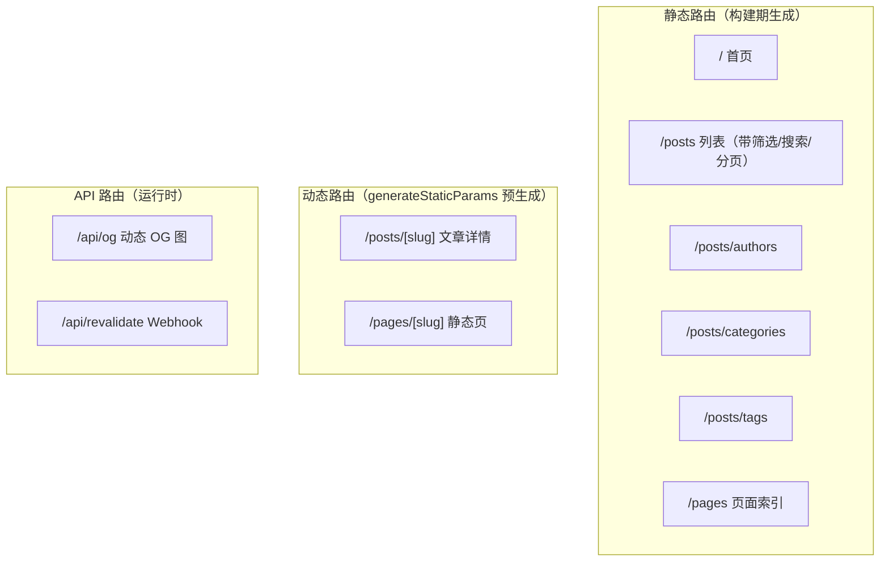

# 分册二 · 页面与渲染

> 本篇讲 `app/` 下的全部路由 + `lib/metadata.ts` + `app/sitemap.ts` + `/api/og`。
> 读完你应该能回答：**每个路由是静态还是动态？缓存多久？SEO 元数据从哪来？**

---

## 一、路由矩阵

项目共有 **8 个路由**（不含 404），分三类：



---

## 二、ISR 配置：一张表看出问题

这是本篇最值得看的部分。我把每个路由的缓存声明抓了出来：

| 路由 | `revalidate` | `dynamic` | `generateStaticParams` |
|---|---|---|---|
| `/` | — | — | — |
| `/posts` | **3600** | `"auto"` | — |
| `/posts/authors` | 3600 | — | — |
| `/posts/categories` | 3600 | — | — |
| `/posts/tags` | 3600 | — | — |
| `/pages` | 3600 | — | — |
| **`/posts/[slug]`** | **无** | — | ✅ `getAllPostSlugs()` |
| `/pages/[slug]` | **3600** | — | ✅ `getAllPages()` |
| `/api/revalidate` | — | — | — （`maxDuration = 30`） |
| `/api/og` | — | — | — |

### 🔴 问题：两个详情页都没有生效的 ISR

源码层面，两个动态路由的写法**确实不一致**：

```tsx
// app/pages/[slug]/page.tsx
export const revalidate = 3600;          // ✅ 声明了

export async function generateStaticParams() {
  const pages = await getAllPages();
  return pages.map((page) => ({ slug: page.slug }));
}
```

```tsx
// app/posts/[slug]/page.tsx
// ← 这里什么都没有                      ❌ 没声明

export async function generateStaticParams() {
  return await getAllPostSlugs();
}
```

**但"声明了"不等于"生效"。** 我实际跑了构建，看它自己打印出来的路由表：

```
Route (app)                Revalidate  Expire
├ ○ /pages                         1h      1y
├ ● /pages/[slug]                              ← 无 Revalidate
├ ● /posts/[slug]                              ← 无 Revalidate
├ ○ /posts/authors                 1h      1y
```

**两个详情页（`● SSG`）都没有 Revalidate 值** —— 即使 `pages/[slug]` 源码里写了 `revalidate = 3600`。

原因：`generateStaticParams` 预生成的静态页在**构建期**就已固化，路由级 `revalidate` 需要**有请求进来触发**才开始计时。

**真正的后果**：两个详情页的刷新**完全依赖 Webhook**。而 Webhook 链路是断的（见分册三：payload 契约字段不匹配）。

**→ 这才解释了 headless 站点最典型的投诉：*"我在后台改了，前台没变。"***

> ✅ **两处修复，缺一不可**：
> 1. 修 Webhook 契约（P0，见分册三）
> 2. 给 `app/posts/[slug]/page.tsx` 补 `export const revalidate = 3600;`，与 `pages/[slug]` 对齐 —— **作为 Webhook 挂掉时的兜底**，最多 1 小时后自愈

### 顺带：`/posts` 的 `dynamic = "auto"`

```tsx
export const dynamic = "auto";
export const revalidate = 3600;
```

`"auto"` 是 Next.js 的默认值 —— 意味着"由框架自行判断"。既然列表页用了 `searchParams`（`?search=` / `?category=` / `?page=`），**带查询参数时会被判定为动态渲染，不带时走静态**。这个设置没毛病，但也基本等于没写。

---

## 三、取数策略：`Promise.all` 的并行读取

列表页 `app/posts/page.tsx` 是取数策略最丰富的地方：

```tsx
const [postsResponse, authors, tags, categories] = await Promise.all([
  getPostsPaginated(page, postsPerPage, { author, tag, category, search }),
  search ? searchAuthors(search) : getAllAuthors(),
  search ? searchTags(search) : getAllTags(),
  search ? searchCategories(search) : getAllCategories(),
]);
```

三个值得学的点：

**① 四个请求并行**，不是串行 await —— 首屏时间取决于最慢的那个，而不是四个之和。

**② 有搜索时切换到"搜索版"取数**，无搜索时取全量下拉选项：

| 状态 | 作者/标签/分类取什么 | 为什么 |
|---|---|---|
| 无搜索词 | `getAllXxx()`（全量 100 条） | 下拉框要能列出所有选项 |
| 有搜索词 | `searchXxx(query)`（按词过滤） | 只列出与结果相关的选项，避免"选了却搜不到" |

**③ 分页信息从 headers 解构**：

```tsx
const { data: posts, headers } = postsResponse;
const { total, totalPages } = headers;
```

### 分页 URL 构造：URL 即状态

```tsx
const createPaginationUrl = (newPage: number) => {
  const params = new URLSearchParams();
  if (newPage > 1) params.set("page", newPage.toString());
  if (category) params.set("category", category);
  if (author) params.set("author", author);
  if (tag) params.set("tag", tag);
  if (search) params.set("search", search);
  return `/posts${params.toString() ? `?${params.toString()}` : ""}`;
};
```

**筛选状态全在 URL 里**，好处有三：可分享、可收藏、可被搜索引擎抓。这是列表页的正解，比 `useState` 存筛选条件强得多。

> 📌 `newPage > 1` 才写 `page` 参数 —— 第 1 页的 URL 是干净的 `/posts`，避免 `/posts?page=1` 和 `/posts` 两个 URL 指向同一内容（duplicate content）。细节到位。

### 防抖搜索

`CLAUDE.md` 记录了 300ms 防抖（`use-debounce`）。这是必要优化：没有防抖的话，每敲一个字符就触发一次路由跳转 + 服务端取数。

---

## 四、详情页：`notFound()` 是唯一的失败出口

```tsx
export async function generateStaticParams() {
  return await getAllPostSlugs();
}

export default async function Page({ params }: { params: Promise<{ slug: string }> }) {
  const { slug } = await params;
  const post = await getPostBySlug(slug);

  if (!post) {
    notFound();                     // ← 拿不到就 404
  }
  // ...
}
```

记住这条链路，它能解释第一分册里的"为什么 `getPostBySlug` 用 Graceful 版本"：

```
getPostBySlug 用 Graceful → 失败返回 []
  → posts[0] 是 undefined → post 为 undefined
  → notFound() → 干净的 404 页面
```

**如果那里用了会抛错的版本**，WordPress 一挂，用户看到的是 500 而不是 404 —— 用户体验和 SEO 都更差。

### Next.js 15+ 的 async params

```tsx
export default async function Page({
  params,
}: {
  params: Promise<{ slug: string }>;
}) {
  const { slug } = await params;
```

**注意 `params` 是 `Promise`**，必须 `await`。这是 Next.js 15 引入的破坏性变更，`CLAUDE.md` 专门记了一条：

> *"Next.js 15+ async params pattern: `params: Promise<{ slug: string }>`"*

如果你从旧教程抄代码，这里会踩坑。

---

## 五、SEO 层：三件套

### ① `lib/metadata.ts` —— 元数据工厂

只有 56 行，但设计得比较集中：

```ts
export function generateContentMetadata({
  title, description, slug, basePath,
}: ContentMetadataOptions): Metadata {
  const ogUrl = new URL(`${siteConfig.site_domain}/api/og`);
  ogUrl.searchParams.append("title", title);
  ogUrl.searchParams.append("description", description);

  return {
    title,
    description,
    openGraph: {
      title, description,
      type: "article",
      url: `${siteConfig.site_domain}/${basePath}/${slug}`,
      images: [{ url: ogUrl.toString(), width: 1200, height: 630, alt: title }],
    },
    twitter: {
      card: "summary_large_image",
      title, description,
      images: [ogUrl.toString()],
    },
  };
}
```

**关键点：canonical 的基准不是请求域名，而是 `siteConfig.site_domain`。**

> 🔴 这是个高频事故点。本项目**没有 `alternates.canonical`**（除了 `layout.tsx` 里写死的 `"/"`）。它在 `openGraph.url` 里硬拼了 `siteConfig.site_domain`。
> **部署到新域名后如果忘了改 `site.config.ts`**，OG URL 会指向旧域名，社交媒体分享出去的卡片就是错的。这与我在另一个项目里踩过的坑同源：**跨环境部署必须逐项比对"烤入值"**。

它还提供了两个 HTML 处理工具：

```ts
export function stripHtml(html: string): string {
  return html.replace(/<[^>]*>/g, "").trim();
}

export function truncateHtml(html: string, maxWords: number): string {
  const text = html.replace(/<[^>]*>/g, "").trim();
  const words = text.split(/\s+/);
  if (words.length <= maxWords) return text;
  return words.slice(0, maxWords).join(" ") + "...";
}
```

> ⚠️ **`stripHtml` 用正则剥标签，对中文不友好且有边界情况**。`truncateHtml` 按 `\s+`（空白）切词 —— **中文没有空格分隔，整段会被当成一个"词"**，截断等于不生效。
> 中文站应该改成按**字符数**截断：
> ```ts
> return text.length <= maxChars ? text : text.slice(0, maxChars) + "...";
> ```

### ② `/api/og` —— 动态社交卡片

```tsx
// app/api/og/route.tsx
export const runtime = "edge";        // 视实现而定
// 用 next/og 的 ImageResponse 渲染 JSX → PNG
{
  width: 1200,
  height: 630,
}
```

访问 `/api/og?title=X&description=Y` 就得到一张实时生成的图。`metadata.ts` 把标题和描述拼进查询串，所以**每篇文章的社交卡片都是自动的** —— 不用手动传图。

> 📌 这是 Next.js 生态里性价比很高的一招。注意 `ImageResponse` 只支持**内联样式**（不支持 Tailwind class），代码里全是 `style={{...}}` 就是这个原因。

### ③ `app/sitemap.ts` —— 动态 sitemap

```ts
export default async function sitemap(): Promise<MetadataRoute.Sitemap> {
  // 静态路由
  const staticUrls: MetadataRoute.Sitemap = [
    { url: `${siteConfig.site_domain}`, ..., priority: 1 },
    { url: `${siteConfig.site_domain}/posts`, ..., priority: 0.8 },
    { url: `${siteConfig.site_domain}/pages`, ..., priority: 0.5 },
    { url: `${siteConfig.site_domain}/posts/authors`, ..., priority: 0.5 },
    { url: `${siteConfig.site_domain}/posts/categories`, ..., priority: 0.5 },
    { url: `${siteConfig.site_domain}/posts/tags`, ..., priority: 0.5 },
  ];

  // 文章路由
  const postUrls: MetadataRoute.Sitemap = posts.map((post) => ({
    url: `${siteConfig.site_domain}/posts/${post.slug}`,
    lastModified: new Date(post.modified),
    changeFrequency: "weekly",
    priority: 0.5,
  }));

  return [...staticUrls, ...postUrls];
}
```

**用 `post.modified` 而不是 `post.date`** —— 这个细节对：搜索引擎看的是内容最后修改时间。

它调用的是 `getAllPostsForSitemap()`，那个函数**循环翻页拿全量**（不像 `getPosts` 只取最近 10 篇）。

### ④ `app/robots.txt` —— 一行配置

```
User-agent: *
Allow: /
```

> ⚠️ **`app/robots.txt` 是静态文件路由**，不参与动态生成。所以 sitemap 的地址没法自动注入。
> 常规做法是改用 `app/robots.ts`：
> ```ts
> export default function robots(): MetadataRoute.Robots {
>   return {
>     rules: { userAgent: "*", allow: "/" },
>     sitemap: `${siteConfig.site_domain}/sitemap.xml`,
>   };
> }
> ```
> 本项目没这么做 —— **生成的 robots.txt 里没有 Sitemap 行**，搜索引擎得靠猜。

---

## 六、布局层

`app/layout.tsx` 是标准的 App Router 骨架：

```tsx
<html lang="en" suppressHydrationWarning>
  <body className={cn("min-h-screen font-sans antialiased", font.variable)}>
    <ThemeProvider
      attribute="class"
      defaultTheme="system"
      enableSystem
      disableTransitionOnChange
    >
      <Nav />
      {children}
      <Footer />
    </ThemeProvider>
    <Analytics />
  </body>
</html>
```

三个细节：

| 代码 | 为什么 |
|---|---|
| `suppressHydrationWarning` | 主题切换会在客户端改 `<html class>`，与服务端渲染结果不一致 → 不抑制就会报 hydration 警告 |
| `disableTransitionOnChange` | 防止切主题时所有元素一起做 CSS 过渡，那场面很丑 |
| `metadataBase: new URL(siteConfig.site_domain)` | 让相对 OG 图路径能被解析成绝对 URL。**这个值也依赖 `site.config.ts`** |

`<html lang="en">` 写死了 —— 中文站要改成 `lang="zh-CN"`，否则会影响浏览器翻译提示与部分无障碍工具。

---

## 七、小结

### 可以照抄的四条

1. **筛选状态放 URL**（`URLSearchParams` 构造），而不是 `useState`
2. **列表页并行取数** `Promise.all`，别串行 await
3. **详情页失败走 `notFound()`**，让数据层用 Graceful 版本配合
4. **动态 OG 图 + 自动拼查询串**，每篇文章零成本获得社交卡片

### 要绕开的五个坑

| 坑 | 位置 | 改法 |
|---|---|---|
| **详情页缺 `revalidate`** | `app/posts/[slug]/page.tsx` | 加 `export const revalidate = 3600` |
| `stripHtml` / `truncateHtml` 不认中文 | `lib/metadata.ts` | 改用字符数截断 |
| canonical 硬依赖 `site_config` | `lib/metadata.ts` | 改域名时同步改；或改用 `metadataBase` 派生 |
| `robots.txt` 静态文件，无 Sitemap 行 | `app/robots.txt` | 改写成 `app/robots.ts` |
| `<html lang="en">` 写死 | `app/layout.tsx` | 按站点语言改 |

---

**上一篇** → [分册一：架构与数据层](next-wp-01-architecture.md) ｜ **下一篇** → [分册三：后端与实时更新](next-wp-03-wordpress-backend.md)
