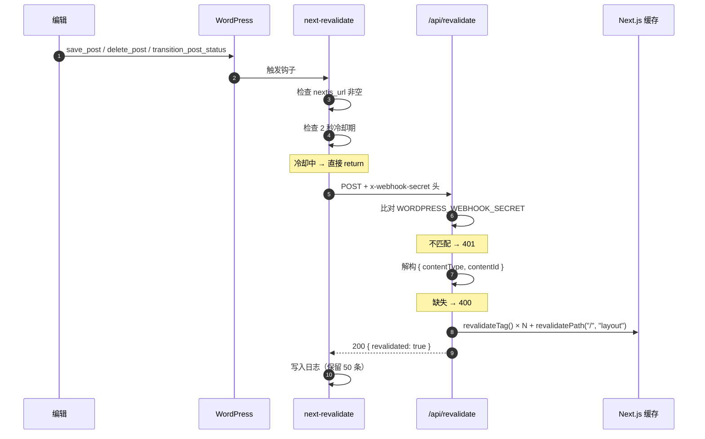

# 分册三 · 后端与实时更新

> 本篇讲 WordPress 侧的三样东西：**空白主题**、**`next-revalidate` 插件**、**Docker 自动装配**。
> 读完你应该能回答：**WordPress 怎么变成纯 API？Webhook 全链路怎么走？冷却和重试在哪一层？**

---

## 一、为什么后端也要给代码

绝大多数 headless 教程止步于"你去找个 WordPress，装上 XX 插件"。next-wp 把后端也给了，因为有三件事**必须**在后端做，前端做不了：

| 必须做的事 | 谁来做 | 不做的后果 |
|---|---|---|
| 挡住 WordPress 自带前端渲染 | **空白主题** | 同一内容有两个 URL，SEO 重复内容 |
| 内容变更时通知前端 | **next-revalidate 插件** | 前端只能等定时再生 |
| 让 WordPress 知道前端在哪 | **环境变量 + 插件配置** | 重定向和目标地址都是空的 |

这三件缺一件，headless 就不成立。

---

## 二、空白主题 `nextjs-headless`

只有 3 个文件，是整个后端改造里最优雅的部分。

### `style.css` —— 主题身份声明

```css
/*
Theme Name: Next.js Headless
Theme URI: https://github.com/9d8dev/next-wp
Description: Minimal theme that redirects frontend requests to Next.js. For headless WordPress only.
Version: 1.0.0
Author: 9d8
License: MIT
*/
```

WordPress 靠主题头部注释识别主题。**这里没有任何 CSS** —— 它根本不渲染页面。

### `functions.php` —— 唯一的逻辑（72 行）

核心是 `template_redirect` 钩子，**逐条判断"这个请求该不该放行"**：

```php
add_action('template_redirect', function () {
    // Allow WordPress admin area
    if (is_admin()) { return; }

    // Allow login/logout pages
    if (strpos($_SERVER['REQUEST_URI'], 'wp-login') !== false ||
        strpos($_SERVER['REQUEST_URI'], 'wp-signup') !== false ||
        strpos($_SERVER['REQUEST_URI'], 'wp-activate') !== false) { return; }

    // Allow REST API
    if (strpos($_SERVER['REQUEST_URI'], 'wp-json') !== false ||
        strpos($_SERVER['REQUEST_URI'], rest_get_url_prefix()) !== false) { return; }

    // Allow cron
    if (strpos($_SERVER['REQUEST_URI'], 'wp-cron') !== false) { return; }

    // Allow AJAX requests
    if (defined('DOING_AJAX') && DOING_AJAX) { return; }

    // Allow XML-RPC (if needed for some integrations)
    if (strpos($_SERVER['REQUEST_URI'], 'xmlrpc.php') !== false) { return; }

    // Get Next.js URL from environment
    $nextjs_url = getenv('NEXTJS_URL');

    if ($nextjs_url) {
        wp_redirect($nextjs_url, 301);   // ← 其余一切 301 到前端
        exit;
    }
});
```

**白名单思路很清晰**：管理后台、登录、REST API、cron、AJAX、XML-RPC 全放行，**剩下的统统 301 到 Next.js**。

这和另一套常见做法（直接 `status_header(404)` 返回 404）有本质区别：

| 做法 | 用户体验 | SEO |
|---|---|---|
| **301 重定向**（本项目） | 点旧链接能到新站 ✅ | 权重转移到新域名 ✅ |
| 返回 404 | 看到"页面不存在" ❌ | 丢掉旧链接的权重 ⚠️ |

**迁移场景（已有 WordPress 站，要换成 headless）应该用 301** —— 这正是本项目选它的原因。

### `index.php` —— 兜底模板

必须存在（WordPress 主题规范要求），但内容极简 —— 只在**主题被直接访问且 `NEXTJS_URL` 没配**时才会渲染，用来提示管理员。

### 顺带：清理前端无用的 `<head>` 输出

```php
add_action('after_setup_theme', function () {
    remove_action('wp_head', 'print_emoji_detection_script', 7);
    remove_action('wp_print_styles', 'print_emoji_styles');
    remove_action('wp_head', 'feed_links', 2);
    remove_action('wp_head', 'feed_links_extra', 3);
    remove_action('wp_head', 'rsd_link');
    remove_action('wp_head', 'wlwmanifest_link');
    remove_action('wp_head', 'wp_generator');       // ← 顺手隐藏版本号，减少信息泄露
});
```

**headless 模式下没人看这个 `<head>`，但移除 `wp_generator` 是安全加分项**（不暴露 WordPress 版本，降低被扫描器针对性攻击的概率）。

> ⚠️ `strpos($_SERVER['REQUEST_URI'], ...)` 这种判断方式**比较脆弱**。`REQUEST_URI` 是用户可控的，理论上可以构造出含 `wp-json` 子串的路径绕过判断。生产环境更稳的做法是改用 WordPress 的 `rest_get_url_prefix()` 精确匹配路径前缀，或用 `REST_REQUEST` 常量。

---

## 三、`next-revalidate` 插件

这是整个项目里最复杂的一块。**但它同时也是仓库里最容易让人误判的地方 —— 我第一轮就读错了，这里给出更正后的结论。**

### 🔴 先搞清楚：仓库里有两份插件代码，但只有一份是活的

| 位置 | 文件 | Version | 类名 | option 键 | 状态 |
|---|---|---|---|---|---|
| `plugin/next-revalidate/` | 23015 字节 | **1.0.5** | `Next_Revalidation` | `next_revalidation_settings` | ⚠️ **陈旧副本** |
| `wordpress/next-revalidate/` | 17865 字节 | **1.1.0** | `NextRevalidate` | `next_revalidate_settings` | ✅ **唯一正本** |

**怎么确定哪个是正本？看 CI，不是看目录名。**

```yaml
# .github/workflows/release-plugin.yml
- name: Create plugin ZIP
  run: |
    cd wordpress                      # ← 从这里打包
    zip -r next-revalidate.zip next-revalidate/
```

```yaml
# .github/workflows/docker-wordpress.yml
with:
  context: ./wordpress                # ← 镜像也从这里构建
```

**两条发布链路（GitHub Release zip + Docker 镜像）都从 `wordpress/next-revalidate/` 取代码。** README 里那个下载链接：

```
https://github.com/9d8dev/next-wp/releases/latest/download/next-revalidate.zip
```

指向的 Release 资产，正是 CI 从 `wordpress/` 目录打出来的包 —— 也就是 **v1.1.0**。

### `plugin/` 目录是什么（为什么它会误导人）？

一个**被遗留在仓库里的旧版本快照**，证据三条：

1. 它自带的 `next-revalidate.zip` 内部时间戳是 **2025-05-06**（比 `wordpress/` 那份落后一年多）
2. zip 里还混着 `__MACOSX/._*` 文件（Mac 打包残留，没清理）
3. 它用 `add_submenu_page`（挂在自定义菜单下），而 v1.1.0 用 `add_options_page`（挂在"设置"下）—— README 写的安装说明是 *"Go to Settings > Next.js Revalidation"*，**对应的是 v1.1.0 的位置**

> ✅ **更正结论**：`plugin/` 目录应视为**历史残留，不要使用**。无论走 Docker 还是下载 Release zip，装到的都是同一个版本（**v1.1.0**）。
>
> 📌 **教训**：判断"哪个文件是正本"时，**要用发布链路（CI workflow）来裁定，而不是猜目录名**。`plugin/` 这个名字比 `wordpress/next-revalidate/` 更"像"插件目录，很容易误导。

### 🔴 真正的问题：插件发的字段，前端读不到

既然只有一份活代码，"版本冲突"就不成立了 —— **但 payload 契约不匹配的问题是真实存在的，而且它就是这个项目最严重的缺陷**。

```php
// 唯一正本 v1.1.0（wordpress/next-revalidate/）实际发出去的东西
$payload = [
    'type' => $type,
    'data' => $data,          // ← data 里才有 id
    'timestamp' => time()
];
```

而 Next.js 端 `app/api/revalidate/route.ts` 读的是：

```ts
const { contentType, contentId } = requestBody;
```

**→ 插件发 `{type, data}`，路由读 `{contentType, contentId}`。字段名完全对不上，路由会读到 `contentType === undefined`，直接返回 400 "Missing content type"。**

> 🔴 这是本系列**最严重的一处实测发现**。**无论走 Docker 还是下载 Release zip，Webhook 都是不通的。**
> 验证方式：
> ```bash
> grep -c "contentType" wordpress/next-revalidate/next-revalidate.php    # → 0 处（唯一正本里根本没有这个字段）
> grep -n "contentType" app/api/revalidate/route.ts                      # → 路由在等它
> ```
>
> **修复（二选一）**：
> - 改插件：发 `{contentType: $type === 'post' ? 'post' : ...，contentId: $data['id']}`
> - 改路由：兼容两种形状
>   ```ts
>   const contentType = requestBody.contentType ?? requestBody.type;
>   const contentId = requestBody.contentId ?? requestBody.data?.id;
>   ```
> 后者更稳 —— 能同时兼容新旧客户端。

### 插件机制拆解

以下是 v1.1.0（唯一在用的版本）的完整机制。

#### ① 监听四类事件

```php
add_action('save_post', [$this, 'on_post_change'], 10, 3);
add_action('delete_post', [$this, 'on_post_delete']);
add_action('transition_post_status', [$this, 'on_status_change'], 10, 3);
// 以及分类/标签变更
```

- **`save_post`**：新建或更新
- **`delete_post`**：删除
- **`transition_post_status`**：状态流转（草稿→发布、发布→草稿），**只在跨越 `publish` 时才触发**

这个设计比只挂 `save_post` 完整得多 —— 光挂 `save_post` 会漏掉"文章被删除"和"文章被撤下"两种情况。

#### ② 冷却期：防抖的核心

```php
private function trigger_revalidation($type, $data) {
    $options = get_option($this->option_name);
    if (empty($options['nextjs_url'])) { return; }

    // Check cooldown
    $cooldown = $options['cooldown'] ?? 2;
    $last = get_option($this->last_option);
    if ($last && (time() - $last['time']) < $cooldown) {
        $this->debug_log('Skipped: cooldown active');
        return;
    }
    // ...
}
```

**为什么必须有冷却期？** 因为 WordPress 保存一篇文章会触发**多次** `save_post`（自动保存、修订版本、元数据更新各算一次）。没有冷却，一个编辑动作可能打出 5~10 个 Webhook，前端跟着重刷 5~10 次。

默认 `cooldown = 2` 秒 —— `setup.sh` 也显式写了 `"cooldown" => 2`。

> ⚠️ **冷却期是"全局"的，不是"按文章"的**。两秒内编辑两篇不同文章，第二篇的 Webhook 会被丢掉 —— 而那篇文章的缓存就过期不了。
> 更严谨的做法是**按 `$post_id` 分别记录冷却时间**。对本项目这种"一人编辑"的场景影响不大，但多人协作的内容团队会踩到。

#### ③ 重试

```php
private function send_with_retry($type, $data, $max_retries, $attempt = 0) {
    $result = $this->send_request($type, $data);
    if (!$result['success'] && $attempt < $max_retries) {
        // 递归重试
    }
}
```

默认 `max_retries = 3`。前端 `/api/revalidate` 有 `maxDuration = 30`，WordPress 侧 `timeout => 15`，两边时间预算对得上。

#### ④ 日志与状态

```php
$this->add_log_entry([
    'time' => time(),
    'type' => $type,
    'data' => $data,
    'success' => $result['success'],
    'http_code' => $result['http_code'],
    'error' => $result['error'],
    'retries' => $result['retries']
]);
```

```php
private function add_log_entry($entry) {
    $log = get_option($this->log_option, []);
    array_unshift($log, $entry);
    $log = array_slice($log, 0, 50);        // ← 只留最近 50 条
    update_option($this->log_option, $log);
}
```

**保留最近 50 条**，存在 `wp_options` 表里。后台能看到历史记录，还能手动触发测试。

> ⚠️ 用 `wp_options` 存日志有个副作用：**每次写都触发一次数据库写入**，且在 `alloptions` 自动加载的情况下可能影响性能。生产站建议改用自定义表或文件日志。

#### ⑤ 手动测试钩子

```php
add_action('wp_ajax_next_revalidate_test', function() { ... });
add_action('wp_ajax_next_revalidate_clear_log', function() { ... });
```

后台点按钮就能发一次测试请求。**这个功能很实用** —— 排障时不用真去改一篇文章。

---

## 四、Docker 自动装配：`setup.sh` + `entrypoint.sh`

这是"一键部署"能成立的原因。 **`docker-entrypoint.sh` 是 WordPress 官方镜像的入口，本项目的 `custom-entrypoint.sh` 包在它外面。**

### `entrypoint.sh` 的三个动作

```bash
#!/bin/bash
set -euo pipefail

copy_custom_files() {
    # ① 等 WordPress 核心解开（最多 120 秒）
    local elapsed=0; local timeout=120
    while [ ! -d /var/www/html/wp-content/plugins ]; do
        if [ "$elapsed" -ge "$timeout" ]; then
            echo "[setup] ERROR: Timed out ..." >&2
            return 1
        fi
        sleep 2; elapsed=$((elapsed + 2))
    done

    # ② 拷插件（幂等）
    if [ ! -d /var/www/html/wp-content/plugins/next-revalidate ]; then
        cp -r /usr/src/next-revalidate /var/www/html/wp-content/plugins/
    fi

    # ③ 拷主题（幂等）
    if [ ! -d /var/www/html/wp-content/themes/nextjs-headless ]; then
        cp -r /usr/src/nextjs-headless /var/www/html/wp-content/themes/
    fi

    # ④ 给 WordPress 加 robots.txt（禁止收录后端）
    if [ ! -f /var/www/html/robots.txt ]; then
        cat > /var/www/html/robots.txt << 'EOF'
User-agent: *
Disallow: /
EOF
    fi

    # ⑤ 跑安装脚本
    /usr/local/bin/setup-wordpress.sh
}

# 延迟 10 秒后台执行（等 volume 挂载完成）
(sleep 10 && copy_custom_files) &

# 最后交给官方 entrypoint
exec docker-entrypoint.sh "$@"
```

**三个精妙之处**：

| 设计 | 为什么 |
|---|---|
| **先拷到 `/usr/src/` 暂存，再拷进 `/var/www/html/`** | `/var/www/html` 是 volume，镜像里的文件会被 volume **覆盖**。所以必须在运行时拷 |
| **`if [ ! -d ... ]` 幂等判断** | 镜像升级时不覆盖 volume 里已存在的插件 → **用户的自定义配置不会被冲掉** |
| **`(sleep 10 && ...) &` 后台执行** | 不阻塞容器启动。`exec docker-entrypoint.sh` 立刻接管，Apache 先起来 |

第四条也很关键：**给 WordPress 后端加 `Disallow: /`** —— 防止搜索引擎索引后端域名。否则同一篇内容会在 `wp.example.com` 和 `example.com` 两个域名下重复出现。

### `setup.sh` —— 用 WP-CLI 全自动配置

```bash
# 安装并启用插件
if ! wp plugin is-active next-revalidate --allow-root 2>/dev/null; then
    wp plugin activate next-revalidate --allow-root
fi

# 启用主题（含旧目录名回退）
if ! wp theme activate nextjs-headless --allow-root 2>/dev/null; then
    wp theme activate theme --allow-root 2>/dev/null || echo "WARNING: ..." >&2
fi

# 写入插件配置
if [ -n "${NEXTJS_URL:-}" ]; then
    settings_json=$(NEXTJS_URL="$NEXTJS_URL" WEBHOOK_SECRET="${WORDPRESS_WEBHOOK_SECRET:-}" php -r '
        $data = [
            "nextjs_url" => getenv("NEXTJS_URL"),
            "webhook_secret" => getenv("WEBHOOK_SECRET"),
            "cooldown" => 2
        ];
        echo json_encode($data);
    ')
    echo "$settings_json" | wp option update next_revalidate_settings --format=json --allow-root
fi
```

**这里是对得上的**：`setup.sh` 写 `next_revalidate_settings`，而正本 v1.1.0 读的正是这个键。

> ✅ 这一条我一开始判断错了 —— 看到 `plugin/` 里那份陈旧副本用的是 `next_revalidation_settings`（少一个 `e`），就下了"配置写不进去"的结论。**但 `plugin/` 根本不是发布路径**（见上文 CI 证据），所以这个不一致在实际部署里不会发生。
>
> ⚠️ 不过它仍是个**待清理的隐患**：`plugin/next-revalidate.zip` 是 2025-05 的旧包还留在仓库里，任何人 `git clone` 后随手解压它，就会得到一份读不到配置的插件。**建议上游直接删掉 `plugin/` 目录。**

### 用 PHP 生成 JSON 而不是拼字符串

```bash
settings_json=$(... php -r '... echo json_encode($data);')
```

这个细节值得单独夸：**用 `php -r` + `json_encode` 生成配置**，而不是 bash 拼字符串。理由代码注释写得很清楚：

> *"Use PHP to build JSON safely (avoids injection if URL/secret contains quotes)"*

如果 `WORDPRESS_WEBHOOK_SECRET` 里有引号，bash 拼串会生成非法 JSON 甚至命令注入。**这是正确做法。**

---

## 五、Webhook 全链路（把两端串起来）



### 密钥要配三处一致

| 位置 | 变量名 |
|---|---|
| Next.js `.env.local` | `WORDPRESS_WEBHOOK_SECRET` |
| WordPress 容器环境 | `WORDPRESS_WEBHOOK_SECRET` |
| 插件设置页 | `webhook_secret` |

**三处任一处不一致 → 401。** 这是最常见的"配了半天不通"的原因。

`setup.sh` 的作用就是让第二、三处自动对齐 —— 但前提是插件版本对（见上面的 option 名问题）。

### 前端接收端：`app/api/revalidate/route.ts`

```ts
export const maxDuration = 30;

export async function POST(request: NextRequest) {
  const requestBody = await request.json();
  const secret = request.headers.get("x-webhook-secret");

  if (secret !== process.env.WORDPRESS_WEBHOOK_SECRET) {
    return NextResponse.json({ message: "Invalid webhook secret" }, { status: 401 });
  }

  const { contentType, contentId } = requestBody;
  if (!contentType) {
    return NextResponse.json({ message: "Missing content type" }, { status: 400 });
  }

  revalidateTag("wordpress", { expire: 0 });      // ← 先全清（问题见分册一）
  // ...按 contentType 分支清细粒度标签
  revalidatePath("/", "layout");                   // ← 最后连 layout 一起刷
  return NextResponse.json({ revalidated: true, ... });
}
```

> 📌 **密钥比对用的是 `!==`，不是恒定时间比较**。理论上存在时序侧信道，但 Webhook 场景下风险可忽略（攻击者无法从响应时间有效推断 32 字节密钥）。若要更严谨可用 `crypto.timingSafeEqual`。

---

## 六、小结

### 可以照抄的四条

1. **空白主题 + 301 白名单** —— 迁移场景的正确姿势，权重能保住
2. **插件先拷 `/usr/src/` 再进 volume** + 幂等判断 —— Docker 里装主题/插件的正解
3. **`php -r` + `json_encode` 生成配置**，别用 bash 拼 JSON
4. **冷却期 + 重试 + 日志** —— 一个 Webhook 客户端该有的三件套

### 要绕开的五个坑

| 坑 | 严重度 | 说明 |
|---|---|---|
| **payload 契约不匹配**（发 `{type,data}`，读 `{contentType,contentId}`） | 🔴 高 | **所有部署路径下 Webhook 都不通** → 内容改了前端不更新 |
| 仓库里留着 2025-05 的旧插件副本 `plugin/` | 🟡 中 | 误用它会导致配置读不到；建议删 |
| 冷却期是全局而非按文章 | 🟡 中 | 并发编辑会漏掉更新 |
| 日志存 `wp_options` | 🟡 中 | 每次写都触发 DB 写入 |
| `strpos($_SERVER['REQUEST_URI'], ...)` 做白名单 | 🟢 低 | 理论上可绕过，生产建议用 `REST_REQUEST` 常量 |

---

**上一篇** → [分册二：页面与渲染](next-wp-02-pages-and-seo.md) ｜ **下一篇** → [分册四：部署、测试与真实缺口](next-wp-04-deploy-and-gaps.md)
