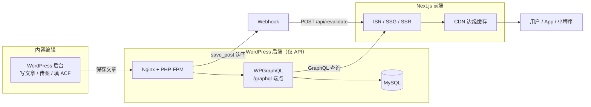
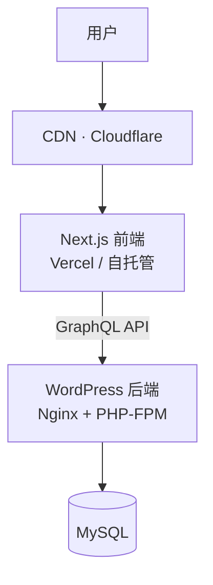
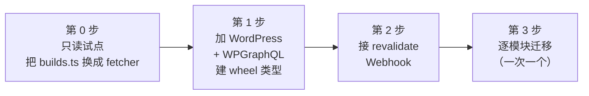

# WordPress Headless CMS × Next.js 实战教程

> **源文章**：[WordPress Headless CMS 架构实战：从后端配置到 Next.js 前端的全栈开发指南](https://tbr8.org/wordpress-headless-cms-%E6%9E%B6%E6%9E%84%E5%AE%9E%E6%88%98%EF%BC%9A%E4%BB%8E%E5%90%8E%E7%AB%AF%E9%85%8D%E7%BD%AE%E5%88%B0-next-js-%E5%89%8D%E7%AB%AF%E7%9A%84%E5%85%A8%E6%A0%88%E5%BC%80%E5%8F%91/)（汤不热吧，2026-07-29，作者 andy）
> **本文定位**：把原文的通用方案落成本项目可执行的路线。原文是"一篇通讲"，本教程是"照着做"。
> **相关**：本仓 README 已声明 `src/content/` 是 headless WordPress 的接入缝（seam），但**尚未实现任何 fetcher** —— 本教程补的正是这一段。

---

## 〇、先看结论：这篇文章讲了什么

原文给出了一套完整的 WordPress Headless CMS 全栈方案，七个部分：

| 部分 | 内容 | 关键动作 |
|---|---|---|
| 一 | 为什么用 Headless | 前后端解耦，多端复用 / 性能 / 安全 |
| 二 | WordPress 后端配置 | 禁用前端渲染、装 WPGraphQL、注册自定义字段、配 CORS + JWT |
| 三 | Next.js 前端 | GraphQL 客户端、集中查询、ISR 列表页与详情页 |
| 四 | 内容实时更新 | Next.js revalidate API + WordPress save_post 钩子 |
| 五 | SEO | Yoast SEO + WPGraphQL Yoast + 动态 sitemap |
| 六 | 生产部署 | Nginx 限制 REST、Docker standalone 部署 |
| 七 | 常见问题 | DOMPurify 清洗、next/image 远程图、Web Vitals |

**核心判断**（原文原话）：WordPress Headless 不是银弹。适合"多端分发 / 极致前端性能 / 团队擅长现代前端 / 需要更高安全"。代价是**额外的前端开发成本**。

---

## 一、架构全景（先建立心智模型）



**一句话理解**：WordPress 退化成一个"带后台界面的数据库 + GraphQL 接口"，所有渲染搬到 Next.js。内容一改，WordPress 主动"拍"一下 Next.js，让对应静态页重新生成。

### 传统模式 vs Headless（原文对比表）

| 维度 | 传统 WordPress | Headless WordPress |
|---|---|---|
| 前端技术 | PHP 模板引擎 | Next.js / React / Vue 等任意框架 |
| 渲染方式 | 服务端渲染（SSR） | SSR + SSG + ISR 多种选择 |
| 性能 | 依赖插件和缓存优化 | 前端可极致优化，CDN 友好 |
| 内容分发 | 单一网站 | 同一后端服务多端（Web / App / 小程序） |
| 开发体验 | PHP + WordPress 生态 | 现代前端工具链，TypeScript 支持 |
| SEO | 原生友好 | 需额外配置，但 SSR/SSG 同样友好 |

---

## 二、WordPress 后端：改造成纯 API

### 2.1 关掉前端渲染

两种做法，**推荐第二种**（更彻底、更省心）：

**做法 A —— `functions.php` 拦截非 API 请求**：

```php
<?php
// 在子主题的 functions.php 中添加
add_action('template_redirect', function () {
    if (!defined('REST_REQUEST') && !is_admin() && !wp_doing_ajax()) {
        // 方式一：重定向到前端站点
        // wp_redirect('https://frontend.example.com' . $_SERVER['REQUEST_URI']);
        // exit;

        // 方式二：返回 404
        status_header(404);
        nocache_headers();
        include(get_404_template());
        exit;
    }
});
```

**做法 B —— 只留一个最小空白主题**（删掉 `wp-content/themes/` 下其他主题）：

```php
// style.css
/*
Theme Name: Headless Blank
Description: 最小化主题，仅供 Headless CMS 使用
Version: 1.0
*/
```

```php
// index.php —— 空文件或仅一行
<?php // Silence is golden
```

> ⚠️ **原文这里有个坑**：代码块里同时放了 `// style.css` 和 `// index.php` 两段，它们是**两个不同文件**，不是同一个文件里的注释。照抄会得到一个坏主题。

### 2.2 装 WPGraphQL（用 GraphQL 而非 REST）

原文推荐 GraphQL 的理由：客户端**精确声明需要的字段**，避免过度获取（over-fetching）和获取不足（under-fetching）。

```bash
# 通过 WP-CLI 安装
wp plugin install wpgraphql --activate
wp plugin install wpgraphql-smart-cache --activate   # GraphQL 缓存
```

装完访问 `https://your-wp-site.com/graphql` 进入 GraphiQL IDE 测试查询。

### 2.3 注册自定义 GraphQL 字段

原文示例：给文章加"阅读时间"字段。

```php
add_action('graphql_register_types', function () {
    register_graphql_field('Post', 'readingTime', [
        'type' => 'String',
        'description' => '预估阅读时间（分钟）',
        'resolve' => function ($post) {
            $content = get_the_content(null, false, $post);
            $word_count = str_word_count(wp_strip_all_tags($content));
            return ceil($word_count / 300) . ' 分钟';
        }
    ]);
});
```

> 🔴 **这个示例对中文站是坏的**（原文未指出）。`str_word_count()` **不认中日韩文字** —— 一篇 2000 字的中文文章会返回 0，结果恒为 `"0 分钟"`。
> 中文站应改成按字符数算：
> ```php
> $chars = mb_strlen(wp_strip_all_tags($content), 'UTF-8');
> return ceil($chars / 400) . ' 分钟';   // 中文约 400 字/分钟
> ```

### 2.4 CORS 与认证

```php
add_action('init', function () {
    add_filter('graphql_response_headers_to_send', function ($headers) {
        $headers['Access-Control-Allow-Origin'] = 'https://frontend.example.com';
        $headers['Access-Control-Allow-Headers'] = 'Content-Type, Authorization';
        $headers['Access-Control-Allow-Methods'] = 'POST, GET, OPTIONS';
        return $headers;
    });
});

// 处理 OPTIONS 预检请求
add_action('init', function () {
    if ($_SERVER['REQUEST_METHOD'] === 'OPTIONS') {
        header('Access-Control-Allow-Origin: https://frontend.example.com');
        header('Access-Control-Allow-Headers: Content-Type, Authorization');
        header('Access-Control-Allow-Methods: POST, GET, OPTIONS');
        status_header(200);
        exit;
    }
});
```

需要用户登录态（评论、会员内容）时用 JWT：

```bash
wp plugin install jwt-authentication-for-wp-rest-api --activate
```

```php
// wp-config.php
define('JWT_AUTH_SECRET_KEY', 'your-secure-random-string-here');
define('JWT_AUTH_CORS_ENABLE', true);
```

> ⚠️ **原文把 `add_action('init', ...)` 写了两遍**（一次挂 filter，一次挂 OPTIONS 处理）—— 在 PHP 里后注册的会覆盖同名回调，实际上会静默失效。**正确写法是合并成一个回调**，或给两个回调不同的函数名。

> 🔑 **安全要点**：这里定义的是**允许的前端域名白名单**。若不显式设置，`Access-Control-Allow-Origin: *` 会让任意网站用你的 API 拉内容。

---

## 三、Next.js 前端：查询与渲染

### 3.1 项目初始化

```bash
npx create-next-app@latest my-headless-site --typescript --tailwind --app
cd my-headless-site
npm install graphql graphql-request isomorphic-dompurify
```

### 3.2 GraphQL 客户端（单一出口）

```ts
// src/lib/graphql.ts
import { GraphQLClient } from 'graphql-request';

const WORDPRESS_API_URL =
  process.env.NEXT_PUBLIC_WORDPRESS_API_URL || 'https://wp.example.com/graphql';

export const client = new GraphQLClient(WORDPRESS_API_URL, {
  headers: { 'Content-Type': 'application/json' },
});

// 需要 Authorization 时
export const authedClient = (token: string) =>
  new GraphQLClient(WORDPRESS_API_URL, {
    headers: {
      'Content-Type': 'application/json',
      Authorization: `Bearer ${token}`,
    },
  });
```

```bash
# .env.local
NEXT_PUBLIC_WORDPRESS_API_URL=https://wp.example.com/graphql
REVALIDATION_SECRET=<openssl rand -hex 32 生成>
```

### 3.3 查询集中管理

> ⚠️ **原文这条注释是错的**：`// src/lib/queries.ts` —— 但 `gql` 标签在 `graphql-request` 里，`queries.ts` **不是** React 组件，不该被当成客户端代码。这一点在 3.4 会变成真问题，见下方"ISR 陷阱"。

```ts
// src/lib/queries.ts
import { gql } from 'graphql-request';

export const GET_ALL_POSTS = gql`
  query GetAllPosts($first: Int = 10, $after: String) {
    posts(first: $first, after: $after) {
      pageInfo { hasNextPage endCursor }
      nodes {
        id
        slug
        title
        excerpt
        date
        readingTime          # 2.3 注册的自定义字段
        featuredImage {
          node { sourceUrl(size: MEDIUM_LARGE) altText }
        }
        categories { nodes { slug name } }
      }
    }
  }
`;

export const GET_POST_BY_SLUG = gql`
  query GetPostBySlug($slug: ID!) {
    post(id: $slug, idType: SLUG) {
      id
      title
      content
      date
      author { node { name avatar { url } } }
      categories { nodes { name slug } }
      seo {
        metaDesc
        title
        opengraphImage { sourceUrl }
      }
    }
  }
`;

export const GET_ALL_CATEGORIES = gql`
  query GetAllCategories {
    categories { nodes { id slug name count } }
  }
`;
```

### 3.4 文章列表页（ISR）

```tsx
// src/app/posts/page.tsx
import { client } from '@/lib/graphql';
import { GET_ALL_POSTS } from '@/lib/queries';

export const revalidate = 60;   // 兜底：60 秒自动再生

export default async function PostsPage() {
  const data = await client.request(GET_ALL_POSTS, { first: 10 });
  const { nodes } = data.posts;

  return (
    <div className="grid gap-8 md:grid-cols-2 lg:grid-cols-3">
      {nodes.map((post) => (
        <a key={post.id} href={`/posts/${post.slug}`} className="block group">
          {post.featuredImage?.node?.sourceUrl && (
            
          )}
          <h2 className="mt-3 text-xl font-bold">{post.title}</h2>
          <p className="text-gray-500 text-sm">
            {post.date} · {post.readingTime}
          </p>
        </a>
      ))}
    </div>
  );
}
```

### 3.5 文章详情页（动态路由 + ISR）

```tsx
// src/app/posts/[slug]/page.tsx
import { notFound } from 'next/navigation';
import { client } from '@/lib/graphql';
import { GET_ALL_POSTS, GET_POST_BY_SLUG } from '@/lib/queries';
import { SafeContent } from '@/components/safe-content';

export const revalidate = 60;

// 构建期预生成所有已发布文章的静态页
export async function generateStaticParams() {
  const data = await client.request(GET_ALL_POSTS, { first: 100 });
  return data.posts.nodes.map((post: { slug: string }) => ({ slug: post.slug }));
}

export default async function PostPage({ params }: { params: { slug: string } }) {
  try {
    const data = await client.request(GET_POST_BY_SLUG, { slug: params.slug });
    const { post } = data;
    if (!post) return notFound();

    return (
      <article className="max-w-3xl mx-auto px-4 py-8">
        <header className="mb-8">
          <h1 className="text-4xl font-bold mb-4">{post.title}</h1>
          <div className="text-gray-500">
            {post.author.node.name} · {new Date(post.date).toLocaleDateString('zh-CN')}
          </div>
        </header>
        {/* 注意：不是直接 dangerouslySetInnerHTML，走 DOMPurify，见第五节 */}
        <SafeContent html={post.content} />
      </article>
    );
  } catch {
    return notFound();
  }
}
```

### 🔴 ISR 陷阱（原文代码有两处必须修）

| 原文写法 | 问题 | 正确写法 |
|---|---|---|
| `<h1 dangerouslySetInnerHTML={{ __html: post.title }} />` | 标题被当 HTML 解析 → **标题里的 `<` `&` 会破坏结构，且是 XSS 面** | `{post.title}`（React 自动转义） |
| `post.content` 直接进 `dangerouslySetInnerHTML` | **原文自己第七节说要 DOMPurify，但正文代码没清洗**，自相矛盾 | 统一走 `<SafeContent>` |
| `export const revalidate = 60`（原文只在列表页提了 ISR） | 详情页若不加，**新文章能生成但改文章不刷新** | 两个页面都要声明 |
| `generateStaticParams` 里 `first: 100` | 文章超过 100 篇时，**第 101 篇起首次访问才生成**（可以接受，但要心里有数） | 分页循环取全量，或接受 on-demand |

---

## 四、实时更新：Webhook + On-Demand ISR

这是整篇文章**最有价值的一节** —— ISR 的"定时再生"不够快，WordPress 一发布就该立刻刷新。

### 4.1 Next.js 侧：revalidation 接口

```ts
// src/app/api/revalidate/route.ts
import { NextRequest, NextResponse } from 'next/server';
import { revalidatePath } from 'next/cache';

export async function POST(request: NextRequest) {
  try {
    const body = await request.json();

    // 🔴 必须校验密钥，否则任何人都能重置你的全站缓存
    if (body.secret !== process.env.REVALIDATION_SECRET) {
      return NextResponse.json({ message: 'Invalid token' }, { status: 401 });
    }

    const postSlug = body.postSlug;
    if (postSlug) {
      await revalidatePath(`/posts/${postSlug}`);
    }

    // 列表页也变了（新文章 / 标题改了）
    await revalidatePath('/posts');
    await revalidatePath('/');

    return NextResponse.json({ revalidated: true, now: Date.now() });
  } catch (err) {
    return NextResponse.json({ message: 'Error revalidating' }, { status: 500 });
  }
}
```

### 4.2 WordPress 侧：发布时拍 Webhook

```php
add_action('save_post_post', function ($post_id, $post, $update) {
    // 跳过自动保存和修订版本
    if (wp_is_post_revision($post_id) || wp_is_post_autosave($post_id)) {
        return;
    }
    // 跳过非发布状态
    if ($post->post_status !== 'publish') {
        return;
    }

    $webhook_url = 'https://frontend.example.com/api/revalidate';
    $secret = defined('REVALIDATION_SECRET') ? REVALIDATION_SECRET : '';

    wp_remote_post($webhook_url, [
        'body' => json_encode([
            'secret'   => $secret,
            'postSlug' => $post->post_name,
            'postId'   => $post_id,
            'action'   => $update ? 'update' : 'publish',
        ]),
        'headers' => ['Content-Type' => 'application/json'],
        'timeout' => 10,
    ]);
}, 10, 3);
```

在 `wp-config.php` 里定义同一个密钥：

```php
define('REVALIDATION_SECRET', '与 Next.js .env.local 里完全一致的那串');
```

> ⚠️ **两个容易忽略的实现细节**：
> 1. `save_post_post` 只钩住 **`post` 这个文章类型**。自定义文章类型（如 `wheel`、`build`）要另写 `save_post_wheel`。
> 2. `wp_remote_post` 是**阻塞调用**，超时 10 秒意味着**编辑器点保存后可能卡 10 秒**。生产站建议改 `'blocking' => false`（发出即返回），或走 WP 的 `wp_schedule_single_event` 异步派发。

---

## 五、SEO

### 5.1 Yoast SEO + WPGraphQL Yoast

```bash
wp plugin install wordpress-seo --activate
wp plugin install add-wpgraphql-seo --activate
```

装完后 GraphQL 查询自动带上 `seo` 字段（见 3.3 的 `GET_POST_BY_SLUG`），然后在 Next.js 生成 meta：

```tsx
// src/app/posts/[slug]/layout.tsx
import type { Metadata } from 'next';
import { client } from '@/lib/graphql';
import { GET_POST_BY_SLUG } from '@/lib/queries';

export async function generateMetadata(
  { params }: { params: { slug: string } }
): Promise<Metadata> {
  const data = await client.request(GET_POST_BY_SLUG, { slug: params.slug });
  const { seo, title } = data.post;

  return {
    title: seo?.title || title,
    description: seo?.metaDesc || '',
    openGraph: {
      title: seo?.title || title,
      description: seo?.metaDesc || '',
      images: seo?.opengraphImage?.sourceUrl ? [seo.opengraphImage.sourceUrl] : [],
      type: 'article',
    },
  };
}
```

> ⚠️ **原文把这段放在 `[slug]/layout.tsx`** —— 但 `generateMetadata` 读的是 `params.slug`，放 `page.tsx` 更直观；放 layout 也可以（Next.js 支持），只是要注意 **layout 的 params 是同一个**，别在 page 和 layout 里重复请求两次。

### 5.2 动态 sitemap

```ts
// src/app/sitemap.ts
import type { MetadataRoute } from 'next';
import { client } from '@/lib/graphql';
import { gql } from 'graphql-request';

const SITE = 'https://frontend.example.com';

export default async function sitemap(): Promise<MetadataRoute.Sitemap> {
  const data = await client.request(gql`
    query GetSitemapPosts {
      posts(first: 1000) {
        nodes { slug modified }
      }
    }
  `);

  const posts = data.posts.nodes.map((post: { slug: string; modified: string }) => ({
    url: `${SITE}/posts/${post.slug}`,
    lastModified: new Date(post.modified),
    changeFrequency: 'weekly' as const,
    priority: 0.8,
  }));

  return [
    { url: SITE, lastModified: new Date(), changeFrequency: 'daily', priority: 1 },
    ...posts,
  ];
}
```

> 🔑 **`modified` 而不是 `date`** —— 原文这里选对了，用修改时间做 `lastModified` 才对。

---

## 六、生产部署

### 6.1 整体架构



### 6.2 WordPress 后端要点

- **PHP 8.2+**：性能与兼容性
- **OPcache**：字节码缓存，响应时间可降 50%
- **Redis 对象缓存**：减少数据库负载
- **限制 API 暴露面**：只开 GraphQL，关掉不需要的 REST 路由

```nginx
# 仅允许前端服务器 IP 访问 REST
location /wp-json/ {
    allow 10.0.0.0/8;
    deny all;
    try_files $uri $uri/ /index.php?$args;
}

# GraphQL 开放给前端
location /graphql {
    try_files $uri $uri/ /index.php?$args;
}
```

> ⚠️ 原文这段是**示意**：真实站点前端在 Vercel/公网，不是 `10.0.0.0/8`。实际要写**前端出口 IP 段**，或用 Cloudflare 的 `CF-Connecting-IP` + 共享密钥校验。

### 6.3 Next.js 部署（Docker standalone）

```dockerfile
# 使用 Docker 部署
FROM node:20-alpine AS builder
WORKDIR /app
COPY package*.json ./
RUN npm ci
COPY . .
RUN npm run build

FROM node:20-alpine AS runner
WORKDIR /app
ENV NODE_ENV=production
COPY --from=builder /app/.next/standalone ./
COPY --from=builder /app/.next/static ./.next/static
COPY --from=builder /app/public ./public
EXPOSE 3000
CMD ["node", "server.js"]
```

必须开启 standalone 输出：

```js
// next.config.js
module.exports = {
  output: 'standalone',
  images: {
    remotePatterns: [{ protocol: 'https', hostname: 'wp.example.com' }],
  },
};
```

> 🔴 **跨机构建的经典坑**（原文未提）：standalone 产物里 `.next/required-server-files.json` 会**硬编码构建机的绝对路径**。如果在 Mac 上 build 再上传到 Linux 服务器，路径对不上会启动失败。
> **正解**：构建就在目标架构/路径下做（Docker 多阶段构建天然解决了这一点，因为 builder 和 runner 都在容器里）。
> 同理 `NEXT_PUBLIC_*` 环境变量是**构建期烤进产物**的 —— 本地 build 时若用的是 fallback 域名，线上 canonical/sitemap 会静默指向错误域名。**跨机部署必须逐项比对烤入值。**

---

## 七、常见问题与最佳实践

### 7.1 rich text 安全渲染（必做）

WordPress 返回的 `content` 是**原始 HTML**，直接 `dangerouslySetInnerHTML` 有 XSS 风险：

```tsx
// src/components/safe-content.tsx
import DOMPurify from 'isomorphic-dompurify';

export function SafeContent({ html }: { html: string }) {
  const clean = DOMPurify.sanitize(html, {
    ALLOWED_TAGS: [
      'h1', 'h2', 'h3', 'h4', 'h5', 'h6',
      'p', 'a', 'img', 'ul', 'ol', 'li',
      'blockquote', 'pre', 'code', 'strong', 'em',
      'table', 'thead', 'tbody', 'tr', 'th', 'td',
    ],
    ALLOWED_ATTR: ['href', 'src', 'alt', 'class', 'target', 'rel'],
  });

  return <div className="prose" dangerouslySetInnerHTML={{ __html: clean }} />;
}
```

> ⚠️ **白名单里漏了两个常用的**：`figure` / `figcaption`（WordPress 图片块默认输出），以及 `iframe`（若要嵌 YouTube 需单独放行 + `allow` 属性白名单）。少了它们，图片说明文字会被**静默剥掉**。
> 🔑 另注意：DOMPurify **不负责校验图片域名**，`` 会通过。

### 7.2 图片优化

```js
// next.config.js
images: {
  remotePatterns: [
    {
      protocol: 'https',
      hostname: 'wp.example.com',
      pathname: '/wp-content/uploads/**',
    },
  ],
}
```

用 `next/image` 替代原生 ``，自动获得懒加载、尺寸优化、WebP 转换。

> 🔑 `pathname` 限死在 `/wp-content/uploads/**` 很关键 —— 不写就是**允许从整个 WP 域名代理任意图片**。

### 7.3 性能监控

```tsx
// src/app/layout.tsx
import { Analytics } from '@vercel/analytics/react';
import { SpeedInsights } from '@vercel/speed-insights/next';

export default function RootLayout({ children }: { children: React.ReactNode }) {
  return (
    <html lang="zh-CN">
      <body>
        {children}
        <Analytics />
        <SpeedInsights />
      </body>
    </html>
  );
}
```

关注 LCP / **INP** / CLS 三项 Core Web Vitals。

> ⚠️ 原文写的是 **FID** —— 该指标已于 2024 年 3 月被 **INP**（Interaction to Next Paint）取代，别再监控 FID。

---

## 八、这套方案怎么落到本项目

本仓 README 已明确写了缝在哪：

> *"This is deliberate: it is the seam where a headless WordPress fetcher will slot in. Swapping a module for an API call should require no component changes."*

当前状态：

- `src/content/*.ts` 是 **21 个典型化模块**（`wheel-skus.ts`、`builds.ts`、`finishes.ts`、`fitment.ts`…），组件**从不硬编码文案**
- 契约在 `src/content/types.ts`（`WheelSku` / `BuildEntry` / `ProductFamily` / `FitmentModel` …）
- `next.config.ts` 目前是 `output: "standalone"`
- README「Known gaps」明确写着：**Headless WordPress integration has not been built. The content layer is structured for it but no fetcher exists yet.**

### 落地路线（建议分四步，不要一次全换）



**第 0 步（不动 WordPress，先验证缝是通的）**
1. 新建 `src/lib/wordpress/client.ts`（GraphQL 客户端）+ `src/lib/wordpress/queries.ts`
2. 挑**读多写少、结构最简单**的模块先试 —— 建议 `builds.ts`（`BuildEntry[]`，字段全是标量，没有嵌套）
3. 写一个 `src/content/builds.remote.ts`，**导出与 `builds.ts` 完全相同的类型**，组件里只改 import 路径
4. 跑 `npm run typecheck && npm run build`，确认**零组件改动**

**第 1 步（WordPress 侧建模）**
- 装 WPGraphQL + WPGraphQL for ACF
- 用 **ACF 字段组**定义 `WheelSku` 的每个字段，字段名与 `types.ts` 一一对应
- 注册自定义文章类型（`wheel` / `build`），**不要复用 `post`**
- 把 `src/content/types.ts` 当**唯一契约权威** —— WordPress 那边字段对不上就在这里报错，而不是在 UI 里悄悄缺一块

**第 2 步（Webhook）**
- 加 `/api/revalidate`，接 `save_post_wheel` 钩子
- 注意本仓是**静态导出历史**（曾用过 `output: "export"`）→ **静态导出模式下 `revalidatePath` 完全无效**。要上 on-demand ISR，必须确认运行形态是 Node runtime（standalone 可以），而不是纯静态产物

**第 3 步（逐模块迁移）**
- 一个 PR 迁移一个 content 模块，其余保持静态
- 每个模块迁完，在 README 的 Known gaps 里划掉一行

### 三个必须提前定的事

| 问题 | 为什么现在就要定 |
|---|---|
| **WordPress 放哪** | 本仓是静态导出基因。若 WP 在另一台机器，跨机部署的 `NEXT_PUBLIC_*` 烤入值问题会立刻出现（见 6.3） |
| **谁是内容权威** | 迁完的模块，`src/content/*.ts` 是**留作 fallback** 还是**彻底删除**？两套并存会长期漂移 |
| **SEO 交接** | 本站已有自己的 canonical / sitemap 逻辑（`lib/metadata.ts` 那种）。接 Yoast 会产生**两套 SEO 来源**，必须选一个当唯一权威 |

---

## 九、原文的坑清单（照抄会踩）

| # | 位置 | 问题 | 影响 |
|---|---|---|---|
| 1 | 2.1 主题代码 | `style.css` 和 `index.php` 混在一个代码块 | 照抄得到坏主题 |
| 2 | 2.3 `readingTime` | `str_word_count()` 不认中文 | 中文站恒返回 `0 分钟` |
| 3 | 2.4 CORS | 两个 `add_action('init', ...)` 同名回调互相覆盖 | 预检请求静默失效 |
| 4 | 3.1 依赖清单 | 没提 `graphql-request` / `isomorphic-dompurify` 要单独装 | `npm i` 后 import 报错 |
| 5 | 3.4/3.5 正文 | `dangerouslySetInnerHTML` 未清洗，与第七节自相矛盾 | XSS 面 |
| 6 | 3.5 标题 | `post.title` 走 `dangerouslySetInnerHTML` | 标题带 `<` `&` 时结构破坏 |
| 7 | 4.2 | `save_post_post` 只钩 `post`，自定义类型不触发 | 自定义内容改了前端不刷新 |
| 8 | 4.2 | `wp_remote_post` 阻塞 10s | 编辑器点保存会卡顿 |
| 9 | 6.2 | Nginx `allow 10.0.0.0/8` 是示意值 | 照抄会把自己的前端拦在门外 |
| 10 | 6.3 | 没提 standalone 硬编码绝对路径 | 跨机部署启动失败 |
| 11 | 7.1 | DOMPurify 白名单缺 `figure`/`figcaption` | 图注被静默剥离 |
| 12 | 7.3 | 监控 FID（已废弃） | 指标无意义 |

---

## 十、要不要做？决策框架

原文的结论值得原样引用：

> *"WordPress Headless CMS 架构不是银弹"*，实施需要**额外的前端开发成本**，但灵活性、性能、安全收益在长期项目中往往值得。

**选 Headless，如果**：内容要多端分发（Web + App + 小程序）｜对前端性能有极致要求 ｜ 团队主力是现代前端 ｜ 需要把 WordPress 藏进内网减少攻击面。

**别选 Headless，如果**：只有一个网站、内容量不大 ｜ 团队里没有稳定的前端开发能力 ｜ 已有的 WordPress 主题和插件生态正在给你省时间 ｜ 预算只够做一次。

> 原文明智的一句：**建议从一个小型内容类型（如博客文章）开始试点**，验证前后端协作流程后再扩展到全站。
> 对本项目，对应的起点就是 **第 0 步的 `builds.ts` 试点**。

---

## 附：最小可跑清单（Checklist）

**WordPress 侧**
- [ ] 建一个空白主题（`style.css` + `index.php` 两个文件）
- [ ] 装 `wpgraphql` + `wpgraphql-smart-cache`
- [ ] 装 `wordpress-seo` + `add-wpgraphql-seo`
- [ ] 注册自定义字段（`readingTime` 用 `mb_strlen` 版本）
- [ ] 配 CORS（白名单写真实前端域名）
- [ ] 注册自定义文章类型 + ACF 字段组
- [ ] `wp-config.php` 定义 `REVALIDATION_SECRET`
- [ ] 挂 `save_post_<type>` 钩子，发 Webhook（非阻塞）

**Next.js 侧**
- [ ] `npm install graphql graphql-request isomorphic-dompurify`
- [ ] `.env.local` 配 `NEXT_PUBLIC_WORDPRESS_API_URL` + `REVALIDATION_SECRET`
- [ ] `src/lib/graphql.ts` 单一客户端出口
- [ ] `src/lib/queries.ts` 集中查询
- [ ] 列表页 / 详情页各声明 `revalidate`
- [ ] `/api/revalidate` 带密钥校验
- [ ] `SafeContent` 组件包裹全部 WP 富文本
- [ ] `next.config` 配 `images.remotePatterns`（`pathname` 限死）
- [ ] `generateMetadata` 接 Yoast 字段
- [ ] `sitemap.ts` 用 `modified` 做 `lastModified`

**验证（跑完必看）**
- [ ] WordPress 发一篇新文章 → 前端 10 秒内出现
- [ ] 改一篇老文章的标题 → 前端列表页同步更新
- [ ] 在文章正文里塞 `<script>alert(1)</script>` → 前端不执行
- [ ] `view-source` 看 canonical / og:url 指向**真实域名**，不是 fallback
- [ ] 停掉 WordPress 后访问已生成的静态页 → **仍然可访问**（这是 headless 的核心价值）
