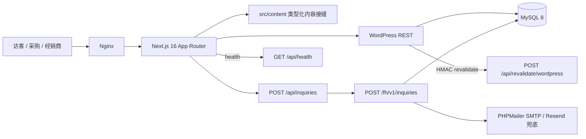

# 当前系统架构快照

## 系统关系

## 技术基线

| 层 | 实现 | 证据 |
|---|---|---|
| 前端 | Next.js `^16.4.0`、React `19.2.4`、TypeScript 5 | `package.json` |
| 路由 | App Router；默认英文无前缀，`/zh`、`/es`、`/th` 由 Proxy rewrite | `src/proxy.ts:37-103`、`src/lib/i18n/types.ts:8-34` |
| 内容 | `src/content/` 业务类型 + `src/lib/wordpress/` 适配器 | `src/content/types.ts`、`src/lib/wordpress/client.ts` |
| CMS | WordPress mu-plugin，自定义 `/fh/v1`、`/fh/v2` 与 `/wp/v2` | `local-wp/mu-plugins/*.php` |
| 数据库 | WordPress MySQL 同库；询盘专用三表 | `local-wp/mu-plugins/fenghuai-inquiries.php:260-330` |
| 邮件 | WordPress PHPMailer SMTP 优先，Resend 兜底 | `fenghuai-inquiries.php:1636,3035-3098` |
| 构建 | `output: "standalone"`；严禁静态导出 | `next.config.ts:90-101`、根 `AGENTS.md` §7.6 |
| CI | GitHub Actions check、依赖审计、E2E job；无 CD | `.github/workflows/verify.yml` |

## 关键数据流

1. 内容读取：页面 → WordPress adapter → `wpRead` → `/wp/v2` 或 `/fh/v1|v2` → 规范化为业务类型 → 组件渲染。
2. 询盘写入：表单 → Next 防滥用/Zod/产品绑定 → WordPress 服务密钥接口 → MySQL 事务（CPT + 幂等键 + outbox）→ 邮件投递。
3. 内容发布：WordPress `post_status`、`fh_publication_status`、schemaVersion 与逐语言批准 → Next 发布资格 → 页面、metadata、sitemap、语言切换器。
4. 缓存同步：WordPress 内容变更 → HMAC webhook → Next 标签与路径失效。

## 当前外部依赖

- WordPress / MySQL 运行环境。
- SMTP 与可选 Resend。
- 正式站点 URL、CMS URL、预览密钥、重验证密钥、询盘服务密钥等环境变量。
- Nginx、TLS、外部 uptime/告警接收通道；当前未形成生产闭环证据。
