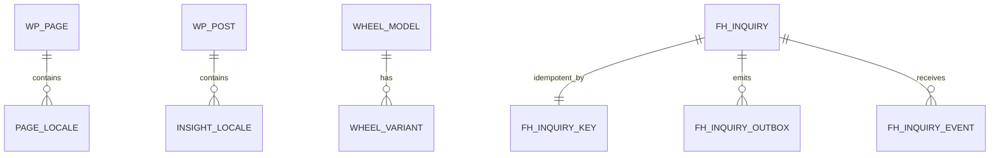

# 数据模型与契约

## 实体关系

## WordPress 内容载体

| 类型 | 用途 | 公开性 |
|---|---|---|
| 原生 `page` | 页面正文、SEO、逐语言内容与批准状态 | 经发布门槛公开 |
| 原生 `post` | Insights 主要编辑载体 | 经发布门槛公开 |
| `wheel_model` CPT | 轮毂型号与规格 | 经人工+机器门槛公开 |
| `fh_guide` CPT | 迁移/回滚源，UI 已关闭 | 兼容读取 |
| `fh_inquiry` CPT | 询盘主实体 | 非公开，后台权限读取 |

wheel taxonomy：`wheel_diameter`、`wheel_process`、`wheel_pcd`、`wheel_width`。ACF 字段组仅确认 `group_fh_insights_structured`；其他关键字段主要由 `register_post_meta` 注册。

## 专用询盘表

| 表 | 作用 | 关键约束 |
|---|---|---|
| `wp_fh_inquiry_key` | 幂等键与询盘关联 | 唯一键防并发重复 |
| `wp_fh_inquiry_outbox` | 事务内写入邮件任务 | 与询盘主记录同事务 |
| `wp_fh_inquiry_event` | 邮件事件去重 | 防重复回调 |

DDL：`local-wp/mu-plugins/fenghuai-inquiries.php:260-330`。

## 内容契约

组件不消费 WordPress 原始结构；`src/lib/wordpress/` 负责读取和规范化，`src/content/types.ts` 及域类型定义稳定业务结构。pages 域已试点 Zod 信封校验，其余 adapter 仍有手写守卫。WordPress 与 TypeScript 的常量契约由 `scripts/verify-contract-parity.mjs` 检查，但并非所有外部响应都具备完整 runtime schema。
