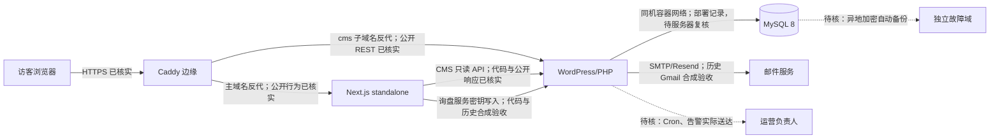
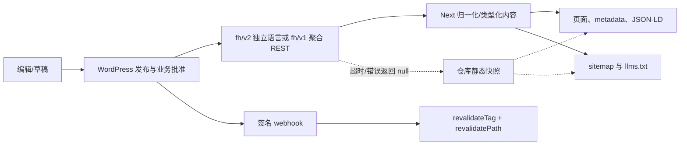
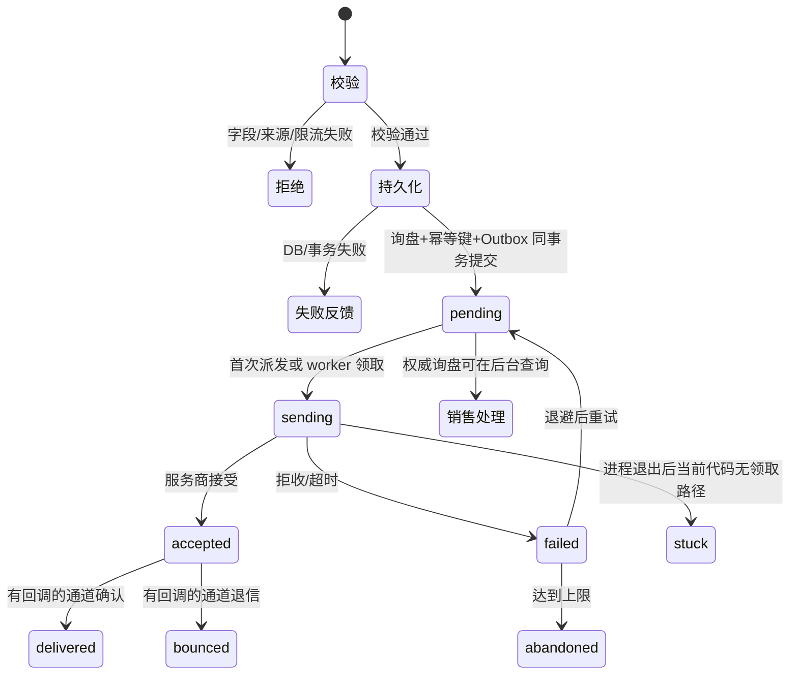
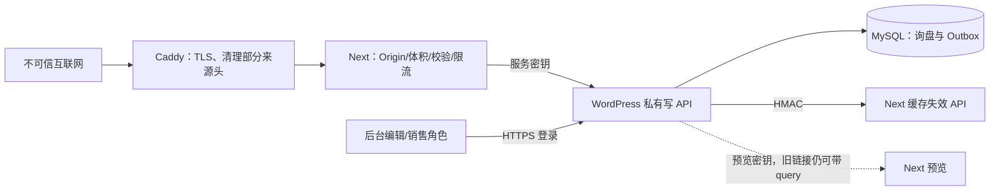

# 实际架构、业务流程与缺口

日期：2026-10-21。图中 **实线**代表源码/公开响应已核实，**虚线或“待核”**代表仅有部署记录或尚未取到生产内部证据。目标态是最小增量，不表示已经实施。证据索引见[`证据台账`](DEEP_DIVE_EVIDENCE_LEDGER.md)。

## 1. 当前系统与环境差异

| 层 | 本地/CI | 生产已知 | 差异与待核 |
|---|---|---|---|
| 源码与镜像 | HEAD `961762e`，工作树有多处未提交/未跟踪；Node `>=24`、`package-lock.json`；CI 设置 Node 24。 | 部署记录称 `stage-20261020-961762efd277-dirty-r2`；公开 `/api/health` 正常。 | `dirty-r2` 不对应可复现提交；当前 diff 已变化，无法还原当时清单。需服务器镜像 digest 与构建证明。 |
| Next 运行时 | `next.config.ts` 用 standalone；本地构建可在 CMS 拒绝连接时完成。 | 部署记录为 Linux/amd64 standalone 容器。 | 线上实际镜像标签、环境变量值只可做脱敏/哈希核对；不能从健康检查推断全部配置正确。 |
| 内容模式 | E2E `WP_MODE=mock` 默认隔离；源码 `WP_MODE=live` 且有 URL 才访问 CMS。 | CMS 公开 v1/v2 只读接口能答；健康检查 `cms=ok`。 | 生产具体镜像内静态快照和实时/缓存内容的来源分布未知。 |
| 边缘与网络 | 仓库 `deploy/edge/conf/Caddyfile` 清理 CF 与 X-Real 头，屏蔽 sitemap。 | 公开 HTTPS/noindex/robots/sitemap 行为与此配置一致。 | 未取得服务器上实际 Caddy 文件、XFF 受信代理设定、监听端口。 |
| WordPress/MySQL | MU 插件有内容 API、询盘表和 WP-Cron；本地部署脚本是旧联调参考。 | 部署记录称 WP/MySQL 同机，历史 DB/媒体隔离恢复成功。 | 实际容器版本、Schema、角色、Cron、插件同步状态未从生产读到。 |
| 监控与备份 | 有 `scripts/backup/`、`scripts/monitor/` 和异常邮件处理器。 | 文档称异地副本、完整监控和回滚尚未完成。 | 脚本存在不证明生产排程；需只读服务器与告警平台证据。 |

**部署追溯目标**：干净 Git 提交 → CI 依赖锁定/检查 → 固定构建变量与产物摘要 → 镜像 digest → 隔离预发布 → 人工批准 → 生产切流 → 健康及合成只读探测 → 回滚。当前链上 `dirty` 镜像、公司仓库访问、预发布/回滚证明是空缺；CI 的 `verify` 和 E2E job 不能替代发布 job。

## 2. CMS 内容状态与缓存

WordPress 的 `fh/v2/pages` 英文首页匿名响应 `ready/publish/approved`，中文为 `unpublished`；匿名预览接口 401。前端[`pages-contract.ts`](../../../src/lib/wordpress/pages-contract.ts)要求公开 Page 同时满足 WordPress `publish` 和业务 `approved`。轮毂公开集合必须经规格、图权和供应审核；源码[`source.ts`](../../../src/lib/wheels/source.ts)将 CMS `null` 回退到仓库集合，CMS 权威空数组保留为空。指南[`insights.ts`](../../../src/lib/wordpress/insights.ts)在响应失败或归一化后零条时回本地英文指南，故**“CMS 明确撤回全部指南”的行为需要单独验证**，不能泛化轮毂的空集合语义。法律页[`legal.ts`](../../../src/lib/wordpress/legal.ts)也可能回本地英文文本。上述回退使 CMS 不可达时本地构建成功，其代价是内容新鲜度与撤回语义难以由构建结果证明。

| 内容状态 | 对英文 Page 的源码判断 | 公开索引/sitemap 判断 | 本轮证据与未决 |
|---|---|---|---|
| 草稿 `draft` | 普通读取拒绝；签名预览另走 draft mode。 | 不应索引或入 sitemap。 | 类型/归一化代码；未登录后台实测草稿。 |
| 待审核 `pending` | `post_status != publish`，普通读取拒绝。 | 不应进入。 | 同上。 |
| 业务已批准但 WP 未发布 | 普通读取仍拒绝。 | 不应进入。 | 代码证据。 |
| WP 已发布但业务未批准 | 普通读取拒绝。 | 不应进入。 | 代码证据；不同内容域需逐个集成测试。 |
| WP 已发布且业务批准 | 可成为 `ready`，还需必要正文/SEO/媒体字段。 | 仅在该路径的语言发布资格集合中才可索引；当前边缘仍全站 noindex。 | 英文首页匿名接口 ready；实际 sitemap 在边缘 404。 |
| 撤回 `withdrawn` | v2 独立语言返回显式撤回；旧 v1 返回 null 后具体消费端可能回本地。 | 目标是不再入任何公开入口。 | 混合 v1/v2 与快照的撤回传播待隔离演练。 |
| 删除/缺失 | 权威缺失与网络不可达在部分读取器上都表现为 null。 | 目标是被删除内容不复活。 | 缺少全域统一“已撤回”与“临时不可达”契约；P1 F-05。 |
| 缺少/未批准译文 | 中文首页 CMS `unpublished`，公网 `/zh` 404。 | 不应有中文 canonical/hreflang/sitemap。 | 本轮只实测中文首页；其他语言/页面未逐一验证。 |

**最小改造**：在每种内容读取结果中明确 `ready / authoritative-empty / withdrawn / temporarily-unavailable / invalid-contract`；为允许快照的域记录版本与最大陈旧期，撤回 tombstone 优先于快照。先补契约及隔离测试，再调整具体读层；无须重建整个 CMS。内容发布回归必须同查页面正文、meta、JSON-LD、站点地图和 `llms.txt`，并验证 webhook 失效顺序及最长 TTL。

## 3. 询盘状态机与异常矩阵

| 场景 | 当前源码/记录 | 本轮判定与所需验证 |
|---|---|---|
| 字段校验失败、无效 Origin、超限 | Next 返回 422/403/429，不保存；空表单移动端显示逐字段错误。 | 代码与 UI 抽测；服务端响应未向生产发测试 POST。 |
| 数据库/事务失败 | WordPress 在事务写键、CPT、meta、Outbox；Next 失败不发 201。 | 代码证据；需隔离 WP/MySQL 验证 `COMMIT`/写入失败和浏览器保留输入。 |
| 同幂等键并发 | DB 唯一键冲突走重放；Next 对真正重放退限流额度。 | 代码证据；需隔离并发重跑，且检查旧客户端缺键的退化行为。 |
| SMTP 拒收/超时 | 写 `failed`、退避；定时 worker 最多五次。 | 代码证据；生产失败恢复、最终收件未知。 |
| 派发时进程退出 | `sending` 不在 worker 领取状态内；初次发送无租约。 | **F-01 条件性缺陷**；必须隔离故障注入。 |
| 服务商已接受，状态回写失败 | 可能重复发信或卡在 `sending`，尤其无 provider ID 的 SMTP。 | 需用授权测试收件箱设计幂等/人工核对流程，不能简单自动重发。 |
| Outbox 积压/告警 | Cron/阈值/邮件接收器已写；健康检查不包含 Outbox。 | 线上运行与送达待核；`sending` 滞留不触发当前 `due/abandoned` 条件。 |
| 销售分配/结果回写 | WP 后台有 `business_status`、`assigned_to`；Next 仅返回共享队列。 | 有字段不代表责任/SLA/成交闭环；需销售流程演练。 |

表单的 [`InquiryContext`](../../../src/lib/inquiry/types.ts) 保留来源页、型号、配置、应用等；所查契约没有 UTM/campaign 字段。客户提交成功后页面回执与 `emailStatus=accepted` 只表示系统/服务商接受，不等于最终送达、人工接收或成交。

## 4. 网络与数据安全信任边界

- 公共面：`/api/health` 只回诊断状态，不应泄露密钥；`GET /api/inquiries` 本轮 404；`POST` 有双层校验与 WordPress 服务密钥；`/api/publication` 是公开资格查询；`/api/revalidate/wordpress` 用 HMAC；预览兼容 query 密钥，需复核实际边缘日志是否去 query。匿名 WordPress `preview=true` 读请求本轮 401。
- 代理面：本地 Caddy 清理 `CF-Connecting-IP`、`X-Real-IP`，而 Next [`guard.ts`](../../../src/lib/inquiry/guard.ts)按这两头再到 XFF 取身份。未见服务器真实配置，不能判定线上可伪造；应把“只有经 Caddy 到达 Next”的假设变成监听端口和隔离伪造测试证据。
- 数据面：WordPress 保存个人联系方式和询盘正文；当前有最小化错误日志设计与默认关闭的留存清理，但法律保留期、备份加密和授权导出范围待批准。没有对生产做 SQL/XSS/CSRF/SSRF 利用测试，也没有读取密钥、客户资料或后台角色清单。

## 5. SEO、GEO 与多语言发布

当前边缘 `X-Robots-Tag: noindex, nofollow`、`robots.txt` 全禁、`sitemap.xml` 404 是**临时展示策略**；首页 HTML 的 `index, follow` 与边缘头不一致，但边缘头当前控制实际响应。正式开放必须把边缘、页面 metadata、CMS 资格和 sitemap 在同一发布窗口核对。`/thank-you` HTML 为 noindex；`llms.txt` 仍列它和测试/待核实内容，不能把 llms.txt 存在当 GEO 效果。产品/企业实体要用经批准的事实与来源，明确“谁签约、谁制造、谁提供检测记录”，不因 JSON-LD 自动成立。索引量、AI 引用量均未取得外部平台证据。

| 语言 | 路由本轮观察 | 正文/SEO/政策/表单 | 判定 |
|---|---|---|---|
| 英文 | 代表页 200，首页 CMS `ready`。 | 部分内容含内部标记和待法务文本。 | 可临时展示，正式索引未通过。 |
| 中文 `/zh` | 404；首页 CMS `unpublished`。 | 未取得批准译文与全链路验收。 | 当前不应公开；不是缺陷。 |
| 其他配置语言 | 本轮未逐一访问。 | 仓库有路由骨架，逐页批准程度未知。 | **待验证**，不能把骨架算成已商业发布。 |

## 6. 体验、性能和外部结构参考

本轮 Chromium/Playwright CLI 在 macOS 上以 390×844、未节流网络单次操作首页、产品、轮毂目录/详情、文章、询价和 `/zh`。移动菜单可打开，空表单“继续”显示字段错误；这些页面在本次加载中没有 JS 页面异常、可见破图或横向滚动。多次跨页导航时 Next 的 `_rsc` 预取请求被取消，不能直接判为故障；另一个**独立的**定向 E2E 确认特定 RSC 请求返回 307，trace 中 `Location` 仍是英文 `/about`，仅 `_rsc` 改变，不能据此称旧语言 cookie 把用户导向泰语。预览退出 POST 与目标页 GET 都返回 200，但浏览器 URL 在 5 秒内未变化。首页单次 `DOMContentLoaded≈1383 ms`、`load≈1384 ms`、资源条目 53；**没有**本轮 LCP/INP/CLS 分布、Lighthouse 或 axe 完整结果。桌面、平板、键盘、不同网络、图片权利/语义、真实提交和失败降级仍待测试。定向 E2E 首次因本机 ENOSPC 中断；空间恢复后同两组 16/18 通过、两项失败，与 10 月 18 日历史 20/22 分开记录。

采购决策路径目标：**认清企业与负责制造主体 → 选产品线 → 核实型号/规格/可供范围及证据 → 提交含来源的询盘 → 收到回执 → 销售分配/澄清 → 报价/结果回写**。当前断点主要在主体/事实证据、私牌交易口径、来源归因和销售过程记录。

| 外部公开结构参考 | 页面可观察做法 | 可借鉴的结构；不可直接继承的内容 |
|---|---|---|
| [Forgiato 经销申请](https://forgiato.com/dealer-application) | 单独的经销商申请入口，问企业类型、营业信息和联系人。 | 先区分经销合作与普通产品询价；不照搬其资质门槛。 |
| [ADV.1 报价请求](https://www.adv1wheels.com/price-request) | 报价页将联系方式、车辆与轮毂参数分组。 | 按产品线收集最低必要技术输入，保持“不知道参数也能询问”；不照搬车型适配承诺。 |
| [BC Forged 订购说明](https://bcforged-na.com/ordering/) | 公开解释从询价、确认细节到订单的步骤。 | 把丰怀已批准的询盘→工程确认→报价下一步说清；其价格、交期、付款和认证仅属于该站。 |

## 7. 最小演进、成本与未重构理由

1. **先补证据与状态机**：F-01 修补 Outbox 滞留；CMS 回退增加显式状态与撤回优先；不改变 Next 与 WordPress 的内容接缝。成本估计见[`实施积压`](IMPLEMENTATION_BACKLOG.md)，没有实际工时单时仅为规划区间。
2. **再补可恢复性**：异地备份/恢复、告警送达、镜像 digest 和回滚。单机 2 核/约 3.6 GiB/60 GB 是部署记录的资源规格，不据此臆测容量瓶颈；应先采集 CPU、内存、磁盘、请求量与 CMS/构建耗时。
3. **最后做增长测量**：在法务同意范围内接 CTA/表单事件与询盘 UTM，再决定分析工具。未见真实账单或人力记录，不给云成本、ROI、扩容收益的数字。
4. **暂不整体重构或拆库**：现有 TypeScript 内容契约、WP 单一写入方和 Next standalone 能支持当前主链路；立即改多服务/新数据库会扩大数据一致性与部署面，缺少经验证的业务收益。若不改 F-01/F-05，风险分别是通知滞留和撤回失效；这两处值得局部改造。
