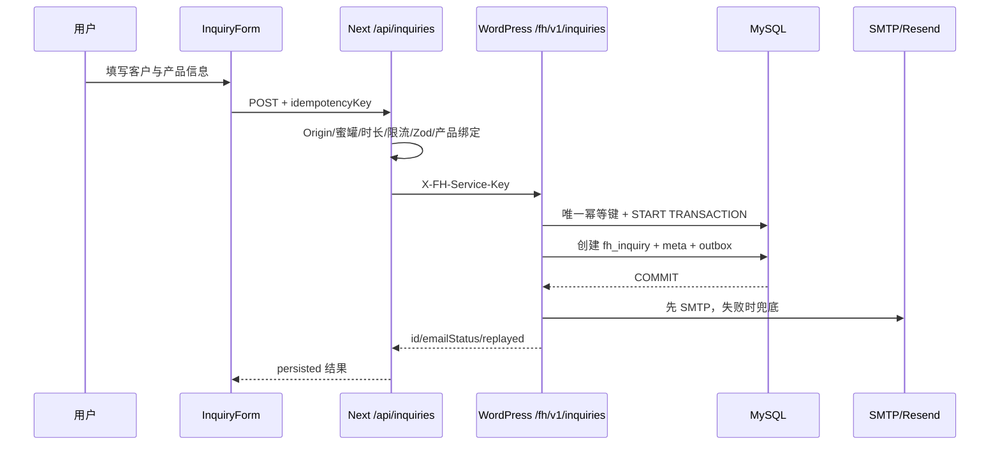

# 功能与业务流程清单

识别到 16 个业务功能域：企业首页与介绍、产品线总览、轮毂目录、轮毂详情、锻造轮毂、旋压轮毂、EV 铝件、定制铝件、自密封轮胎、经销商/私牌、Insights、螺栓孔距指南、兼容重定向、询盘/报价、工具、法律与支持。

## 横切功能

| Feature ID | 功能 | 当前状态 | 关键证据 |
|---|---|---|---|
| FEAT-NAV | 全站导航与语言切换 | 已实现，部分验证 | `site-header.tsx`、`language-switcher.tsx` |
| FEAT-PUBLICATION | 内容/语言发布资格 | 已实现 | `src/lib/i18n/publication.ts:14-126` |
| FEAT-PREVIEW | 草稿预览 | 已实现，E2E 有退出路径失败 | `src/app/api/preview/**` |
| FEAT-CMS-READ | WordPress 内容读取与规范化 | 已实现，部分域有 Zod | `src/lib/wordpress/` |
| FEAT-REVALIDATE | WordPress 主动缓存失效 | 已实现，外部链路待验 | `src/app/api/revalidate/wordpress/route.ts` |
| FEAT-INQUIRY | 询盘提交、事务、幂等与通知 | 已实现，生产链路待验 | `src/app/api/inquiries/route.ts`、`fenghuai-inquiries.php` |
| FEAT-SEO | metadata、robots、sitemap、JSON-LD | 部分实现 | `src/lib/seo/`、`src/app/robots.ts`、`sitemap.ts` |
| FEAT-I18N | 4 语言路由与审批式发布 | 英文主路径可用，其余部分实现 | `src/proxy.ts`、`src/lib/i18n/` |
| FEAT-HEALTH | 健康检查与 uptime 探测 | 已实现；当前本地为 503 | `src/app/api/health/route.ts` |
| FEAT-BACKUP | 备份/恢复脚本 | 脚本存在；真实恢复未验 | `scripts/backup/` |

## 询盘流程

已确认事务与幂等证据：`fenghuai-inquiries.php:1115-1265`。邮件失败不会回滚已经持久化的询盘；生产 CMS 不可用时 Next 返回 503，开发环境内存回退明确返回 `persisted:false`。
