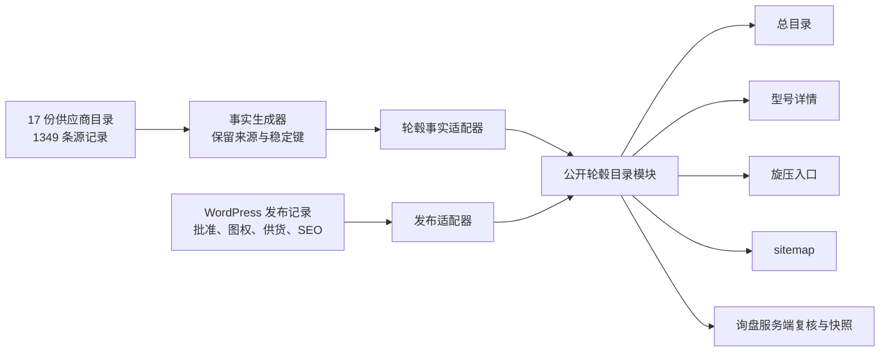

# 轮毂公开目录架构方案（讨论稿）

- 日期：2026-10-06
- 状态：**数据链路部分已落地并写入 DEC-052**（2026-10-06）。已实现：事实层按 model 合并、WordPress CPT `wheel_model`、批准快照、`src/lib/wheels/` 四个对外接口、询盘服务端复核。**目录页与详情页的接线仍未做**，本稿其余部分（W01–W03 / WD01–WD06 渲染细节）继续作为施工依据。
- ⚠️ 一处口径修正：事实层是**按（来源目录, model）分条**的，同一 model 横跨多个尺寸目录且各目录变体互不重叠，所以公开型号必须**取并集合并**（1349 条源记录 → 1219 个唯一型号）。本稿 §3 表格里的「108 组重复型号」正是这一现象，处置口径以合并为准。
- 适用路由：`/products/wheels`、`/products/wheels/[model]`、
  `/products/wheels/flow-formed`、sitemap 与轮毂询盘

## 1. 结论

轮毂页面不能按“先改目录，再单独改详情”的方式施工。正确做法是先建立一个
**公开轮毂目录模块**，让目录、详情、旋压入口、sitemap 和询盘服务端复核全部调用
它的稳定接口。

推荐的数据链路是：



WordPress 管理“哪些型号可以公开、用哪张图、公开名称和 SEO”；供应商事实层管理
“实际有哪些 variant 及其规格”。展示模块永远不直接读取原始 JSON、WordPress
REST 响应或旧 `wheel-skus.ts`。

## 2. 为什么不能直接使用当前 `publishedWheelModels`

当前 `src/content/wheel-catalogue.ts` 的 `publishedWheelModels` 实际只执行：

```ts
allModels.filter((model) => model.hasImage)
```

这只是“有图技术候选”，不符合已经确定的公开门槛：

```text
hasImage
AND publicationStatus = approved
AND imageRightsStatus = approved
AND supplyStatus = confirmed
AND specificationStatus = verified
AND 至少一个 approved variant
```

继续沿用这个名字会让目录、详情和 sitemap 很容易把 1073 个有图候选误当成已批准
产品。建议把它改名为 `imageMatchedWheelModels`，并禁止页面直接导入。

## 3. 新发现的数据身份问题

本轮重新检查 1349 条源记录，发现当前数据不能把 `model` 或
`productionCode` 直接当全局主键：

| 问题 | 数量 | 影响 |
|---|---:|---|
| 重复的大小写归一化型号代码组 | 108 组 | 同一个型号可能分散在不同尺寸目录，也可能存在需要人工判断的冲突 |
| productionCode 重复组 | 77 组 | 询盘只传 productionCode 不能总是唯一定位源记录 |
| 同型号但 styleName 冲突 | 15 组 | 不能自动选择一个对外名称；且部分名称带第三方商标 |
| 同型号但 process 冲突 | 2 组 | 不能自动归入旋压或其他工艺页 |
| 不适合直接作为 URL 的型号 | 5 个 | 包含 `*`、`#`、弯引号或方括号，需要独立公开 slug |
| 同一源文件内重复型号 | 0 组 | `源目录 + model` 可以作为源记录稳定身份的基础 |

108 组重复型号中，90 组的 productionCode 集合彼此不重叠，常见情况是同一设计
跨 15、16、17、18、19 英寸目录出现。它们可能应合并为一个公开型号，也可能只是
代码复用；未经审核不能自动合并。

因此需要区分：

- **源记录**：一份来源目录中的一条型号记录；
- **公开型号**：编辑审核后，由一条或多条源记录组成的网站产品；
- **公开变体**：公开型号中获准显示和询盘的具体 variant。

## 4. 建议的数据契约

### 4.1 事实层

生成器改为读取 17 份组成当前总表的尺寸目录，并为每条记录保留来源：

```ts
type WheelSourceRecord = {
  sourceKey: string;          // 例如 17-inch-3:dx008
  sourceDocument: string;
  modelCode: string;
  process?: WheelProcess;
  variants: WheelSourceVariant[];
  imageCandidates: string[];
};

type WheelSourceVariant = WheelVariant & {
  variantKey: string;         // sourceKey + productionCode
};
```

`sourceKey` 使用“规范化来源目录键 + 规范化型号代码”。实测每一份源目录内部没有
重复型号，因此它比当前只用 `model.toLowerCase()` 更可靠。旧总表继续作为对账输入，
生成器必须验证 17 份目录仍合计 1349 条记录、3485 条变体。

### 4.2 WordPress 发布覆盖层

WordPress 每一个公开候选记录只保存编辑决定，不复制整套工程事实：

```ts
type WheelPublicationRecord = {
  publicSlug: string;
  displayModel: string;
  sourceKeys: string[];
  approvedVariantKeys: string[];
  publicationStatus: "draft" | "approved" | "withdrawn";
  imageRightsStatus: "pending" | "approved" | "rejected";
  supplyStatus: "pending" | "confirmed" | "unavailable";
  specificationStatus: "pending" | "verified" | "rejected";
  approvedProcess?: WheelProcess;
  heroMediaId: number;
  seoTitle?: string;
  seoDescription?: string;
};
```

`publicSlug` 独立于 `modelCode`，解决特殊字符、代码复用和未来改名问题。公开 slug
一旦上线保持稳定；如需改名，用 redirect 记录迁移，不直接改旧 URL。

### 4.3 展示层视图

公开模块只返回对页面安全的字段：

```ts
type PublicWheelModel = {
  slug: string;
  displayModel: string;
  process?: WheelProcess;
  hero: MediaAsset;
  variants: PublicWheelVariant[];
  filterSummary: WheelFilterSummary;
};
```

`styleName`、`vehicleHints`、未批准图片、未批准 variants、原始来源备注和内部审核
状态不直接交给展示模块。第三方款式名默认不进入公开视图。

## 5. 公开轮毂目录模块的接口

建议位置：`src/lib/wheels/public-catalogue.ts`。这是一个深模块，内部可以有事实、
WordPress、筛选、slug、相关型号和缓存实现，对页面只暴露四个入口：

```ts
getWheelCataloguePage(input): Promise<WheelCataloguePageView>
getWheelDetailPage(slug): Promise<WheelDetailPageView | null>
listPublishedWheelSlugs(): Promise<string[]>
resolvePublishedWheelSelection(input): Promise<ResolvedWheelSelection | null>
```

- `getWheelCataloguePage` 同时接受 `scope = all | flow-formed` 和筛选/分页；旋压页
  通过固定 scope 复用同一查询实现。
- `getWheelDetailPage` 返回详情、批准 variants、finish 文本和相关型号，页面不自己
  拼相关产品。
- `listPublishedWheelSlugs` 是 `generateStaticParams` 和 sitemap 的唯一来源。
- `resolvePublishedWheelSelection` 供询盘服务端使用，以 slug + variantKey 重新解析，
  不相信客户端提交的尺寸、PCD、ET、CB 或 finish。

删除这个模块后，上述复杂度会重新散落到五个调用方，因此这条接缝有足够深度。

## 6. 筛选纪律

目录筛选以 variant 为交集单位：

```ts
model.variants.some((variant) =>
  matchesDiameter(variant, diameter) &&
  matchesWidth(variant, width) &&
  matchesPcd(variant, pcd)
)
```

不能分别在 `model.sizes` 与 `model.pcds` 中命中后就认为存在该组合。process 是
经过批准的型号级条件；finish 首发只显示数量或文本，不做 531 个原始值的色板筛选。

目录每页 24 个。筛选 URL 保留给分享和浏览器返回；无效筛选返回正常空状态，未知
型号 slug 返回真实 404。

## 7. 路由职责

| 路由 | 只负责 | 不负责 |
|---|---|---|
| `/products/wheels` | 解析 query、调用目录接口、渲染 W01–W03 | 自行判断上架、读取原始 JSON、拼 variant |
| `/products/wheels/[model]` | 调用详情接口、`null → notFound()`、渲染 WD01–WD06 | 自己找相关型号、相信 URL 规格 |
| `/products/wheels/flow-formed` | 锁定 flow-formed scope、增加 WFF01–WFF03/WFF05 叙事 | 复制第二套目录、从图片推断工艺 |
| `/products/wheels/forged` | 保持能力页 | 冒充型号目录；后续可链接获准 forged 筛选结果 |
| `sitemap.ts` | 消费批准 slug | 导入旧 `wheelSkus` 或全部源记录 |
| `/api/inquiries` | 服务端复核 slug/variantKey 并存快照 | 接受客户端传来的规格作为事实 |

## 8. Next.js 渲染与 WordPress 更新

- 详情页可用 `generateStaticParams` 预渲染首发批准型号，未预渲染但后来由 WordPress
  批准的 slug 仍允许按需渲染；任何不在当前公开集合的 slug 均 `notFound()`。
- WordPress 发布、撤回或改图后触发按 tag 重验证；目录、详情、旋压页和 sitemap
  使用同一 `wheel-publication` 缓存标签。
- 撤回必须让公开集合立即失效。CMS 故障时只允许使用最后一次成功的批准快照，不能
  回退到“所有有图型号”。
- 当前 1349 条事实可继续作为本地构建快照；首期 WordPress 负责从这批事实中选择
  10–20 个型号上架。未来导入新供应商事实时，只替换事实适配器，不改变页面接口。

## 9. 文件改造范围

### 新增

```text
src/lib/wheels/
├── public-catalogue.ts       对外稳定接口
├── publication-policy.ts     公开资格与 fail-closed 校验
├── query.ts                  variant 交集筛选、分页、facets
├── related.ts                相关型号计算
├── slug.ts                   稳定公开 slug 与历史 redirect
└── types.ts                  模块内部类型（若不属于 WordPress 内容契约）

src/lib/wordpress/wheels.ts   发布覆盖层适配器
src/components/wheels/        目录卡、筛选、变体选择、询盘摘要
```

### 修改

```text
scripts/generate-wheel-catalogue.mjs
src/content/types.ts
src/content/wheel-catalogue.ts（生成物）
src/app/products/wheels/page.tsx
src/app/products/wheels/[sku]/page.tsx（目录名可保留，参数语义改为公开 slug）
src/app/products/wheels/flow-formed/page.tsx
src/app/sitemap.ts
src/lib/inquiry/types.ts
src/lib/inquiry/validate.ts
src/lib/inquiry/store.ts
```

### 最后归档

- `src/content/wheel-skus.ts`
- 旧 `WheelSku`、`WheelSketch` 产品页逻辑
- sitemap 中 16 个虚构 SKU

只有新目录、详情、询盘和 sitemap 全部切换并通过验收后，才归档旧实现。

## 10. 施工阶段

1. **数据身份与发布契约**：来源键、variantKey、重复/冲突报告、WordPress 发布字段。
2. **公开目录模块**：资格判断、查询、详情、slug、相关型号和询盘解析。
3. **首发批准集**：业务从候选中确认 10–20 个型号及 variants、图权和供货状态。
4. **W01–W03 目录**：服务端筛选、24 个/页、移动筛选抽屉、真实图片卡。
5. **WD01–WD06 详情**：单张主图、实际 variant 单选、嵌入式询盘。
6. **WFF01–WFF05 旋压入口**：复用目录卡和查询模块，锁定两种工艺值。
7. **询盘与 sitemap**：服务端复核、不可变快照、批准 URL 全量对账。
8. **移除旧路径**：归档 `wheel-skus.ts` 和 SVG 产品页，扫描竞品与虚构 URL。

## 11. 必须验证的失败路径

- 无图、待审、撤回、无批准 variant 的型号不会出现在任何公开表面。
- 重复 model、重复 productionCode、特殊字符型号不会产生路由冲突。
- 同一筛选结果必须存在至少一条同时满足全部条件的 variant。
- 客户修改 query 中的 ET/PCD/productionCode 时，服务端拒绝或按真实记录覆盖。
- flow-formed 只包含批准 process 为 `旋压` / `低压+旋压` 的公开型号。
- sitemap slug 集合与公开模块返回集合完全一致。
- WordPress 故障不会把 1073 个有图候选全部放开。

## 12. 建议决定

建议确认以下三点后再开始代码施工：

1. 接受“源记录”和“公开型号”分层，重复 model 不自动合并。
2. WordPress 只记录发布决定和编辑内容，实际 variant 规格仍来自事实层。
3. 首发先批准 10–20 个公开型号，架构支持以后从同一 1349 条事实中无部署上新；
   新增供应商原始数据的自动导入作为后续适配器工作。

确认后需要先同步 `ARCHITECTURE.md` 与 `DECISIONS.md`，再修改类型和应用代码。
