# UI 页面审计报告

日期：2026-10-08
审计对象：当前工作树的本地生产构建
审计视口：桌面端 1440×900、移动端 390×844
结论：**整体视觉系统已经具备 B2B 品牌站的雏形，桌面端主要展示页完成度较高；但询盘体验、移动端遮挡、产品图片可信度、语言状态和法律/联系信息会直接损害转化与信任，正式上线前必须整改。**

## 0. 自主整改后 UI 复验

首次审计截图与问题描述在后文保留。本轮使用同一 Playwright CLI 会话重新构建并复验，
当前变化如下：

| Issue | 当前状态 | 复验证据 |
|---|---|---|
| UI-001 / UI-010 | 开发侧关闭 | `/request-a-quote` 已为四线/B-C 两步表单；390×844 下 Step 1、Step 2、隐私勾选、返回、失败保留与成功跳转均实测 |
| UI-003 | 技术止血完成，业务信息待提供 | 页头、页脚、联系页不再显示可点击假电话/邮箱/地址；正式信息仍是上线门槛 |
| UI-004 | 索引风险关闭，法务内容待批准 | 五个法律页保留草稿提示但全部 `noindex,nofollow`，且不在 sitemap；批准前仍不建议作为正式政策入口 |
| UI-005 / UI-009 | 关闭 | 移动筛选展开时浮动询盘按钮自动隐藏；筛选面板宽 324px、页面宽 390px，Apply 在顶部可操作 |
| UI-006 | 关闭 | 偏距页 390×844 下 `scrollWidth=390`；公式容器宽 350px，内部 `scrollWidth=425`，滚动被限制在公式块内 |
| UI-007 | 关闭 | 未完成语言切换已移除，根页面固定 `lang=en` |
| UI-002 / UI-008 | 未关闭 | 产品主图质量/首发型号命名和公司级品牌锁定需要业务、内容与管理层决定 |
| UI-011 | 部分关闭 | 未批准洞察与适配页已 `noindex` 并退出 sitemap；内容状态表达与正式批准仍需继续治理 |

整改后询盘移动端：

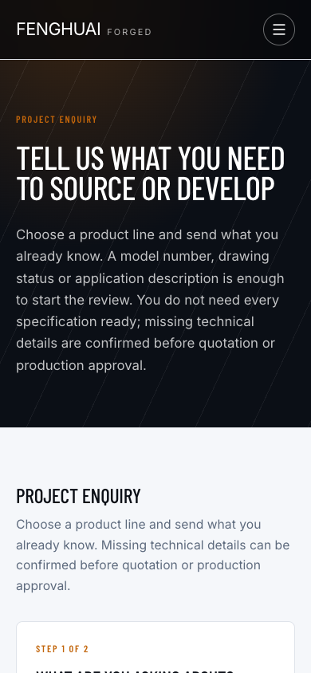

整改后筛选展开状态：

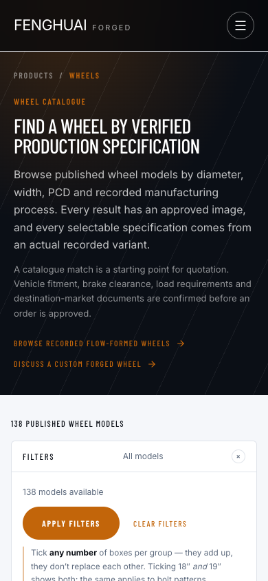

整改后偏距页：

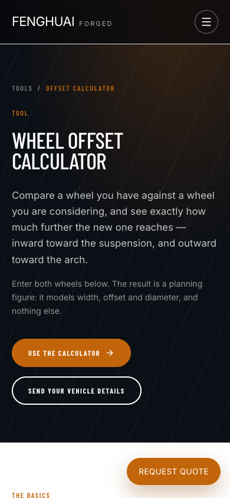

## 1. 审计方法与边界

本轮使用 Playwright CLI 访问本地生产实例，对 22 个核心路由执行页面截图和结构检查，覆盖首页、公司、能力、四条产品线、轮毂目录与详情、询盘、联系、经销商、适配、洞察、工具和法律页面。

自动检查包括：

- 页面是否只有一个 H1；
- 图片是否缺少 `alt`；
- 表单输入是否缺少可访问名称；
- 390 px 视口是否出现横向溢出；
- 页面控制台是否出现错误；
- 关键交互状态是否遮挡正文或操作区。

结果：抽查页均有一个 H1，未发现缺失 `alt` 或无名称输入控件；首页控制台无错误；22 个核心路由中 21 个在移动端没有横向溢出。此结果不等于完整的 WCAG 2.2 AA、真实设备、弱网或 Core Web Vitals 验收。

## 2. 总体评价

### 2.1 值得保留的部分

1. 黑、白、暖橙的令牌体系统一，工业制造气质明确。
2. 大字号标题、留白、网格和产品线卡片在桌面端已形成一致的视觉语言。
3. 首页在桌面和移动端都能保持清楚的信息层级，首屏主张和行动入口可见。
4. 目录页基础布局、筛选入口、卡片密度和分页结构已经可用。
5. 页面基础语义和图片替代文本比一般原型完整，适合作为后续无障碍整改的底座。

首页桌面基线：

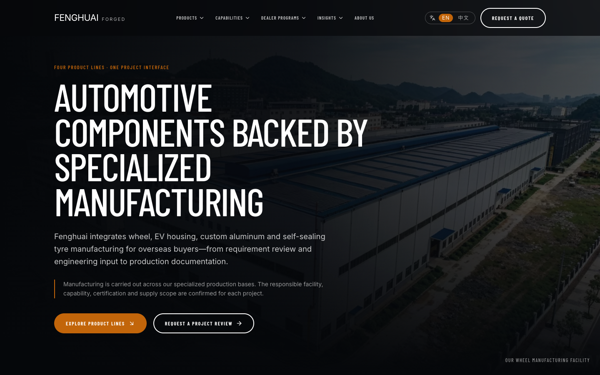

首页移动基线：

### 2.2 不能把“视觉完成”当成“商用完成”

页面看起来已经接近成品，但当前最危险的 UI 问题都发生在客户作决定的节点：查看产品真图、确认企业身份、理解政策、填写询盘、切换语言。这些位置的错误会直接降低信任或导致客户无法提交，不是上线后再优化的装饰问题。

## 3. UI Issue 清单

优先级：P0＝正式上线前必须关闭；P1＝预发布验收前关闭；P2＝上线后持续优化。

| Issue | 优先级 | 页面/组件 | 问题与影响 | 完成判据 |
|---|---:|---|---|---|
| UI-001 | P0 | `/request-quote` | 页面宣称“三个字段、一分钟”，实际有八个必填项；表单强制公司、车型和轮毂系列，只适合轮毂企业客户，个人客户和其他三条产品线无法正确表达需求 | 改为两步四线表单；第一步仅保留客户类型、产品线和联系方式；个人客户不强制公司；文案与实际必填项一致；手机与桌面完成率测试通过 |
| UI-002 | P0 | 轮毂详情与目录 | 首个公开型号名称显示为“12”，其详情主图浏览器解码源尺寸约 131×98，却被放大为大幅主视觉；目录图片还存在背景、裁切和来源风格不一致 | 首发型号使用可识别的商业名称；主图达到统一最低尺寸、背景、角度和裁切标准；100% 人工抽检通过 |
| UI-003 | P0 | `/contact`、页头、页脚 | 假电话、假邮箱和泛化地址以真实联系渠道样式出现，客户无法联系且会质疑企业真实性 | 正式信息书面确认并完成真实拨打/收发测试；未确认前不得显示可点击假渠道 |
| UI-004 | P0 | 五个法律页 | 页面公开显示“Pending legal review”“These terms are provisional”及假设性条款，同时仍可被搜索引擎索引 | 法务批准正式版本；批准前关闭公开入口或设置 `noindex`，且不进入 sitemap |
| UI-005 | P1 | 移动端轮毂筛选 | 筛选面板打开后，固定的“Request quote”按钮覆盖面板说明和底部操作区域，形成两个竞争性行动入口 | 打开筛选抽屉时隐藏/收起全局固定行动按钮；所有筛选项和应用按钮均能完整滚动到并点击 |
| UI-006 | P1 | `/tools/offset-calculator` | 390 px 视口横向溢出约 81 px；公式块和结果区右边界约到 471 px，用户必须横向拖动 | 320–430 px 宽度下页面 `scrollWidth` 不大于 `clientWidth`；公式可换行或在自身容器内滚动，不推动整页 |
| UI-007 | P1 | 中文切换 | 切换中文后 `html lang` 变为 `zh`，导航和按钮变中文，但 H1 与主体仍为英文；对用户和辅助技术都构成错误语言承诺 | 完整中文内容放到独立语言路由后再开放；在此之前隐藏语言切换并保持 `lang=en` |
| UI-008 | P1 | 全站页头/页脚 | 页头品牌锁定为“FENGHUAI FORGED”，与现在四条产品线的公司级定位冲突，容易让轮胎、壳体和定制铝件显得是附属或误入 | 管理层确认公司级英文品牌锁定；页头、页脚、站点标题、邮件和社媒统一 |
| UI-009 | P1 | 多个移动页 | 全局底部固定询盘条在长页面上持续占用可视高度，部分场景遮挡卡片文字、筛选操作和表单尾部 | 对抽屉、键盘、表单提交区和页面底部建立避让规则；移动端关键操作无覆盖，正文有足够底部安全区 |
| UI-010 | P1 | 询盘移动页 | 长表单在首屏后形成较长的单列输入流，必填原因、进度、保存状态和隐私同意都不清楚，放弃成本高 | 两步结构有明确进度与返回；错误就地提示；提交时保留数据并防重复；隐私链接与勾选在按钮前可见 |
| UI-011 | P2 | 洞察、适配与工具页 | 实用内容与工具方向正确，但占位文章、未验证适配和工具说明混在同一视觉可信度层级，用户难以区分“指南”与“工程确认” | 为内容增加“指南/已验证/待工程确认”状态；未验证数值不使用与已验证规格相同的组件样式 |

## 4. 关键证据与页面说明

### 4.1 产品目录：结构可用，商品图片不稳定

桌面端目录层级清楚，筛选与产品卡片关系明确：

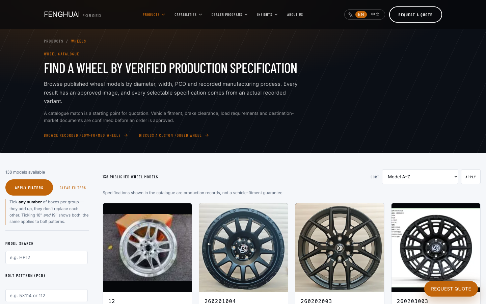

移动端卡片宽度与内容顺序基本合理：

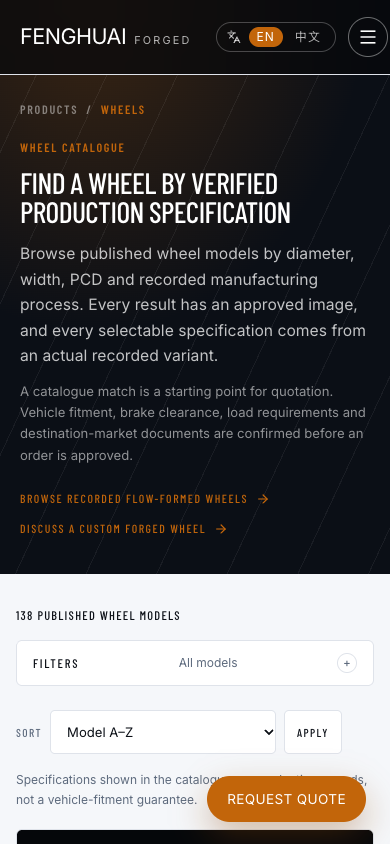

但详情首屏把低清小图放大，同时型号“12”缺乏可销售的命名上下文。对批发商而言，图片质量就是质量控制能力的替代信号，此处会抵消页面其他部分的专业感。

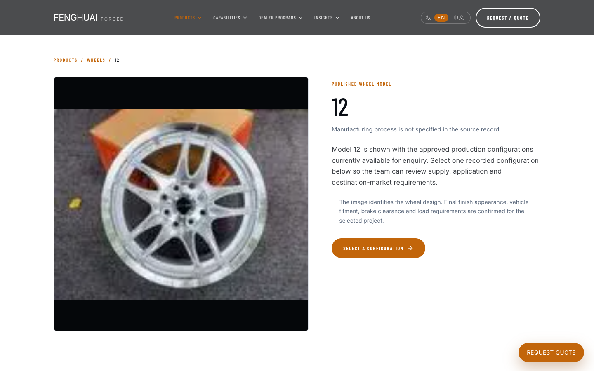

### 4.2 筛选：移动端固定行动按钮遮挡操作区

筛选抽屉是局部任务，用户此时应只看到筛选与应用操作。全局固定询盘按钮仍覆盖在抽屉上方，造成视觉冲突和误触风险。

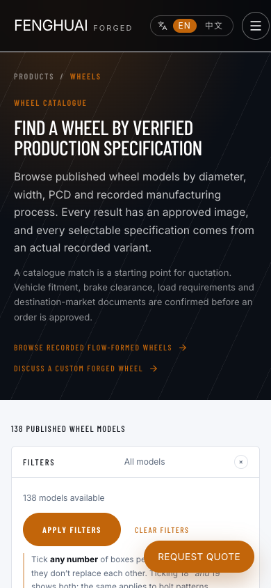

### 4.3 询盘：承诺与实际成本不一致

桌面端表单的视觉排版整洁，但字段模型仍是轮毂企业客户模型；标题承诺与实际必填数量不一致。

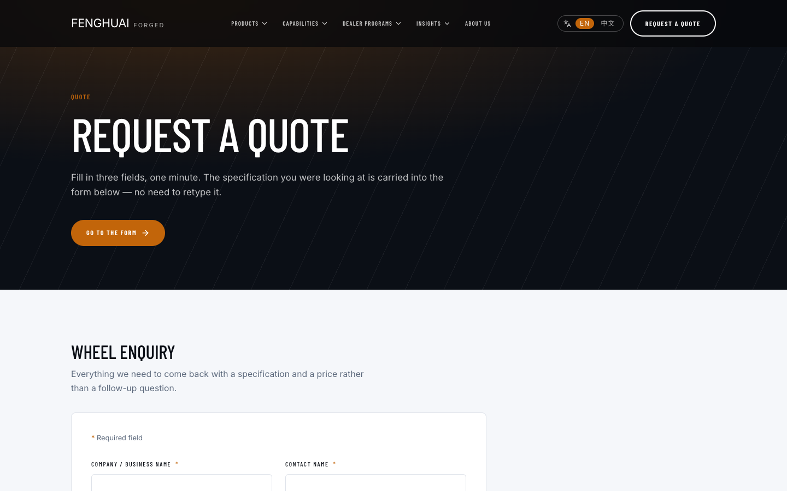

移动端单列以后长度更明显，且没有步骤、客户类型和产品线分流。

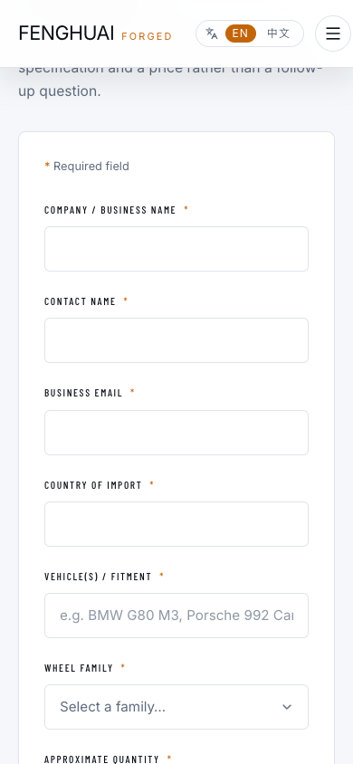

### 4.4 工具页：唯一明确横向溢出

偏距计算器的公式块将整页撑宽约 81 px。应优先修组件宽度和公式排版，不应通过全局 `overflow-x: hidden` 掩盖内容截断。

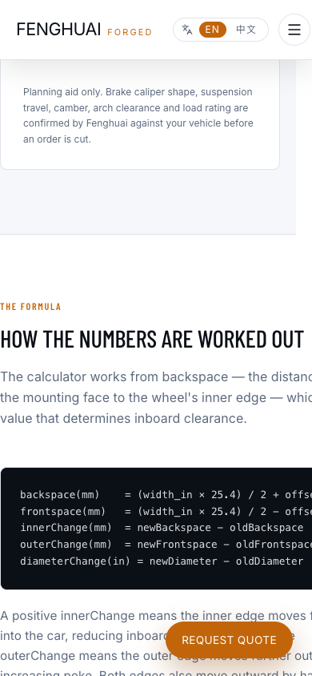

### 4.5 语言状态：只翻译框架，没有翻译内容

下面页面已经声明为中文，但主体标题仍为英文。正式上线时应采用完整语言版本，而不是混合语言界面。

### 4.6 信任页：假联系信息和法律草稿不能公开

联系页的版式已经像正式渠道，因此占位值更容易被误认为真实信息：

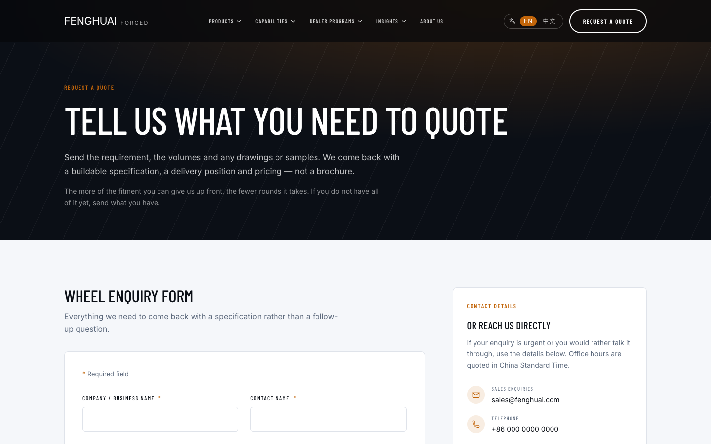

法律页把内部草稿状态直接暴露给客户和搜索引擎：

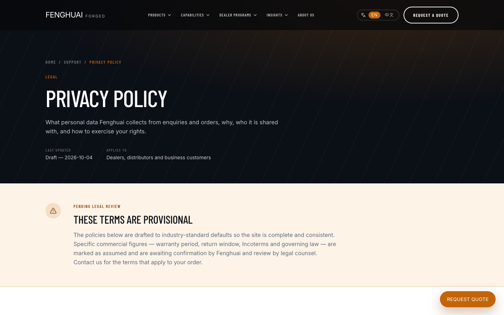

## 5. 页面级结论

| 页面组 | 视觉/响应式 | 内容/转化 | 上线判断 |
|---|---|---|---|
| 首页、公司页 | 桌面与移动层级稳定 | 品牌锁定和中文状态需统一 | 整改后可上线 |
| 能力与四条产品线 | 组件语言一致，图文节奏较好 | 证据、业务边界和未确认主张仍需签字 | 条件放行 |
| 轮毂目录 | 布局与筛选基础可用 | 首发集合、图质和移动筛选遮挡阻断 | 不放行 |
| 轮毂详情 | 信息架构基本完整 | 低清主图、型号命名和规格批准阻断 | 不放行 |
| 询盘 | 视觉整洁 | 字段模型、隐私、幂等与防滥用阻断 | 不放行 |
| 联系/经销商 | 页面结构可用 | 真实渠道、负责人和经销政策未确认 | 不放行 |
| 洞察/适配/工具 | 内容框架可用 | 占位、未验证状态与移动溢出需修 | 不放行 |
| 法律页 | 模板可读 | 法律草稿和假设条款公开 | 不放行 |

## 6. UI 整改顺序

### 第一批：先消除信任损害

1. 隐藏或替换假联系信息。
2. 法律草稿关闭索引与公开导航入口。
3. 首发产品剔除低清主图和不可销售命名。
4. 不完整中文切换暂时下线。

### 第二批：修复转化主链路

1. 重做两步四线/B-C 询盘。
2. 修移动筛选与固定行动按钮冲突。
3. 修偏距计算器横向溢出。
4. 在真实手机上完成填写、键盘、返回、报错、重试和成功页验收。

### 第三批：统一品牌和可访问性

1. 确认公司级品牌锁定和四线导航命名。
2. 对首发集合做完整键盘、焦点、对比度、缩放和屏幕阅读器测试。
3. 预发布环境运行 Lighthouse 与真实设备弱网测试，记录基线而不是只看单次分数。

## 7. UI 放行门槛

- [ ] 320、360、390、430、768、1024、1440 px 下无整页横向溢出。
- [ ] 所有抽屉、弹窗、固定按钮与软键盘场景无关键操作遮挡。
- [ ] 首发商品图片、名称、规格和供货状态全部人工签字。
- [ ] B/C 客户及四条产品线都能在两步内进入正确询盘路径。
- [ ] 页面显示的电话、邮箱、地址、政策和语言都是真实且完整的。
- [ ] 键盘焦点、错误提示、表单标签、颜色对比和 200% 缩放通过验收。
- [ ] 至少两台 iOS、两台 Android 真机完成主要路径测试。

## 8. 2026-10-09 UI 复验补充

- Insights 列表已改为图像主导、编号档案式的信息架构；
- 页头/页脚已重做为公司级品牌锁定：透明首屏导航、滚动实体状态、下划线激活态、
  方形 FH 字标、深色大字号页脚、编号导航与双语切换；未复制参考站资产或品牌；
- 悬浮询盘按钮在目录筛选打开或页脚进入视口时自动退场，不再遮挡页脚链接；
- 代表页 axe/WCAG A/AA、键盘焦点、首错聚焦、等效 200% 缩放通过；
- 桌面/移动截图位于 `resources/screenshots/2026-10-09-header-footer-redesign/` 与
  `resources/screenshots/2026-10-09-insights-redesign/`。

仍需预发布真机和屏幕阅读器 UAT；中文页面正文尚未逐页完成，当前中文 URL 不索引。
