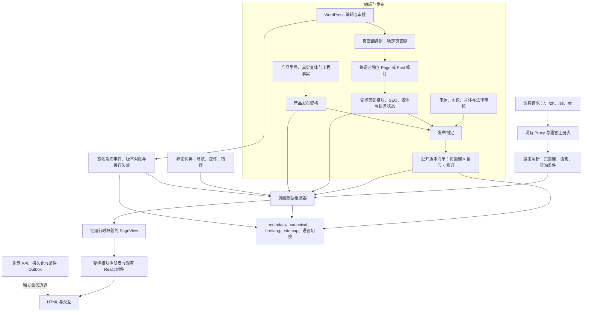

# 全站多语言模块架构重规划（待评审）

日期：2026-10-16。性质：目标架构提案；首页试点已采纳并完成本地技术验收，[全站迁移评审](2026-10-16-homepage-pilot-and-sitewide-review.md)建议分批推进。此报告保留提出时的目标，不充当当前代码状态正本。本提案只处理现有峰徊站的四条产品线、轮毂目录、公司与能力页、内容、工具、政策和询盘，不扩展商城或另建后台。当前事实仍以 `ARCHITECTURE.md`、`STATUS.md` 和现行页面规格为准；本轮执行边界见[首页架构决定](../../docs/adr/2026-10-16-homepage-locale-modules.md)。

## 一、问题与目标

当前站点已有四语 URL、`src/proxy.ts`、界面词典、WordPress Page/Post 和轮毂接缝。问题集中在四处：

1. 页面模块的存在与顺序仍由路由 JSX 固定。例如[首页](../../src/app/page.tsx)固定渲染五个模块，[产品总览页](../../src/app/products/page.tsx)还保留旧的后续区块；运营不能独立调整模块。
2. [WordPress Page 编辑入口](../../local-wp/mu-plugins/fenghuai-pages.php)把英文内容与三种译文放在整块 JSON 字段中，编辑、修订、逐语言审核和模块级预览难以操作。
3. [`resolveLocalized()`](../../src/lib/i18n/localized-page.ts) 在译文缺失时回退英文；目前四种语言都被视为可索引，[页面地图](../../src/app/sitemap.ts)与语言切换没有共用逐页逐语言的发布结果。
4. 产品事实、营销主张、界面词条、法律文本和询盘状态的风险不同，不能交给同一种自由编辑块决定公开资格。

目标是让每个可见模块都明确回答：**数据正本在哪里、如何按语言取得、谁批准、缺失时如何呈现、哪些 URL 可以公开与索引**。React 组件保留渲染职责，WordPress 管理可编辑内容，产品与询盘业务规则继续由各自的稳定接缝负责。

## 二、目标架构图



`PageView` 是所缺的 bridge：输入为页面键和语言，输出为已核准、已归一化的页面模块与 SEO 数据，或明确的“未发布／缺译／撤回／暂时不可用”结果。组件不读取 WordPress 原始字段，路由也不自行猜测语言内容是否完整。

## 三、内容与模块契约

| 层 | 正本与目标职责 | 边界 |
|---|---|---|
| 路由和语言 | 保留现有英文根路径及 `/zh`、`/es`、`/th`；URL 决定公开语言，Cookie 只记偏好 | 本轮无须先把 38 个页面模板整体搬入 `[locale]` 目录；切换国际化库也不能代替内容接缝 |
| 页面身份 | 稳定 `pageKey`、页面类型、可用模块类型、必需模块 ID 和关联对象 | 四种语言是同一页面的独立修订，不是四套互不关联的产品事实 |
| 营销模块 | 判别式模块类型、稳定 `moduleId`、顺序、可见性、语言文案、CTA、媒体引用 | 编辑器只允许已注册模块和字段；必需披露、证据说明和转化入口受模板约束 |
| 界面词条 | `src/lib/i18n` 的导航、筛选、按钮、表单字段、错误与无障碍名称 | 长正文、SEO 描述和法律条款不塞进通用词典 |
| 产品事实 | 现有轮毂型号／变体和公开资格；四线能力引用经过审核的事实与媒体 | 模块只能引用已公开的型号或能力，不能手写尺寸、适配或供货结论 |
| 内容与政策 | Insights 用原生 Post；政策用受审的独立文档版本；每语言有审批结果 | 法律、工程和图权审批不能由翻译完成状态替代 |
| 询盘与工具 | 表单、计算、验证和持久化逻辑保留专用模块；可见说明按语言提供 | 营销编辑不能改计算公式、服务端错误码、产品快照或客户资料权限 |

建议的最小页面视图合同：

```ts
type PageResult =
  | { status: "ready"; page: PageView }
  | { status: "unpublished" | "missing-locale" | "withdrawn" | "temporarily-unavailable" };

type PageView = {
  pageKey: string;
  locale: "en" | "zh" | "es" | "th";
  revision: string;
  seo: { title: string; description: string; canonicalPath: string };
  modules: MarketingModuleView[];
};

type MarketingModuleView =
  | HeroModule
  | ProductLineGridModule
  | EvidenceModule
  | ProcessModule
  | FaqModule
  | CallToActionModule;
```

上述类型是边界示意，不是立即新增六个通用大组件。实施时先将首页现有模块逐个映射到类型；其他页面有真实复用需求才扩充注册表。每个模块通过稳定 ID 对齐译文；允许某语言调整可选模块顺序或隐藏可选模块，必需模块和安全披露不能由编辑器隐藏。

## 四、WordPress 与发布模型的结构性变更

目标以**同一页面键下的独立语言 Page/Post 记录**承载正文、模块树、SEO、媒体说明、原生修订与审批。现有一个 Page 内的 `content_by_locale`／`seo_by_locale`／`locale_status` JSON 保留为迁移来源和兼容读取，逐页迁完再退出运营录入；不得一次性删除。WordPress 管理界面提供受控模块字段或受控 Gutenberg 块，并通过既有站点 MU 插件输出白名单 REST 契约。现有 ACF 免费版不提供 Repeater，不能把“运营可视化编辑”建立在未安装的字段能力上。

公开版本清单由内容适配层统一计算，至少包含页面键、语言、修订、有效状态、模块与媒体审核结果、SEO 完整性、关联事实版本。**页面渲染、metadata、sitemap、hreflang、语言切换与缓存标签都读取同一判定**。缺少已批准译文时返回该语言的不可用结果；公开页不静默混入英文正文。WordPress 临时故障可读取仍有公开资格的最后有效版本；明确撤回、图权失效或安全性失效必须压过旧快照。

发布流程：编辑保存 → 类型与引用校验 → 语言／事实／媒体审批 → 生成版本 → 签名事件 → 定向失效 → 匿名请求核对页面和 SEO → 记录生效结果。事件须携带页面键、语言和修订；旧事件不可恢复已撤回内容。预发布继续保持 `noindex`。

## 五、现有页面族如何落地

| 页面族 | 模块策略 | 主要改造点 |
|---|---|---|
| 首页、产品总览、公司与能力、四条产品线、定制开发、经销、表面处理 | 受控营销模块列表；沿用现有组件 | JSX 固定编排改为 `PageView.modules`，正文和 SEO 按语言独立修订；清理旧轮毂单线模块和占位承诺 |
| 轮毂目录、旋压目录、锻造说明、型号详情 | 固定领域骨架＋受控营销槽位 | 目录和规格仍取同一批准型号集合；本地化标题、解释、空状态、CTA、媒体说明；型号事实不复制四份 |
| Fitment、孔距、工具 | 固定事实／计算模块＋本地化说明 | 未核验数据保持显式状态；计算不从 CMS 文案取公式；逐语言审核说明与 SEO |
| Insights 与技术文章 | 原生 Post 按翻译组关联，共用文章渲染器 | 正文、媒体、SEO、内链和批准状态按语言分开；缺译无英文公开回退 |
| 政策与隐私 | 专用文档视图和语言版本 | 法律责任人、适用主体、版本与生效日期独立核验；临时模板不能因页面存在自动成为正式政策 |
| 联系、询盘、感谢页 | 固定业务流程＋本地化内容和界面状态 | UI 字典覆盖字段／错误／回执；服务端错误代码稳定；WordPress 不控制是否持久化成功 |
| 别名与旧路径 | 保留现有重定向映射 | 不建立第二份页面内容与第二套语言审批 |

## 六、需要动的骨头与迁移顺序

1. **发布合同先统一。** 建立页面键 × 语言 × 内容／媒体／事实／法律／SEO 的覆盖账本；明确原有“所有语言可索引”指示与逐语言内容审批之间的差距。先让页面、sitemap 和 `hreflang` 共用同一公开资格，避免迁移期间继续制造英文回退的语言页。
2. **扩展内容接缝。** 在 `src/content/types.ts`、WordPress Page 契约和适配器中增加版本化 `PageResult`／模块联合类型与运行时校验；旧 Page JSON 与新记录双读、对照，不先改全部页面。
3. **首页试点。** 将现有五个首页组件接入模块注册表；完成四语言独立编辑、预览、审批、撤回、模块顺序、媒体与 SEO 验收。保持英文 URL 和当前视觉基线。
4. **迁营销页。** 依次迁产品总览、四条产品线、About／Capabilities、定制开发与经销页；每页清掉旧硬编码及重复内容正本。未通过事实审核的模块保持草稿或不展示。
5. **迁领域与转化页。** 轮毂／Fitment／工具只迁展示文案和可控营销槽；文章、政策、表单各走专用合同；完成 API 错误语言映射。
6. **收口运营与发布。** 编辑界面、版本事件、失败重试、缓存对账、四语 SEO 和浏览器验收都通过后，再将旧 `content_by_locale` 降为只读迁移资料。OpenNext 样机与询盘生产验证按现有任务单独推进。

每一步都能退回旧读取器与现有英文页面；迁移时保留稳定页面键、URL、型号 ID 和询盘 API。回滚不得把已撤回的敏感内容从旧快照重新公开。

## 七、首个可验收切片

以首页为试点，验收信号为：编辑人员可在 WordPress 中修改一个模块、调换 H02–H04 中两个可移动模块的顺序、撤回一种语言，无需改代码或重新部署；H01–H05 全部必需且不可隐藏；四语言版本各有本语言正文、图片说明和 SEO，未经审校的版本保持草稿；缺译语言明确不可公开索引；`sitemap`、`hreflang`、语言切换与匿名页面一致；产品事实及询盘链路不受影响。试点通过后再批准全站迁移，不以安装 `next-intl` 或创建 `[locale]` 目录作为完成标准。

## 相关现状与已有规划

- 当前系统边界：[架构总纲](../../ARCHITECTURE.md)；当前优先级：[项目状态](../../STATUS.md)。
- 页面规格：[页面索引](../../PAGE-SPECS/index.md)；四语实施：[现行任务](../../work/active/2026-10-12-full-site-four-language-implementation.md)。
- 原有规划：[商业化增量规划](commercial-rebuild-technology-plan-2026-10-14.md)。该规划建议沿用现有 JSON 译文字段；本提案因“所有模块可按语言运营编辑”的新目标，提出逐语言独立修订与模块发布合同。采纳时需同步修订原规划中的对应工作包，不保留两个并行目标。
