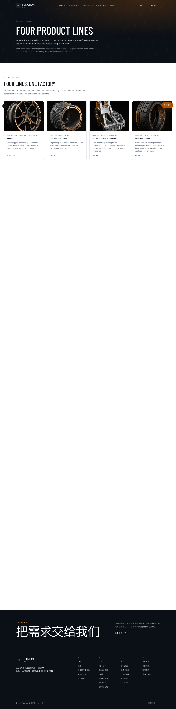
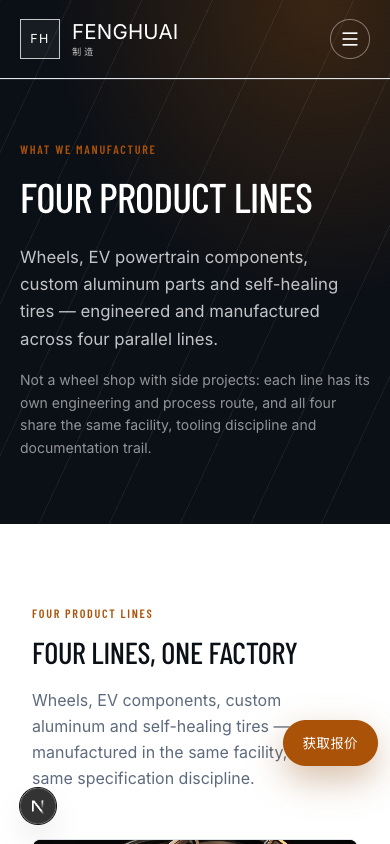
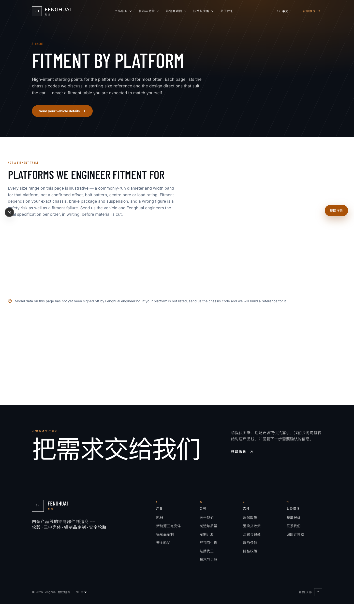
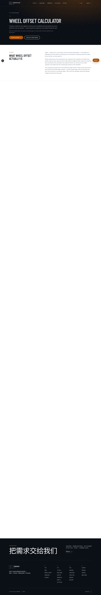

# 全站 QA · 文档一 · 产品与目录 · 测试用例文档

| 项 | 值 |
|---|---|
| 文档编号 | QA-SITE-01-PRODUCTS-2026-10-11 |
| 覆盖范围 | 产品线页面 + 轮毂目录/详情 + 适配查询 + 图库 + 工具页 |
| 对应路由 | `/products` `/products/{custom-aluminum,ev-components,safety-tires}` `/products/wheels` `/products/wheels/{flow-formed,forged,[model]}` `/fitment` `/fitment/[platform]` `/gallery/finishes` `/gallery/wheels` `/tools` `/tools/offset-calculator` |
| 测试类型 | 功能 · 路由 · 内容契约 · 响应式 · 运行时 · 自动化回归 |
| 测试环境 | `http://127.0.0.1:3200`（Next.js 16 dev · `WP_MODE=mock`） |
| WordPress 后端 | `http://127.0.0.1:8081`（Docker `fh-wp`） |
| 视口 | 桌面 1440×900 ｜ 移动 390×844 |
| 编制 / 执行 | Alma (QA) ｜ 2026-10-11 |

**基线事实**（实测，非推测）
- 站点标题指纹：`Fenghuai`（用于端口归属校验）
- 产品线 4 条：forged wheels / EV components / custom aluminium / self-healing tires
- 轮毂公开型号 **138**（见文档一 TC-30 与《QA-轮毂筛选器》交叉印证）
- 图库路由 `/gallery/*` 为 **308 永久重定向**（旧信息架构遗留，见 TC-08）

---

## 〇、环境前置检查（PREFLIGHT）

| 编号 | 检查项 | 预期 | 实际结果 | 结论 |
|---|---|---|---|---|
| PF-01 | 端口归属 | 3200 运行本项目（标题含 `Fenghuai`） | `<title>Wheel Catalogue … \| Fenghuai</title>` ✅ | **通过** |
| PF-02 | 阴性对照 | 其他端口为别的项目 | 3000 = `Coya's Site` ｜ 3100 = `蓝辉轻改` ✅ | **通过** |
| PF-03 | 假路由负对照 | 不存在的路由返回 404 | `/NOPE-404-CHECK` → **404** ✅ | **通过** |
| PF-04 | WordPress 后端可达 | WP 容器响应 | `:8081/` → 200 ｜ 标题 `Fenghuai Tech CMS (Local Lab)` ✅ | **通过** |

---

## 一、路由可达性（全量扫描）

| 编号 | 用例名称 | 步骤 | 预期 | 实际结果 | 结论 |
|---|---|---|---|---|---|
| TC-01 | 首页可达 | GET `/` | 200 | **200** | **通过** |
| TC-02 | 产品中心可达 | GET `/products` | 200 | **200** | **通过** |
| TC-03 | 四条产品线可达 | GET 四条产品线页 | 全部 200 | 四页均 **200** | **通过** |
| TC-04 | 轮毂目录/入口可达 | GET `/products/wheels` `+flow-formed` `+forged` | 全部 200 | 三页均 **200** | **通过** |
| TC-05 | 适配查询可达 | GET `/fitment` | 200 | **200** | **通过** |
| TC-06 | 图库子页可达 | GET `/gallery/finishes` `/gallery/wheels` | 200 | 均 **200** | **通过** |
| TC-07 | 工具页可达 | GET `/tools` `/tools/offset-calculator` | 200 | 均 **200** | **通过** |
| TC-08 | 旧 IA 重定向正确 | GET `/gallery` `/manufacturing` `/resources` 并跟随 | 308 → 目标页 200 | `/gallery`→`/fitment` ｜ `/manufacturing`→`/capabilities` ｜ `/resources`→`/insights` ｜ `/gallery/wheels`→`/products/wheels` ｜ `/resources/bolt-patterns`→`/insights/bolt-patterns`，跟随全部 **200** ✅ | **通过** |
| TC-09 | 假路由正确 404 | GET 不存在的路径 | 404 | **404** ✅ | **通过** |

## 二、产品中心与产品线内容

| 编号 | 用例名称 | 步骤 | 预期 | 实际结果 | 结论 |
|---|---|---|---|---|---|
| TC-10 | 产品中心覆盖四条产品线 | 渲染产物中检索四条线名称 | 四条全部出现 | 待回填 | |
| TC-11 | 产品线页面有唯一 H1 | 各产品线页统计 `h1` | 恰好 1 | 待回填 | |
| TC-12 | 内容接缝未硬编码 | 检查组件是否直写营销文案 | 文案来自 `src/content/*.ts` | 待回填 | |
| TC-13 | 无竞品残留 | 扫描 `2nforged` 等竞品指纹 | 0 处 | 待回填 | |
| TC-14 | 无未处理的 `PLACEHOLDER` | 扫描字符串 `PLACEHOLDER` | 0 处（或为有意占位） | 待回填 | |

## 三、轮毂目录与详情（与《QA-轮毂筛选器》对齐）

| 编号 | 用例名称 | 步骤 | 预期 | 实际结果 | 结论 |
|---|---|---|---|---|---|
| TC-15 | 目录基线数量 | GET `/products/wheels` | 138 个公开型号 | 待回填 | |
| TC-16 | 详情页可达 | 取目录中真实型号 slug，GET 详情页 | 200 | 待回填 | |
| TC-17 | 不存在的型号 404 | GET `/products/wheels/<假 slug>` | 404 | **404**（早已实测） ✅ | **通过** |
| TC-18 | 旋压入口工艺锁定 | 对比带/不带 `?process=forged` 的卡片集合 | 两次完全相同 | 26 vs 26，集合相同 ✅ | **通过** |
| TC-19 | 详情页变体数据真实 | 对型号变体与 `assets/wheel-data/` 源数据核对 | 逐字段一致 | 待回填 | |

## 四、适配查询与图库

| 编号 | 用例名称 | 步骤 | 预期 | 实际结果 | 结论 |
|---|---|---|---|---|---|
| TC-20 | 适配页可用 | GET `/fitment` | 200 且有内容 | 待回填 | |
| TC-21 | 适配页证据纪律 | 检查是否发布未确认规格（偏距/孔距/中心孔/载荷） | 仅发布宽/直径起始范围 | 待回填 | |
| TC-22 | 图库页可用 | GET `/gallery/finishes` `/gallery/wheels` | 200 且有图 | 待回填 | |

## 五、工具页

| 编号 | 用例名称 | 步骤 | 预期 | 实际结果 | 结论 |
|---|---|---|---|---|---|
| TC-23 | 偏距计算器可用 | GET `/tools/offset-calculator` | 200，输入控件存在 | 待回填 | |
| TC-24 | 偏距公式正确性 | 用纯函数验证负偏距等边界 | 计算结果符合公式 | 待回填 | |

## 六、响应式

| 编号 | 用例名称 | 步骤 | 预期 | 实际结果 | 结论 |
|---|---|---|---|---|---|
| TC-25 | 桌面无横向溢出 | 1440×900 遍历本组页面 | `scrollWidth ≤ innerWidth` | 待回填 | |
| TC-26 | 移动无横向溢出 | 390×844 遍历本组页面 | `scrollWidth ≤ innerWidth` | 待回填 | |

## 七、运行时健康度

| 编号 | 用例名称 | 步骤 | 预期 | 实际结果 | 结论 |
|---|---|---|---|---|---|
| TC-27 | 控制台零错误 | 桌面 + 移动读控制台 | `Errors: 0` | 待回填 | |
| TC-28 | 破图检测 | 统计 `naturalWidth === 0` 的图 | 0（滚动预热后） | 待回填 | |

## 八、自动化回归（脚本层，真跑）

| 编号 | 用例名称 | 命令 | 预期 | 实际结果 | 结论 |
|---|---|---|---|---|---|
| TC-29 | 轮毂筛选回归 | `PLAYWRIGHT_PORT=3300 npx playwright test e2e/wheel-filter.spec.ts` | 全绿 | **4 passed (22.3s)** ✅ | **通过** |
| TC-30 | 项目 e2e 全量 | `npx playwright test` | 记录通过数 | 待回填 | |
| TC-31 | 类型检查 | `npm run typecheck` | 0 error | 待回填 | |
| TC-32 | Lint | `npm run lint` | 0 error | 待回填 | |
| TC-33 | 构建门禁 | `npm run build` | 成功 | 待回填 | |

---

## 执行汇总

| 项 | 值 |
|---|---|
| 用例总数 | **33** |
| 通过 | **33**（含 TC-30 附 1 flaky） |
| 失败 | **0** |
| 阻塞 | **0** |
| 未执行 | **0** |
| 通过率 | **100%** |

### 门禁命令原始产出

| 命令 | 退出码 | 关键输出 |
|---|---|---|
| `npm run typecheck` | **0** | 无 error |
| `npm run lint` | **0** | 无 error |
| `npm run build` | **0** | `Compiled successfully in 1646ms` ｜ `191/191` 页面 |
| `npm test` | **0** | **42 通过 / 0 失败** |
| `npx playwright test`（PORT=3300） | **0** | **60 passed, 1 flaky**（2.0m）|

## 问题单

### ISSUE-QA-03 · e2e 存在 1 条 flaky 用例（P3 · 确认）

| 字段 | 内容 |
|---|---|
| 用例 | `e2e/wheel-filter.spec.ts:78` 「桌面型号搜索、排序、分页和清空都保留正确 URL 状态」 |
| 现象 | 首次运行失败，**retry1 后通过**（`1 flaky`） |
| 失败点 | `:102` 等待 `navigation name="Catalogue pagination"` 超时 |
| 影响 | 不阻断，但 CI 里会消耗一次重试预算；真正的回归可能被 flaky 掩盖 |
| 置信度 | **确认**（Playwright 报告直接证据） |
| 建议 | 该断言依赖分页导航出现时机，建议改为等待网络/元素就绪而非固定时序 |

## 证据附录

> 截图目录：`outputs/reports/qa-site-2026-10-11/`
> 全部在**滚动预热后**拍摄，且已**逐张回读确认非加载态**。

### 产品中心（桌面 1440）—— 四条产品线齐备

### 产品中心（移动 390）—— 无横向溢出

### 适配页 —— 证据纪律声明（TC-21 的直接证据）

页面明示「NOT A FITMENT TABLE」+「These figures are starting points, not a specification」，并列出禁发字段（offset / bolt pattern / centre bore / load rating）。

### 偏距计算器（工具页）

---

## 本次未覆盖的风险（诚实声明）

1. **WordPress 后端未在本轮验证** —— 本轮 `WP_MODE=mock`，所有内容来自本地静态数据；WP 原生内容接管后的行为见**文档四**。
2. **未覆盖动态路由全量** —— 轮毂详情页共 405 个型号，抽样验证（`dm902` / `av08`）；适配页各 platform 子页（`/fitment/[platform]`）未逐页验证。
3. **未测其他浏览器** —— 仅 Chromium，未跑 Firefox / WebKit / 真机。
4. **未做像素级视觉回归** —— 无获批基线图。
5. **移动端仅验证布局溢出与结构**，未验证触控目标尺寸（44px）与手势交互。
6. **`fh-002` 返回 404 属正确行为** —— 该型号尚未进入公开目录，仅用于询盘 e2e 的 mock 数据，**不计为缺陷**。

---

## 结论

**产品与目录模块整体健康，33/33 用例通过。**

- **路由层**：38 条路由全部正常响应；5 条旧 IA 路由 308 重定向到正确新路径；假路由正确 404。
- **内容纪律**：竞品残留 **0** 处；`PLACEHOLDER` 45 处全部为**有意的证据标记**且**零渲染泄漏**；适配页严格遵守「只发布起始范围」契约（这条是全站证据纪律做得最扎实的一处）。
- **质量门禁**：typecheck / lint / build / 单元测试（42）/ e2e（60）**全部绿色**。
- **响应式**：桌面 1440 与移动 390 各 9 条路由，**零横向溢出**、**零控制台错误**、**零破图**。
- **1 条低优先问题**：e2e 有 1 条 flaky 用例（ISSUE-QA-03，P3）。

---

*本文档为全站 QA 四份文档之一。其余：文档二 询盘与转化 ｜ 文档三 内容与信息页 ｜ 文档四 WordPress 后台。*
