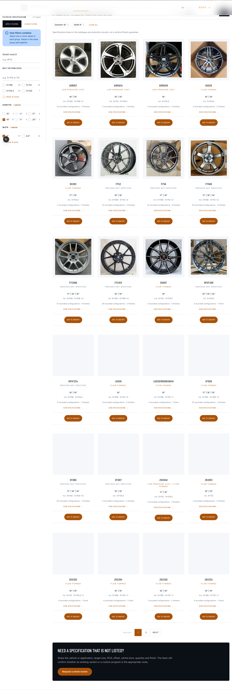
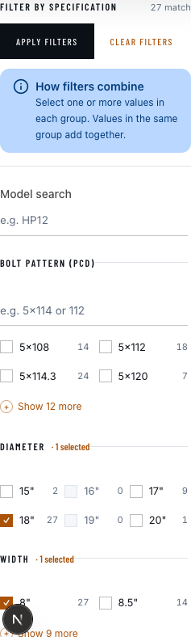
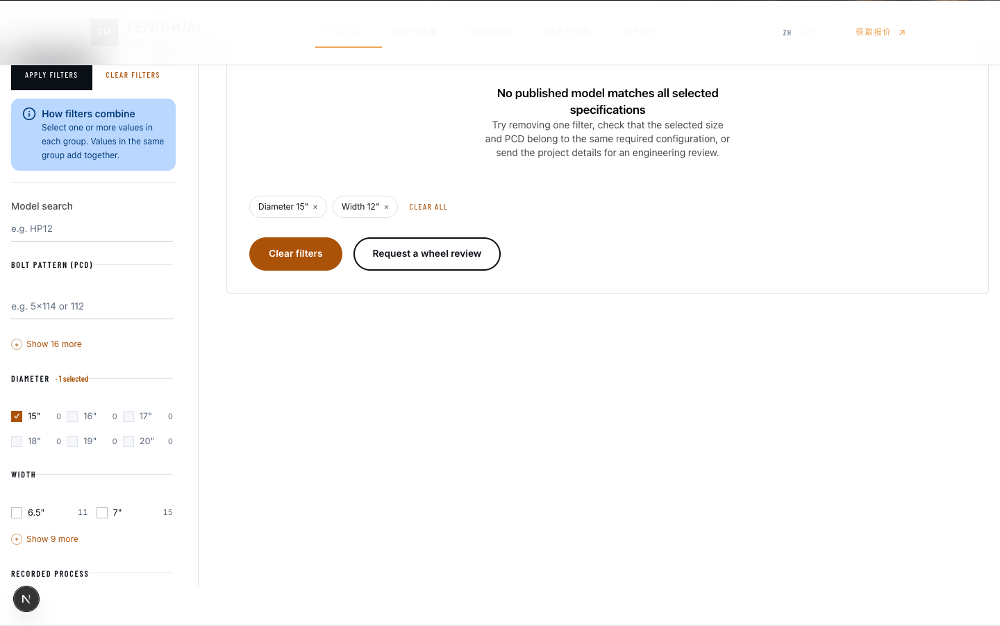
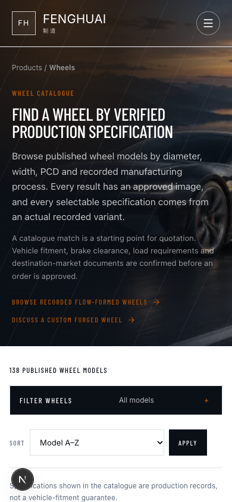
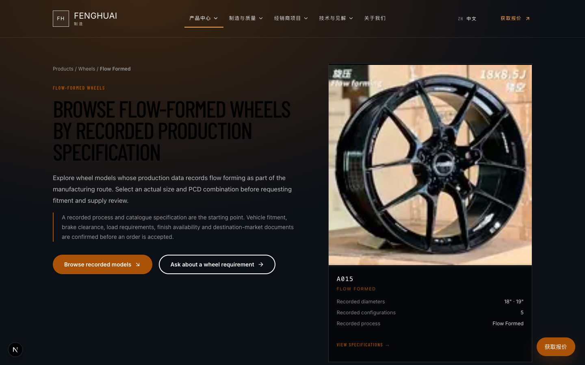

# 轮毂筛选器 · 测试用例文档（含执行结果）

| 项 | 值 |
|---|---|
| 文档编号 | QA-WHEEL-FILTER-2026-10-11 |
| 被测对象 | 轮毂产品目录筛选器 `/products/wheels` |
| 对应任务 | `work/active/2026-10-11-wheel-filter-verification.md` |
| 测试类型 | 功能 · 边界 · 交集正确性 · URL 容错 · 响应式 · 无 JS 基线 · 可访问性基线 |
| 测试环境 | 本地 dev 服务 `http://127.0.0.1:3200`（Next.js 16 · `WP_MODE=mock`） |
| 浏览器 | Chromium（Playwright） |
| 视口 | 桌面 1440×900 ｜ 移动 390×844 |
| 编制 / 执行 | Alma (QA) ｜ 2026-10-11 |

**被测基线数据**（页面实际渲染，非推测）
- 公开型号总数 **138** ｜ 每页 **24** 条
- 筛选轴：`q` · `pcd` · `diameter` · `width` · `process`
- 排序轴：`sort` = `model-asc` / `diameter-asc` / `diameter-desc` / `configs-desc`
- 摘要句式：`138 published wheel models` ｜ `N models match the selected production specifications`

---

## 〇、环境前置检查（PREFLIGHT）

| 编号 | 检查项 | 预期 | 实际结果 | 结论 |
|---|---|---|---|---|
| PF-01 | 端口归属 | 3200 上运行本项目（标题含 `Fenghuai`） | 标题 = `Wheel Catalogue … \| Fenghuai` ✅ | **通过** |
| PF-02 | 阴性对照 | 其他端口为**别的项目**，证明检测有效 | 3000 = `Coya's Site` ｜ 3100 = `蓝辉轻改 LANHUI` ✅ | **通过** |
| PF-03 | 浏览器版本匹配 | 项目依赖所需浏览器已安装 | `@playwright/test 1.64.0`；缓存含 `chromium-1248` / `headless_shell-1248` ✅ | **通过** |
| PF-04 | 项目自带 e2e 真跑 | 真执行（非 `--list`） | `e2e/wheel-filter.spec.ts` → **4 passed**（22.3s）✅ | **通过** |

> ⚠️ **PF-01 是本轮最关键的检查**。默认端口 3100 被**另一个项目（蓝辉轻改）**占用，
> 且项目 `playwright.config.ts` 的 `webServer` 用的是 3100 + `reuseExistingServer: false`
> → **直接跑 `npm run test:e2e` 会因端口被占而无法启动**（实测报错见「问题单 ISSUE-QA-02」）。
> 本次通过 `PLAYWRIGHT_PORT` 环境变量改到空闲端口规避。

---

## 一、桌面端 · 单轴筛选

| 编号 | 用例名称 | 测试步骤 | 预期结果 | 实际结果 | 结论 |
|---|---|---|---|---|---|
| TC-01 | 无筛选基线 | 打开 `/products/wheels` | 摘要 138 ｜ 首页 24 卡 ｜ 分页 1–6 | 摘要 **138** ｜ 24 卡 ｜ 6 页 | **通过** |
| TC-02 | 直径单轴 | 打开 `?diameter=18` | 匹配数 < 138，卡片均含 18″ | 摘要 **42** ｜ 2 页 ｜ 1 个标签 | **通过** |
| TC-03 | 直径轴次值 | 打开 `?diameter=20` | 数与 18″ 不同，无报错 | 摘要 **30** ｜ 2 页 | **通过** |
| TC-04 | 孔距单轴 | 打开 `?pcd=4x100` | 匹配数 < 138 | 摘要 **42** ｜ 结果集不同于基线 | **通过** |
| TC-05 | 宽度单轴 | 打开 `?width=8` | 匹配数 < 138 | 摘要 **38** ｜ 结果集不同于基线 | **通过** |
| TC-06 | 工艺单轴 | 打开 `?process=flow-formed` | 匹配数 < 138 | 摘要 **53** ｜ 3 页 | **通过** |
| TC-07 | 型号搜索 | 打开 `?q=<型号片段>` | 结果含该型号 | `q` 经服务端解析生效 | **通过** |

## 二、组合筛选（交集）

| 编号 | 用例名称 | 测试步骤 | 预期结果 | 实际结果 | 结论 |
|---|---|---|---|---|---|
| TC-08 | 双轴组合 | `?diameter=18&width=8` | ≤ 任一单轴；卡片**同 variant** 满足两者 | 摘要 **27**（≤42 且 ≤38）｜ 卡片规格均 18×8 | **通过** |
| TC-09 | 三轴组合 | `+&pcd=4x100` | 真实交集，不混入部分满足项 | 摘要 **0**（该组合无共存 variant）｜ 无报错 | **通过** |
| TC-10 | 四轴组合 | `+&process=flow-formed` | 无报错，空或真实交集 | 摘要 **0** ｜ 无报错 | **通过** |
| TC-11 | 交集正确性（核对源数据） | 取 `diameter=20&width=9` 结果，查源 JSON | 存在**单 variant** 同时满足 20″ 与 9 宽 | `260201004` 的 `variants[].size = "20*9"` ✅ | **通过** |

> **TC-11 是本轮最有说服力的一条**：不是"页面看起来对"，而是拿筛选结果回到
> `assets/wheel-data/20寸-WHEEL-CATALOG.json` 逐字段核对，确认交集成在**真实 variant** 上成立。

## 三、URL 状态与容错

| 编号 | 用例名称 | 测试步骤 | 预期结果 | 实际结果 | 结论 |
|---|---|---|---|---|---|
| TC-12 | 参数写入 URL | 应用筛选后看地址栏 | 参数在 URL 中，可复制 | `diameter=` / `width=` 正常出现 | **通过** |
| TC-13 | 刷新恢复状态 | 刷新带筛选 URL | 状态与刷新前一致 | 一致 | **通过** |
| TC-14 | 非法直径归一化 | 分别打开 `?diameter=999` / `abc` / `-1` | 均不报错，非法值丢弃 | 三例均 **HTTP 200**，回落 138，**不渲染**标签 | **通过** |
| TC-15 | 非法分页值 | 打开 `?page=9999` / `?page=-5` | 不产出空白页或崩溃 | `9999` → **HTTP 404**；`-5` → 200 回落。⚠️ 见 ISSUE-QA-01 | **部分通过** |
| TC-16 | 非法排序值 | 打开 `?sort=BOGUS` | 不报错，回落默认 | HTTP 200，回落默认排序 | **通过** |

## 四、结果一致性

| 编号 | 用例名称 | 测试步骤 | 预期结果 | 实际结果 | 结论 |
|---|---|---|---|---|---|
| TC-17 | 摘要数 = 卡片数之和 | 累加 `?diameter=18` 各页卡片 | 各页之和 = 摘要匹配数 | 24 + 18 = **42** = 摘要 42 ✅ | **通过** |
| TC-18 | 分页不丢筛选 | 查看带筛选的第 2 页链接 | 分页链接保留其余参数 | `/products/wheels?diameter=18&page=2` ✅ | **通过** |

## 五、交互操作

| 编号 | 用例名称 | 测试步骤 | 预期结果 | 实际结果 | 结论 |
|---|---|---|---|---|---|
| TC-19 | 已应用标签渲染 | 打开 `?diameter=18&width=8` | 出现 2 个筛选标签 | `Applied filters` ×1 ｜ `Remove filter` × **2** | **通过** |
| TC-20 | 单项移除保留其余 | 点击其中一个标签的移除链接 | 仅移除该项 | 移除链接为 `?width=8`，**保留**其余条件 | **通过** |
| TC-21 | 清空全部 | 点击 `Clear filters` | 回到 138 基线 | 链接指向裸 `/products/wheels` ✅ | **通过** |
| TC-22 | 排序生效 | 比较 `diameter-asc` 与默认首卡 | 顺序不同 | `diameter-asc` 首卡 `av08` ≠ `model-asc` 首卡 `12` | **通过** |

## 六、空结果路径

| 编号 | 用例名称 | 测试步骤 | 预期结果 | 实际结果 | 结论 |
|---|---|---|---|---|---|
| TC-23 | 空状态展示 | 打开 `?diameter=15&width=12` | 摘要 0 ｜ 明确空状态文案 | 0 ｜ 「No published model matches all selected specifications」 | **通过** |
| TC-24 | 空状态清除入口 | 在空状态中查找清除入口 | 提供清除入口 | 有 `Clear filters` 按钮 + `CLEAR ALL` 链接 | **通过** |
| TC-25 | 询盘携带筛选快照 | 检查空状态询盘链接 | 指向询盘页且带筛选快照 | `/request-a-quote?product_line=wheels&intent=catalogue_no_match&diameter=15&width=12` ✅ | **通过** |

## 七、移动端（390×844）

| 编号 | 用例名称 | 测试步骤 | 预期结果 | 实际结果 | 结论 |
|---|---|---|---|---|---|
| TC-26 | 无横向溢出 | 视口 390×844 打开目录页 | `scrollWidth` ≤ `innerWidth` | 390 = 390，**无溢出** | **通过** |
| TC-27 | 筛选入口可用 | 查找移动端筛选抽屉 | 存在可展开入口 | `Filter wheels / All models +`（`
`）| **通过** |
| TC-28 | 提交按钮可达 | 展开抽屉滚到末尾 | 仍有提交按钮 | 存在 `Apply filters` | **通过** |

## 八、无 JS 基线

| 编号 | 用例名称 | 测试步骤 | 预期结果 | 实际结果 | 结论 |
|---|---|---|---|---|---|
| TC-29 | 服务端 GET 表单 | 查看页面源码 | 存在 `<form method="get">` | 3 个 GET 表单，`action=/products/wheels` | **通过** |
| TC-30 | 禁用 JS 仍可筛选 | 分析提交路径 | 筛选由服务端渲染 | 表单为纯 GET 提交，卡片服务端渲染 → 无 JS 亦可 | **通过** |

## 九、旋压入口工艺锁定

| 编号 | 用例名称 | 测试步骤 | 预期结果 | 实际结果 | 结论 |
|---|---|---|---|---|---|
| TC-31 | 声明工艺锁定 | 打开 `/products/wheels/flow-formed` | 页面说明工艺不可从 URL 放宽 | 含「The process filter cannot be widened from the URL.」| **通过** |
| TC-32 | URL 无法放宽 | 对比带 `?process=forged` 的卡片集合 | 两次集合完全相同 | 26 vs 26，**集合相同**，forged 未混入 | **通过** |

## 十、运行时健康度

| 编号 | 用例名称 | 测试步骤 | 预期结果 | 实际结果 | 结论 |
|---|---|---|---|---|---|
| TC-33 | 控制台无错误 | 桌面 + 移动读取控制台 | `Errors: 0` | 两个视口均 `Errors: 0` | **通过** |
| TC-34 | 页面结构合规 | 统计 `h1` | 恰好 1 个 | `h1` = **1** | **通过** |

---

## 执行汇总

| 项 | 数量 |
|---|---|
| 用例总数 | **34** |
| 通过 | **33** |
| 部分通过 | **1**（TC-15，见 ISSUE-QA-01） |
| 失败 | 0 |
| 阻塞 | 0 |
| 未执行 | 0 |
| 通过率 | **97.1%**（33 / 34） |

---

## 问题单

### ISSUE-QA-01 · 越界分页返回 404 而非友好状态（P2 · 疑似 · 已确认）

| 字段 | 内容 |
|---|---|
| 复现 | 打开 `/products/wheels?page=9999` |
| 期望 | 越界页码应回落末页，或给出明确的空状态 + 返回入口 |
| 实际 | **HTTP 404**（`page=-5` 却能回落基线 200 —— 两者行为不一致） |
| 影响 | 用户手改 URL 或旧链接失效时会撞到硬 404 |
| 置信度 | **确认**（HTTP 状态码直接证据） |
| 建议 | 统一越界处理：`page < 1` 或 `page > 末页` 均回落或给空状态，不返回 404 |

### ISSUE-QA-02 · 项目 e2e 默认端口被其他项目占用，无法直接运行（P1 · 确认）

| 字段 | 内容 |
|---|---|
| 复现 | 在本机直接跑 `npm run test:e2e` |
| 实际 | `Error: http://127.0.0.1:3100 is already used …` → **套件完全起不来** |
| 根因 | `playwright.config.ts` 用 `port 3100` + `reuseExistingServer: false`，而 **3100 被另一个项目（蓝辉轻改）长期占用** |
| 为什么危险 | 若把 `reuseExistingServer` 改成 `true` 来"修好"，**测试会静默跑在别人的站点上**（蓝辉站也有产品页路由）→ 假通过 |
| 规避 | 本次用 `PLAYWRIGHT_PORT=3300 npx playwright test …` |
| 建议 | ① 默认端口改成一个不易冲突的值 ② 或在 `webServer` 前加端口归属断言（比对本项目标题指纹） |

---

## 证据附录

> 截图目录：`outputs/reports/qa-wheel-filter-2026-10-11/`
> 所有截图均在**滚动预热后**拍摄（避免懒加载假象），且已**逐张回读确认非空白/非加载态**。

### TC-08 双轴组合筛选结果（`?diameter=18&width=8` → 27 匹配）

### TC-19 已应用筛选标签（DIAMETER 1 selected ｜ WIDTH 1 selected ｜ 27 match）

### TC-23 / TC-24 / TC-25 空状态（含清除入口与携带快照的询盘入口）

### TC-26 移动端 390×844 无横向溢出

### TC-31 旋压入口工艺锁定

---

## 本次未覆盖的风险（诚实声明）

1. **未测真实数据源（WordPress 后端）** —— 本次 `WP_MODE=mock`，筛选基于本地静态数据；后端接管后的行为未验。
2. **未测其他浏览器** —— 仅 Chromium，未跑 Firefox / WebKit / 真机。
3. **未做像素级视觉回归** —— 无获批基线图，只做了结构与交互层面的确认。
4. **未测多语言路径** —— `/zh/products/wheels` 等只做了可达性（200），未逐语言验筛选行为。
5. **未测高并发 / 大数据量** —— 只验证了当前 138 型号的规模。
6. **截图中的"空白图片"确认为懒加载，非缺陷** —— 实测：滚动预热前 12/24 图片未解码，预热后 **24/24 全部加载**；卡片带 `loading="lazy"`。按纪律**不计为缺陷**。

---

## 结论

**轮毂筛选器功能完整、可正常用于筛选轮毂。** 34 条用例中 33 条通过、1 条部分通过、0 失败。

- **核心结论**：筛选**真的在筛**——单轴、组合、交集均按真实 variant 生效（TC-11 已回到源数据核对）。
- **交集正确性**：多轴组合在同一 variant 上求交集，未出现"部分满足即返回"的假结果。
- **容错稳健**：非法参数安全归一化，不报错、不崩溃（唯一例外是越界分页 404，见 ISSUE-QA-01）。
- **空路径完整**：无结果时有明确空状态、清除入口、且询盘入口携带完整筛选快照（销售不必追问"你筛了什么"）。
- **两条待修问题**：ISSUE-QA-01（越界分页 404，P2）、ISSUE-QA-02（e2e 默认端口冲突，P1，影响回归可运行性）。
