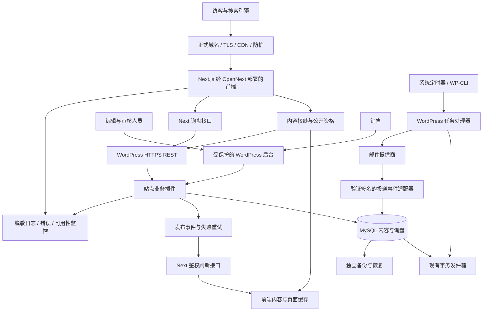
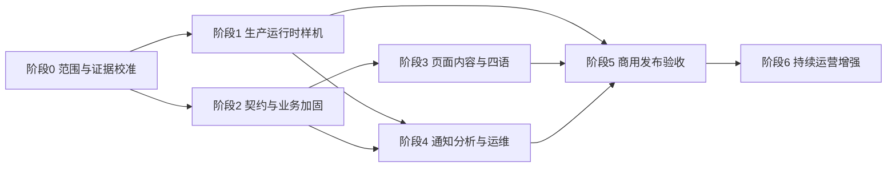

# 峰徊商业独立站技术栈与增量重建规划

> 日期：2026-10-14
>
> 文档定位：基于商业蓝图与现有仓库证据的技术选型、增量建设和局部重构建议。
>
> 交付范围：规划文档。本文没有执行代码重构、服务采购、生产部署或数据迁移。

**建议继续使用现有 Next.js + Headless WordPress 技术路线，以现有产品、内容和询盘能力为基础，完成“内容可运营、商机可跟进、系统可恢复”的商业化升级。** 优先保留已经形成的稳定接口和业务数据，集中重构发布资格、内容回退、接口校验、发布同步及过于集中的后台业务代码。新增投入主要用于生产部署、可靠调度、投递观测、销售流程、分析和交接。

本文承接[《Next.js + Headless WordPress 商业独立站建设与重构蓝图》](nextjs-headless-wordpress-commercial-blueprint-2026-10-14.md)。前篇回答“商业独立站应具备什么”，本文回答“我们已有的基础如何利用、具体使用哪些技术、哪些地方动刀，以及怎样分阶段落地”。前篇的 M01—M32 模块编号在本文中继续使用。

本轮检查了依赖清单与锁文件、部署和 CI 配置、内容与询盘关键代码、相关 WordPress 插件片段，以及当前状态、后续决策和已有验收报告。**这是一轮有范围的静态核查，不是全仓安全审计，也没有重新连接生产服务或复跑历史测试。** 文中“代码存在”“历史验收通过”“本次建议”“待实测”是不同证据级别。

本文是日期规划交付物，不新增一份持续维护的系统架构正本。被采纳的模块边界和技术决定应进入根目录架构及相应 ADR；执行进度继续以 `STATUS.md` 与具体任务为准。

## 目录

1. [总体建议与建设边界](#p1)
2. [现有基础与需要校准的判断](#p2)
3. [推荐技术栈及取舍](#p3)
4. [目标系统架构与部署形态](#p4)
5. [前端、组件与内容接缝重构](#p5)
6. [WordPress、数据模型与编辑后台](#p6)
7. [产品、询盘与销售运营升级](#p7)
8. [缓存、多语言、SEO 与内容增长](#p8)
9. [生产安全、监控、备份与交付](#p9)
10. [32 个商业模块的增量映射](#p10)
11. [实施阶段、依赖与大致工期](#p11)
12. [迁移、回滚与验收](#p12)
13. [预算、责任与关键决定](#p13)
14. [证据入口与官方资料](#p14)

## 一、总体建议与建设边界

### 1.1 本轮建设的商业终点

客户可以从搜索、广告或直接访问进入网站，了解企业及四条产品线，阅读经过核验的内容，选择真实轮毂配置或提出项目需求，提交单产品或多产品询盘。后台持久保存需求，销售能够接手、跟进并记录结果。编辑能够自行更新内容，维护人员能够发现故障、恢复数据和控制费用。

网站继续以询盘和商务接洽为主。订单可以由销售在线下业务流程中成交并记录结果；在线支付、库存锁定、税费、履约和退款属于另一阶段的交易系统，不混入本轮基础工程。

现有四条产品线可以共享品牌、导航、询盘、内容发布和运维，但不强行共用同一种产品模型：

| 产品线 | 本轮推荐形态 | 数据准备充分后再扩展 |
|---|---|---|
| 轮毂 | 分类、真实型号、规格变体、筛选、多款询盘 | 经核验的适配关系、产品比较 |
| 新能源三电铝制品 | 有证据的应用与能力页、工程需求入口 | 真实型号目录和专属规格模型 |
| 定制铝制品 | 工艺能力、输入条件、合作流程与项目询盘 | 经授权案例、受控文件协作 |
| 自密封轮胎 | 技术机制、适用边界、真实资料与咨询 | 审核通过的型号、测试和规格目录 |

不能把轮毂的尺寸、PCD、ET 字段直接套到另外三条业务线；也不能因为希望展示“完整产品管理”，就为没有真实型号的业务生成虚构 SKU。

### 1.2 四类改造动作

| 动作 | 含义 | 本项目典型对象 |
|---|---|---|
| 保留 | 维持技术和契约，补必要验证 | App Router、内容接缝、轮毂领域模型、询盘持久化 |
| 增量 | 在既有模块增加字段、能力或接线 | 销售跟进、内容审核信息、告警、事件统计 |
| 局部重构 | 改善内部结构，保留外部行为和历史数据 | 空值回退语义、PHP 业务文件、界面组件边界 |
| 条件扩展 | 达到业务和成本条件后实施 | 独立搜索、专用询盘明细表、CRM、交易、AI |

“商业级”不是技术越多越好。每项新增依赖至少要回答：解决哪一个已确认问题、谁维护、怎么故障降级、如何退出、如何验收。

### 1.3 本轮范围建议

**商用核心版：** 经过审核的产品与能力内容、可运营 WordPress、完整询盘清单和持久化、基础销售工作台、可靠邮件任务、技术 SEO、基础分析、生产运行时、监控与恢复。

**运营增强版：** 更完整的跟进历史、报价与成交统计、经过授权的案例、经审核的多语言正文、来源质量分析及编辑批量操作。

**后续扩展版：** 在线交易、客户账户、复杂 CRM/ERP、私密图纸门户、海量适配、独立搜索服务与 AI 自动化。

多语言按“已有语言技术基础继续复用、每个公开语言独立验收”的方式推进。不能为了赶时间取消已提出的四语目标；也不能把未审核译文作为合格版本公开。实际发布批次需要按译文准备情况安排。

## 二、现有基础与需要校准的判断

### 2.1 代码和配置中已确认的基础

下表为 2026-10-14 的有限核查快照，后续变化应写入正式状态或架构，不能把本文当作实时清单。

| 领域 | 本轮证据 | 判断与处理方向 |
|---|---|---|
| 前端框架 | 锁文件为 Next.js 16.4.0、React 19.2.4、TypeScript 5.9.3 | 保留技术路线，不重新搭脚手架 |
| 样式与组件 | Tailwind CSS 4.2.2、Astryx 0.6.7、Base UI 1.3.0、StyleX 0.19.1；存在 shadcn 工具 | 做职责收拢，不再增加另一套大型 UI 体系 |
| 校验 | 已安装 Zod 4.6.5 | 扩展运行时契约，不重复引入校验库 |
| 构建运行 | 项目要求 Node.js ≥24；Next 配置为 standalone | 预发布继续可用，目标部署另做适配验证 |
| 内容 | WordPress 客户端、页面／轮毂契约与预览、刷新接口存在 | 已有接缝，应补完整校验和状态表达 |
| 产品公开资格 | 轮毂适配器检查发布、图权、供货、规格与变体 | 保留这些门槛，检查覆盖范围和回退行为 |
| 多款询盘 | 浏览器清单、最多 20 条、型号和生产代码、服务端逐项绑定存在 | 已有功能，改造重点是边界与用户反馈 |
| 询盘落库 | Next API 调 WordPress；仅持久化确认后返回成功 | 不是从内存表单开始重建 |
| 后台业务 | `fh_inquiry` CPT、业务状态、负责人和内部备注存在 | 以现有后台为基础扩充销售能力 |
| 投递基础设施 | 幂等键、outbox、邮件事件表，以及领取和重试逻辑存在 | 生产接线与故障验收优先 |
| 预发布 | 仓库有 WordPress/MySQL Compose 与 9080 前端部署配置 | 已有试验环境，不等于生产批准 |
| 测试 | Node 测试、Playwright、axe、ESLint、类型和构建检查存在 | 增加业务场景和实际运行时验证 |
| CI | GitHub Actions 已执行安装、测试、综合检查与生产依赖审计 | 增量完善，不另建一套重复流水线 |

版本来自锁文件，表示仓库解析结果，不等于本轮审查了所有依赖的安全性；WordPress 核心与数据库实际运行补丁版本未远程读取。部署配置显示 PHP 8.3 镜像和 MySQL 8.0 镜像，不能据此推断线上实例已经更新或符合长期维护要求。

### 2.2 已有历史验收的边界

2026-10-12 的询盘报告记录了浏览器提交、WordPress/MySQL 持久化和 QQ SMTP 接受。它支持“预发布链路曾经跑通”的判断，不支持“今天仍正常”“生产可靠性全部满足”或“收件箱已确认送达”的判断。

因此后续任务应写成“复用并生产化询盘闭环”，而不是“重新开发询盘持久化”。同样，存在 WordPress 读取函数不能证明所有页面已接管；存在四个语言前缀不能证明正文、邮件和政策都完成审核。

### 2.3 文档漂移需要在实施第一步处理

本轮发现几个会影响任务拆分的差异：

| 旧表述或容易误读的内容 | 更接近当前证据的判断 | 规划处理 |
|---|---|---|
| `PROJECT.md` 仍记“询盘当前内存 Map、持久化待实现” | 现有 API 已以 WordPress 持久化确认作为成功门槛 | 不按旧表述重新估算整个询盘系统 |
| 早期范围排除多产品询盘 | DEC-074 与代码已有多款清单 | 保留功能，纳入商用回归验收 |
| 部分架构和四语记录要求隐私版本或勾选决定表单开放 | DEC-100 和后续报告已取消该技术门槛 | 不在重构中恢复旧门槛；保留真实隐私审核 |
| 部分总纲写“WordPress 未接入页面” | 页面接缝及多个调用点已存在，接管范围仍需逐页验收 | 建立页面接管矩阵，不以一句话描述全站 |

本轮不把所有历史记录改写成“最新状态”。开始实施时，先校准范围与架构正本，标注失效条目，历史报告保留原始日期和结果。这样既保留证据，又避免重复建设。

### 2.4 三个已定位、适合优先核验的局部风险

**内容读取把不同结果压缩为 `null`。** `getWordpressPageDocument` 对非 live、响应无效、权威集合为空和页面归一化失败都可能返回 `null`。这会增加调用方区分“内容明确撤回”和“源站暂不可用”的难度。轮毂集合归一化也存在整批失败后转回快照的约定。建议建立明确的结果类型并复核所有调用点；本轮不据此断言已经发生草稿泄露。

**清单操作的身份键不完全一致。** 添加时使用型号与生产代码的组合，更新数量和移除函数按生产代码匹配。如果生产代码并非全目录唯一，就可能误操作其他条目。应先核验唯一性契约，再统一身份键并迁移旧浏览器清单；不凭假设修改业务编码。

**API 仍有含义模糊的兼容字段。** 询盘响应中的 `delivered` 将 `accepted` 也计为真，而同时存在更准确的 `emailStatus`。建议保留旧客户端兼容期，逐步让展示与统计只使用明确状态，不把 SMTP 接受表达为最终送达。

以上是有源代码依据的重构候选，不是本轮已修复的缺陷，也不是完整缺陷清单。

## 三、推荐技术栈及取舍

### 3.1 推荐组合总表

| 层级 | 推荐技术 | 动作 | 选择理由与边界 |
|---|---|---|---|
| 页面与服务端入口 | Next.js 16 App Router | 保留 | 已有路由与元数据；页面、API 和预览共用工程体系 |
| 视图 | React 19 | 保留 | 服务端渲染为主，交互按需要客户端化 |
| 类型 | TypeScript 5 | 保留 | 固定内容、产品、询盘和错误契约 |
| 运行时校验 | Zod 4 + PHP 服务端校验 | 扩展 | 外部响应和写入均需校验；跨语言规则用样例对齐 |
| 样式 | Tailwind CSS 4 + 项目语义令牌 | 保留 | 复用当前暖白设计体系与布局能力 |
| 交互原语 | 现有 Astryx／Base UI，通过项目组件封装 | 收拢 | 减少同类控件的多实现；不强迫全部页面迁移 |
| 内容后台 | WordPress 原生 Page/Post + 现有站点 MU 插件 | 增量 | 编辑体系、产品与询盘已形成基础 |
| 内容传输 | WordPress REST + Next 服务端适配器 | 保留 | 足够支持本轮业务，不引入 GraphQL 迁移负担 |
| 数据库 | 同一套 WordPress MySQL，业务逻辑隔离 | 保留 | 延续 CPT、幂等、outbox 和事务边界 |
| 询盘运营 | `fh_inquiry` CPT + WordPress 工作台 | 扩展 | 复用账户和权限，避免自建第二后台 |
| 多款明细 | 不可变结构化 JSON 快照，必要时增查询投影 | 保留优先 | 保持历史事实；需要逐项统计时才引入子表 |
| 发信 | WordPress PHPMailer + 可替换 SMTP／提供商适配 | 保留并生产化 | 邮件发送在 WordPress 侧，不再增 Node 发信器 |
| 后台业务任务 | MySQL outbox + 可靠系统调度 + WP-CLI | 加固 | 已有任务模型，不先采购独立消息中间件 |
| 正式前端运行时 | OpenNext；优先验证 Cloudflare Workers | 待样机 | 符合项目部署方向，实际兼容与费用须验证 |
| 内容缓存 | Next 缓存 + 适配器持久缓存、标签与刷新机制 | 明确配置 | 不能沿用进程内或本地磁盘假设 |
| 公共媒体 | 初期保留 WP 媒体源；按需独立媒体域名／对象存储 | 渐进 | 先解决权利、URL、缓存和备份，再迁移托管 |
| 多语言 | 现有 locale 接缝、字典与 WP 译文字段 | 保留并补审核 | 避免四语实施中途再换国际化框架 |
| 站点分析 | 统一事件接缝，建议 GA4 作为首个适配器 | 新增或核验接线 | 业务数据库统计为正本；分析不采集个人资料 |
| 错误与可用性 | 结构化日志 + 独立外部探测；Sentry 为候选 | 新增或核验接线 | 先定义告警与脱敏，具体服务经运行时样机验证 |
| 代码质量 | ESLint、TypeScript、Node 测试 | 保留 | 复用现有检查与样例 |
| 浏览器验证 | Playwright + axe | 增量 | 验证用户路径、语言与关键可访问性 |
| 持续集成 | GitHub Actions + 锁文件安装 | 保留并补门禁 | 可复现构建、验证与发布记录 |
| CMS 部署 | Linux、Docker Compose、反向代理、HTTPS | 加固 | 延续现有试验设施，补生产配置与恢复 |

这里“建议 GA4”“Sentry 为候选”属于选型意见，不表示已建立账户、开通套餐或完成 SDK 集成。低成本和维护能力优先；不要求为了凑技术栈同时购买所有服务。

### 3.2 版本策略：以现有锁定组合为起点

先对现有依赖组合完成商业链路回归，再单独安排安全补丁和兼容升级。不要把框架大版本、组件库、数据库和部署平台同时更换，否则发生问题后难以归因。

建议将开发与 CI 的 Node 版本明确为经过验证的 Node 24 补丁版本，而不是让所有未来大版本都自动进入。Node 构建环境与 Workers 的运行环境是两件事，不能用本地 Node 版本证明线上 API 全兼容。Node 支持周期以官方发布表复核。[Node.js 发布周期](https://nodejs.org/en/about/previous-releases)

WordPress 应盘点核心、PHP、插件和数据库实际版本，确认其支持期与安全补丁。现有 PHP 8.3／MySQL 8.0 配置可以作为迁移来源，但生产版本应形成单独兼容矩阵；不要在本规划中把某个未测补丁号写成强制安装要求。WordPress 官方运行要求可作为核验入口。[WordPress 运行要求](https://wordpress.org/about/requirements/)

### 3.3 当前不建议引入的技术

- **独立 NestJS／Express 后端：** Next API 与 WordPress 已承担当前边界，新增服务会带来重复权限、日志与部署。
- **PostgreSQL／MongoDB 作为第二业务数据库：** 目前没有证明需要第二套持久数据正本。
- **Redis／RabbitMQ／Kafka：** 先验证现有 MySQL outbox 与调度是否满足负载、恢复和成本。
- **Elasticsearch 或独立搜索 SaaS：** 当前先做好结构化筛选与正确的发布过滤，实际搜索性能成为瓶颈后再引入。
- **新一套全局状态管理或表单库：** 现有清单与表单可局部整理；有明确复杂状态需求时再选。
- **一次性换成其他 CMS：** 现有 WordPress 接缝和业务插件有迁移价值，目前缺口主要在运营与生产化。
- **完整 WooCommerce 商城：** 只有在线价格、库存、支付和履约成为明确业务要求时才启动。

这些是当前阶段的成本取舍，不是永久禁止。后续引入时，应提供能够推翻现有方案的具体业务或性能证据。

## 四、目标系统架构与部署形态

### 4.1 推荐目标拓扑

图中 OpenNext、可靠调度、生产事件适配、监控和独立备份表示本轮目标，不表示已经在正式环境实现。页面和业务可以共享工程仓库，内容与询盘共享 MySQL，但公开内容、客户资料和运维凭据必须有不同访问边界。

### 4.2 正式前端：优先做 OpenNext + Workers 样机

OpenNext Cloudflare 适配器将 Next 构建产物转换为 Workers 可执行形态；其官方说明支持 Next 的 Node.js 运行时，但依赖 Workers 提供的兼容能力。保留当前 API 中 `runtime = "nodejs"` 的方向，不等于可以不经测试使用所有 Node 功能。[OpenNext Cloudflare 概览](https://opennext.js.org/cloudflare)

样机优先验证本项目实际需要的能力：

| 检查项 | 本项目需要验证的结果 |
|---|---|
| 构建与包体 | 现有主题、图标和依赖能通过适配构建，包体符合所选套餐限制 |
| 询盘 API | HTTPS 调 WordPress 成功；超时、幂等和响应签名正确 |
| 加密与令牌 | HMAC、随机标识、收据签名和比较行为正确 |
| 语言路径 | 显式前缀、重定向、RSC 请求和偏好行为正确 |
| 预览 | 鉴权草稿只对相应请求可见，不进入共享缓存 |
| 缓存更新 | 产品与 Page 更新、撤回及多语言失效按预期执行 |
| 媒体 | 公开源地址、允许域名、图片优化与 CSP 匹配 |
| 静态资源 | 平台静态文件响应的缓存和安全头单独核对 |
| 可观测性 | 日志、错误和请求标识可以关联到 CMS 任务 |

新增适配器配置时，以锁定的适配器版本为依据。官方入门资料提供现有项目接入路线，但本项目应保留自身环境和业务门禁，不能直接把示例当生产配置。[OpenNext 接入指南](https://opennext.js.org/cloudflare/get-started)

### 4.3 区分缓存基础设施与业务数据库

OpenNext Cloudflare 的缓存方案可能使用 R2、Durable Objects、D1 等资源。它们承担增量缓存、重验证队列和标签状态，不代表把产品或询盘迁移到另一套数据库。采用什么组合，应按适配器版本、刷新语义和流量实测确定。[OpenNext 缓存配置](https://opennext.js.org/cloudflare/caching)

必须保持两条队列的职责清楚：前端重验证任务负责内容缓存；WordPress outbox 负责客户通知。不能因为名称都叫“队列”，就把邮件业务搬到缓存适配器内部。

### 4.4 WordPress 与 MySQL：保留、加固、独立维护

保留 Linux 上的 WordPress/PHP 与 MySQL 部署方式，数据库不映射公网。正式后台使用受控 HTTPS 入口；服务间内容读取和询盘写入采用独立凭据，媒体地址使用浏览器可访问的正式源。

现有 Node 前端通过 Compose 内网访问 WordPress 的方式，不能原样用于云端 Workers。样机需要设计可达的 HTTPS API 入口、服务认证、超时、网络故障和防护例外；不把内部容器主机名写进云端配置。跨境网络对 CMS 写入时延的影响应在目标地区实测。

首期询盘仍依赖 CMS 可写：CMS 故障时返回真实失败、保留表单输入并允许重试，不能伪造接收成功。若以后要求 CMS 故障也照常接单，再单独设计独立持久入口与对账机制，并承认其增加了业务系统复杂度。

### 4.5 回退与平台决策

现有 Node standalone 预发布保留为对照与迁移回退基础。OpenNext 样机遇到可修复兼容问题时，先局部修复；遇到不能满足核心链路的限制时，形成证据再评估其他 OpenNext 目标。更改正式平台方向须另行决定，不能为了上线直接把预发布容器当作已批准生产架构。

任何平台都不能把 Next 改成纯静态导出而移除 `/api/inquiries`、预览和刷新能力。

## 五、前端、组件与内容接缝重构

### 5.1 保留现有目录与业务入口

本轮不为追求“标准目录”搬动全部代码。继续使用 `src/app/` 放路由，`src/components/` 放展示与交互，`src/content/` 放稳定内容类型，`src/lib/wordpress/` 放 CMS 适配，`src/lib/wheels/` 和 `src/lib/inquiry/` 放领域规则。

新增职责可以先放在现有模块下的命名文件中。只有单个模块确实需要独立协作和测试边界时再分目录。目录重命名与行为重构分开提交，方便审查与回滚。

### 5.2 收拢组件体系

当前并存 Tailwind、Astryx、Base UI、StyleX 和项目组件，并不意味着都要删除。推荐建立使用规则：

1. 品牌颜色、焦点和间距服从现有语义令牌与暖白设计正本。
2. 导航、弹窗、输入、提示等重复交互通过项目封装使用选定原语。
3. 产品规格表、证据卡片、能力流程等保留业务组件，不为了统一库而重写。
4. 每种交互维护一套主实现；只有有明确差异的业务场景才保留例外。
5. 完成依赖与引用检查后，才清理没有使用的组件或库；历史有价值内容按项目规则归档。

不新增一个万能页面搭建器。编辑可以调整批准的内容区块、顺序和媒体，不能输入任意 React、CSS 或脚本。品牌布局仍由代码模板负责。

### 5.3 从“内容存在”升级为“内容结果明确”

建议在内容接缝内部引入以下结果语义，再适配到现有页面接口：

| 结果 | 含义 | 页面与缓存处理 |
|---|---|---|
| 可公开 | 当前语言和内容版本已批准 | 渲染并按策略缓存 |
| 明确撤回 | 权威源要求不再公开 | 停止公开、失效关联缓存，禁止旧快照复活 |
| 尚未发布 | 草稿或审核不足 | 仅通过鉴权预览访问 |
| 不存在 | 该稳定标识没有对象 | 返回合适的不存在状态 |
| 源站不可用 | 超时或网络故障 | 仅对仍有资格的批准版本降级；否则受控失败 |
| 内容损坏 | 响应结构不符或数据不合法 | 告警并隔离，不能猜测补参数 |

公开资格、索引资格和媒体可见性应使用可复用规则，但不要形成一套包含所有业务的大型通用引擎。先把轮毂、页面和文章的共性收口，保留各自必需的字段规则。

### 5.4 用现有 Zod 补足运行时结构校验

目前部分 Page 归一化只判断内容是对象，再断言为泛型。建议对首页、关于、能力、询盘和政策等模板逐一建立 schema；已有字段无需为了命名一致而全量改动。

迁移方式是先生成验证报告，识别现有内容缺失；修正内容或保留显式兼容适配后，再启用严格发布校验。不要直接上线一个新 schema，让所有旧页面突然不可见。解析失败要包含对象标识和错误路径，日志不包含私密正文。

### 5.5 前端状态与错误表达

询盘清单继续使用现有轻量状态方式；客户端只保存型号、配置和数量等必要查询线索，最终规格由服务端复核。统一清单身份键和存储版本，处理过期条目、跨标签页更新、容量上限和存储不可用。

API 错误建议返回稳定错误代码、可定位字段及请求标识，前端按语言展示。不要直接把 PHP 或上游异常字符串展示给客户；也不要把所有错误都改成“出错了”而让用户无法修正。

### 5.6 UI 改造的真实重点

首页讲清四线业务与下一步；目录让筛选维度易懂；详情让真实规格和边界可扫描；询盘清单让客户看懂提交了什么；成功页准确说明已接收与后续联系。轮胎机制图和未核验 fitment 等已记录内容问题优先处理，不让技术重构掩盖内容风险。

每类页面以代表模板验收，保留 `hasRender` 媒体兜底、声明式动效和无 JavaScript 正文可见规则。新的视觉组件不能改变内容批准与公开逻辑。

## 六、WordPress、数据模型与编辑后台

### 6.1 保留原生内容类型与站点插件

继续使用 Page 承载业务页面，Post 承载技术文章，现有轮毂自定义内容类型承载型号与变体，`fh_inquiry` 承载私有询盘。FAQ、证据、下载或案例是否独立建模，以独立生命周期和复用需要决定；不为了模型表格完整而一次性创建所有类型。

现有 MU 插件是有价值的工程资产：模型、页面编辑、询盘、Webhook 和轮毂编辑已经按文件形成一定分工。应继续纳入版本管理，不让数据库里临时点出的字段成为不可复现的唯一实现。

### 6.2 内容归属必须明确

| 内容 | 目标权威来源 | Next.js 中允许保留的内容 |
|---|---|---|
| 公司名称、联系方式、公共介绍 | 经审核的站点设置或指定 Page | 类型、模板和明确版本的受控快照 |
| 页面业务正文 | WordPress Page | 渲染组件与 schema |
| 产品型号、规格、图片关系 | WordPress 产品记录 | 适配器、领域规则与受控缓存 |
| 技术文章 | WordPress Post | 正文渲染与相关文章规则 |
| 固定按钮、错误提示、辅助界面文字 | 版本化语言字典 | 由代码管理，按语言验收 |
| 品牌视觉、组件布局、交互逻辑 | 代码与设计令牌 | 完整保留 |
| 私有证据、客户资料 | 受权限保护的后台记录与存储 | 仅必要的服务端访问能力 |

全站 `site` 常量不应一律搬入后台。例如路由定义、界面键和图标属于工程配置；企业名称、邮箱和营业时间属于业务内容。实施时建立字段归属表，再逐项迁移，避免把简单设置变成任意代码配置界面。

### 6.3 编辑后台的增量建设

建议优先完善四种操作界面：

- **产品编辑：** 基本身份、规格变体、图片、公开资格、SEO 与审核信息分组展示，批量操作提供预览与差异报告。
- **业务 Page 编辑：** 以页面模板显示明确字段，提示长度、媒体比例、语言状态及缺失项。
- **发布面板：** 显示编辑保存、审核批准、事件发送、前台生效及失败原因，不把这些状态合成一个“发布成功”。
- **询盘工作台：** 列表、负责人、业务状态、下一次跟进、历史记录和通知状态清楚分离。

继续复用 WordPress 管理界面和权限，不新建一套 Next 管理站。除非经过编辑验证证明现有字段界面不能满足需求，否则不先购买 ACF 或另一个页面构建器。

### 6.4 局部拆分询盘 PHP 文件

现有询盘插件同时承载类型注册、建表、校验、写入、通知、事件、保留删除和后台工作台，已经适合逐步拆出内部职责。建议保留原 MU 入口文件与既有函数／路由作为兼容门面，再分离：

| 内部职责 | 应管理的内容 | 不应改变的外部契约 |
|---|---|---|
| 模型与权限 | CPT、能力、字段、数据库版本 | 现有记录与角色能力的兼容性 |
| 请求校验 | 产品线、客户类型、长度与结构 | 有效旧请求仍可处理 |
| 事务写入 | 幂等、询盘、快照与待办事件 | 持久化成功语义、编号与去重 |
| 邮件任务 | 领取、租约、重试、模板、发送适配 | 通知状态含义与失败可恢复 |
| 投递事件 | 验签、去重、映射与审计 | 事件不覆盖更确定的终态 |
| 后台操作 | 列表、筛选、跟进与导出 | 服务端权限检查 |
| 数据保留 | 保留候选、批准删除与审计 | 不默默删除历史业务数据 |

MU 插件子目录不能仅靠“文件放在那里”假设自动加载，应由稳定入口显式加载。拆文件前先形成契约测试，拆分时不同时更改状态枚举和表结构，避免一次改动引入多个故障来源。

### 6.5 数据库继续采用“主记录 + 基础设施表”

保留 `fh_inquiry` CPT 及现有 meta；幂等键、outbox 和邮件事件保留自定义表。实际数据库表名带站点前缀，迁移工具应通过现有表名函数解析，不写死某个环境的前缀。

多款明细继续作为提交时不可变快照，先改善后台表格化显示、导出和 schema 版本。蓝图中的“询盘主记录和明细”是业务结构要求，不强制一定建两张 SQL 表。只有需要逐 SKU 查询、报表或较高并发时，再引入受控明细子表或查询投影。

若增加查询投影，原始快照仍是历史事实依据；投影可重建并带版本。迁移需校验明细数量、总数量、产品身份与主记录归属，不让“优化查询”改变客户当时提交的需求。

### 6.6 审核字段要能约束发布

产品保留发布、图权、供货、规格核验等维度；页面和文章增加适用的事实负责人、来源、语言审批、复核日期与媒体授权信息。不能只在后台加一个“已审核”勾选框，而不在 API 和公开接缝执行。

供应商证书、工厂能力与深圳公司主体关系需要明确关联。证据失效时能查到受影响内容，并将其进入复核或撤回流程。上传文件存在与获得公开授权是两个事实。

## 七、产品、询盘与销售运营升级

### 7.1 产品系统：先保证事实一致，再扩字段

轮毂继续使用现有型号与生产代码契约，先确认生产代码的唯一范围，再决定是否增全局稳定变体 ID。内部稳定标识、公开网址和展示名称分开；改名或改 slug 不应该切断历史询盘。

目录筛选必须按同一个有效变体满足组合条件，而不是把产品下不同变体的参数拼成不存在的组合。图片、规格、下载和适配结论分别有审批依据。筛选和 sitemap 使用同一公开集合，不能各自重新解释审核状态。

另外三条产品线先以能力文档与项目需求承接，逐步形成各自字段模型。这样能保留统一询盘入口，也不会让不适用字段污染整个产品库。

### 7.2 询盘清单：复用并加固

现有清单最多 20 条属于技术容量规则；数量采用可安全表示的正整数，不能恢复历史上已经被替代的 999 上限。若之后引入业务数量限制，需要业务依据和单独决定。

本轮建议补以下行为：达到条目上限时给出明确提示；重复 SKU 合并后解释结果；修改和移除使用统一身份键；浏览器存储失败时仍允许当次使用；服务端指出失效条目；提交成功只在持久化确认后清空清单。

保留直接询盘和总询盘的分流，避免客户正在咨询单一型号时被无关清单强行改变上下文。不同入口应共享校验与写入能力，不能再出现各自的一套后台数据。

### 7.3 持久化与幂等：完善边缘情况

继续通过 Next 服务端调用 WordPress 专用写入接口；不让浏览器携带后台凭据，也不让 Next 直接写 WordPress 数据表。主记录、快照、幂等关系和 outbox 的原子性需要在真实数据库配置中验证。

幂等验收至少覆盖：同一请求重复、并发同键、服务端保存后客户端超时、同键不同载荷、密钥轮换后重试、旧客户端缺少幂等键。现有实现允许缺少键的旧调用方时，应明确它无法获得同样的去重保证；不得在升级中无计划地拒绝全部旧入口。

建议为新客户端明确必需的幂等行为，旧接口通过兼容期迁移。去重范围、有效期与请求指纹都需要规格，不能把客户两次真实采购需求误合并。

### 7.4 邮件：保留发送器，补实际提供商事件

继续由 WordPress PHPMailer 发信，避免 Next 再引入 Nodemailer 形成双发送通道。正式服务商应支持业务需要的身份配置、投递观测和故障处理；现有 QQ SMTP 可作为已验证来源，但不能凭 SMTP 接受证明最终送达。

仓库已有通用邮件事件入口，并不表示任意服务商能直接对接。新增薄适配器负责验证该服务商的真实签名、映射消息标识和事件类型，再调用内部统一事件处理。服务商不支持终态回调时，应如实保留 `accepted/unknown` 并安排人工核验，不能生成虚假的 `delivered`。

重试系统要区分短暂连接故障、认证错误和永久拒收；退信可能要求销售改用其他已授权渠道，不应无限向同一无效地址重发。通知邮件只含必要摘要，完整客户资料在受控后台查看。

### 7.5 可靠调度：把任务从“依赖访问”变成可监控服务

建议在 WordPress 主机使用系统定时器或等效可靠调度，调用现有任务处理器；WP-CLI 可以作为执行入口。调度加锁、超时、退出码、日志和心跳，领取任务继续受已有数据库租约保护。

WordPress 官方提供将 WP-Cron 接入系统任务调度的方法，WP-CLI 也提供到期事件执行能力。采用前需验证主机用户权限、容器执行路径及重复调度；不要在替代调度未正常工作前关闭原触发方式。[WordPress 系统调度指南](https://developer.wordpress.org/plugins/cron/hooking-wp-cron-into-the-system-task-scheduler/) · [WP-CLI 事件执行](https://developer.wordpress.org/cli/commands/cron/event/run/)

生产调度同时覆盖邮件重试、发布事件补偿、内容复核提醒和保留检查，但不同任务应有独立状态与告警，避免某个失败任务阻塞全部任务。

### 7.6 销售工作台：从存档升级到可以跟进

当前基础状态为新询盘、已分配、已联系、已关闭与垃圾，已有负责人和内部备注。建议保留历史状态，增量增加业务需要的能力：

| 能力 | 推荐实现 | 注意事项 |
|---|---|---|
| 负责人 | 使用可校验的用户引用并兼容旧文本 | 离职或停用用户的历史归属仍可追踪 |
| 下一次跟进 | 时间、时区、到期列表和提醒 | 通知失败不改变业务状态 |
| 跟进历史 | 追加式记录操作人、动作与时间 | 不以覆盖一个备注框替代完整历史 |
| 有效商机 | 独立判定和无效原因 | 垃圾与未成交分开 |
| 已报价 | 报价日期、引用和下一步 | 不等于在本轮实现在线报价引擎 |
| 成交／流失 | 结果、日期与原因，必要时受控金额 | 老的 closed 不能自动猜成成交 |
| 导出 | 按权限、范围和审计导出 | 避免全员无限制下载客户资料 |

`assignOwner` 当前返回 `unassigned`，不能据此宣称已有自动路由。先保证未分配队列有人每日处理，再按产品线、语言或地区增加简单规则；不要先上复杂线索评分。

### 7.7 业务与隐私的边界保持真实

继续遵守已经实施的询盘行为：不因缺少隐私勾选或旧版本字段关闭表单，不伪造同意记录。正式发布仍须有与实际收集、存储、邮件和分析行为一致的隐私说明与必要专业审核。

营销订阅若后续增加，应与业务询盘分开。改变法律文本或需要恢复某种用户选择机制，应依据业务和适用市场审核结论，不由技术人员套模板决定。

## 八、缓存、多语言、SEO 与内容增长

### 8.1 发布同步采用“内容事件 + 状态确认”

复用现有 HMAC 刷新接口，不重复新建一条不受控刷新路由。当前接口已验证签名，但本轮看到的请求主要由类型和 slug 决定失效范围；建议增加事件标识、时间、内容版本、语言和操作类型，兼容旧载荷后再逐步切换。

推荐的发布链路是：保存内容与版本 → 记录发布事件 → 发送鉴权通知 → 刷新受影响缓存 → 从匿名访问验证版本 → 记录结果。重复事件可安全处理，旧版本事件不能恢复新版本已经撤回的内容。签名保护完整性，事件时效与去重用于控制重放；不是验签通过就等于发布成功。

事件记录可以采用独立的轻量发布 outbox，复用领取、重试等基础设施思路，但不要直接把内容事件塞入邮件状态表并共用其枚举。

### 8.2 回退策略按风险分类

| 场景 | 建议行为 |
|---|---|
| 普通已批准介绍页短时读失败 | 可以展示有版本与有效资格的最后批准内容 |
| 产品字段结构损坏 | 隔离异常对象、告警；是否整体降级由契约明确 |
| CMS 明确返回空公开集合 | 尊重权威空集合，不以本地数组重新上架 |
| 已撤回、权利失效或私有内容 | 阻止公开，撤回名单与缓存失效协同 |
| 预览读取失败 | 显示预览错误，不能退回公开页并声称预览成功 |
| 某语言未批准 | 明确缺失状态，不让英文正文伪装成已批准译文 |

最后有效版本必须有时间、对象、语言和审批版本，不能把构建时某个文件永远称为“最后有效”。当无法证明它仍可公开时，应按内容风险保守处理。

### 8.3 暂不同时迁移缓存模型

当前配置未开启 Cache Components，已有 `revalidateTag`、`revalidatePath` 和 fetch 接缝。本轮建议先修正现有缓存语义并通过 OpenNext 验收，不同时把全站改成另一套缓存 API。

Next.js 已分别提供启用和未启用 Cache Components 的说明；实施使用仓库安装版本对应文档。后续若迁移缓存模型，应有性能目标、兼容验证及独立回滚，不因为 API 较新就批量改写。[Next.js 未启用 Cache Components 的缓存说明](https://nextjs.org/docs/app/guides/caching-without-cache-components)

### 8.4 四语内容继续使用现有接缝

复用 `en/zh/es/th` 语言结构、界面字典和 WordPress `content_by_locale`、`seo_by_locale`、`locale_status` 等字段。先逐页建立六维矩阵：正文、媒体、界面、错误、SEO、索引资格。

默认内容修订后，相关译文需要重新审阅；产品型号与数字事实不随翻译改变。语言路由、页面数据和缓存键应一致；所有前缀的刷新范围要通过测试证明，不能只清理无前缀路径就假设全语种更新。

本轮不建议迁移到新的翻译 SaaS 或重换国际化库。只有翻译协作量、术语维护或编辑体验确实超出当前能力时，再评估接入。

### 8.5 SEO 和 GEO 与发布资格共用基础

保留现有 Next 元数据与 sitemap 实现入口，抽取统一资格判断，优先处理状态中已记录的未核验 fitment 索引问题。保留有价值旧网址，改路径时建立最相关的重定向，不把所有旧页指向首页。

站点设置、正文、结构化数据与图权来自相同事实源。没有价格、库存和评价时，不为满足富结果格式编造数值。Google 对产品摘要与可购买页面的商家信息有不同要求，实施时按真实业务选择。[Google 产品结构化数据](https://developers.google.com/search/docs/appearance/structured-data/product)

GEO 的本轮技术工作是让企业主体、参数条件、来源、作者、审阅和更新时间可以结构化维护，并在页面正文中清楚呈现。内容增长以真实客户问题、选型指南和授权案例为主，不新增一套专供 AI 读取但与页面事实不同的数据。Google 的 AI 搜索说明仍以基础 SEO 和可靠内容为核心，不要求特殊 AI 标记。[Google AI 搜索与网站](https://developers.google.com/search/docs/appearance/ai-features)

### 8.6 分析接缝与业务报表

推荐先定义统一事件接口，再接 GA4；前台组件不直接到处调用平台 API。事件包括浏览产品、使用筛选、加入询盘、开始填写、提交错误、持久接收成功、联系点击和下载。按平台规范配置并核验事件，不把推荐事件和自定义事件混淆。[GA4 事件设置](https://developers.google.com/analytics/devguides/collection/ga4/events)

UTM 只采集允许字段，来源网址去掉可能带客户资料的查询参数。询盘数量与销售结果以业务记录为准，GA4 用于访问与行为分析；不要求两套统计绝对相等，也不能用分析脚本决定表单是否可用。

基础报表先回答四个问题：哪个渠道带来有效询盘、哪些产品被咨询、多久有人首次处理、多少进入报价或成交。更细归因和实验要在样本与数据质量足够之后再做。

## 九、生产安全、监控、备份与交付

### 9.1 安全能力沿既有边界加固

保留现有服务端字段校验、Origin 检查、蜜罐、时间陷阱和应用限流，再验证其在目标平台上的效果。进程内限流无法自然覆盖多个实例；建议增加平台边缘规则或具备共享状态的限流能力，并验证误伤恢复。

如确有机器人滥用，可在高风险动作接入 Turnstile，必须在服务端验证 token；客户端显示通过不等于完成防护。它的单次使用与过期规则还会影响表单重试，需与询盘幂等分开设计。[Turnstile 服务端校验](https://developers.cloudflare.com/turnstile/get-started/server-side-validation/)

前端、CMS 服务账户、管理员和销售账号分离；后台身份增加适合的账户保护。现有 CSP 和媒体允许源必须按正式媒体域名、分析与验证码接入一起核对，先观察再收紧。不能为了接通服务把整个策略替换成通配符。

### 9.2 环境与配置按用途隔离

| 环境 | 内容与数据 | 通知 | 索引与访问 |
|---|---|---|---|
| 本地 | 合成或脱敏数据，可控 mock | 默认隔离或禁发 | 不作为公开站 |
| Node 预发布 | 受控联调内容 | 受控测试收件人 | 不索引，必要时鉴权 |
| OpenNext 验证环境 | 同版本样机内容 | 受控渠道 | 不索引且保护敏感页面 |
| 正式环境 | 批准的内容和真实询盘 | 正式服务商与销售收件人 | 只开放具备资格的页面 |

环境配置至少分类为：公开站点地址、服务端 CMS 地址、公开媒体源、服务认证、刷新密钥、收据密钥、邮件配置、分析标识和环境标签。配置名沿用既有定义，新增时记录作用、读取阶段和默认失败行为。

`NEXT_PUBLIC_APP_URL` 等公开构建变量必须检查实际产物，不能只检查运行容器环境。正式域名要同时核对 canonical、OG、sitemap、重定向、邮件链接、媒体地址与 CORS／CSP。[Next.js 环境变量](https://nextjs.org/docs/app/guides/environment-variables)

### 9.3 监控围绕业务故障

建议建立三个层面：外部探测监控页面与接口可达；应用日志关联 Next 请求、WordPress 询盘与事件；业务面板监控通知积压、发布失败和未分配询盘。

错误收集可评估 Sentry，也可以先使用平台日志和轻量错误汇聚；必须先验证 Workers/PHP 各自接入、脱敏与费用。先不启用录屏类能力，避免在未定义隐私边界前采集完整表单交互。

最低告警包括：询盘写入失败、邮件积压或放弃、发布同步失败、备份失败、证书或域名即将到期、费用异常。告警需要负责人、升级路径和恢复确认；只把错误写进日志不算有人接管。

### 9.4 备份与恢复的实际范围

备份内容数据库、询盘及基础设施表、媒体原件、业务插件、模型版本和恢复配置。独立备份采用与生产故障域分离的存储和权限；公有媒体 CDN 不能代替原件备份。

恢复需在隔离环境验证：最新可恢复时间、询盘与明细、审批状态、媒体引用、账号权限和未完成任务。恢复旧库之后不能直接重发所有旧 outbox，应先对账已接受或已送达事件；撤回与删除记录也需按策略重新应用。

恢复点与恢复时间目标先由业务接受可损失窗口，再反推备份或日志机制。每天备份一次不能宣称最多丢失 15 分钟数据；零丢失也不是普通单机备份的默认结果。

### 9.5 CI/CD 的增量改造

现有 `npm run check` 已含主题检查、测试、lint、类型和构建，CI 在它之前又执行一次 `npm test`。可以在确认覆盖一致后消除重复执行，把时间用于更有价值的集成与端到端检查。

建议门禁按层组织：

1. 文档改动：链接、引用、格式和补丁检查。
2. 普通代码改动：相关单元、类型和 lint，必要的模板浏览器测试。
3. 公共接缝或询盘变更：完整检查、WordPress/PHP 语法及实际数据库集成。
4. 部署或缓存变更：OpenNext 构建与运行时测试、预览和撤回、域名元数据验证。
5. 正式发布：批准内容、隐私审核、备份点、回滚目标、人工业务验收与发布后检查。

测试使用独立凭据和可控收件人，避免构建或 Playwright 继承开发机真实 SMTP 配置。生产依赖审计是输入之一，不把“无工具告警”当成完整安全结论。

### 9.6 性能与可访问性沿用现有测试工具

重点测试首页、目录、详情、询盘清单和表单，覆盖项目视觉正本约定的代表屏宽。用 Playwright 验证流程，用 axe 辅助发现可访问性问题，再人工走键盘、焦点与错误提示。

目标仍采用 LCP ≤2.5 秒、INP ≤200 毫秒、CLS ≤0.1 的良好体验阈值，按真实访问第 75 百分位分别观察移动与桌面。数据不足时先做实验室基线，上线后补真实样本，不承诺凭一次评分证明商用质量。[Web Vitals](https://web.dev/articles/vitals)

## 十、32 个商业模块的增量映射

“已有基础”只表示代码、模型、配置或历史证据存在；未单独检查的页面标为待盘点。下表与商业蓝图一一对应，但将它们合并为后文较少的实施工作包，避免形成 32 个互相依赖却各自重写接口的项目。

| 蓝图模块 | 建议动作 | 具体工程或内容交付 | 优先阶段 |
|---|---|---|---|
| M01 商业定位 | 保留四线业务，更新表达 | 客户类型、产品／能力边界、销售接单规则 | 阶段 0、3 |
| M02 信息架构 | 保留有效路由，局部整理 | 页面目的、公开资格、导航及旧新网址表 | 阶段 0、3 |
| M03 设计系统 | 保留暖白令牌与现有组件，收拢重复 | 组件主实现与交互状态清单 | 阶段 3 |
| M04 公共导航 | 增量集中内容归属 | 企业信息、联系方式、语言与菜单验收 | 阶段 2、3 |
| M05 首页 | 以现有模板增量更新 | 四线入口、真实证据、清晰行动路径 | 阶段 3 |
| M06 产品目录 | 保留目录和筛选，强化一致性 | 公开集合、组合筛选、分页与空态 | 阶段 2、3 |
| M07 产品详情 | 保留模型与页面，更新真实内容 | 变体、图组、证据、资料和询盘绑定 | 阶段 2、3 |
| M08 方案与定制 | 完善已有能力页面，覆盖待核验 | 输入条件、流程、责任和工程入口 | 阶段 3 |
| M09 制造与质量 | 内容更新与审核关系增量 | 主体、证据、有效期和适用产品关联 | 阶段 0、3 |
| M10 关于与信任 | 复用 Page，更新事实 | 企业主体与供应链关系一致性 | 阶段 3 |
| M11 案例 | 按资料情况补齐，不假定已可发布 | 案例模型或模板、授权和产品关联 | 运营增强 |
| M12 知识与资源 | 复用 Post，完善内容运营 | 主题、审阅人、相关产品、资料版本 | 阶段 3、运营增强 |
| M13 搜索与适配 | 保留筛选，治理索引和核验 | 真实组合匹配、未验证适配隔离 | 阶段 0、2 |
| M14 多 SKU 清单 | 保留并局部重构 | 身份键、存储版本、容量提示、失效条目 | 阶段 2 |
| M15 商机处理 | 复用 CPT/outbox，增量生产化 | 可靠通知、跟进历史、负责人和业务结果 | 阶段 2、4 |
| M16 媒体 | 保留素材关系与兜底，补权利和源治理 | 批准状态、衍生文件、正式媒体源与备份 | 阶段 0、3、5 |
| M17 政策与隐私 | 复用 Page，按真实数据流修订 | 正式主体、政策审核和保留策略 | 阶段 3、5 |
| M18 后台模型 | 保留 MU 插件，改善编辑与权限 | 字段分组、角色、可复现定义 | 阶段 2 |
| M19 编辑发布 | 复用预览，补全生命周期 | 草稿、批准、定时、撤回、修订和前台结果 | 阶段 2 |
| M20 内容接缝 | 核心局部重构 | 显式结果类型、schema、兼容适配和错误分类 | 阶段 2 |
| M21 缓存同步 | 保留入口，增加可靠性 | 事件版本、重试、撤回、对账与多语言失效 | 阶段 1、2、4 |
| M22 SEO/GEO | 保留元数据入口，统一事实与资格 | sitemap、canonical、链接、结构化事实 | 阶段 0、3、5 |
| M23 国际化 | 保留现有四语体系，按页完成 | 六维语言矩阵、错误码与审阅状态 | 阶段 3 |
| M24 性能与无障碍 | 用既有工具增强验证 | 图片与脚本优化、真实设备和键盘验收 | 阶段 3、5 |
| M25 安全 | 既有防护加固 | 服务账户、分布式防滥用、权限、密钥轮换 | 阶段 1、4、5 |
| M26 分析 | 建立统一事件与业务统计接缝 | 事件字典、来源、有效线索与销售结果 | 阶段 4 |
| M27 部署 | 新增正式适配，保留预发布对照 | OpenNext 样机、平台配置、域名与发布门禁 | 阶段 1、5 |
| M28 监控 | 增量接线，实际覆盖待核验 | 业务探测、积压、发布失败与负责人 | 阶段 4、5 |
| M29 恢复 | 现有备份说明基础上实测与加固 | 独立备份、隔离恢复和事件对账 | 阶段 4、5 |
| M30 维护 | 保留 CI，改善覆盖与升级机制 | 消除重复测试、PHP 集成和平台验收 | 全阶段 |
| M31 迁移 | 建立小步迁移机制 | 标识、schema、快照、网址、灰度和回退 | 阶段 0、2、5 |
| M32 扩展 | 保留接口边界，暂不启动完整系统 | 未来交易、CRM、ERP、AI 的启动条件 | 后续扩展 |

本轮明确不推荐的全量重做包括：整体替换 CMS、重新开发一套询盘后端、把所有数据迁到新数据库、重新设计全站视觉、一次性更换全部 UI 原语。只有局部验收证明现有实现无法满足边界时，才扩大重构范围。

## 十一、实施阶段、依赖与大致工期

### 11.1 以验收门槛组织阶段

图中的并行只表示工作依赖：例如资料审核可与样机验证同时推进，并不代表本轮已经启动多团队实施。共享内容契约先收敛，后续页面才能独立建设。

### 阶段 0：范围、事实和验收基线

**要做的事：** 校准旧项目说明与后续决策；建立页面／语言／内容源／审核状态矩阵；复核待处理图片和 fitment 索引；确认首批公开产品、正式主体、销售责任、目标域名和预算边界。

**交付物：** 校准后的正本、明确的公开集合、问题与依赖清单、代表产品和合成询盘测试数据。

**完成条件：** 不再以过期文档重复建设；能准确说出哪些功能已有、哪些有历史验收、哪些待实测；不能公开的内容已有处理路径。

### 阶段 1：OpenNext 生产候选样机

**要做的事：** 在隔离分支和验证环境接入适配器，配置缓存资源、服务访问、预览与刷新；复测现有询盘 API、语言路由、图片及签名功能；测目标地区到 CMS 的延迟和故障行为。

**交付物：** 平台兼容矩阵、可重复构建配置、资源清单、已知限制和费用模型。

**完成条件：** 核心链路通过实际运行时验证，部署目标可以据此确定。样机不通过时定位原因或调整候选，不让后续全部工作依赖未验证的平台假设。

### 阶段 2：内容契约与询盘基础加固

**要做的事：** 明确内容结果语义，补模板 schema，统一清单身份键，整理错误码与通知状态；为关键 PHP 职责建立测试后逐步拆分；完善后台内容与询盘界面。

**交付物：** 兼容契约、迁移脚本、代表页面垂直切片、询盘故障回归结果。

**完成条件：** 产品上新、更新、撤回以及多款询盘可连续完成；错误与撤回不会被普通回退掩盖；老记录和有效旧请求仍可使用。

### 阶段 3：页面、内容与四语补齐

**要做的事：** 按客户决策路径更新首页、目录、详情、能力、关于、联系、政策与技术文章；逐页落实事实来源、媒体、界面、错误、元数据和语言审核。

**交付物：** 经过审核的页面集合、四语矩阵、移动端与可访问性证据。

**完成条件：** 每个公开页面和语言有负责人，正文与实际业务一致；未批准内容不从其他入口漏出；不存在为凑页面而编造的产品和案例。

此阶段资料、专业审核、译文校对的耗时可能大于开发耗时。没有资料时，应继续推进模板和审核工具，但不能把空模板标为已完成业务页面。

### 阶段 4：通知、销售、分析和恢复

**要做的事：** 接可靠调度、邮件服务商事件、告警与积压处理；增加销售跟进；接统一分析事件；建立独立备份并在隔离环境恢复。

**交付物：** 可操作销售工作台、任务处理手册、监控面板、事件字典、恢复记录。

**完成条件：** 邮件故障不影响已接收询盘；未分配商机有人处理；备份能恢复并核对；分析数量可与业务记录解释性对账。

### 阶段 5：正式发布准备与验收

**要做的事：** 核对真实域名与构建值、实际运行时、媒体和缓存；迁移批准内容；完成故障注入、权限、端到端、业务人工验收；演练回滚与交接。

**交付物：** 版本清单、配置与数据备份点、验收记录、发布及回退步骤、责任人确认。

**完成条件：** 所有适用 P0 门槛通过。发布前最后处理授权事项：正式部署、DNS、真实收件人测试与付费服务。规划文档本身不代替这些具体授权。

### 阶段 6：上线后的运营增强

根据真实商机与运营负担决定是否增加案例、翻译协作、复杂跟进、查询投影、独立搜索或外部 CRM。每个扩展先建立可观察目标，例如缩短首次响应时间或减少目录无结果，再决定技术投入。

### 11.2 大致工程量

以下为基于有限核查的**规划估算**，不是报价或排期承诺。假设一名熟悉 Next.js 与 WordPress 的全栈开发者，已有环境可继续使用，业务人员持续配合；不包含大量拍摄、素材版权取得、专业法律审核与整站人工翻译。

| 阶段 | 建议预留工程量 | 主要不确定性 |
|---|---:|---|
| 阶段 0 | 2—4 人日 | 文档漂移与真实内容集合 |
| 阶段 1 | 3—6 人日 | 适配器、缓存、网络和第三方兼容 |
| 阶段 2 | 5—9 人日 | 契约迁移、PHP 耦合和历史数据 |
| 阶段 3 | 5—10 人日 | 模板数量、内容完整性和四语接线 |
| 阶段 4 | 4—7 人日 | 邮件事件、调度、监控和恢复 |
| 阶段 5 | 3—5 人日 | 生产配置、失败修复与交接 |
| 合计 | 22—41 人日 | 外部审核和新增业务范围另计 |

建议另留约 20% 工程缓冲，用于边缘问题和复测，因此整体可按约 27—50 人日准备。单人全职通常相当于约 6—10 个工作周；多人可以缩短部分等待，但共享契约、审核和最终集成不能简单按人数平均除。

项目旧说明中的目标日为 2026-11-04，距本次规划日期 2026-10-14 为 21 个自然日。这个窗口不能自动视为足以完成上述全部工作。若仍保留该目标，应根据阶段 0、1 的结果重排人力与范围；可延后非关键增强，但不能省略持久化、权限、正式内容审核和恢复门槛。

### 11.3 可直接拆分的工作包

| 工作包 | 主要任务 | 前置条件 | 独立验收结果 |
|---|---|---|---|
| W01 基线校准 | 正本差异、页面矩阵、公开集合 | 无 | 明确的范围与证据表 |
| W02 平台样机 | OpenNext、网络、缓存、签名 | W01 的代表样例 | 实际运行时兼容结果 |
| W03 内容契约 | 显式状态、schema、版本、回退 | W01 | 撤回与异常不混淆 |
| W04 后台运营 | 字段界面、审核、修订与角色 | W03 目标契约 | 编辑独立完成发布流程 |
| W05 产品与询盘 | 清单身份、上下文、幂等、状态 | W01、W03 | 单品和多款询盘全链路 |
| W06 发布同步 | 事件、重试、多语刷新与对账 | W02、W03 | 普通更新与紧急撤回 |
| W07 页面与语言 | 内容、组件、元数据和审批 | W03、W04 | 按模板和语言验收 |
| W08 投递与销售 | 服务商适配、调度、跟进与告警 | W05 | 邮件故障与销售处理 |
| W09 分析与监控 | 事件口径、探测、脱敏与责任 | W05 | 业务记录与分析可解释 |
| W10 恢复与发布 | 备份、恢复、迁移、回滚、交接 | W02、W06—W09 | 商用发布证据包 |

W07 可以按模板划分，W08 和 W09 可以在接口稳定后独立推进。W03 不宜由各页面自行重新定义；W10 必须集成验证，不能用各工作包分别通过来推断整个站点通过。

## 十二、迁移、回滚与验收

### 12.1 增量迁移顺序

1. **保存基线。** 记录当前代码版本、内容导出、数据库备份与配置清单，不把敏感值写入报告。
2. **先兼容读取。** 新代码支持旧字段与新字段，差异有可见日志；不要先删旧字段。
3. **迁移一类对象。** 用一个产品、一个 Page 和一条历史询盘验证映射、权限和结果。
4. **批量试运行。** 输出将修改的对象、字段和差异，不立即覆盖来源原件。
5. **受控切换。** 明确唯一写入端、切换窗口与增量同步；短时冻结编辑须提前安排。
6. **核对后扩展。** 核对数量、关系、公开资格、语言、媒体与历史快照，再扩到其他模板。
7. **延后清理兼容层。** 观察稳定后，依据引用与历史价值决定移除或归档。

迁移内容源不等于同步批准内容。导入成功的对象仍要保留原来的未审核状态；数据库中的 `approved` 字段也需要与真实审核记录一致。

### 12.2 各类改动如何回滚

| 改动 | 推荐回滚方式 | 不能采用的做法 |
|---|---|---|
| 页面模板 | 回退到兼容内容契约的前端版本 | 回旧代码后让它误读新 schema |
| 内容字段 | 双读兼容、字段映射与版本回退 | 直接删除新字段导致编辑成果丢失 |
| 询盘插件拆分 | 保留入口和函数门面，逐块回退 | 同时回旧代码与旧业务数据库 |
| 新增跟进状态 | 显式兼容映射，保留原始状态审计 | 将未知状态默认为成交或垃圾 |
| OpenNext 切换 | 按预先验证的流量与配置回退计划执行 | 出问题后临时猜测旧环境配置 |
| 媒体迁移 | 保存对象映射、旧源和缓存策略 | 替换地址后立即删除原件 |
| 数据库结构变更 | 先做向后兼容扩展，独立迁移 | 发布失败就恢复旧库覆盖新询盘 |

### 12.3 关键验收场景

| 验收场景 | 要证明的结果 |
|---|---|
| 编辑上新真实产品 | 无需改代码，目录、详情、筛选和 SEO 一致 |
| 产品明确撤回 | 页面和查询不从本地回退重新公开 |
| 单页数据结构损坏 | 错误可定位，不编造内容，也不牵连无关页面 |
| 四语局部未批准 | 语言资格与实际正文、元数据一致 |
| 多款清单同编码边界 | 修改或移除只影响目标身份 |
| 保存成功后网络超时 | 安全重试不产生重复询盘 |
| 数据库事务中途失败 | 不返回成功，不留下半套可见业务记录 |
| 邮件超时与退信 | 已保存线索仍可处理，通知状态真实 |
| 任务处理进程中断 | 租约可恢复，失败不会永久搁置 |
| 发布事件重复和乱序 | 重复安全，旧事件不恢复撤回内容 |
| 不同角色访问后台 | 未授权读写和导出均被服务端拒绝 |
| 分析脚本不可用 | 浏览与询盘保持正常 |
| 新生产运行时 | API、预览、媒体、刷新与语言实际可用 |
| 隔离恢复与代码回滚 | 最新可恢复数据明确，新询盘不被覆盖 |

这些测试应形成固定样例，优先验证真实业务契约与故障恢复。纯文案更新不必全部重跑，涉及公开资格、持久化或运行时的改动则必须覆盖相关场景。

### 12.4 商用核心版的交付包

- [ ] 批准的产品与页面集合，以及每个公开语言的审核矩阵。
- [ ] 明确版本的代码、内容模型、依赖锁文件与部署配置。
- [ ] WordPress 编辑与审核操作说明。
- [ ] 单产品、多款询盘和项目需求的完整验收证据。
- [ ] 销售负责人、状态、跟进、导出和通知异常处理说明。
- [ ] SEO、分析事件与业务统计口径。
- [ ] 权限、防滥用、密钥管理和正式环境配置检查。
- [ ] 邮件调度、发布同步、监控告警与值守责任。
- [ ] 已执行的备份恢复、回滚记录与账户交接。

复用能力可以通过新的验收记录进入交付包，不要求为了“全新系统”而重写。反过来，历史报告也不能替代正式环境的最终验证。

## 十三、预算、责任与关键决定

### 13.1 预算按总运营责任计算

项目曾记录约人民币 1000 元／月的运行维护目标。本文将其作为待重新确认的约束，而不是认定它足以覆盖当前四语内容、销售协作和全部人工维护。

技术选型遵循以下预算原则：优先复用已有服务器与软件能力；先让一套数据库和后台可靠运行；为备份、监控和必要的邮件能力留空间；不把免费额度当永久商业保障；服务费用与内容、技术人工分别核算。

建议成本表至少包含：

| 项目 | 估算方法 | 采购前的验证 |
|---|---|---|
| 前端与缓存 | 请求、CPU、带宽、存储与重验证资源 | 样机计量及目标地区访问 |
| WordPress／数据库 | 主机、磁盘、快照、备份及维护 | 资源水位与恢复能力 |
| 媒体 | 原件、衍生图、请求、下载和迁移流量 | 实际文件量与图片策略 |
| 邮件 | 业务量、回调能力、退信处理 | 真实域名测试与服务商事件契约 |
| 监控 | 错误量、日志保留、探测与告警 | 脱敏、采样及费用上限 |
| 人工维护 | 升级、故障、内容和翻译审核 | 责任、工时与响应范围 |

本轮未取得具体采购报价，不能给出“某套餐一定够用”的结论。若服务和人工合计超过目标，应优先减少非必要运营范围或调整维护方式，不削掉备份、数据保护和关键告警。

### 13.2 责任安排

业务负责人确认产品集合、供应主体和承诺；工程审核人确认参数与适配；内容人员维护正文、授权和语言；销售负责询盘分配与结果；技术人员负责接口、发布、故障和恢复。

这些角色可以由少数人兼任，但每项必须有人负责。服务器密码、域名、邮件账号、代码仓库和分析账户应归企业可控制的账户体系，不放在单个开发者的私人账户中形成不可替代依赖。

### 13.3 开始实施前需要落定的决定

下表是后续实施的决策记录入口，不是本轮暂停交付的问题清单；本文已给出可用于讨论的默认建议。

| 决策 | 本文默认建议 | 改变建议的条件 |
|---|---|---|
| 是否全量重写 | 增量建设与局部重构 | 关键契约不可修复且迁移收益明确 |
| 正式部署 | 保持 OpenNext，优先验证 Workers | 实际平台无法满足链路或费用目标 |
| 询盘存储 | CPT + 现有基础设施表 + 不可变明细快照 | 独立查询与统计形成真实瓶颈 |
| 销售后台 | 扩展 WordPress 工作台 | 多团队协作和外部 CRM 有明确收益 |
| 邮件 | 保留 PHPMailer，新增实际服务商适配 | 发送 API 的能力或维护收益显著更优 |
| 多语言 | 延续四语目标，按批准状态验收 | 用户明确调整目标市场与公开范围 |
| 内容回退 | 明确状态、版本与撤回规则 | 不允许重新回到统一空值兜底 |
| 产品扩展 | 轮毂目录 + 其他三线能力页起步 | 获得完整、可发布的真实型号资料 |
| 工期 | 阶段门槛优先，估算后按资源重排 | 首阶段实测和审核进度改变估算 |

### 13.4 建议的第一批实施顺序

先完成 W01 基线校准与当前内容风险处理，同时为 W02 准备隔离样机；随后用一个真实轮毂型号、一个业务 Page 和一份多款询盘完成 W03—W06 的代表切片。切片通过后再扩展四线页面和四语内容，最后集成通知、销售、分析、监控与恢复。

这样每一步都能形成可验证成果：不是完成一批技术组件后再寻找业务用途，而是在已有基础上逐步把商业链路变得完整、明确和可持续维护。

## 十四、证据入口与官方资料

### 14.1 本轮本地证据

| 证据 | 用途与边界 |
|---|---|
| [商业蓝图](nextjs-headless-wordpress-commercial-blueprint-2026-10-14.md) | 商业目标与 M01—M32 定义 |
| [项目说明](../../PROJECT.md)、[当前状态](../../STATUS.md) | 业务范围和发布阻断；旧技术快照需结合后续证据 |
| [架构正本](../../ARCHITECTURE.md)、[设计正本](../../DESIGN.md) | 当前系统边界与暖白视觉规则 |
| [依赖清单](../../package.json)、[锁文件](../../package-lock.json) | 当前声明与解析版本，不代表运行实例盘点 |
| [Next 配置](../../next.config.ts) | standalone、媒体允许源、安全头和环境相关配置 |
| [WordPress 页面读取](../../src/lib/wordpress/pages.ts) | 内容接缝返回值与数据源选择 |
| [页面契约](../../src/lib/wordpress/pages-contract.ts)、[轮毂契约](../../src/lib/wordpress/wheels-contract.ts) | 公开字段、语言状态、校验与失效范围 |
| [询盘 API](../../src/app/api/inquiries/route.ts) | 持久化成功语义、服务端绑定与邮件状态 |
| [询盘清单](../../src/lib/wheels/inquiry-cart.ts)、[询盘仓储](../../src/lib/inquiry/store.ts) | 清单身份、快照与分配接口 |
| [WordPress 刷新接口](../../src/app/api/revalidate/wordpress/route.ts) | 签名与内容失效入口 |
| [询盘 MU 插件](../../local-wp/mu-plugins/fenghuai-inquiries.php) | CPT、状态、基础设施表、投递与后台工作台片段 |
| [WordPress 部署配置](../../deploy/wordpress/compose.yml)、[前端预发布说明](../../deploy/frontend/README.md) | 配置中的环境形态，不代表本轮检查了远程实例 |
| [CI 配置](../../.github/workflows/verify.yml) | 现有验证命令与重复执行候选 |
| [决策日志](../../DECISIONS.md) | 重点参考 DEC-005、072—074、100；不同年代条目不能一律视为当前规则 |
| [四语任务](../../work/active/2026-10-12-full-site-four-language-implementation.md) | 待完成语言范围；隐私门槛描述已由后续决定改变 |
| [询盘历史验收](40-consentless-inquiry-qq-smtp-2026-10-12.md) | 2026-10-12 的持久化与 SMTP 接受证据 |

### 14.2 外部资料的使用方式

正文已将官方来源放在相关技术事实旁，检索日期为 2026-10-14。OpenNext、Next.js、WordPress 和服务商 API 都可能随版本变化；执行时锁定版本并再次核对对应说明。

本轮浏览 Sentry 的 Next.js 文档入口未成功取得内容，因此仅把它列为错误收集候选，没有据此确认当前适配器兼容性、套餐或集成方案。采用时须补查官方说明并实测。

本文中的工程量、角色安排、工作包、预算方法和重构顺序是本次规划建议，不是官方平台保证，也不是已经通过的验收结果。正式实施时应将采纳内容写入现行架构、页面规格与具体任务，并以实际检查结果更新状态。
