# Jev SEO audit: 119.91.205.130

Audited 2026-10-12T13:18:00+00:00 · 60 URLs crawled · 60 HTML pages · 18 Jev judgments · Jev cost $0.0002

**Overall score: 20/100 (grade F)**. Capped at 20: the homepage or whole site is blocked from search

> **Partial audit:** PageSpeed Insights unavailable, so performance used crawl timings only. The overall score covers only the areas that were assessed.

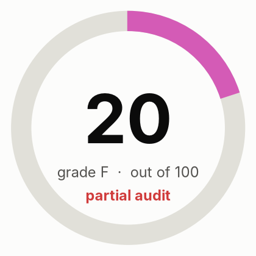

| Area | Score | Weight | How it is scored |
|---|---:|---:|---|
| Crawl and indexing | 65 | 20 | Rules only |
| On-page | 95 | 15 | Rules only |
| Content quality | 70 | 20 | 70% Jev judgment (helpfulness, specificity, trust), 30% rules |
| Links and architecture | 100 | 10 | Rules only |
| Structured data and sharing | 93 | 8 | Rules only |
| AI search readiness | 88 | 12 | 70% Jev judgment (citability, answer-first, entity clarity), 30% rules; editorial heuristics, since Google states no special optimization is required for AI features |
| Performance | 98 | 10 | Crawl observations only: PageSpeed Insights unavailable |
| Security and trust | 88 | 5 | Rules only |
| Search visibility and authority | n/a | 15 | Not assessed: run with --full (DataForSEO) |

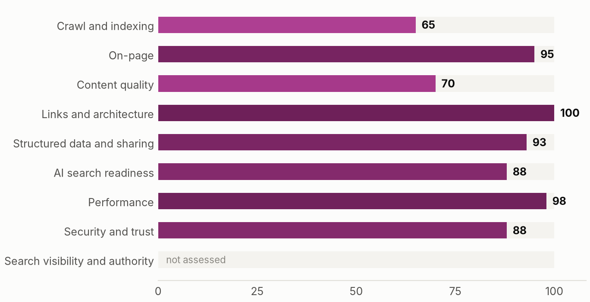

**Contents:** [Executive summary](#executive-summary) · [How this audit was made](#how-this-audit-was-made) · [Priority actions](#priority-actions) · [What the crawl found](#what-the-crawl-found) · [How Jev reads the site](#how-jev-reads-the-site) · [Findings by area](#findings-by-area) · [Robots access](#robots-access) · [Page inventory](#page-inventory) · [Method and limits](#method-and-limits)

## Executive summary

119.91.205.130 scores 20 out of 100 (grade F) across 8 scored areas. The strongest areas are links and architecture, performance, on-page; the weakest are crawl and indexing, content quality, AI search readiness. The audit produced 12 actions, 2 of them marked fix first and 1 quick wins.

**What is working**

- Links and architecture scores 100.
- Performance scores 98.
- On-page scores 95.

**What is holding the site back**

- JEV-001: Pages excluded from search with noindex (60 pages carry noindex)
- JEV-002: Site not served over HTTPS, or HTTP does not redirect to HTTPS (Homepage over HTTPS: False; HTTP redirects to HTTPS: False)

### Plan

**This week**

- JEV-001 Pages excluded from search with noindex

**This month**

- JEV-002 Site not served over HTTPS, or HTTP does not redirect to HTTPS
- JEV-003 No structured data on the homepage

**This quarter**

- JEV-004 Sitemap lists URLs that redirect, fail or are noindex
- JEV-005 Key pages show little evidence of expertise or trust
- JEV-006 Canonical points to a different URL
- JEV-007 Duplicate titles across pages
- JEV-008 Pages with identical main text

_Written by: Automatic summary (no lead-agent narrative was written)._

## How this audit was made

A source finds, code decides, Jev judges, Claude writes. Code crawls, counts and scores. Jev (TypeSafe's System One model) answers narrow typed questions about meaning, with probabilities. Missing data is shown as missing.

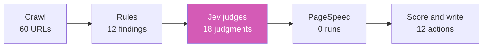

## Priority actions

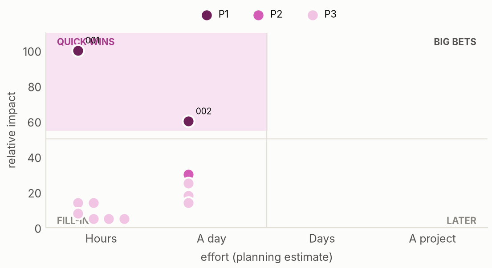

| ID | Action | Priority | Impact | Effort | Pages | By | Verify |
|---|---|---|---:|---|---:|---|---:|
| JEV-001 | Pages excluded from search with noindex (quick win) | P1 Fix first | 100 | Hours | 60 | rule |  |
| JEV-002 | Site not served over HTTPS, or HTTP does not redirect to HTTPS | P1 Fix first | 60 | About a day | 1 | rule |  |
| JEV-003 | No structured data on the homepage | P2 Plan next | 30 | About a day | 1 | rule |  |
| JEV-004 | Sitemap lists URLs that redirect, fail or are noindex | P3 When convenient | 25 | About a day | 37 | rule |  |
| JEV-005 | Key pages show little evidence of expertise or trust | P3 When convenient | 18 | About a day | 1 | Jev judged |  |
| JEV-006 | Canonical points to a different URL | P3 When convenient | 14 | Hours | 10 | rule |  |
| JEV-007 | Duplicate titles across pages | P3 When convenient | 14 | Hours | 11 | rule |  |
| JEV-008 | Pages with identical main text | P3 When convenient | 14 | About a day | 11 | rule |  |
| JEV-009 | Images without width and height | P3 When convenient | 8 | Hours | 36 | rule |  |
| JEV-010 | Pages without a canonical link | P3 When convenient | 5 | Hours | 17 | rule |  |
| JEV-011 | Duplicate meta descriptions | P3 When convenient | 5 | Hours | 14 | rule |  |
| JEV-012 | Structured data missing properties Google requires for rich results | P3 When convenient | 5 | Hours | 24 | rule |  |

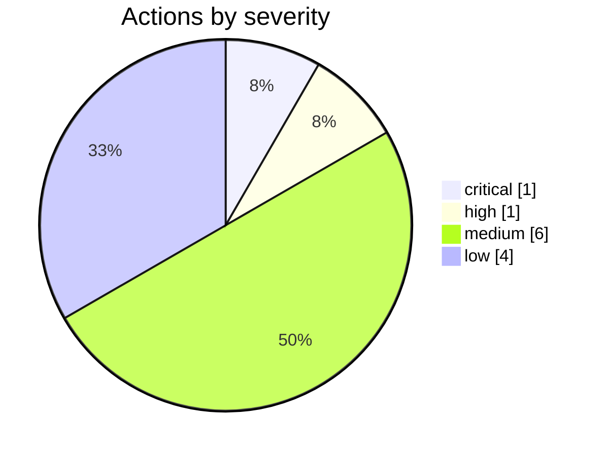

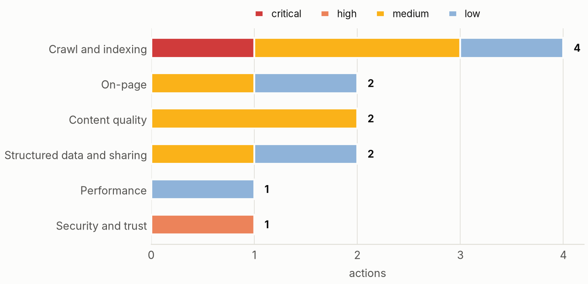

## What the crawl found

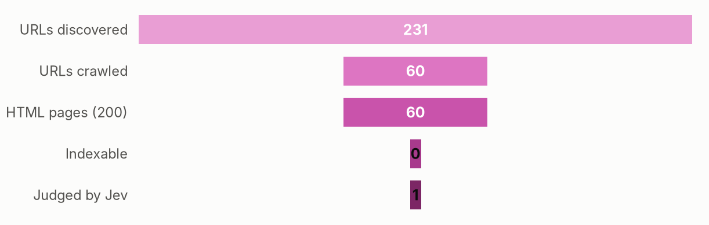

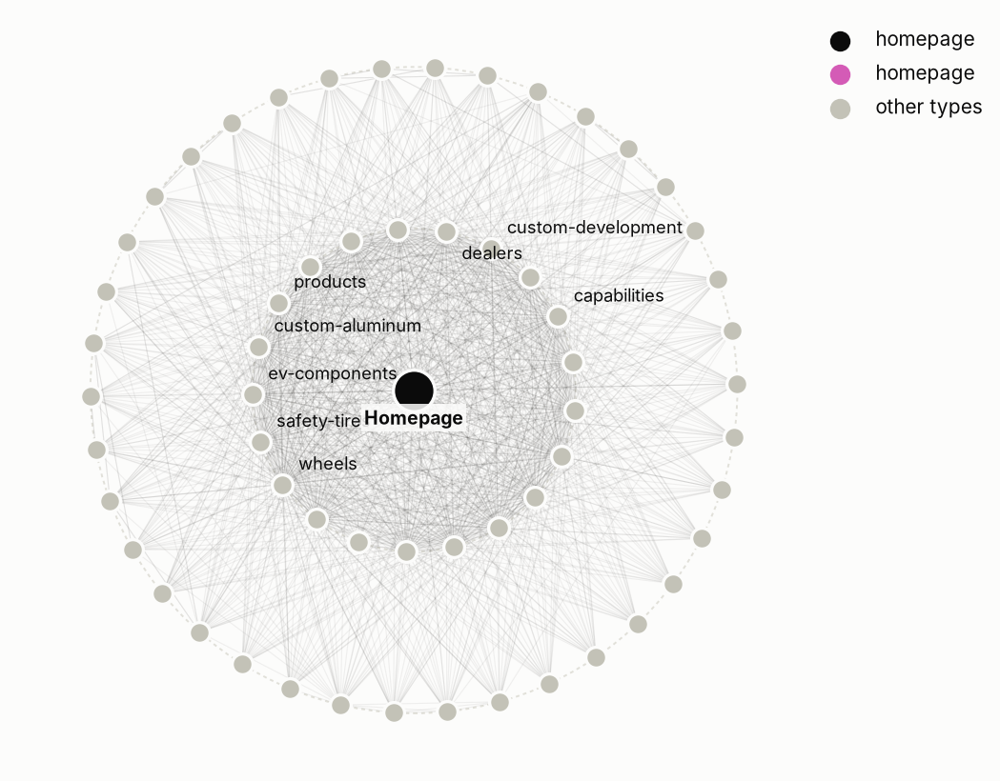

## How Jev reads the site

- **What kind of business is this?** agency or b2b services, confidence 0.72 _(verify)_
- **How clear is the offer on the homepage?** 0.93, confidence 0.80
- **Does the homepage say who, what and where?** P(yes) 0.88
- **How focused is the site's topic set?** 1.00, confidence 1.00
- **Does it serve a specific local area?** P(yes) 0.21 _(verify)_

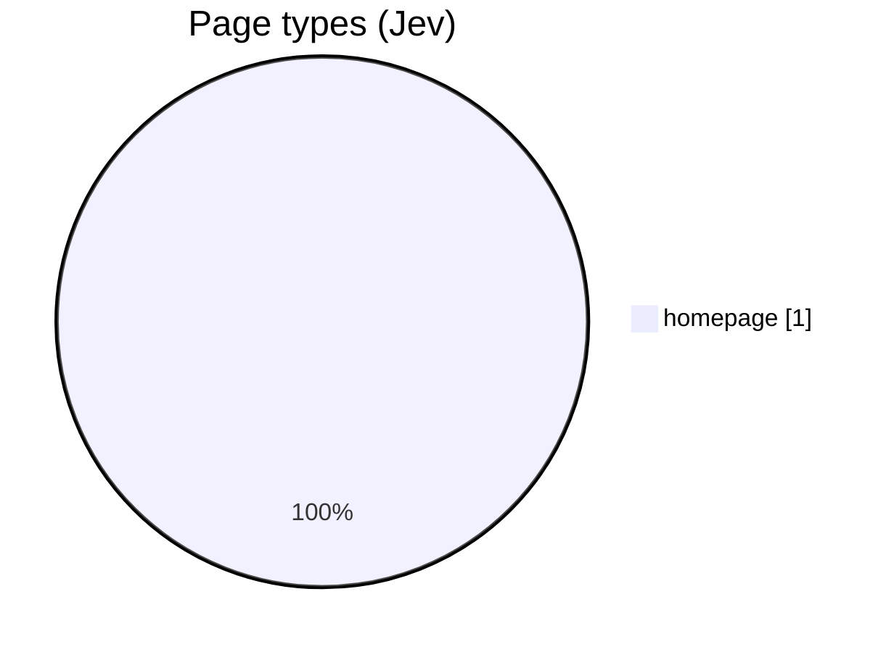

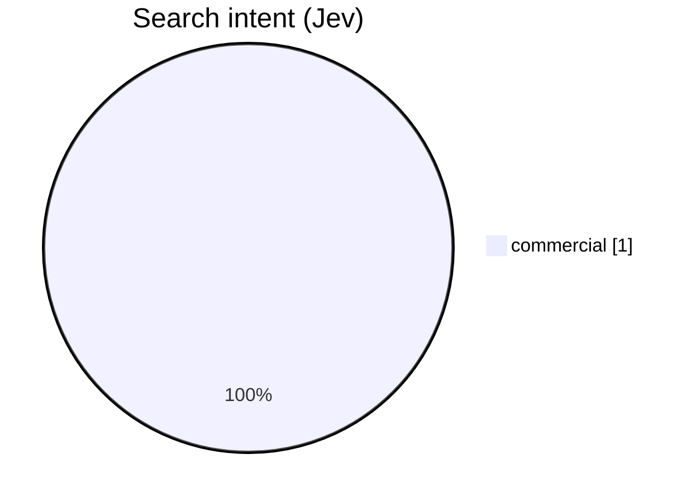

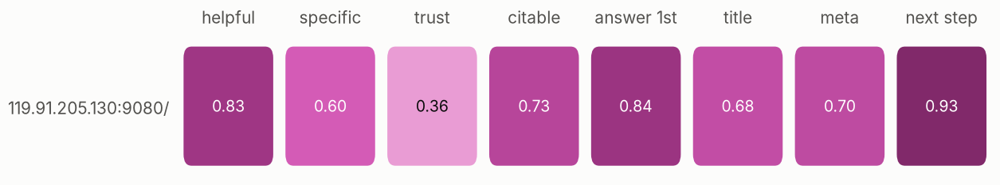

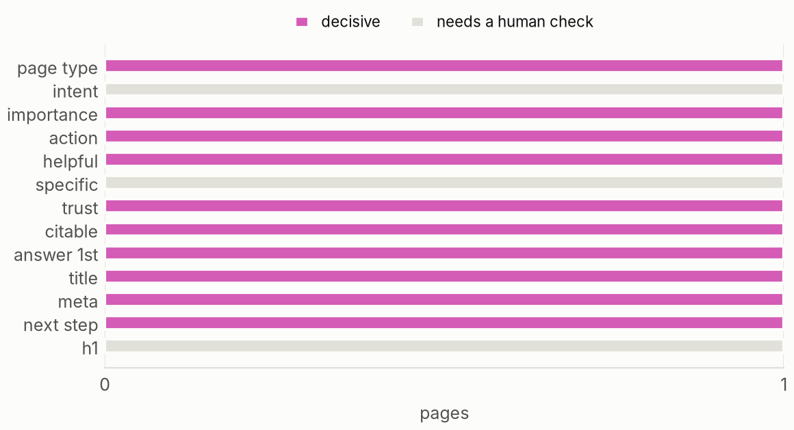

### Where to invest

## Findings by area

### Crawl and indexing (65)

**JEV-001 · Pages excluded from search with noindex** `P1` `critical` `rule`

- Evidence: 60 affected · 60 pages carry noindex
- Fix: Confirm each noindex is intended; remove it from pages that should rank. ([source](https://developers.google.com/search/docs/crawling-indexing/block-indexing))
- URLs: http://119.91.205.130:9080/, http://119.91.205.130:9080/products, http://119.91.205.130:9080/products/wheels, http://119.91.205.130:9080/products/ev-components, http://119.91.205.130:9080/products/custom-aluminum, http://119.91.205.130:9080/products/safety-tires, http://119.91.205.130:9080/capabilities, http://119.91.205.130:9080/custom-development and 52 more

**JEV-004 · Sitemap lists URLs that redirect, fail or are noindex** `P3` `medium` `rule`

- Evidence: 37 affected · 37 of the crawled sitemap URLs are not final indexable pages
- Fix: List only final, indexable, HTTP 200 URLs in the sitemap. ([source](https://developers.google.com/search/docs/crawling-indexing/sitemaps/overview))
- URLs: http://119.91.205.130:9080/, http://119.91.205.130:9080/about, http://119.91.205.130:9080/capabilities, http://119.91.205.130:9080/contact, http://119.91.205.130:9080/custom-development, http://119.91.205.130:9080/products, http://119.91.205.130:9080/products/ev-components, http://119.91.205.130:9080/products/safety-tires and 29 more

**JEV-006 · Canonical points to a different URL** `P3` `medium` `rule`

- Evidence: 10 affected · http://119.91.205.130:9080/request-a-quote?from=home -> http://119.91.205.130:9080/request-a-quote; http://119.91.205.130:9080/request-a-quote?product_line=wheels -> http://119.91.205.130:9080/request-a-quote; http://119.91.205.130:9080/request-a-quote?product_line=ev-components&intent=project_assessment&from=ev-components&category=water-cooled-motor&evidence=unspecified -> http://119.91.205.130:9080/request-a-quote; http://119.91.205.130:9080/request-a-quote?product_line=ev-components&intent=project_assessment&from=ev-components&category=die-cast-motor&evidence=unspecified -> http://119.91.205.130:9080/request-a-quote; http://119.91.205.130:9080/request-a-quote?product_line=ev-components&intent=project_assessment&from=ev-components&category=controller-inverter&evidence=unspecified -> http://119.91.205.130:9080/request-a-quote
- Fix: Check that these pages really are duplicates of their canonical target; otherwise self-canonicalise. ([source](https://developers.google.com/search/docs/crawling-indexing/consolidate-duplicate-urls))
- URLs: http://119.91.205.130:9080/request-a-quote?from=home, http://119.91.205.130:9080/request-a-quote?product_line=wheels, http://119.91.205.130:9080/request-a-quote?product_line=ev-components&intent=project_assessment&from=ev-components&category=water-cooled-motor&evidence=unspecified, http://119.91.205.130:9080/request-a-quote?product_line=ev-components&intent=project_assessment&from=ev-components&category=die-cast-motor&evidence=unspecified, http://119.91.205.130:9080/request-a-quote?product_line=ev-components&intent=project_assessment&from=ev-components&category=controller-inverter&evidence=unspecified, http://119.91.205.130:9080/request-a-quote?product_line=ev-components&intent=project_assessment&from=ev-components&category=unspecified&evidence=project_evidence_list, http://119.91.205.130:9080/request-a-quote?product_line=ev-components&intent=project_assessment&from=ev-components&category=unspecified&evidence=unspecified, http://119.91.205.130:9080/request-a-quote?product_line=custom-aluminum&intent=project_assessment&from=custom-aluminum&application=motor-reducer&input_type=unspecified and 2 more

**JEV-010 · Pages without a canonical link** `P3` `low` `rule`

- Evidence: 17 affected · 17 of 60 pages
- Fix: Add a self-referencing rel=canonical to each indexable page. ([source](https://developers.google.com/search/docs/crawling-indexing/consolidate-duplicate-urls))
- URLs: http://119.91.205.130:9080/products, http://119.91.205.130:9080/products/custom-aluminum, http://119.91.205.130:9080/products/safety-tires, http://119.91.205.130:9080/capabilities, http://119.91.205.130:9080/custom-development, http://119.91.205.130:9080/dealers, http://119.91.205.130:9080/dealers/private-label, http://119.91.205.130:9080/insights and 9 more

### On-page (95)

**JEV-007 · Duplicate titles across pages** `P3` `medium` `rule`

- Evidence: 11 affected · 1 title shared by several pages
- Fix: Give each page a title that distinguishes it from the others. ([source](https://developers.google.com/search/docs/appearance/title-link))
- URLs: http://119.91.205.130:9080/request-a-quote, http://119.91.205.130:9080/request-a-quote?from=home, http://119.91.205.130:9080/request-a-quote?product_line=custom-aluminum&intent=project_assessment&from=custom-aluminum&application=battery-system-structures&input_type=unspecified, http://119.91.205.130:9080/request-a-quote?product_line=custom-aluminum&intent=project_assessment&from=custom-aluminum&application=motor-reducer&input_type=unspecified, http://119.91.205.130:9080/request-a-quote?product_line=custom-aluminum&intent=project_assessment&from=custom-aluminum&application=power-electronics-thermal-management&input_type=unspecified, http://119.91.205.130:9080/request-a-quote?product_line=ev-components&intent=project_assessment&from=ev-components&category=controller-inverter&evidence=unspecified, http://119.91.205.130:9080/request-a-quote?product_line=ev-components&intent=project_assessment&from=ev-components&category=die-cast-motor&evidence=unspecified, http://119.91.205.130:9080/request-a-quote?product_line=ev-components&intent=project_assessment&from=ev-components&category=unspecified&evidence=project_evidence_list and 3 more

**JEV-011 · Duplicate meta descriptions** `P3` `low` `rule`

- Evidence: 14 affected · 2 descriptions shared by several pages
- Fix: Write a distinct description for each page. ([source](https://developers.google.com/search/docs/appearance/snippet))
- URLs: http://119.91.205.130:9080/products/wheels, http://119.91.205.130:9080/products/wheels?page=2, http://119.91.205.130:9080/products/wheels?page=6, http://119.91.205.130:9080/request-a-quote, http://119.91.205.130:9080/request-a-quote?from=home, http://119.91.205.130:9080/request-a-quote?product_line=custom-aluminum&intent=project_assessment&from=custom-aluminum&application=battery-system-structures&input_type=unspecified, http://119.91.205.130:9080/request-a-quote?product_line=custom-aluminum&intent=project_assessment&from=custom-aluminum&application=motor-reducer&input_type=unspecified, http://119.91.205.130:9080/request-a-quote?product_line=custom-aluminum&intent=project_assessment&from=custom-aluminum&application=power-electronics-thermal-management&input_type=unspecified and 6 more

### Content quality (70)

**JEV-005 · Key pages show little evidence of expertise or trust** `P3` `medium` `Jev judged`

- Evidence: 1 affected · Jev trust averaged 0.36 (0 worst, 1 best) on 1 page: /
- Fix: Add named people, credentials, reviews, sources, results and contact details where they help the reader. ([source](https://developers.google.com/search/docs/fundamentals/creating-helpful-content))
- URLs: http://119.91.205.130:9080/

**JEV-008 · Pages with identical main text** `P3` `medium` `rule`

- Evidence: 11 affected · 2 groups of pages with identical main text
- Fix: Consolidate duplicates or canonicalise them to one URL. ([source](https://developers.google.com/search/docs/crawling-indexing/consolidate-duplicate-urls))
- URLs: http://119.91.205.130:9080/request-a-quote, http://119.91.205.130:9080/request-a-quote?from=home, http://119.91.205.130:9080/request-a-quote?product_line=custom-aluminum&intent=project_assessment&from=custom-aluminum&application=battery-system-structures&input_type=unspecified, http://119.91.205.130:9080/request-a-quote?product_line=custom-aluminum&intent=project_assessment&from=custom-aluminum&application=motor-reducer&input_type=unspecified, http://119.91.205.130:9080/request-a-quote?product_line=custom-aluminum&intent=project_assessment&from=custom-aluminum&application=power-electronics-thermal-management&input_type=unspecified, http://119.91.205.130:9080/request-a-quote?product_line=ev-components&intent=project_assessment&from=ev-components&category=controller-inverter&evidence=unspecified, http://119.91.205.130:9080/request-a-quote?product_line=ev-components&intent=project_assessment&from=ev-components&category=die-cast-motor&evidence=unspecified, http://119.91.205.130:9080/request-a-quote?product_line=ev-components&intent=project_assessment&from=ev-components&category=unspecified&evidence=project_evidence_list and 3 more

### Structured data and sharing (93)

**JEV-003 · No structured data on the homepage** `P2` `medium` `rule`

- Evidence: 1 affected · No JSON-LD or microdata types on the homepage
- Fix: Add JSON-LD describing the organisation and website (for example Organization and WebSite). ([source](https://developers.google.com/search/docs/appearance/structured-data/intro-structured-data))
- URLs: http://119.91.205.130:9080/

**JEV-012 · Structured data missing properties Google requires for rich results** `P3` `low` `rule`

- Evidence: 24 affected · Product on /products/wheels/12 lacks offers, review or aggregateRating; Product on /products/wheels/260201004 lacks offers, review or aggregateRating; Product on /products/wheels/260202003 lacks offers, review or aggregateRating; Product on /products/wheels/260203003 lacks offers, review or aggregateRating; Product on /products/wheels/a015 lacks offers, review or aggregateRating; Product on /products/wheels/a091f lacks offers, review or aggregateRating; and 18 more
- Fix: Add the missing required properties listed in the evidence, or remove markup that cannot be completed truthfully. ([source](https://developers.google.com/search/docs/appearance/structured-data/intro-structured-data))
- URLs: http://119.91.205.130:9080/products/wheels/12, http://119.91.205.130:9080/products/wheels/260201004, http://119.91.205.130:9080/products/wheels/260202003, http://119.91.205.130:9080/products/wheels/260203003, http://119.91.205.130:9080/products/wheels/a015, http://119.91.205.130:9080/products/wheels/a091f, http://119.91.205.130:9080/products/wheels/av08, http://119.91.205.130:9080/products/wheels/cg02b and 16 more

### Performance (98)

**JEV-009 · Images without width and height** `P3` `low` `rule`

- Evidence: 36 affected · 263 images without explicit size
- Fix: Set width and height so layout does not shift while images load. ([source](https://web.dev/articles/optimize-cls))
- URLs: http://119.91.205.130:9080/, http://119.91.205.130:9080/products/wheels, http://119.91.205.130:9080/products/ev-components, http://119.91.205.130:9080/products/custom-aluminum, http://119.91.205.130:9080/products/safety-tires, http://119.91.205.130:9080/capabilities, http://119.91.205.130:9080/insights, http://119.91.205.130:9080/about and 28 more

### Security and trust (88)

**JEV-002 · Site not served over HTTPS, or HTTP does not redirect to HTTPS** `P1` `high` `rule`

- Evidence: 1 affected · Homepage over HTTPS: False; HTTP redirects to HTTPS: False
- Fix: Serve every page over HTTPS and permanently redirect HTTP to HTTPS. ([source](https://developers.google.com/search/docs/appearance/page-experience))
- URLs: http://119.91.205.130:9080/

## Robots access

| User agent | Access |
|---|---|
| Googlebot | allowed |
| Bingbot | allowed |
| GPTBot | allowed |
| OAI-SearchBot | allowed |
| ChatGPT-User | allowed |
| ClaudeBot | allowed |
| Claude-SearchBot | allowed |
| PerplexityBot | allowed |
| Google-Extended | allowed |
| Applebot-Extended | allowed |
| CCBot | allowed |
| Bytespider | allowed |

## Page inventory

| Page | Depth | Words | Inlinks | Type (Jev) | Intent (Jev) | Importance | Action (Jev) |
|---|---:|---:|---:|---|---|---:|---|
| http://119.91.205.130:9080/ | 0 | 672 | 59 | homepage | commercial | 1.00 | keep or improve |
| http://119.91.205.130:9080/about | 1 | 1024 | 59 |  |  |  |  |
| http://119.91.205.130:9080/capabilities | 1 | 664 | 59 |  |  |  |  |
| http://119.91.205.130:9080/contact | 1 | 493 | 59 |  |  |  |  |
| http://119.91.205.130:9080/custom-development | 1 | 652 | 59 |  |  |  |  |
| http://119.91.205.130:9080/dealers | 1 | 1036 | 59 |  |  |  |  |
| http://119.91.205.130:9080/dealers/private-label | 1 | 876 | 59 |  |  |  |  |
| http://119.91.205.130:9080/insights | 1 | 1890 | 59 |  |  |  |  |
| http://119.91.205.130:9080/insights/bolt-patterns | 1 | 1049 | 59 |  |  |  |  |
| http://119.91.205.130:9080/products | 1 | 762 | 59 |  |  |  |  |
| http://119.91.205.130:9080/products/custom-aluminum | 1 | 1265 | 59 |  |  |  |  |
| http://119.91.205.130:9080/products/ev-components | 1 | 875 | 59 |  |  |  |  |
| http://119.91.205.130:9080/products/safety-tires | 1 | 1123 | 59 |  |  |  |  |
| http://119.91.205.130:9080/products/wheels | 1 | 1002 | 59 |  |  |  |  |
| http://119.91.205.130:9080/request-a-quote | 1 | 227 | 59 |  |  |  |  |
| http://119.91.205.130:9080/request-a-quote?from=home | 1 | 227 | 1 |  |  |  |  |
| http://119.91.205.130:9080/support/privacy | 1 | 1168 | 59 |  |  |  |  |
| http://119.91.205.130:9080/support/returns | 1 | 785 | 59 |  |  |  |  |
| http://119.91.205.130:9080/support/shipping | 1 | 938 | 59 |  |  |  |  |
| http://119.91.205.130:9080/support/terms | 1 | 1175 | 59 |  |  |  |  |
| http://119.91.205.130:9080/support/warranty | 1 | 961 | 59 |  |  |  |  |
| http://119.91.205.130:9080/tools/offset-calculator | 1 | 1649 | 59 |  |  |  |  |
| http://119.91.205.130:9080/gallery/finishes | 2 | 375 | 1 |  |  |  |  |
| http://119.91.205.130:9080/products/wheels/12 | 2 | 512 | 5 |  |  |  |  |
| http://119.91.205.130:9080/products/wheels/260201004 | 2 | 530 | 3 |  |  |  |  |
| http://119.91.205.130:9080/products/wheels/260202003 | 2 | 507 | 3 |  |  |  |  |
| http://119.91.205.130:9080/products/wheels/260203003 | 2 | 507 | 3 |  |  |  |  |
| http://119.91.205.130:9080/products/wheels/a015 | 2 | 633 | 7 |  |  |  |  |
| http://119.91.205.130:9080/products/wheels/a091f | 2 | 510 | 5 |  |  |  |  |
| http://119.91.205.130:9080/products/wheels/av08 | 2 | 630 | 2 |  |  |  |  |
| http://119.91.205.130:9080/products/wheels/cg02b | 2 | 538 | 5 |  |  |  |  |
| http://119.91.205.130:9080/products/wheels/cg02p | 2 | 538 | 3 |  |  |  |  |
| http://119.91.205.130:9080/products/wheels/cjf015 | 2 | 544 | 2 |  |  |  |  |
| http://119.91.205.130:9080/products/wheels/dim057 | 2 | 827 | 3 |  |  |  |  |
| http://119.91.205.130:9080/products/wheels/dim5014 | 2 | 627 | 3 |  |  |  |  |
| http://119.91.205.130:9080/products/wheels/dim5018 | 2 | 592 | 3 |  |  |  |  |
| http://119.91.205.130:9080/products/wheels/dim687 | 2 | 545 | 3 |  |  |  |  |
| http://119.91.205.130:9080/products/wheels/dm902 | 2 | 636 | 1 |  |  |  |  |
| http://119.91.205.130:9080/products/wheels/dq002 | 2 | 625 | 5 |  |  |  |  |
| http://119.91.205.130:9080/products/wheels/dq019209001s3212 | 2 | 518 | 3 |  |  |  |  |
| http://119.91.205.130:9080/products/wheels/dq019209011sh3212 | 2 | 518 | 3 |  |  |  |  |
| http://119.91.205.130:9080/products/wheels/dx035 | 2 | 554 | 5 |  |  |  |  |
| http://119.91.205.130:9080/products/wheels/dx045 | 2 | 509 | 3 |  |  |  |  |
| http://119.91.205.130:9080/products/wheels/dx046 | 2 | 510 | 1 |  |  |  |  |
| http://119.91.205.130:9080/products/wheels/dx088 | 2 | 854 | 7 |  |  |  |  |
| http://119.91.205.130:9080/products/wheels/dx125 | 2 | 548 | 1 |  |  |  |  |
| http://119.91.205.130:9080/products/wheels/dx137 | 2 | 521 | 2 |  |  |  |  |
| http://119.91.205.130:9080/products/wheels/flow-formed | 2 | 1347 | 3 |  |  |  |  |
| http://119.91.205.130:9080/products/wheels/forged | 2 | 542 | 4 |  |  |  |  |
| http://119.91.205.130:9080/products/wheels?page=2 | 2 | 999 | 1 |  |  |  |  |
| http://119.91.205.130:9080/products/wheels?page=6 | 2 | 887 | 2 |  |  |  |  |
| http://119.91.205.130:9080/request-a-quote?product_line=custom-aluminum&intent=project_assessment&from=custom-aluminum&application=battery-system-structures&input_type=unspecified | 2 | 244 | 1 |  |  |  |  |
| http://119.91.205.130:9080/request-a-quote?product_line=custom-aluminum&intent=project_assessment&from=custom-aluminum&application=motor-reducer&input_type=unspecified | 2 | 244 | 1 |  |  |  |  |
| http://119.91.205.130:9080/request-a-quote?product_line=custom-aluminum&intent=project_assessment&from=custom-aluminum&application=power-electronics-thermal-management&input_type=unspecified | 2 | 244 | 1 |  |  |  |  |
| http://119.91.205.130:9080/request-a-quote?product_line=ev-components&intent=project_assessment&from=ev-components&category=controller-inverter&evidence=unspecified | 2 | 244 | 1 |  |  |  |  |
| http://119.91.205.130:9080/request-a-quote?product_line=ev-components&intent=project_assessment&from=ev-components&category=die-cast-motor&evidence=unspecified | 2 | 244 | 1 |  |  |  |  |
| http://119.91.205.130:9080/request-a-quote?product_line=ev-components&intent=project_assessment&from=ev-components&category=unspecified&evidence=project_evidence_list | 2 | 244 | 1 |  |  |  |  |
| http://119.91.205.130:9080/request-a-quote?product_line=ev-components&intent=project_assessment&from=ev-components&category=unspecified&evidence=unspecified | 2 | 244 | 1 |  |  |  |  |
| http://119.91.205.130:9080/request-a-quote?product_line=ev-components&intent=project_assessment&from=ev-components&category=water-cooled-motor&evidence=unspecified | 2 | 244 | 1 |  |  |  |  |
| http://119.91.205.130:9080/request-a-quote?product_line=wheels | 2 | 244 | 3 |  |  |  |  |

## Method and limits

- Area score: 100 minus, per finding, severity amount (critical 25, high 12, medium 6, low 2) × (0.5 + 0.5 × share of pages affected). Content and AI readiness blend 70% Jev judgment with 30% rules. Performance blends 50% Lighthouse mobile with 50% crawl observations.
- Overall: weighted mean of scored areas; unscored areas are excluded, never zero.
- Impact: severity weight × (0.6 + 0.4 × reach) × (0.6 + 0.8 × highest Jev importance of affected pages), scaled to 100.
- Jev answers are decisive at confidence 0.80 (Choice, Score) or P(yes) at least 0.80 or at most 0.20 (Noul). Others are flagged to verify.
- Jev: model jev-1.13.0, 2 requests, 4991 input tokens, 0 failed, cost $0.0002.
- No Search Console, analytics, backlink or keyword data was used (run with --full for DataForSEO).
- Scores rank work; they do not predict rankings or traffic.

_Generated by jev-seo 0.1.1._
