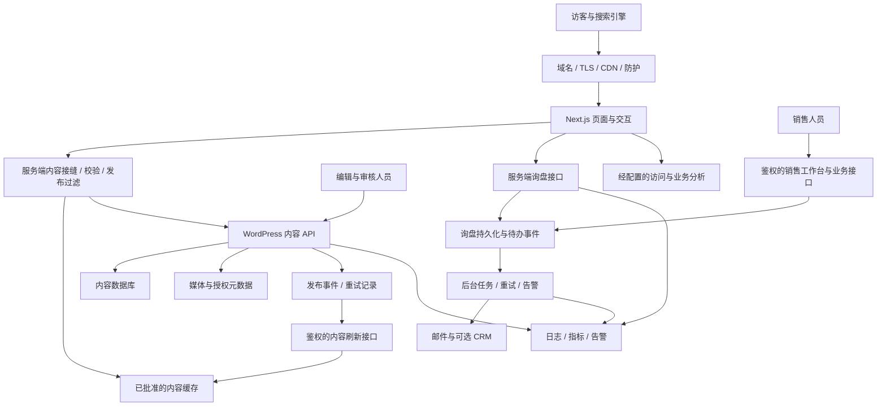

# Next.js + Headless WordPress 商业独立站建设与重构蓝图

> 编写日期：2026-10-14
>
> 文档性质：面向目标状态的商业网站长篇规划与模块改造指南。
>
> 阅读对象：企业负责人、产品与内容负责人、设计师、前后端开发、销售和运维人员。

**一个达到商用水准的独立站，应当让客户能够理解企业、找到合适的产品、核实关键事实、顺利发起业务，并让企业能够持续发布内容、接住商机、衡量结果和恢复故障。** Next.js 与无头 WordPress 可以组成这样的系统，但这两项技术只是基础。商业质量来自产品信息、内容治理、用户体验、业务处理和运营保障之间的完整配合。

本文按用户要求，不依据现有代码、当前完成度、既定上线日期或已有预算来限制目标方案，也不审计现有实现。以“面向海外市场、以产品与能力展示和询盘获客为核心的企业独立站”为主要场景；在线交易作为条件性扩展单独说明。制造业、工业品、定制产品是文中主要例子，不代表对某家企业资质、产能、规格或服务范围的事实确认。

这里的“需要更新、补齐或重构”表示：**要达到本蓝图的目标，必须逐项对照处理；不能据此推断当前模块一定不存在或一定有缺陷。** 本文是待评审的目标建议，不取代仓库中的现行架构、页面规格与决策正本。只有方案被采纳并进入实施，才应将对应决定写入正式架构与规格。

本文采用用户认可的商业标准作为基线：**品牌展示系统 + 产品管理系统 + 客户转化系统 + 内容增长系统 + 数据分析系统 + 安全运维系统。** 对询盘型网站，目标闭环包括多产品／多 SKU 询盘清单、询盘主记录与明细、可靠通知、销售分配、跟进和结果统计。商业网站可以通过询盘完成成交，不以具备在线支付作为所有网站的统一门槛。

## 阅读导航

1. [商用级的定义与业务边界](#s1)
2. [整体系统架构与关键数据流](#s2)
3. [网站信息架构与页面组织](#s3)
4. [内容模型与发布规则](#s4)
5. [前台业务模块：M01—M17](#s5)
6. [后台与工程模块：M18—M25](#s6)
7. [运营与持续交付模块：M26—M32](#s7)
8. [逐模块更新与重构总表](#s8)
9. [分阶段落地与迁移方法](#s9)
10. [商业上线验收清单](#s10)
11. [运营分工、成本与交接](#s11)
12. [官方资料与使用边界](#s12)

<a id="s1"></a>
## 一、商用级的定义与业务边界

### 1.1 先定义网站承担的生意

网站建设首先要回答：客户是谁、客户要完成什么决策、企业准备如何承接。这会直接决定目录结构、表单长度、内容深度和后台复杂度。

| 业务模式 | 客户在网站上的主要任务 | 网站必须承接的结果 |
|---|---|---|
| 标准产品询价 | 找型号、确认参数、比较方案、索取报价 | 有型号和需求上下文的询盘 |
| 定制项目开发 | 理解能力、确认条件、提出项目需求 | 可由工程或销售判断的项目线索 |
| 经销与批发合作 | 判断产品组合、供货关系和合作方式 | 可分配负责人的渠道合作申请 |
| 个人购买咨询 | 确认用途、数量、适用性与联系方法 | 不被企业字段阻挡的咨询 |
| 在线零售交易 | 判断价格、库存、运费、交付和退换 | 可结算、履约、对账和售后的订单 |

前四类可以共用内容与询盘基础设施，但应该有不同的入口与条件字段。第五类会新增交易系统责任，不能用“询盘按钮换成购买按钮”实现。

本蓝图建议先建立产品展示与询盘闭环，保留交易扩展边界。是否开放某种客户类型，必须由企业真实交付能力决定；不能让网站承诺团队无法提供的服务。

### 1.2 商业质量的六个维度

| 维度 | 客户感受到的结果 | 企业应当拿得出的证据 |
|---|---|---|
| 清晰 | 知道你是谁、卖什么、适合谁 | 页面结构、产品分类与用户任务相匹配 |
| 可信 | 参数、图片、案例和承诺可核实 | 内容来源、审批人、授权记录与版本 |
| 易用 | 手机能浏览、筛选、阅读和提交 | 真实设备与键盘操作验收 |
| 可靠 | 提交不会悄悄丢失，内容不会随意泄露 | 持久化、权限、重试与恢复演练 |
| 可运营 | 编辑和销售能够独立完成日常工作 | 上新、撤稿、跟进、导出和交接记录 |
| 可改进 | 知道哪些页面和渠道产生有效商机 | 从访问到有效询盘、报价和成交的统计口径 |

页面视觉精致是其中一部分。商用网站也不等于必须拥有会员、商城、AI 客服、多语言、复杂动画和微服务。功能是否必要，取决于它是否服务真实用户任务，以及企业是否有能力维护。

### 1.3 目标分级与本文标注

全文采用以下工作类型，实际项目评估后再确定适用项：

- **需更新（U）**：边界与结构可用，但资料、文案、图片、配置或字段需更新。
- **需补齐（A）**：目标能力缺失，需要新增流程、字段、界面或服务。
- **条件性重构（R）**：若现有实现把职责混在一起、无法扩展或无法保证可靠性，应调整结构。
- **需核验（V）**：必须用真实数据、权限或故障场景验证，不能凭截图判断完成。

优先级以商业风险划分：

- **P0：商用上线必备。** 关系到关键内容真实性、咨询可达、数据安全、核心可用性与恢复。
- **P1：增长与运营成熟度。** 对获客和效率重要，但可根据实际范围分批上线。
- **P2：有条件扩展。** 有明确需求、负责人和维护能力后建设。

优先级不表示页面越多越好。例如没有可公开案例时，关闭案例入口可以是合格结果；发布虚构案例则不合格。

<a id="s2"></a>
## 二、整体系统架构与关键数据流

### 2.1 推荐形态：边界清楚的模块化系统

推荐采用“静态优先的 Next.js 展示层 + WordPress 内容管理 + 服务端业务接口 + 持久化业务记录 + 后台任务”的形态。早期可以集中部署，按职责划分模块即可，不必一开始拆成多个微服务。



图中是逻辑模块，不代表每个方框都要购买一个服务。内容数据与询盘记录可以共享物理数据库，但必须分开数据模型、权限、查询接口和保留规则。只有运维隔离、规模或可靠性要求足够明确时，才值得拆分物理存储。

### 2.2 各层到底负责什么

| 层级 | 应当负责 | 不应承接的职责 |
|---|---|---|
| Next.js 展示层 | 页面、导航、交互、可访问性、元数据输出 | 在组件里解释 WordPress 原始字段或决定审核资格 |
| 内容接缝 | 数据适配、运行时校验、语言解析、发布过滤 | 页面视觉排版和销售处理逻辑 |
| WordPress | 内容录入、结构化字段、媒体管理、审核与修订 | 任意执行前端代码、把客户隐私当公开文章输出 |
| 业务接口 | 输入校验、权限、防滥用、持久化与幂等 | 把发信成功当作唯一业务记录 |
| 后台任务 | 投递、重试、同步、定时检查与失败升级 | 依赖访客继续停留在页面才能完成 |
| 分析与监控 | 流量、转化、故障、责任追踪 | 无目的收集客户的完整个人资料 |

前台公开内容的事实来源应唯一。产品在 WordPress 中维护时，就不应再由某个页面文件手工维护第二份规格；全站联系电话、企业名称和政策链接也不应散落在十几个组件中。

### 2.3 四条必须闭合的数据链路

**链路一：内容发布。** 编辑录入资料 → 完成事实与素材审核 → 保存内容版本 → 发布事件持久记录 → Next.js 按影响范围刷新 → 检查页面、目录、搜索和 sitemap → 后台显示发布结果。WordPress 的保存成功与前台更新成功是两个不同状态。

**链路二：询盘处理。** 客户提交 → 服务端校验 → 生成稳定请求标识 → 持久保存询盘与待通知事件 → 向客户确认已接收 → 后台通知与分配 → 销售跟进 → 记录有效性、报价或关闭原因。客户收到成功提示之前，系统应当已经掌握可恢复的记录。

**链路三：内容撤回。** 审核人撤回资料 → 更新公开资格 → 失效关联缓存与搜索记录 → 页面、附件和索引入口按策略处理 → 验证旧地址。涉及隐私、权利或危险错误时，不能只等普通缓存自然过期。

**链路四：故障恢复。** 监控发现异常 → 指定负责人接手 → 选择代码回滚、数据恢复或服务切换 → 验证内容和询盘 → 补发未完成事件 → 记录原因与整改。备份只有在能恢复并核对业务数据时才有价值。

### 2.4 REST、GraphQL 与服务端取数

WordPress 原生 REST API 通常足够支持企业站。自定义内容类型和分类可以显式开放 REST 支持，但开放接口不等于所有字段都适合公开。[WordPress 自定义内容类型 REST 支持](https://developer.wordpress.org/rest-api/extending-the-rest-api/adding-rest-api-support-for-custom-content-types/)

建议先采用 REST、明确响应结构、分页和字段白名单。只有当关联查询复杂、查询次数和维护成本已成为真实问题时，再评估 GraphQL；GraphQL 并不会自动解决审核、缓存、访问控制或数据质量。

默认通过 Next.js 服务端读取并整理内容，浏览器只拿到展示所需信息。若某些公开搜索直接调用内容 API，应单独审核其字段、流量、防滥用和缓存边界。后台凭据只留在服务端。WordPress Application Passwords 可用于经 HTTPS 的服务间认证，配合专用账户与最小权限，而不是复用个人管理员密码。[WordPress 认证文档](https://developer.wordpress.org/rest-api/using-the-rest-api/authentication/)

### 2.5 渲染与缓存的目标，而非固定 API 配方

公开内容页面优先预渲染或缓存；预览、客户资料、后台操作和写入接口采用相应的动态处理。具体缓存 API 必须根据锁定的 Next.js 版本、是否启用 Cache Components、目标运行时来选择，不能混用不同版本教程的默认行为。官方已经分别提供不同缓存模型的说明。[Next.js 缓存指南](https://nextjs.org/docs/app/getting-started/caching) · [未启用 Cache Components 的缓存说明](https://nextjs.org/docs/app/guides/caching-without-cache-components)

| 内容或请求 | 推荐目标 | 故障时的行为 |
|---|---|---|
| 已批准的介绍页与文章 | 可缓存，发布后定向刷新 | 可以保留仍有公开资格的旧批准版本 |
| 产品目录与详情 | 可缓存，产品、分类和语言关联刷新 | 不把接口异常伪装成“没有产品” |
| 撤回内容 | 走紧急失效或拒绝访问机制 | 不因源站故障恢复为旧的可公开状态 |
| 编辑预览 | 鉴权读取草稿，禁止共享缓存 | 提示预览失败，不转成公开内容 |
| 询盘提交 | 动态处理，禁止缓存响应中的客户资料 | 明确失败或处理中，允许安全重试 |
| 询盘管理与导出 | 强鉴权、权限校验、审计 | 拒绝未授权读取 |

<a id="s3"></a>
## 三、网站信息架构与页面组织

### 3.1 围绕客户决策组织页面

```text
网站首页
├── 产品
│   ├── 产品线 / 分类页
│   ├── 产品详情页
│   └── 经审核的选型或适配页（有真实数据时）
├── 解决方案 / 应用
│   ├── 行业或用途页
│   └── 定制开发与合作流程
├── 制造与质量
│   ├── 制造能力及适用边界
│   └── 检验、追溯与证据说明
├── 案例（有公开授权时）
├── 知识与资源
│   ├── 技术文章 / 选型指南
│   ├── 常见问题
│   └── 下载资料
├── 关于企业
├── 联系与询盘
│   └── 提交结果页
└── 政策与服务说明
```

这是目标页面类型，不是强制一次性建立的栏目数量。某条产品线还没有成熟型号时，可以建立经过确认的能力页；没有案例证据时，暂不设置案例入口；资料量较小时，FAQ 和下载可以先放在相关页面内。

### 3.2 核心客户路径

| 进入方式 | 典型疑问 | 应有的连续路径 |
|---|---|---|
| 搜索具体型号 | 这个产品满足我的要求吗？ | 产品详情 → 规格与限制 → 带型号询盘 |
| 搜索某类供应商 | 你能供应哪些类型？ | 分类页 → 分类说明 → 产品或能力 → 询盘 |
| 搜索技术问题 | 我该怎样选择？ | 技术文章 → 选择依据 → 相关产品或方案 |
| 收到企业介绍链接 | 你们可靠吗？ | 关于 → 制造与质量 → 案例或证据 → 联系 |
| 广告或展会扫码 | 你能解决我的项目需求吗？ | 专题落地页 → 适用条件 → 精简项目表单 |

任何重要页面都应有明确的下一步，但下一步不一定是立即询盘。技术文章可以先引导阅读选型指南；证据页可以引导查看适用产品；高意向产品页则应直接传递产品上下文。

对于有车型、品牌和安装适用性需求的业务，可以在产品目录之上增加“品牌 → 车型 → 年款／版本 → 已验证候选产品”路径。这是一套需要独立数据治理的选型能力，不能把品牌名或车型关键词批量组合成页面。

### 3.3 不宜混淆的页面边界

产品页回答“这个具体型号是什么”；产品线页回答“这一类有什么选择”；能力页回答“可以做到什么、需要哪些输入”；案例页回答“在明确条件下实际完成过什么”；文章回答“某个问题该怎样理解”。

把这些内容混成一篇长图文，会同时伤害阅读、维护、筛选和搜索理解。反过来，为同一内容拆出大量只有标题不同的页面，也不能增加商业价值。

<a id="s4"></a>
## 四、内容模型与发布规则

### 4.1 内容应成为可管理的数据

| 内容对象 | 最低关键字段 | 主要关系 |
|---|---|---|
| 站点设置 | 企业正式名称、品牌、联系方式、导航、社交链接、默认元数据 | 被全站引用 |
| 产品线 / 分类 | 名称、说明、适用对象、选择维度、排序、语言状态 | 关联产品、能力和文章 |
| 产品 | 稳定标识、型号、名称、分类、摘要、主图、规格、审批状态 | 关联变体、媒体、证据和资料 |
| 产品变体 | 变体标识、有效参数组合、单位、供应状态、核验信息 | 从属于产品 |
| 能力 / 解决方案 | 问题、适用范围、输入条件、流程、限制与证据 | 关联产品、案例与询盘类型 |
| 案例 | 背景、目标、约束、方案、实际结果、授权范围 | 关联客户授权、产品和媒体 |
| 文章 / FAQ | 标题、正文、作者、审阅人、主题、发布日期、复核日期 | 关联产品与问题 |
| 媒体 / 下载资料 | 原件标识、衍生图、语言、权利、可见性、版本、替代说明 | 被产品和页面引用 |
| 证据 | 来源、权利主体、适用型号或范围、有效期、公开范围 | 支撑特定主张 |
| 政策 | 适用主体、适用市场、正文、版本、审核与生效日期 | 表单及页脚引用 |
| 询盘 | 请求标识、客户类型、联系信息、需求、产品快照、状态、负责人 | 独立私有业务对象 |

并不是每行都必须变成一个 WordPress 自定义文章类型。独立生命周期、被多处引用、需要权限或需要查询的对象才值得独立建模；简单展示块可以是受约束的页面字段。

### 4.2 产品参数必须表达真实组合

工业产品常见错误是把几个范围摆在一起，暗示范围内任意组合都能供应。例如宽度、直径、孔距、材料、表面处理各有多个值，不代表它们能进行任意组合。

建议采用“产品 → 已确认变体 → 变体参数和证据”的结构。范围说明可以作为能力介绍，但应与可供应型号分开。未知值用空值与解释表达，不能用 `0`、默认值或系列通用值填补。单位、测量条件、版本和适用范围需要一起维护。

对于影响安全或安装的适配结论，仅有尺寸相似不足以证明适用；页面应区分“客户提供的需求”“候选产品”和“经过工程核验的适配结论”。

### 4.3 发布资格不能只有一个布尔值

内容至少应能表达以下几个独立维度：

| 维度 | 示例状态 | 解决的问题 |
|---|---|---|
| 编辑 | 草稿、待审、已发布、已撤回 | 是否完成编辑流程 |
| 事实 | 未核验、已核验、需复核 | 参数与主张是否有依据 |
| 素材权利 | 未确认、已授权、到期、禁止公开 | 图片、案例、证书能否使用 |
| 语言 | 缺失、翻译中、待审、已批准、需更新 | 每个语言版本是否可发布 |
| 公开范围 | 内部、受限、公开 | 数据可以被谁读取 |
| 搜索资格 | 不索引、允许索引 | 已公开页面是否适合搜索发现 |

建议将“可公开”视为多项条件共同决定的结果：编辑发布成立、事实审核通过、所需素材已授权、语言版本已批准且没有撤回标记。索引资格在此基础上另行判断。

`noindex` 不是访问控制。一个不能公开的草稿，不能因为写了 `noindex` 就暴露在公共 API、图片地址或下载链接中。

### 4.4 内容更新与版本联动

产品规格变更后，相关下载资料、翻译、案例引用和适配结论可能需要复核。每项引用应保存稳定对象标识，关键主张应知道自己依赖哪个证据版本。

历史询盘则需要保存客户提交时的产品名称、型号、选中变体及内容版本快照，避免产品改名或下架之后，销售不知道客户当时看见了什么。快照中应只保留必要信息，并遵守业务数据的保留规则。

<a id="s5"></a>
## 五、前台业务模块：每个模块具体需要更新什么

### M01 · 商业定位与客户路径｜P0

**职责。** 将企业的真实业务转化为清晰的客户入口，确定以询盘、经销合作、项目沟通还是交易为主要结果。

**需要的内容。** 客户分组、目标市场、核心产品线、供应关系、差异化依据、服务边界、销售接单条件和实际跟进流程。每项优势应能对应证据，避免只写“高品质、全球领先、一站式服务”。

**更新与重构备注。** 【U】重写定位和主要价值说明；【A】为不同客户任务定义入口与转化结果；【R】若所有客户都被送到同一个没有上下文的联系表单，应拆分路径并复用底层表单能力。

**验收。** 由销售和业务负责人分别用真实客户问题走查；客户能判断是否适合自己，销售能解释每类提交应由谁处理。

### M02 · 信息架构与网址体系｜P0

**职责。** 建立稳定的分类、页面关系、网址、面包屑与跳转规则，让用户和搜索引擎都能理解网站。

**需要的内容。** 产品分类词表、页面清单、页面目的、父子关系、主行动入口、旧新网址映射和语言关系。网址示例可采用 `/{语言}/products/{分类}/{产品}`，但具体层级应按目录稳定性决定。

**更新与重构备注。** 【U】统一命名、分类说明与导航标签；【A】补页面清单和重定向规则；【R】若分类沿用组织架构或竞争对手业务，应按用户选型方式调整。产品标识与 slug 分开，改网址不应改变业务身份。

**验收。** 核心产品能通过普通链接到达；删除、改名、迁移和不存在网址都有正确处理；没有循环跳转、孤立页面或把所有旧页导向首页的做法。

### M03 · 设计系统与基础组件｜P0

**职责。** 保证页面一致、可读、可维护，让不同模块看起来属于同一个品牌。

**需要的内容。** 色彩与字体令牌、间距、栅格、按钮层级、表格规则、表单状态、图标、摄影规范、移动端行为、焦点样式和减少动效模式。

**更新与重构备注。** 【U】建立品牌视觉语言和图像标准；【A】补空状态、加载、错误、禁用、成功状态；【R】若页面各自实现按钮、卡片和表单，提取稳定基础组件与业务组件。视觉令牌与组件逻辑留在代码中，编辑不能任意输入 CSS。

**验收。** 用长标题、缺失图片、多语言文本、窄屏和大字号验证；组件不能只在展示样例里好看。系统中同一类行动应有一致的语义和交互。

### M04 · 全站导航、页脚与公共联系入口｜P0

**职责。** 在任何页面帮助用户找到产品、建立信任并继续联系。

**需要的内容。** 导航分组、企业名称、经确认的邮箱或电话、营业时间及时区、语言入口、政策链接和已维护的社交账户。没有持续维护的入口可以不显示。

**更新与重构备注。** 【U】集中维护公共信息；【A】补移动菜单、键盘控制、当前页面提示和有效语言切换；【R】若电话、地址和导航写在多处组件中，改成统一配置或站点设置对象。

**验收。** 菜单可打开、关闭、返回焦点；浮动按钮不遮挡表单与政策信息；页脚链接不落到空页；即时通讯点击仅统计为点击，不计为已收到询盘。

### M05 · 首页｜P0

**职责。** 在短时间内说明企业业务，并把不同意向的访客带到合适路径。

**建议结构。** 明确业务的首屏 → 产品或能力入口 → 有依据的差异点 → 制造与质量证据 → 合作流程 → 经授权的案例或资料 → 询盘入口。顺序和区块数量应随业务调整。

**需要的内容。** 一句话定位、真实主视觉、产品线摘要、可核实的优势、关键证据链接和下一步说明。没有可信数字时可以省略数字墙。

**更新与重构备注。** 【U】替换泛化口号与没有业务信息的文案；【A】让首屏和各产品线有明确落点；【R】若首页依赖巨大视频或动画才能说明业务，应重组为可快速理解的内容结构。

**验收。** 手机首屏可理解主要业务并继续操作；图片延迟或脚本失败不应隐藏主要文字；首页每项强主张都有可追踪来源。

### M06 · 产品线与分类目录｜P0

**职责。** 帮助客户理解差异并缩小选择范围，不只是展示产品卡片。

**需要的内容。** 分类定位、适用人群、核心选择维度、产品卡片、经核验的参数摘要、相关指南和无结果帮助。只有能力资料的类别应明确表现为能力介绍。

**更新与重构备注。** 【U】补分类导语和有意义的卡片字段；【A】支持真实需要的筛选、排序、分页与条件重置；【R】若目录展示手工数组而详情来自后台，应统一数据来源与发布资格。

**验收。** 筛选数量与实际结果一致，条件变化可解释；无图、未批准、已撤回产品不会出现在卡片、筛选值或搜索建议中；分页产品有可发现的链接。

### M07 · 产品详情与变体｜P0

**职责。** 让客户完成具体型号的适用性判断，并把选定信息带入询盘。

**建议结构。** 型号和核心用途 → 真实图组 → 主要规格 → 可用变体 → 工艺与表面处理 → 适用条件和限制 → 配套资料 → 常见问题 → 相关选择 → 带型号询盘。

**需要的内容。** 每项参数的值、单位和适用变体；图片对应型号；可以公开的测试或证据；供应条件与定制边界。没有公开价格时使用询价说明，不能填零价营造可购买状态。

**更新与重构备注。** 【U】补准确参数、图注和边界说明；【A】补选中变体、询盘上下文、资料版本和缺图兜底；【R】若参数在正文、筛选和表单里各维护一份，应改成共享产品模型。只有真实存在的参数组合才能成为可选变体。

**验收。** 页面规格、筛选、结构化数据和询盘快照一致；切换变体不会显示不存在的组合；下架型号不能从旧入口继续被误认为可供应。

### M08 · 应用方案与定制开发｜P0 或 P1，取决于业务

**职责。** 服务从问题出发、还没有确定型号的客户，说明什么项目适合进入合作。

**需要的内容。** 应用问题、输入条件、适用范围、设计或选型流程、验证步骤、双方责任、交付内容及限制。定制表单可询问应用、目标规格、数量阶段、时间要求和是否已有技术文件。

**更新与重构备注。** 【U】把抽象能力改成具体工作过程；【A】补项目咨询入口和需求准备指南；【R】若把定制能力包装成现货产品，应分离“能力范围”与“可供应型号”。

**验收。** 客户知道需要准备什么，业务人员能够初步判定是否承接；未报价前不擅自承诺交期、成本和所有性能要求。私密图纸仅在安全文件流程就绪后接受在线上传。

### M09 · 制造、质量与技术证据｜P0

**职责。** 支撑客户的供应商判断，准确表达能力属于谁、覆盖什么范围。

**需要的内容。** 真实工序、设备用途、质量控制点、检验方式、追溯过程、证书或报告的持有人、适用对象和有效状态。合作工厂与自有工厂应清楚区分。

**更新与重构备注。** 【U】核对工厂照片、工艺说明和资格主体；【A】建立主张与证据的对应关系以及到期复核；【R】若所有产品共用一组无法说明适用范围的证书，应改为按主体、产品或工艺关联。

**验收。** 每条重要能力主张有来源；证书到期或授权失效可以找到受影响页面；不能把通过某项测试扩大表述为所有型号、所有场景均符合要求。

### M10 · 关于企业与信任信息｜P0

**职责。** 让客户了解交易和沟通主体，建立基本可信度。

**需要的内容。** 正式企业名称、业务角色、服务地区、实际联系方式、团队职责、品牌与供应链关系，以及可以公开的历史信息。仅在授权充分时使用客户标识和合作品牌。

**更新与重构备注。** 【U】删除无法证实的资历、客户数量与宏大描述；【A】补企业与供应商关系说明；【R】若关于页只是首页宣传内容的重复，应围绕主体和合作责任重新组织。

**验收。** 页脚、关于页、政策、表单和邮件中的主体一致；读者能区分品牌、经营主体与制造主体；负责人可以说明每项公开信息的依据。

### M11 · 客户案例与应用展示｜P1

**职责。** 展示真实项目中的问题、约束、解决过程和结果。

**需要的内容。** 项目背景、客户目标、已获准公开的产品或方案、实施条件、结果衡量方式、照片权利和公开授权。没有量化结果时如实描述过程与交付，不补写成功数字。

**更新与重构备注。** 【U】把图片集合整理成有背景和结论的案例；【A】增加授权范围、关联产品和审核日期；【R】若案例页、图库和文章重复存储同一资料，应确定主记录并用关联引用。

**验收。** 公开匿名案例时也不会从照片、文件名或图纸泄露客户；案例成果不被泛化成全产品承诺。没有合格案例时，可以暂时不开放此模块。

### M12 · 知识中心、FAQ 与下载资源｜P1

**职责。** 解答客户决策中的实际问题，支持搜索获客和销售解释。

**需要的内容。** 选型指南、工艺比较、参数解释、应用限制、维护说明、合作流程和资料下载；技术内容需有作者或审阅责任人、来源和复核日期。

**更新与重构备注。** 【U】围绕真实客户问题重写文章与 FAQ；【A】补主题分类、相关阅读和产品关联；【R】若内容只按日期排列或充满重复关键词，应建立“问题—指南—产品—咨询”的关系。资料下载应有版本与语言，不直接暴露工作底稿。

**验收。** 用户读完能做出下一步判断；过期资料可替换或撤回；文章不存在编造规格、假作者或没有来源的工程建议。编辑产能不足时，少量准确内容优于批量低质量文章。

### M13 · 站内搜索、筛选与适配查询｜基础筛选 P0，复杂搜索 P1

**职责。** 将用户的型号、参数或用途需求映射到真实可公开的产品。

**需要的内容与数据。** 可筛选属性及单位、分类与品牌关系、同义词、型号别名、可供应变体。适配查询还需要年款、版本、关键配置、核验依据及审核状态，不能只维护车型名称。

**更新与重构备注。** 【U】统一参数词表、单位和搜索别名；【A】补组合筛选、清空、结果数、无结果建议与网址状态；【R】若筛选按产品级属性拼接而不检查变体，应改为对真实变体组合求匹配。目录规模小时可先使用内容 API 和受控查询，只有性能证据充分时才引入独立搜索服务。

**验收。** 同时选择两个参数时，至少存在一个满足两者的有效变体；不同变体分别满足条件不能合并成假匹配。输入不存在的型号、特殊字符或极端条件不会报错；撤回产品从搜索索引和建议中消失。适配未经核验时，不输出“保证适用”。

### M14 · 多产品／多 SKU 询盘清单与表单｜P0

**职责。** 让客户一次表达多个产品的采购意向，减少销售反复追问，同时不把询盘清单伪装成已经确认价格和库存的购物车。

**需要的内容与字段。** 每项产品、变体、数量及单位、项目备注；联系人、必要的联系渠道、客户类型、国家或地区、沟通语言、用途。企业客户可补公司与采购阶段；个人客户不必填写无关企业信息。不清楚具体变体时，应允许以“待确认规格”的项目需求提交。

**更新与重构备注。** 【U】重写字段说明、隐私告知、成功与失败提示；【A】补加入、修改数量、移除、清单摘要、跨页面保留和提交；【R】若每个页面有独立表单，应统一为共享清单与服务端业务接口。浏览器只保留最少的产品清单，不默认长期保存联系方式或需求正文。

**提交时必须发生的检查。** 服务端重新读取产品资格和变体关系，验证数量、单位、条目上限与字段长度，拒绝被篡改或已失效的条目，并让客户修改后重试；以当前合法数据生成快照。不能信任浏览器传来的产品名称、单价、可用状态或隐藏字段。目标是获得可靠需求，不是提前形成成交承诺。

**验收。** 可提交多个真实 SKU；刷新、返回、重复点击、超时重试和下架产品都有明确行为；表单出错后保留合理输入并定位问题。成功页只在持久接收得到确认后出现，且不在网址中携带姓名、邮箱或完整需求。

### M15 · 询盘持久化、通知与销售工作台｜P0

**职责。** 将每一条收到的需求变成可恢复、可分配、可跟进的业务记录。

**最低数据结构。**

| 对象 | 核心字段 | 必须满足的规则 |
|---|---|---|
| 询盘主记录 | 内部标识、对外编号、幂等键、联系信息、语言、来源、业务状态、负责人、时间 | 非公开；请求身份可稳定追踪 |
| 询盘明细 | 产品及变体标识、名称和规格快照、数量、单位、备注、内容版本 | 从属主记录；不能只保存一串可变产品链接 |
| 跟进记录 | 操作人、动作、备注、下一步时间、状态变更 | 可追溯；敏感备注有权限 |
| 通知／同步事件 | 事件标识、渠道、尝试次数、下次重试时间、结果、错误分类 | 可重试和人工补偿，防重复副作用 |
| 隐私与政策记录 | 已呈现的政策版本、必要的处理依据记录、独立的营销选择 | 不把业务联系和营销订阅混成同一选择 |

**推荐处理顺序。** 校验 → 在可保证一致性的持久化步骤中保存主记录、明细和待通知事件 → 返回已接收 → 后台发送通知 → 分配销售 → 跟进。采用事务发件箱或等效可恢复机制，避免“主记录已保存，但进程在创建通知任务前退出”的间隙。若使用 WordPress，需验证具体数据库表、存储引擎和写入方式是否能兑现这种一致性，不能假设多次文章元数据写入天然具备完整事务。

**业务状态与通知状态分开。** 业务可以是新询盘、已分配、已联系、有效商机、已报价、成交、关闭或垃圾；通知可以是待发送、已被服务商接受、已投递、退信、失败待重试。SMTP 接受不等于进入收件箱，销售跟进也不等于发送了自动邮件。

**更新与重构备注。** 【A】建立主从记录、编号、责任人、筛选、导出权限、状态和跟进提醒；【R】将内存记录、单纯邮件转发或表单插件回调改为可恢复业务流程；【V】测试进程重启、重复提交、服务商超时、永久退信和后台无人处理的告警。PHPMailer／SMTP 只负责投递环节，询盘必须在明确的业务存储中保存；该存储可以在 WordPress 后端实现，也可以由专门服务承接。

幂等必须覆盖数据库唯一约束和并发请求；同一幂等键提交不同内容应被识别。队列通常按可能重复投递设计，处理者要防重复，不能未经验证承诺“严格只执行一次”。匿名接口只接受提交，不提供询盘列表、按邮箱检索或可猜编号读取客户资料。

**验收。** 屏蔽发信服务后仍能收到并保存询盘；恢复后可重试；连续重复提交只生成一个业务结果；销售能找到、分配和处理询盘。邮件提醒内容最小化，完整资料通过受控工作台查看；垃圾线索与正常线索分开统计。

### M16 · 图片、视频、图纸与下载资产｜公开媒体 P0，私密上传 P2

**职责。** 保证资产真实、清晰、快速、可追溯，并区分宣传资料和客户机密。

**需要的内容。** 原件、衍生尺寸、图片所对应产品、权利主体、授权范围、替代文本、语言、版本、有效期与公开状态。素材文件能打开，不代表具备发布权利。

**更新与重构备注。** 【U】补图片说明、授权和资料版本；【A】建立图片转换、尺寸约定、视频封面与缺失兜底；【R】将散落路径与页面耦合改成媒体对象引用。前台仅请求获准且可渲染的文件。私有原件与已公开衍生图采用分离的访问策略。

如果以后接受客户图纸，应使用私有存储、短时受控访问、大小与类型白名单、内容检测和独立保留策略。不能把机密图纸上传到默认公开的 WordPress 媒体库。上传防护可按 OWASP 指南设计。[OWASP 文件上传安全](https://cheatsheetseries.owasp.org/cheatsheets/File_Upload_Cheat_Sheet.html)

**验收。** 缺图不产生破图；替换图片能避免旧缓存长期残留；撤销公开权限时，旧 CDN 和源站地址按策略处理。曾公开的信息无法保证收回访客已下载副本，紧急撤稿要区分“停止继续提供”和“清除外部副本”。

### M17 · 隐私、政策与服务说明｜P0

**职责。** 准确说明谁在运营、收集哪些数据、怎样处理需求，以及交易或服务如何约定。

**需要的内容。** 实际经营主体、数据字段与目的、处理服务商、保留规则、联系渠道、适用业务的供货或售后说明。若做在线交易，还需与实际交易流程一致的配送、退款和争议处理说明。

**更新与重构备注。** 【U】按真实业务和目标市场修订政策；【A】建立政策版本、审核责任及表单关联；【R】若政策由通用模板拼接且与实际追踪或售后不一致，应先盘点数据流和业务流程再重写。

**验收。** 政策内容与实际表单、分析工具、存储和服务商一致；必要的选择机制可生效；营销选择可独立表达。具体法律义务与措辞由熟悉适用市场的专业人员审核，本蓝图不替企业判断适用法律或授权使用某一政策模板。

<a id="s6"></a>
## 六、后台与工程模块：让编辑、数据和前台真正解耦

### M18 · WordPress 内容模型、角色与业务插件｜P0

**职责。** 把后台变成编辑和审核人员能够直接使用的业务工具。

**需要建设的内容。** 产品、分类、品牌、适配关系、案例、文章、FAQ、页面和站点设置的适当模型；字段说明、必填条件、单位、校验规则、列表筛选、媒体关系和审批信息。没有对应业务的模型不必预建。

**更新与重构备注。** 【A】用版本管理的站点业务插件注册内容模型和必要接口；【R】若字段定义绑在主题或手动配置里无法复现，应建立可迁移的模型定义。结构化字段可以用成熟工具，也可以原生实现；选择时比较编辑体验、许可、升级、导出与接口能力，而不只比较安装速度。

推荐区分内容作者、编辑、技术审核、发布人员、销售和系统管理员。一个人可兼任，但权限不必合并。销售不需要修改站点代码；内容编辑不应随意读取全部询盘。不能只隐藏后台菜单，还要在 API 和服务端操作中校验能力。

**验收。** 用不同角色实测创建、预览、发布、导出和读取；未授权操作被后端拒绝；自定义字段与模型能在新环境重建；询盘、审核内部备注和私密证据不出现在匿名内容接口。

### M19 · 编辑体验、审核、预览、定时发布与回滚｜P0

**职责。** 让非开发人员独立完成受控的日常发布。

**推荐流程。** 草稿 → 资料检查 → 专业审核 → 语言审核 → 前台预览 → 批准发布 → 前台结果确认 → 定期复核。简单文章可以减少节点，重要参数和法律内容保留必要审核。

**更新与重构备注。** 【U】补字段提示、模板和编辑操作说明；【A】补修订历史、受控预览、定时发布和撤回；【R】若预览只能看到 WordPress 主题页，应对接 Next.js 的实际页面模板。发布流程应覆盖自定义字段、分类、媒体关系和译文，不能只回滚标题与正文。

Next.js 提供 Draft Mode 支持草稿预览，但仍需正确连接草稿数据源、验证入口权限并隔离缓存。预览链接应限制目标路径与有效期，不能形成任意跳转；界面明确显示正在预览，并提供退出方式。[Next.js Draft Mode](https://nextjs.org/docs/app/guides/draft-mode)

定时发布和通知重试需要可靠调度。不要把“后台显示了未来发布时间”当作执行保证；低访问量站点也应能准时触发任务，并检测漏执行。

**验收。** 编辑不上代码仓库即可上新、换图、改文案、预览、发布和撤回；普通访客看不到草稿；回滚后前台、相关列表和缓存回到一致版本；失败时后台能看见原因。

### M20 · 内容接缝、接口与领域契约｜P0

**职责。** 隔离 CMS 数据格式变化，让业务规则和页面组件保持稳定。

**推荐链路。** WordPress 响应 → 适配器 → 运行时数据校验 → 公开字段过滤 → 语言与发布资格处理 → 稳定领域对象 → 页面组件。TypeScript 类型帮助开发，但不能代替对外部响应的运行时校验。

**更新与重构备注。** 【A】定义产品、变体、媒体、页面、SEO、语言和错误类型；【R】将页面中的原始 API 字段读取、HTML 修补、地址拼接和审批判断移入相应接缝模块。富文本采用受控区块或经过清洗的 HTML，不能直接信任任意脚本、嵌入内容与不安全链接。

接口需要区分不存在、未发布、无权限、校验失败、上游超时和上游故障；源站失败不是合法的“空目录”。为请求设置超时、有限重试、分页和字段范围，避免一次拉取全部内容。

**验收。** 模拟字段缺失、类型错误、恶意富文本和不支持的区块；系统给出受控结果与告警。更换 WordPress 字段名时主要修改适配层，展示组件不需要批量跟着变化。

### M21 · 渲染、缓存、发布同步与撤稿｜P0

**职责。** 平衡访问速度与内容正确性，让更新和撤回都可验证。

**需要管理的内容。** 缓存键、语言、内容版本、标签关系、失效范围、事件标识、更新时间和发布结果。需要覆盖源数据缓存、页面缓存、CDN、站内搜索以及已打开页面的行为；不能只验证刷新了一个详情页。

**更新与重构备注。** 【A】建立签名验证的发布事件、时间窗口、防重放、持久重试和周期对账；【R】若每次修改都全站重新构建，改为可验证的局部刷新；若全部请求实时读取 WordPress，则对适合的公开内容建立缓存与降级。具体 API 依版本实现。

普通更新可以接受短时间旧内容，并在约定时间内完成刷新。紧急撤稿需要另一条策略：先阻止不合格内容继续公开，再清理关联缓存；必要时在边缘或服务端维护撤回名单，检查故障时是否仍会放行旧内容。源站无法确认资格时，对高风险撤回内容采取保守行为。

发布事件的验签失败必须拒绝；重复事件可以安全处理；乱序事件不能让旧版本覆盖新版本。检查“刷新请求已接受”与“外部页面已生效”两个状态，并保留人工重放入口。

多实例或多区域部署时，需要验证共享缓存与失效传播，不能假设一台实例刷新后所有实例自动同步。相关平台行为应结合 Next.js 自托管与部署适配器说明验证。[Next.js 自托管指南](https://nextjs.org/docs/app/guides/self-hosting)

**验收。** 修改产品后，详情、目录、首页推荐、筛选、搜索和相关元数据一致；漏掉发布事件仍可通过对账发现；撤稿后使用匿名请求和旧网址复查，不能只在管理员浏览器中测试。

### M22 · 技术 SEO、结构化数据与 GEO｜基础 P0，持续增长 P1

**职责。** 帮助搜索系统发现并理解真实页面，让用户从搜索到站后看到一致的信息。

**必须具备的内容。** 每种页面模板的标题、描述、主标题、规范网址、分享信息、面包屑、内部链接、索引规则、sitemap 和旧网址重定向。站点应有搜索站长工具所有权与检查责任人。

**更新与重构备注。** 【U】为页面补准确而有区分度的标题与摘要；【A】统一元数据生成与索引资格；【R】若正文和 sitemap 使用不同发布规则，收拢到同一资格判断。WordPress SEO 插件中的字段只有被前端正确读取和渲染才生效，安装插件并不等于 Next.js 已完成 SEO。

普通链接需要形成首页、分类、产品及相关内容之间的可发现路径，不能让产品只能通过搜索框找到。Google 的站点结构指南明确强调页面间链接关系。[Google 网站导航结构](https://developers.google.com/search/docs/specialty/ecommerce/help-google-understand-your-ecommerce-site-structure)

索引策略应按页面类型制定：有效产品和有独立价值的分类可索引；搜索结果、重复筛选组合、提交成功页通常不作为自然获客页面。`robots.txt` 阻止抓取不能代替 `noindex`，而搜索引擎需要能读取页面才看得到 `noindex`。私密内容仍必须鉴权。[Google noindex 说明](https://developers.google.com/search/docs/crawling-indexing/block-indexing)

结构化数据必须来自页面上的真实事实。可按实际内容使用 Organization、BreadcrumbList、Article、Product 等类型；询盘页不应捏造价格、库存或评分来满足富结果条件。Google 区分不可直接购买页面的产品摘要和可购买页面的商家信息，符合标记规范也不保证展示富结果。[Google 产品结构化数据](https://developers.google.com/search/docs/appearance/structured-data/product)

**GEO 的工作内容。** 统一企业、品牌和产品事实；把重要答案写成可阅读的正文；明确参数条件、来源、作者与复核日期；维护有证据的案例和外部品牌信息。可以抽样观察目标问题在 AI 搜索中的品牌提及和引用，但要记录日期、问题与环境，不能把少数回答当稳定排名。对于 Google 的 AI 搜索功能，官方仍强调基础 SEO 与有帮助的内容，没有要求一套特殊 AI 标记。[Google AI 功能与网站](https://developers.google.com/search/docs/appearance/ai-features)

**验收。** 匿名获取 HTML 能看到主要内容和正确元数据；公开网址、canonical、分享域名、sitemap 一致；草稿与撤回内容不被推荐或收录到 sitemap；结构化数据真实并通过适用校验。没有真实数据时，不能以“SEO 需要”为理由生成产品、车型或城市页面。

### M23 · 多语言与国际化｜需要多语言时为 P0，否则 P2

**职责。** 向目标市场提供完整、准确、可运营的语言版本。

**需要的内容。** 页面正文、导航、表单提示、单位表达、邮件模板、图片替代文本、下载资料和政策。每种语言有独立完成度和审核状态，不能仅靠语言前缀认定翻译已完成。

**更新与重构备注。** 【U】建立术语表与审阅规则；【A】建立稳定内容身份与译文关系、语言级 slug、发布状态和回退行为；【R】若翻译散落在组件条件分支，应分离界面短语与 CMS 内容。机器翻译可以辅助，但关键规格与承诺需要实际审核。

已发布译文通常使用自身规范网址；仅对真实可访问的对应版本生成 `hreflang`，并维护互相引用。不得把所有语言都规范到默认语言，也不能把未翻译正文包装成已完成译文。[Google 多语言版本说明](https://developers.google.com/search/docs/specialty/international/localized-versions)

**验收。** 切换语言后仍停留在对应产品或页面；没有译文时行为清楚，不悄悄伪造该语言版本；默认语言更新后相关译文进入复核；询盘能记录沟通语言并分配合适人员。

### M24 · 性能、移动体验与无障碍｜P0

**职责。** 让真实客户在目标市场的设备与网络上顺利完成阅读和询盘。

**更新与重构备注。** 【U】优化图片尺寸、视频策略、字体与首屏内容；【A】制定页面性能预算和真实用户监测；【R】减少不必要的客户端脚本、重复请求、全局第三方脚本和大型首屏动画。客户端交互应围绕筛选、表单和菜单等真实需求设置。

以真实访问的第 75 百分位分别观察移动端与桌面端：LCP 不高于 2.5 秒、INP 不高于 200 毫秒、CLS 不高于 0.1，是 Core Web Vitals 的良好阈值。新站数据不足时先使用受控实验室测试，上线后补真实用户数据；一次 Lighthouse 高分不能代替长期实测。[Web Vitals 官方说明](https://web.dev/articles/vitals)

无障碍可采用 WCAG 2.2 AA 作为目标，覆盖语义、键盘、焦点、对比度、表单标签与错误提示等。不能仅靠自动扫描宣称全面符合；需要人工走查关键流程。[WCAG 2.2 标准](https://www.w3.org/TR/WCAG22/)

**验收。** 在目标屏宽、慢网络、长文字、放大显示和键盘操作下走完产品浏览与询盘；图片加载不造成明显跳动；弹窗不困住焦点；减少动效设置有效；关键内容不因脚本未加载而整体消失。

### M25 · 安全、权限与数据保护｜P0

**职责。** 防止客户信息泄露、后台被接管、接口被滥用和内容被恶意篡改。

**更新与重构备注。** 【A】建立资产与接口清单、服务端验证、最小权限、账户保护、密钥管理、速率限制、日志脱敏和安全更新流程；【R】把仅靠前端隐藏或校验的保护移到服务端，把高权限共享账户改成可追踪个人或服务账户。

至少检查：所有写入和读取权限、使用 Cookie 认证的跨站请求保护、存储与反射型脚本注入、服务端请求伪造、上传类型、注入风险、表单轰炸和敏感日志。跨域规则与来源检查可以辅助防护，但不能代替鉴权。匿名询盘接口应按流量和风险分层限流，失败时仍给真实客户可理解的反馈。

WordPress 需要持续更新、收敛插件、限制文件权限、保护后台和维护备份；无头化不会使后台自动安全。[WordPress 安全加固](https://developer.wordpress.org/advanced-administration/security/hardening/) 网站安全验收可以从 OWASP ASVS 中选择适合的控制项，并记录每项验证证据；不凭清单宣称完成认证。[OWASP ASVS](https://owasp.org/www-project-application-security-verification-standard/)

**验收。** 匿名无法读取任何询盘；低权限编辑无法导出客户数据；草稿和预览不能共享缓存；失效凭据不可继续使用；故意构造的异常输入不会进入邮件头、数据库查询或不安全 HTML。对客户数据的导出、删除和权限变更留审计记录。

<a id="s7"></a>
## 七、运营与持续交付模块：让网站能够长期开展业务

### M26 · 数据分析、线索归因与增长实验｜基础 P0，深入分析 P1

**职责。** 回答客户从哪里来、看了什么、在哪里流失，以及哪些流量最终成为有效商机。

**建议事件字典。**

| 事件 | 准确触发时机 | 允许的主要参数 |
|---|---|---|
| `page_view` | 有效页面访问 | 路由类型、语言、经过清理的网址 |
| `view_item` | 产品详情有效展示 | 产品标识、分类、语言 |
| `filter_products` | 用户实际改变筛选条件 | 受控筛选字段、结果数量 |
| `add_to_inquiry` | 成功加入询盘清单 | 产品、变体、数量 |
| `begin_inquiry` | 用户开始填写询盘 | 表单类型、清单数量 |
| `inquiry_error` | 提交遭遇可分类错误 | 错误代码、字段类型，不含字段值 |
| `generate_lead` | 持久接收已得到确认 | 允许的业务分类、来源；不含联系方式 |
| `contact_click` | 点击电话、邮件或即时通讯入口 | 联系方式类型、入口位置 |
| `download_resource` | 有效下载动作 | 资料标识、语言、版本 |

其中一部分是平台推荐事件，一部分是自定义事件。选择 GA4 或其他工具后，应按其事件规范映射，不把内部命名误认为全部是标准事件。GA4 提供 `generate_lead` 等推荐事件定义。[GA4 推荐事件](https://developers.google.com/analytics/devguides/collection/ga4/reference/events)

**更新与重构备注。** 【A】建立事件字典、有效线索定义、渠道参数白名单和业务漏斗；【R】若以按钮点击或成功页浏览量计算询盘，应改为以持久化结果为依据，并处理刷新与重复上报。销售有效性与成交状态从业务系统统计，前台分析用于解释访问行为，两者通过受控内部映射核对。

核心指标包括：询盘提交成功率、有效询盘占比、首次响应时间、进入报价的比例、成交情况、各渠道获客成本及长期线索质量。每项指标都需写明分子、分母、时间窗、去重和垃圾线索规则。低流量时先核对真实询盘，避免用不足样本过早判断页面改版效果。

不得把姓名、邮箱、电话、图纸、完整自由文本或带敏感参数的网址发送到普通分析平台。即便是内部关联标识，也要评估其可识别性与使用范围；使用允许的随机标识不等于自动匿名。浏览器分析会受拦截和选择设置影响，因此询盘数据库是“收到多少询盘”的业务正本，分析报表不是。

**验收。** 一次正常提交只记一次结果；测试与垃圾线索可排除；拒绝非必要追踪不会阻止正常咨询；能解释报表与后台数量差异；销售状态可用于按渠道评估有效性。

### M27 · 环境、部署与运行时｜P0

**职责。** 让经过验证的代码和配置，以可重复、可回滚的方式运行在正式环境。

**推荐环境。** 本地开发、预发布与生产分离，各自有明确的内容来源、凭据、域名、邮件去向和分析配置。预发布不要默认连接真实客户数据或向真实客户发送通知；需要真实业务验收时明确限定范围。

**更新与重构备注。** 【A】建立版本锁定、构建流水线、运行时验证、配置检查、域名校验、健康检查和发布记录；【R】若生产靠个人电脑临时手动操作，应改为可复现发布。部署方式需要支持所选动态 API、预览、缓存刷新、后台任务与图像处理，不应为简化托管而破坏业务链路。

若采用 OpenNext，应先用目标适配器和实际平台完成样机：内容读取、动态询盘、预览、增量刷新、图片处理、调度、依赖兼容与日志均需验证。适配器支持范围应以对应平台文档和实测为准，本地开发运行成功不能证明部署运行时兼容。[OpenNext Cloudflare 文档](https://opennext.js.org/cloudflare)

服务密钥只在服务端；公开环境变量不得放凭据。`NEXT_PUBLIC_` 变量会在构建时写入浏览器产物，构建后仅更改环境变量不能自动修正原值；正式域名、canonical、分享网址和 sitemap 必须核对实际产物。[Next.js 环境变量](https://nextjs.org/docs/app/guides/environment-variables)

**验收。** 新成员能按说明构建与发布到受控环境；不存在开发域名和错误邮件收件人；核心接口在实际运行时成功；发布失败可退回兼容版本；域名、证书和托管账户归属清楚。

### M28 · 日志、监控、告警与运行目标｜P0

**职责。** 及时发现网站不能开展业务的情况，并把问题交给可以处理的人。

**监控对象。** 公开页面可用性、询盘接口错误率、持久化失败、通知积压、退信、发布事件失败、内容陈旧、证书与域名到期、存储和费用。日志使用请求与事件标识关联流程，默认对联系信息和正文脱敏。

以下数字是**讨论用的内部目标示例，不是行业统一门槛，也不是对现有系统的测量结果**。只有确认服务能力、成本和责任人后才能正式采用。

| 指标 | 示例目标 | 统计或验收方法 |
|---|---|---|
| 关键公开页面可用性 | 每月 99.9% | 持续外部探测；区分 CDN 正常与业务正常 |
| 合法询盘持久接收成功率 | 每月不低于 99.5% | 排除明确校验拒绝与垃圾请求，保留系统错误 |
| 普通内容发布生效 | 通常 5 分钟内 | 从批准发布到匿名页面显示对应版本 |
| 通知开始投递 | 通常 1 分钟内 | 从保存事件到发起投递，不承诺收件箱到达 |
| 询盘数据库恢复点目标 | 不超过 15 分钟 | 根据持续日志或备份能力实测 |
| 关键业务恢复时间目标 | 不超过 4 小时 | 在隔离环境计时演练 |

“持久接收后不能因进程重启丢失”属于基本要求；整个数据库灾难下可能丢多少数据，则由恢复点目标和实际备份能力决定。若业务要求灾难情况下也零数据丢失，需要另行设计和投入，不能用一句“自动备份”替代。

**更新与重构备注。** 【A】建立低噪声告警、负责人、升级路径与处理手册；【R】若只监测首页是否返回 200，应增加业务链路探测。测试询盘使用独立标记和受控通知去向，不混入销售统计。

**验收。** 人为触发通知失败、发布失败和接口不可用，负责人确实收到告警且知道处理方式；平台自身故障时有备用获知渠道；告警恢复后停止重复通知。

### M29 · 备份、恢复与退出能力｜P0

**职责。** 在误操作、故障、账号问题或更换服务商时恢复业务并带走自己的数据。

**需要保护的资产。** 内容数据库、询盘及跟进记录、媒体原件、模型与插件配置、重定向规则、部署配置和恢复所需凭据。不同数据可以有不同备份周期，但必须匹配其可接受损失。

**更新与重构备注。** 【A】建立独立备份、恢复说明、访问控制与定期演练；【R】若唯一备份与生产同账户同故障域，应调整存储和访问安排。备份与生产删除策略要协调，恢复后不能重新公开已撤回资料或无意恢复已处理删除请求的数据。

恢复过程还应核对已经发送过的邮件与已处理事件，避免恢复旧数据库后重复通知或重复同步。恢复不是只看到首页打开，需要核对产品数量、媒体、最新询盘、状态和权限。

**验收。** 由非原开发者在隔离环境恢复，并记录实际恢复点与耗时；备份文件不是空文件或损坏文件；企业可以导出内容、原图、询盘和必要操作记录，不被单一外包账户锁住。

### M30 · 测试、依赖升级与维护机制｜P0

**职责。** 防止每次改页面、插件或框架版本时破坏商业闭环。

**应覆盖的检查。** 数据契约与发布过滤、权限、询盘幂等、主从记录一致性、通知重试、草稿预览、内容撤回、多语言关联、关键页面和移动操作。视觉回归用于发现布局变化，不能代替业务测试。

**更新与重构备注。** 【A】建立风险分级的检查矩阵、锁定依赖、升级窗口和回归样例；【R】若所有质量保障依靠开发者手动点首页，应把关键状态和故障路径纳入自动或可重复的验收。文案小改不必运行无关重型测试，公共契约、路由和运行时改动则需完整验证。

Next.js、WordPress 核心、PHP、数据库、插件、部署适配器和邮件服务都应有明确维护人。安全更新应能进入紧急流程，普通升级先在预发布验证兼容性；自动更新不应等于无人观察结果。

**验收。** 发布前能得到可解释的检查结果；失败阻断对应发布；升级后复测一条完整产品询盘链路和一条内容发布／撤回链路；已知风险有处理人和期限。

### M31 · 数据迁移、渐进重构与旧网址治理｜进入改造时 P0

**职责。** 在建立新架构时保留已有数据与访问路径，避免“重做一遍”造成业务中断。

**需要的内容。** 对象与字段映射、旧新标识关系、媒体映射、语言状态、旧新网址、转移方式、校验与回退规则。页面存在不代表内容适合继续发布，迁移时仍需保留审核状态。

**更新与重构备注。** 【A】准备可重复导入、试运行、差异报告与抽样复核；【R】按纵向业务切片替换，而不是一次重写全站。迁移期间明确每类数据唯一写入端，尽量避免两套后台同时编辑形成冲突。

**验收。** 产品、变体、图片、资料、语言和询盘关系完整；旧链接去往最相关的新页；不存在的新内容按规则处理；能停止迁移并回退。内容模型升级与代码回滚应兼容，避免旧代码无法读取新数据。

### M32 · 在线交易、CRM、ERP 与 AI 扩展｜P2，启动相应业务后重定级

**职责。** 在基础闭环稳定之后，承接新的业务复杂度。

| 扩展 | 启动条件 | 需要新增的实质能力 |
|---|---|---|
| 正式 CRM 集成 | 多人协作、重复客户或跟进效率成为瓶颈 | 客户去重、字段映射、归属、同步方向、重试与冲突处理 |
| 在线报价 | 价格规则和审批责任明确 | 报价版本、有效期、币种、数量、审核、接受记录 |
| 在线商城 | 有可公开价格、可执行库存和履约规则 | 定价、税费配置、运费、订单、支付、退款、履约、对账 |
| 会员或客户中心 | 复购、私有资料或订单查询有稳定需求 | 身份、组织权限、会话安全、找回与访问审计 |
| ERP 或 PIM | 多渠道和大量产品导致数据管理瓶颈 | 主数据归属、同步队列、冲突解决与对账 |
| AI 客服或内部助手 | 有稳定知识源和人工接手机制 | 权限隔离、引用、拒答边界、评测、费用和操作审计 |
| 多站点 | 不同品牌、市场或法人确有运营差异 | 内容共享规则、主体与域名隔离、权限与费用归属 |

**更新与重构备注。** 【A】为选中的扩展写独立业务规格与验收；【R】保持产品身份、内容、询盘与订单边界，不在页面组件里堆第三方接口。若采用 WooCommerce 等交易引擎，应让价格、库存、订单和退款由明确的交易正本管理；WordPress 展示字段不能另存一份独立库存。

在线支付至少需要验证通知签名、幂等处理、金额币种核对、状态转换、退款、对账和故障补偿；不能以浏览器跳回成功页认定已付款。优先采用成熟支付与交易能力，选型后按官方资料和适用业务要求单独实施。

AI 可以帮助找资料和草拟回复，但不应自行编造规格、承诺适配或擅自接受报价。公开助手使用公开知识，私有询盘与图纸需要另外的权限隔离。自动写入、发信和业务决策必须有明确授权与可追溯边界。

**验收。** 外部系统离线时网站核心路径可控；事件重复或乱序不会破坏记录；故障可以重放和对账；有明确的人接手异常。没有经营与运维责任人时，先不启动扩展。

<a id="s8"></a>
## 八、逐模块更新与重构总表

### 8.1 用户认可的十类能力，如何落到实施模块

| 商业能力 | 对应模块 | 上线必需部分 | 后续扩展部分 |
|---|---|---|---|
| 品牌展示 | M01—M05、M09—M11 | 定位、主体、入口与真实证据 | 丰富案例与专项落地页 |
| 产品管理 | M06—M08、M13、M18、M20 | 产品、变体、分类、基本筛选、审批 | 深度适配、复杂搜索与比较 |
| 客户转化 | M14—M15 | 多 SKU 清单、持久化、通知、销售处理 | 在线报价与精细化自动分配 |
| 内容管理 CMS | M12、M16、M18—M21 | 非开发人员上新、预览、发布、撤回 | 更复杂协作和批量内容操作 |
| SEO 与 GEO | M02、M12、M22—M23 | 索引、元数据、链接与可信事实 | 持续内容增长和市场扩展 |
| 安全与隐私 | M17、M25、M29 | 访问控制、保护、审核和恢复 | 按规模加强检测与审计 |
| 网站性能 | M03、M16、M21、M24 | 手机可用、快速稳定、关键无障碍 | 更细的区域与模板优化 |
| 数据分析 | M26、M28 | 询盘统计、事件口径、来源与故障 | 实验、渠道质量和销售漏斗分析 |
| 运营与自动化 | M15、M19、M28—M30 | 基础通知、销售责任、可靠调度 | CRM 深度集成与营销自动化 |
| 扩展与集成 | M23、M32 | 当前商业范围明确需要的部分 | 多语言、多站点、交易、ERP、AI |

“运营与自动化属于 P1”不能理解为上线时可以没有销售跟进或邮件失败处理。基础承接属于 P0，复杂自动化才是扩展。同理，多语言在单语言业务中可以后置，一旦公开承诺服务某种语言，该语言的关键路径质量就不能后置。

### 8.2 可直接用于差距评估的模块清单

下表是待对照目标。**所有现状结论均为“未审计”**；实施时为每行补负责人、实际差距、证据和目标日期，再选择 U／A／R／V。不要直接把整表转成“全部重写”的开发任务。

| 编号 | 模块 | 需要更新或补齐的核心内容 | 触发重构的典型情况 | 最低交付证据 |
|---|---|---|---|---|
| M01 | 商业定位 | 客群、业务边界、转化路径 | 客户类型与流程混在一起 | 客户路径与接单规则 |
| M02 | 信息架构 | 页面目的、分类、网址和映射 | 分类失真、重复页面、网址无治理 | 页面清单与跳转检查 |
| M03 | 设计系统 | 令牌、组件状态、响应式规则 | 页面独立造轮子 | 组件状态及关键屏宽验收 |
| M04 | 公共导航 | 导航、企业与联系信息 | 同一事实散落多处 | 全站链接和菜单验收 |
| M05 | 首页 | 定位、入口、证据与行动 | 堆砌视觉、缺业务路径 | 手机与匿名首屏走查 |
| M06 | 产品目录 | 分类说明、卡片、筛选与分页 | 目录和详情数据不同源 | 公开产品集合核对 |
| M07 | 产品详情 | 规格、变体、图组、条件和资料 | 参数多处维护、假组合 | 页面与询盘快照一致 |
| M08 | 应用与定制 | 问题、条件、流程、输入与交付 | 把能力当作现货型号 | 项目需求可判定 |
| M09 | 制造与质量 | 主体、工艺、证据及范围 | 所有主张共用模糊证书 | 主张与证据关联表 |
| M10 | 关于与信任 | 经营主体、角色和联系方式 | 宣传替代主体事实 | 企业信息一致性核验 |
| M11 | 案例 | 背景、过程、结果与授权 | 图片集冒充案例 | 授权与事实审核 |
| M12 | 知识与资源 | 问题、指南、审阅人与关联 | 关键词文章堆积 | 可解决实际问题的内容 |
| M13 | 搜索与适配 | 属性、同义词、变体和核验 | 筛选制造不存在的匹配 | 组合查询与撤稿验收 |
| M14 | 询盘清单 | 多 SKU、数量、需求与表单状态 | 分散表单、信任客户端数据 | 多条明细端到端提交 |
| M15 | 商机处理 | 主从记录、幂等、通知、分配 | 邮件充当数据库或内存保存 | 故障重试与销售处理记录 |
| M16 | 媒体资产 | 权利、版本、衍生文件与可见性 | 公开与私密资产混放 | 文件可用与权限验证 |
| M17 | 政策与隐私 | 数据流、版本、主体、业务说明 | 模板与实际操作冲突 | 专业审核与流程核对 |
| M18 | 后台模型 | 字段、关系、角色与插件定义 | 主题绑定数据、全员管理员 | 后台角色和迁移演练 |
| M19 | 编辑发布 | 预览、审核、调度、撤回与修订 | 上新依赖开发改代码 | 编辑独立操作记录 |
| M20 | 内容接缝 | 领域对象、校验、错误分类 | 页面直接消费 CMS 原始字段 | 契约与异常数据测试 |
| M21 | 缓存同步 | 事件、版本、关联刷新与撤稿 | 只能全量构建或无法撤稿 | 匿名端发布与撤回检查 |
| M22 | SEO／GEO | 元数据、链接、索引与事实 | 多套发布过滤、伪结构化数据 | 抓取与索引资格检查 |
| M23 | 国际化 | 译文、术语、关系与审核 | URL 多语言、正文单语言 | 全链路语言矩阵 |
| M24 | 性能与无障碍 | 图片、脚本、移动与键盘体验 | 重客户端、关键内容依赖动效 | 性能报告与人工走查 |
| M25 | 安全 | 权限、校验、密钥与防滥用 | 只靠前端保护 | 角色及攻击样例验证 |
| M26 | 分析 | 事件、归因、有效性与统计口径 | 点击数等同询盘数 | 事件与业务记录核对 |
| M27 | 部署 | 环境、构建、域名与运行时 | 个人电脑手动发布 | 目标平台验证和回滚记录 |
| M28 | 监控 | 业务探测、指标、告警与负责人 | 只看首页 200 | 告警触发与处理演练 |
| M29 | 恢复 | 备份范围、恢复点与退出数据 | 从未还原过备份 | 第二人恢复记录 |
| M30 | 维护 | 测试矩阵、升级与责任 | 改动只凭肉眼验首页 | 关键回归结果 |
| M31 | 迁移 | 标识、关系、网址与回退 | 全量重写且无迁移策略 | 试导入、差异报告和回退 |
| M32 | 扩展 | 交易、CRM、ERP 或 AI 的契约 | 页面里混入外部业务逻辑 | 对账、补偿和异常接手 |

### 8.3 如何判断“更新”还是“重构”

只缺文案或图片时，优先更新内容；字段能够表达事实但缺审核动作时，优先补流程；当模型无法表达真实产品、同一事实出现多个版本、权限无法隔离或故障后无法恢复时，才进入结构重构。

重构应有可观察的改善目标，例如“编辑上新不再要求代码部署”“邮件失败不再丢失询盘”“撤回产品不再残留在筛选结果”，不能只以“代码更现代”作为商业理由。

<a id="s9"></a>
## 九、分阶段落地与迁移方法

### 阶段一：确认商业范围与信息模型

先确定客户类型、产品分类、询盘流程、语言范围、真实内容来源和负责人。输出页面清单、产品与变体模型、内容审核规则和线索状态。尚未确认的业务问题进入待决清单，而不是交给开发猜测。

**退出条件：** 产品、销售和内容负责人能够共同解释一个产品如何发布、一条询盘如何处理，以及哪些内容不能公开。

### 阶段二：做通一条完整业务切片

选择一个经过核验的代表产品和必要变体，完成后台编辑 → 审核预览 → 前台详情 → 加入多 SKU 清单 → 服务端持久化 → 通知 → 销售跟进 → 统计的完整链路。同时测试产品撤回与邮件失败。

这条切片用来验证内容接缝、业务存储、目标运行时和责任分工。先解决能否稳定开展业务，再大批量填充页面。

**退出条件：** 非开发人员能够上新；客户可提交；销售可跟进；重启和通知失败不使已接收询盘丢失；访问权限正确。

### 阶段三：扩展模板和真实内容

基于已经验证的模型，铺开目录、首页、关于、质量、方案与知识内容；建立品牌视觉、移动体验和内部链接。按资料成熟度逐项发布，不按页面数量填空。

如果需要多语言，在此阶段建立完整语言流程，而不是等所有页面完成后才补一个语言切换器。先确认一个模板如何覆盖正文、表单、元数据和通知，再扩展到其他模板。

**退出条件：** 全部拟公开页面有内容负责人、发布资格和清晰客户路径，页面之间引用一致。

### 阶段四：上线前加固与业务验收

完成技术 SEO、分析、实际平台部署、权限、故障注入、备份恢复、告警和交接。用目标客户的典型任务验收，不只由开发人员检查浏览器控制台。

**退出条件：** 第十章中适用 P0 项全部通过，未完成的 P1／P2 功能不会以空入口或错误承诺暴露给客户。正式发布、DNS 与真实发信按企业授权流程执行。

### 阶段五：运营与增长

以实际线索为依据，改进高流量低转化页面、无结果搜索、常见售前问题和未及时跟进的商机。逐步增加经授权案例、技术指南和重点市场内容。

只有出现明确需求时再投入 CRM 深度集成、交易、ERP、复杂适配与 AI。每次扩展重新评估其事实来源、权限、失败路径、费用和运营责任。

### 重构已有站点时的切换规则

1. 先盘点数据与网址，再设计新模型；保留旧标识到新标识的映射。
2. 在隔离环境试迁移，检查数量、关系、审批状态和抽样内容。
3. 每个阶段指定唯一写入源，避免编辑在新旧系统同时改同一对象。
4. 先切一类页面或一条业务链路，观察错误与数据差异后扩大范围。
5. 切换窗口处理增量数据，保存回退点；不能只迁移最初那份快照。
6. 回滚前考虑数据库结构和新写入询盘，避免“回滚代码”同时丢掉业务数据。

<a id="s10"></a>
## 十、商业上线验收清单

这里的检查框全部保持未勾选，表示目标标准，**不代表已对任何现有网站完成验证**。每项验收至少记录环境、版本、时间、操作者和证据；不适用项说明业务理由。

### 10.1 企业、页面与内容

- [ ] 正式主体、联系方式、业务范围与对外承诺通过负责人审核。
- [ ] 首页、目录、详情、关于、联系和必要政策构成完整访问路径。
- [ ] 产品、图片、参数、变体、资料和适配结论有各自适用的审核依据。
- [ ] 草稿、未授权和撤回内容不能通过页面、公共 API、搜索或附件绕过限制。
- [ ] 手机、桌面、长文本和关键无障碍操作通过验收。
- [ ] 404、服务异常、空列表、缺图和表单失败状态可理解且可继续操作。

### 10.2 后台与发布

- [ ] 编辑可以独立创建、修改、预览、发布和撤回产品及文章。
- [ ] 后台能维护业务实际需要的品牌、车型、案例、FAQ 和资源关系。
- [ ] 权限由服务端执行，编辑、审核、销售与管理员边界明确。
- [ ] 定时发布和后台任务经过低访问量与失败重试验证。
- [ ] 修改与撤回能够同步影响目录、详情、搜索、推荐和 sitemap。
- [ ] 内容修订或回滚包含必要的自定义字段、媒体和语言关联。

### 10.3 多 SKU 询盘与销售

- [ ] 客户可以添加多个产品或 SKU、修改数量、移除并提交需求。
- [ ] 企业客户和个人客户不会被不适用的必填字段阻挡。
- [ ] 服务端验证产品资格、变体关系与所有客户输入。
- [ ] 询盘主记录、明细和通知任务可恢复，成功提示对应真实持久接收。
- [ ] 重复点击、超时重试和并发请求不会制造重复业务记录。
- [ ] 邮件服务故障时询盘不丢失，恢复后可以重试和人工补偿。
- [ ] 销售能查看、分配、更新状态、记录跟进及下一步。
- [ ] 没有匿名查询询盘、猜编号读取资料或无权限导出的漏洞。

### 10.4 SEO、GEO 与分析

- [ ] 核心页面有正确的标题、描述、主标题、规范网址和分享信息。
- [ ] sitemap 只含允许索引且正确返回的公开规范网址。
- [ ] 内部链接、分页、旧网址重定向与筛选索引规则经过检查。
- [ ] 结构化数据与页面事实一致，没有编造价格、评分或库存。
- [ ] 已开放语言的正文、表单、元数据与通知完成相应审核。
- [ ] 站长工具可访问，存在抓取与索引异常的处理责任人。
- [ ] 询盘成功、联系方式点击与销售有效性分别统计，不混算转化。
- [ ] 普通分析事件不包含客户姓名、邮箱、电话或需求正文。

### 10.5 安全、部署与运营

- [ ] 正式域名、HTTPS、配置与实际构建产物一致。
- [ ] 生产与预发布的凭据、索引、通知去向和数据使用范围分离。
- [ ] 目标部署运行时通过动态接口、预览、刷新和后台任务验证。
- [ ] 已执行与风险相匹配的代码、集成和端到端检查。
- [ ] 防滥用、服务端权限、输入验证和密钥保护经过实测。
- [ ] 错误、询盘失败和通知积压能触发可处理的告警。
- [ ] 数据备份已在隔离环境恢复，并核对最新业务记录。
- [ ] 发布回滚经过演练，且不会丢掉上线后新产生的询盘。
- [ ] 政策、追踪配置与实际处理流程一致，并完成所需专业审核。
- [ ] 编辑、销售与运维负责人完成交接，账户、续费与费用告警有人负责。

### 10.6 必须执行的故障场景

| 场景 | 合格行为 | 需要保留的证据 |
|---|---|---|
| WordPress 暂时不可用 | 已批准且仍可公开的缓存按策略服务；无缓存页面给受控错误 | 页面响应与告警 |
| 邮件服务超时 | 询盘仍在后台，通知进入重试，不误报客户未提交 | 业务记录与事件状态 |
| 客户连续提交同一请求 | 返回同一业务结果或明确状态 | 并发结果与唯一记录 |
| 发布事件丢失 | 对账发现内容版本不一致并可修复 | 对账记录与最终页面 |
| 产品进入清单后下架 | 提交时指出失效条目，允许修改 | 前后端提示与拒绝原因 |
| 产品紧急撤稿 | 页面、查询、文件与索引入口按撤回策略处理 | 匿名旧地址复查 |
| 草稿链接被转发 | 无权访问者拿不到私有草稿 | 权限与缓存验证 |
| 部署版本异常 | 可回滚到兼容版本，业务记录保留 | 回滚过程与数据核对 |
| 数据库或媒体丢失 | 可在约定恢复目标内恢复并核对 | 隔离恢复演练记录 |
| 分析脚本被拦截 | 产品浏览和询盘仍可用，后台统计照常 | 无分析脚本的业务验收 |

<a id="s11"></a>
## 十一、运营分工、成本与交接

### 11.1 商用能力必须有人负责

| 角色 | 对什么结果负责 | 最低日常动作 |
|---|---|---|
| 业务负责人 | 业务范围、承诺、优先级和预算 | 确认是否承接新需求，处理关键取舍 |
| 产品／工程审核人 | 产品参数、适配、性能与技术结论 | 审核新增和变更，复核到期证据 |
| 内容编辑 | 内容准确、完整、及时与一致 | 上新、修订、链接检查和内容复核 |
| 销售负责人 | 询盘有人接、跟进及时、结果可追踪 | 分配、跟进、关闭原因和数据质量 |
| 技术维护人 | 系统可用、安全、可恢复 | 告警处理、升级、备份与发布 |
| 市场／增长负责人 | 获客来源、内容效果和线索质量 | 分析漏斗、提出改进、验证结果 |

这些是责任，不要求每个角色单独招聘一名员工。小团队可以兼任，但不能让所有事项都默认“以后找开发”。每个关键角色都应有替补或交接方式。

建议工作节奏：每日处理询盘和故障；每周检查线索质量、发布失败和重要内容变化；每月检查费用、更新、权限与搜索表现；按风险安排恢复演练和证据复核。具体频率取决于业务量与承诺，不能只写进文档而无人执行。

### 11.2 费用按系统责任估算

本文不根据未核实的套餐价格给出一个看似准确的总价。采购时应按流量、地区、数据规模、可用性要求和人员能力重新核价。

**持续总成本 = 前端运行与 CDN + WordPress 与数据库 + 媒体与备份 + 邮件与任务 + 监控与安全 + 软件许可 + 内容维护 + 技术维护 + 故障处理预留。**

一次性投入还包括品牌与页面设计、模型与后台建设、数据整理、图片处理、迁移、专业内容审核、测试和培训。服务器账单很低，不代表总运营成本很低；自动化也需要监控、修复和知识维护。

| 成本项 | 应询问的问题 | 常见遗漏 |
|---|---|---|
| 前端运行 | 请求、缓存、图片处理和流量如何计费？ | 爬虫、图片转换与流量峰值 |
| 内容后台 | 谁更新系统、维护数据库和处理故障？ | 插件冲突与升级人工 |
| 媒体与备份 | 原件、衍生文件、备份和下载分别多大？ | 保留多版本与恢复流量 |
| 邮件与业务任务 | 额度、退信、重试和域名配置谁负责？ | 送达诊断和积压处理 |
| 内容运营 | 谁核验规格、翻译和案例授权？ | 技术审阅与持续复核 |
| 安全与恢复 | 是否有独立备份与实际演练？ | 只购买备份而未计恢复人工 |

### 11.3 交付不应只有代码仓库

完整交付至少包括：可维护代码、内容模型、编辑指南、审核职责、销售工作台说明、事件字典、部署配置说明、恢复手册、服务账号归属、续费清单，以及真实验收证据。

交接应让接手者实际完成一次产品上新、一次内容撤回、一次询盘处理、一次通知重试和一次隔离恢复。只有原开发者可以操作的系统，仍然具有明显的商业连续性风险。

### 11.4 第一个商业里程碑

一个陌生客户通过搜索或其他渠道进入网站，能够理解企业、找到真实产品、核对参数、把多个合适的 SKU 放入询盘清单并提交。企业能持久保存需求、通知并分配销售、记录跟进和结果。与此同时，编辑可以独立维护内容，运维能发现故障并恢复数据，负责人能看清商机来源和质量。

这个里程碑把用户认可的六个系统连接起来：品牌负责建立理解，产品负责支持选择，转化负责接住需求，内容负责持续获客，数据负责解释结果，安全运维负责保证业务持续运行。后续的交易、国际化深化和 AI 能力，在这条链路稳定之后才有可依赖的基础。

<a id="s12"></a>
## 十二、官方资料与使用边界

本文的技术事实参考 Next.js、WordPress、Google Search Central、web.dev、W3C、OWASP 和 OpenNext 官方资料，检索日期为 2026-10-14。正文在相应事实旁附有直接链接，便于实施时复核；没有把未查证的产品价格、平台兼容性或转化率写成既定事实。

本文提出的模块边界、P0／P1／P2 分级、内容模型、实施顺序和示例运行目标，是针对企业独立站的方案建议，不是任何框架官方要求，也不是统一的行业认证标准。

以下边界需要在实施时继续核对：

- Next.js 缓存、预览与部署行为依赖实际版本和配置；以锁定版本的文档与目标平台测试为准。
- WordPress 字段、权限、修订和定时任务能力依赖具体实现及插件组合，不应假设安装后自动符合本蓝图。
- SEO、结构化数据与 GEO 的实施不保证收录、排名、流量、AI 引用或成交。
- 隐私、政策、付款与售后要求随业务与市场而不同；应由相应负责人和专业人员核定。
- 本文没有检查现有仓库代码，没有计算现有模块完成率，也没有批准任何正式发布或技术迁移。

**使用方式：** 先以第八章对照现状，再把确认的差距转成有负责人、依赖、交付物和验收证据的工作项。采纳的架构与业务决定进入正式规格；本文继续保留为商业目标与规划参考。
