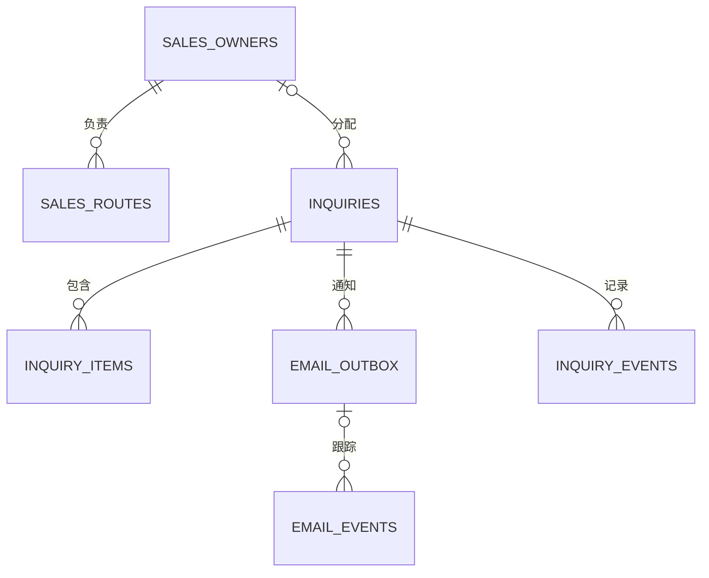

# 数据库、内容接口与询盘设计

日期：2026-10-04。性质：待实现的设计规格，不是已运行数据库或迁移脚本。目标：英文首发、四产品线、B/C 询盘；不建立订单与支付模型。

## 1. 数据各放在哪里

| 内容 | 唯一事实源 | 读写责任 |
|---|---|---|
| 页面、产品、变体、文章、审核信息 | WordPress / MySQL | 编辑在 WordPress 写；Next.js 服务端读 |
| 原始 PPT、PDF、产品资料 | 原始资料目录，只读 | 提取结果进入研究目录，原件不覆盖 |
| 已授权公开图 | WordPress 媒体记录 + 媒体存储 | 内容后台上传，前台通过 CDN 读 |
| 询盘、快照、分配、邮件记录 | WordPress CPT `fh_inquiry`（同一 MySQL 库） | **WordPress 是唯一写入点**；Next 服务端经 WP REST 转发；销售在 wp-admin 处理 |
| 客户图纸、未公开证据 | 私有对象存储 | 受控授权访问；不能放 `public/` |

**⚠️ 本节已由 DEC-055 取代（2026-10-06）：询盘不再使用独立 PostgreSQL，改为同库的 WordPress CPT `fh_inquiry`。**

WordPress 的表由 WordPress/项目插件管理，**Next.js 既不直接写 `wp_*`，也不持有任何数据库凭据** —— 轮毂 CRUD 走 WP API（`wp_insert_post`），询盘走 WP REST 端点。这一点与原设计一致，只是询盘的落点从独立库改成了同一库的 CPT。

> **为什么单库（DEC-055 摘要）**
>
> ① 选定 CPT 之后双库在物理上已不可行 —— CPT 的数据必然落在 `wp_posts` / `wp_postmeta`。
> ② **决定性理由**：WordPress 后台要能查阅管理询盘 ⇒ WP 的 PHP 进程必须能连上存询盘的库 ⇒ 「WP 被攻破或插件有漏洞时能读到询盘」**无论询盘在哪个库都成立**，双库的 PII 隔离收益归零。双库只有在本方案（Next 独占询盘、WP 看不到）下才有价值。
> ③ 原设计要的「隔离」发生在**应用层**：它担心 WordPress **应用**故障。直写方案下 WP 应用挂了询盘照常记录，经 WP REST 方案下询盘被阻断；而 MySQL 本身挂掉时两者结果相同。**单库不削弱应用层隔离。**
> ④ 容量实测：全量 1219 型号 + 5 年询盘推演约 **104,000 行 / 44 MB**，离需要拆表的量级差 2–3 个数量级。`wp_postmeta` 的 `meta_key` 有索引，按 meta 过滤 `EXPLAIN` 走 `ref`。
> ⑤ 单库消掉 4 条风险：Next 不再持有 DB 凭据 / 无两个写者 / REST 是显式契约而非静默表契约 / `33061:3306` 端口映射可取消。

写入路径：`浏览器 → Next /api/inquiries（公开边界：限流、蜜罐、时间陷阱、上下文复核）→ 服务端转发（服务凭据）→ WP REST /fh/v1/inquiries → MySQL`。**浏览器不直连 WP REST** —— 否则跨源，且要为一个我们不需要的跨源通路开放 CORS。

WordPress 停机时现有缓存页面可继续浏览；询盘提交会返回诚实失败（保留输入可重试），并提供已确认的直接联系渠道兜底。目录询价只能使用仍在有效期内的已批准服务端快照，否则降级为一般需求咨询，不能信任浏览器传来的规格。

## 2. WordPress 内容模型

一期用轻量项目插件定义内容类型、字段、校验与 REST 返回字段。禁止仅用可视化页面编辑器把规格藏进正文。

| 对象 | WordPress 实现 | 核心字段与关系 |
|---|---|---|
| 页面 | 原生 page + 受控字段 | 路径、语言、标题、段落、主行动、SEO、审核状态 |
| 产品 | `catalog_product` 自定义内容类型 | `product_uuid`、公开型号、产品线、供应方、简介、主图、来源、发布状态 |
| 变体 | `catalog_variant` 自定义内容类型，不生成公开页面 | `variant_uuid`、父产品 ID、供应方、生产编码、型号级实际规格、证据与审批 |
| 技术文章 | 原生 post | 作者/审核者、正文、相关产品线、来源、更新时间 |
| 产品线 | `product_line` 分类 | wheels、ev_components、custom_aluminum、self_sealing_tires |
| 制造工艺 | `manufacturing_process` 分类 | flow_formed、forged、cast、unknown，未知不自动推断 |
| 供应方 | 私有 `supplier` 内容类型 | 稳定 ID、法定名称、角色、授权范围、有效期；联系人不对外 |
| 证据资料 | 私有 `source_document` 内容类型 | 文件哈希、版本、来源公司、页码、权利状态、私有原件地址 |
| 图片 | 原生 attachment + 扩展字段 | 对应产品/变体、图权状态、原件来源、页码、哈希、替代文本 |
| 工程审核 | 私有审核字段/记录 | 对象、审核人、时间、证据版本、允许发布字段、备注 |

变体约数千条的规模先使用自定义内容类型；若经过实际性能测试发现筛选查询瓶颈，再增加由插件维护、可重建的规格索引表。索引不是第二事实源，不提前引入独立搜索集群。

注册产品内容类型、分类及允许公开的字段以提供 REST；供应商内部资料和证据原件采用独立受限接口，不能为了方便把所有字段设成公开。[WordPress 官方依据](https://developer.wordpress.org/rest-api/extending-the-rest-api/adding-rest-api-support-for-custom-content-types/)。

### 产品公用字段

| 字段 | 类型/规则 |
|---|---|
| `product_uuid` | 稳定 UUID，跨导入不变；不拿可变 slug 当主键 |
| `source_key` | 来源公司 + 来源目录 + 原始型号的规范化键；插件保证导入唯一 |
| `public_model` / `slug` | 经业务确认的公开编号与 URL；slug 变动生成重定向 |
| `product_line` | 四产品线枚举；能力页可没有产品记录 |
| `supplier_id` / `brand_owner_id` | 供货方、品牌权利方分开；有共同股东不等于同一主体 |
| `content_locale` | 首期 en；编辑字段标签可中文 |
| `description` / `summary` | 经审校的英文，营销正文不写死在组件 |
| `hero_media_id` | 主图必须实体存在且授权获准 |
| `has_image` / `media_approved` | 分别表示文件存在与获准使用；不能互相替代 |
| `engineering_status` | pending / approved / rejected；记录审核人与来源版本 |
| `publication_status` | draft / ready / published / retired |
| `source_document_ids` | 引用来源文件、页码及字段证据 |
| `content_version` / `updated_at` | 缓存失效与历史快照所需 |

发布条件由后台发布钩子和前台读取过滤双重执行：产品内容已批准、主图存在且可用、供货关系确认、实际变体已审核。没有产品数据时只发布经确认的能力内容。撤回或授权过期必须立即停止新询价并同步失效缓存，历史询盘快照保留。

### 四条产品线的规格

| 类型 | 字段 | 规则 |
|---|---|---|
| 轮毂变体 | `diameter_in`、`width_in`、`bolt_count`、`pcd_mm`、`offset_mm`、`center_bore_mm`、`finish_code`、`production_code` | 数值用定点小数；正负 ET 合法；未知为 null，不能填 0 |
| 轮毂补充 | 工艺、材料、载荷及适配证据引用 | 型号工艺不能继承宣传册总能力；载荷和适配没有批准证据不发布 |
| 三电铝件 | 部件类别、材料、工艺、尺寸/公差、冷却/密封测试、表面处理 | 首期为能力分类；有具体型号数据后才建规格记录 |
| 定制铝件 | 可接受输入、工艺能力、检验能力、项目范围 | 客户要求与工厂已具能力分字段，不能把需求写成承诺 |
| 自密封轮胎 | 尺寸代码、载荷指数、速度级别、适用条件、验证报告、地区售后 | 缺型号表时不建 SKU；不继承宣传册中任何泛化“安全保证” |

每条变体是一种实际组合。例如已有 `18×8.5 / 5×112 / ET35` 与 `19×9 / 5×114.3 / ET40` 时，不得将尺寸、PCD、ET 各取集合后组合出从未生产过的配置。两组孔距/范围只有供应商确认的组合才拆分。JSON 提取结果中列错位或范围歧义进入异常队列。

跨供应商相同型号默认不同产品；同一设计多个尺寸是否合并，由稳定来源键与人工映射决定。PPT 的 36 款与蓝辉主表的 1349 型号不凭编号相似直接合并。

## 3. 内容接缝与 REST 接口

目标调用方向：页面服务端装配 → `src/content/` 类型化读取接口 → WordPress 适配层 → REST。展示组件只接收既有类型数据，不知道 CMS 字段名或凭据。

当前页面直接导入静态数组，`wpCollection/wpItem` 尚未接到页面。因此 T05 要先补齐稳定的异步内容读取契约，T09 再替换数据源；不能把“只改一个配置文件”作为真实接入验收。

建议接口（路径待实现）：

| 接口 | 谁可访问 | 约定 |
|---|---|---|
| `GET /wp-json/site/v1/products` | 公开只读 | 只返回可发布产品；分页/筛选、限制单页数量，不返回内部备注 |
| `GET /wp-json/site/v1/products/{slug}` | 公开只读 | 已批准规格、对应变体、媒体与公开说明 |
| `GET /wp-json/site/v1/pages/{slug}` | 公开只读 | 稳定的段落类型，不接受任意脚本 |
| `POST /api/revalidate` | WordPress 签名调用 | 时间戳、消息 ID、签名校验、重放保护、对象范围白名单 |
| `GET /api/preview` | 经授权编辑 | 短时签名，访问草稿不污染公开缓存 |

生产 CMS 故障不得退回虚构产品 fixture：已批准内容可短时使用最后成功版本并报警；首次未取得真实内容则返回明确不可用/404。产品安全撤回设置失效屏障，不能继续使用旧版本“可供”状态。生产 `WP_MODE=live` 且配置不全应直接阻止发布。

## 4. 询盘数据库表与关系

下表为逻辑模型。迁移实现时必须添加非空、唯一、检查、外键和索引，不是把整张表塞成一个无约束 JSON。

| 表 | 字段与关系 | 约束与索引 |
|---|---|---|
| `sales_owners` | `id UUID`、名称、内部邮箱、是否启用 | 邮箱唯一；只由受控配置维护 |
| `sales_routes` | `id`、优先级、国家/地区、产品线、客户类型、`owner_id`、启用状态 | owner 外键；优先级确定；匹配失败进入公共队列 |
| `inquiries` | `id UUID`、`inquiry_no`、创建时间、姓名、邮箱、公司可空、国家、`customer_type`、语言、消息、`status`、`owner_id`、来源路径、同意时间、隐私版本、`idempotency_key`、`request_hash` | 询盘号唯一、幂等键唯一；客户类型 business/personal；索引 `(status,created_at)`、`(owner_id,created_at)` |
| `inquiry_items` | `id`、`inquiry_id`、产品/变体 UUID、产品线、数量、`catalog_snapshot JSONB`、`customer_requirements JSONB` | inquiry 外键；数量有值则大于 0；询盘可无产品，作为一般咨询 |
| `email_outbox` | `id`、`inquiry_id`、种类、收件人、模板版本、状态、尝试次数、下次重试时间、锁租约、提供商消息 ID、去重键、发送内容快照 | 去重键唯一；索引 `(status,next_attempt_at)`；发出后不改内容 |
| `email_events` | `id`、outbox 关联、提供商消息 ID、事件 ID、事件种类、发生/收到时间、最小化错误信息 | 提供商事件 ID 唯一；无已知消息的合法事件先暂存后关联 |
| `inquiry_events` | `id`、`inquiry_id`、操作者、动作、时间、最小必要备注 | inquiry 外键；审计记录追加写 |
| `inquiry_attachments`（二期） | `id`、`inquiry_id`、私有对象键、文件名、MIME、大小、哈希、扫描状态、留存时间 | 私有存储；不以用户文件名拼接路径；到期清理 |

主键统一 UUID，时间统一带时区 UTC，在后台按需要显示当地时间。邮箱保留输入值及用于查询的规范化值；不得以“同邮箱”将两次不同需求合并。询盘不做公开列表或按序号公开查询。

**状态分开管理**：业务状态是 new/assigned/contacted/closed/spam；邮件状态是 pending/sending/accepted/delivered/bounced/failed/unknown。邮件 accepted 只是提供商接受，不代表已送达；delivered 也不等于客户已阅读。模型不得将它们折成一个 `success=true`。

一期销售从收件箱处理，技术维护者提供受控导出与失败重发操作，不搭建公开后台。`contacted/closed` 由明确的内部操作更新；没有 CRM/邮箱同步时不能自动声称销售已回复。统计“有效询盘”用销售每周人工标注，分析看板中不虚报成交。

## 5. 提交、事务与重试

1. 浏览器提交带幂等键的请求；服务端检查大小、字段长度、邮箱、枚举、国家和数量，并进行限流、蜜罐与必要的人机验证。来源路径限制为本站合理长度，不信任任意外部 URL。
2. 从已批准内容读取产品与变体。目录规格由服务端生成快照；客户输入保存在 `customer_requirements`，不能被误认为工厂确认值。失效变体返回 409，提示重新选择；无产品的一般需求可独立保存。
3. 在**同一个数据库事务**内创建 inquiry、items、owner 分配结果和销售通知 outbox。任一失败全部回滚，返回可重试错误，不显示提交成功。
   - 载体由 DEC-055 定为 WordPress CPT `fh_inquiry` + **事务 outbox**；事务边界在 WordPress 侧（`$wpdb->query('START TRANSACTION')`）。

   > ⚠️ **CPT 与「同一事务」的张力（实现时必须解决）**：`wp_insert_post()` / `update_post_meta()` 各走自己的查询，**本身不构成一个可回滚的事务单元**。所以询盘的落库不能只靠一组 post + meta 调用 —— 需要显式事务包裹，或把「幂等键 + outbox」放在带唯一约束的专用表里与 CPT 记录同事务写入。**这是一个必须在实现阶段验证的点，不能假设 CPT 自动具备事务性。**
4. 事务提交后返回 201、询盘号和 `notification_status=pending`。相同幂等键与相同请求返回原询盘；键相同但内容不同返回 409。唯一约束解决并发，不靠“先查再插”的竞态窗口。
5. 定时发送器领取到期 outbox，用数据库锁/租约避免并发重复领取。崩溃后租约超时可恢复。发信调用不能留在数据库长事务内。
6. 邮件提供商接受时记录 `provider_message_id` 与 accepted。接收签名回调后记录 delivered/bounced 等事件，先存去重事件再更新投影，允许重复和乱序通知。
7. 网络超时意味着投递结果不明。提供商允许的窗口内沿用同一发送幂等键和同一内容；超过窗口且不能对账时转 unknown 人工检查，不盲目无限重发。Resend 的幂等支持及有效窗口以实现时文档为准。[官方依据](https://resend.com/docs/dashboard/emails/idempotency-keys)。
8. 暂定退避 1、5、15、60 分钟，最多 8 次并设总重试期限；配置错误、永久退信停止自动重试并报警。所有失败保留询盘、原因和后续动作，不能把邮件故障改成丢弃询盘。

邮件 `From` 使用已验证公司域名，销售通知 `Reply-To` 为已校验客户邮箱；业务收件人只从服务端配置读取，不接受客户端指定。邮件内容包含询盘号、B/C 类型、产品线、型号/变体、数量、客户需求和来源页。客户回执为后续选配，先防止表单被滥用成发信器。

私密图纸上传延期到首发后。首期表单说明“提交需求后与销售沟通图纸传递”，不放无法使用的上传按钮；如一个月内必须上传，则从页面扩容工时中替换范围，并完成大小/MIME/恶意文件扫描、隔离存储、签名下载及清理。

## 6. 安全、留存与运营边界

- 当前 `GET /api/inquiries` 公开返回邮箱、消息等记录，属于发布阻断项。首期关闭；未来内部读取需身份认证、角色权限和审计。
- `POST /api/inquiries`、预览、回调、任务入口不得被 CDN 缓存。任务/回调必须校验调用身份；API 密钥、数据库账号不进入浏览器。
- 询盘日志只记 ID、耗时与错误码，不打印客户整段邮件/联系方式。原有 mock 邮件全量日志需要关闭。
- 询盘数据库账号使用最小权限；生产与测试隔离。产品导入不能访问询盘库。
- 负责人确认目标市场、存储地区、处理方、留存时间和删除流程，再让审核者完善隐私政策。建议把留存天数作为明确配置，不由开发者私定永久保存。
- 删除请求需要确认请求者与范围；主库、附件、导出副本和备份过期周期都在操作手册中说明。询盘快照的不可变性不阻止依法或按承诺删除个人数据。

## 7. 必须实际跑的数据库验收

| 场景 | 预期 |
|---|---|
| 正常提交后重启服务 | 原询盘与待发邮件仍存在 |
| 同一键并发提交 10 次 | 仅一个 inquiry，返回同一询盘号 |
| 同一键修改需求再提交 | 409，不覆盖原需求 |
| 写 items 或 outbox 时故障 | 不留下“有询盘无待发任务”的半成品 |
| 邮件服务不可用 | 询盘保存，发件箱待重试，告警可见 |
| 发送后进程崩溃 | 重试/对账可恢复，不重复创建询盘；模糊投递进入核查 |
| 重复/乱序回调 | 事件只记一次，状态不因晚到 accepted 覆盖 bounced |
| 产品改名/改规格 | 历史询盘快照不变 |
| 客户伪造规格/owner | 服务端丢弃伪造目录字段与收件人，客户要求独立保留 |
| 匿名读取列表/私有附件 | 被拒绝，正文不泄漏个人信息 |
| 数据恢复 | 在独立环境恢复后能列出预期样例、关联项与事件，记录实测恢复时间 |

正式迁移文件必须有版本号、向前兼容策略和验证查询。升级数据库前备份；回滚应用时优先保留新增数据，只回滚兼容代码，不能清空生产表来“恢复正常”。
