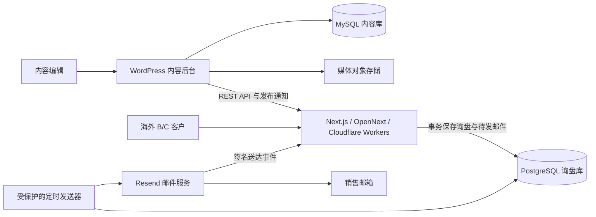

# 深圳公司四产品线独立站：从资料到上线的执行计划

日期：2026-10-04。状态：规划交付，尚未实施。首期市场与语言：用户已确认海外客户、英文优先。

本计划依据本次需求、3 份原始画册、现有代码抽查和官方技术文档制定。用户确认公司按 PPT 使用“深圳峰徊科技有限公司”，与蓝辉为同一股东名下的不同公司。目标为 **2026 年 11 月 4 日前上线，整体运行维护预算约 1000 元/月**。域名、收件邮箱及具体服务方案待确定。旧项目中的“丰怀、纯 B2B、单一锻造轮毂厂”不再作为业务前提。

## 阅读与使用

| 文件 | 用途 | 谁看 |
|---|---|---|
| 本文件 | 确定范围、排期、部署和上线门槛 | 你与朋友 |
| [数据库与接口设计](02-data-and-inquiry-design.md) | 数据放哪里、字段与关系、询盘可靠性 | 开发者 |
| [素材与页面分配](03-content-and-assets.md) | 三家公司资料放到哪些页面、哪些资料还缺 | 朋友、供应商、编辑 |
| [逐步任务与验收](04-task-cards.md) | 带编号、依赖、操作与验收的施工清单，以及模型提示模板 | 你、DeepSeek |
| [逐页逐视口施工规格](../../PAGE-SPECS/2026-10-04-launch-viewport-spec.md) | 每屏回答什么、内容模块、主视觉、PPT 页码与行动 | 你、朋友、设计与开发 |
| [代码与资产盘点](05-code-and-assets-inventory.md) | 前后端模块、克隆遗留、虚构内容、数据接缝缺口 | 你、开发者（执行前必读） |
| [资料核验记录](../../resources/research/2026-10-04-site-plan/README.md) | 页码、原始文件指纹、现状缺口、外部依据 | 审核者 |

## 1. 首期要交付什么

一个由深圳公司统一接洽的英文产品与询盘网站。客户可以了解四条产品线、查看已核实产品、提交需求；销售在邮箱收到完整上下文并直接回复；编辑在 WordPress 更新产品与文章。

四条线平行展示：轮毂（旋压、锻造）、新能源三电铝制品、定制铝制品、自修复轮胎。页面描述应按证据使用“自密封轮胎”；不能把所有损伤都说成能够自行修复。

| 客户 | 主要路径 | 询盘补充信息 |
|---|---|---|
| 经销商、品牌商、采购商 | 产品线 → 型号/能力 → 批量询价 | 公司、目标市场、数量、规格、项目阶段 |
| 个人车主 | 轮毂/轮胎 → 选型帮助 → 个人咨询 | 国家、车型年款、现有尺寸、需求；不强制公司名称 |
| 工程与定制客户 | 三电/铝制品 → 定制流程 → 工程咨询 | 材料、图纸是否具备、预计数量、验证要求 |

B/C 入口共享产品库和询盘系统，通过 `customer_type` 区分。个人客户的最低采购量、安装支持、交付范围及售后政策必须确认；确认前只接受需求咨询，不承诺零售交付。四条产品线不必都制造一套 C 端页面。

首期包含：首页、产品中心、轮毂目录与单品模板、旋压/锻造入口、三条能力页、关于公司、制造与质量、定制开发、联系/询盘/成功页、技术文章和经审核的政策页。能力或品牌归属未确认的页面保持草稿。

首期不做在线付款、购物车结账、客户账号、订单管理、自研 CRM、AI 客服、自动车型适配推荐。多产品“询价清单”可在基本提交链路稳定后增加，不阻塞首期。

**为一个月首发，建议先选 10–20 个审核通过的轮毂型号作为发布批次**，这是工作量控制建议，不是必须凑满的产品数量。其余产品在逐项核准后扩容。无图或未确认产品不建公开页面、不进筛选、不进 sitemap；不能为了数量生成空壳页。历史“1018 个有图”仅是候选口径，不等于 1018 个已获授权并可销售的型号。

## 2. 现有项目可以复用多少

| 对象 | 2026-10-04 核查 | 本计划动作 |
|---|---|---|
| Next.js 页面、组件、令牌 | 已有基础，依赖声明为 Next.js 16.3.5 | 保留可用结构，调整业务内容与入口 |
| 产品内容 | 页面仍导入示例 `wheelSkus`，带虚构编号 | 替换为审核后数据，不把样例当真实产品 |
| WordPress 客户端 | 有 REST 读取函数，但未发现页面/内容层调用 | 建立实际数据接缝；不能声称配置 URL 就全部接通 |
| 询盘存储 | `Map` 内存，服务重启丢失 | 改为事务持久化 |
| 邮件 | 已有 Resend HTTP 调用，缺 key 时模拟 | 接真实配置、发件箱、重试与送达事件 |
| 询盘读取 | `GET /api/inquiries` 无鉴权返回记录 | 最高优先级关闭公开读取；预发布前完成 |
| 语言 | cookie 切换，尚无独立语言 URL | 首期公开英文固定 URL；中文公开页后续单独设计 |
| 部署 | `standalone` 配置；无 OpenNext 依赖/配置 | 做适配验证，再部署；保留运行时 API |
| 版本控制 | 当前目录无 `.git`，同时存在 npm/bun 锁文件 | 建立版本控制流程，选定包管理器；未经授权不提交推送 |

本次是规划与资料核验，未运行应用构建，未声称现有代码通过上线验收。历史构建成功不覆盖今天的代码和实际生产环境。

## 3. 网站页面与资源如何组织

| 路径 | 页面回答的问题 | 主要来源 | 主要行动 |
|---|---|---|---|
| `/` | 谁为我提供哪些产品与服务 | 峰徊画册第 1–4、22 页 | 进入产品线 |
| `/products` | 四条线如何选择 | 峰徊第 4 页 | 进入对应目录/能力页 |
| `/products/wheels` | 哪些真实型号可询价 | 核准后的型号表与独立产品图 | 查看型号 |
| `/products/wheels/flow-formed` | 哪些型号已确认使用旋压工艺 | 型号级工艺证据 | 筛选/询价 |
| `/products/wheels/forged` | 锻造的可供范围是什么 | 峰徊第 9 页、航鹏第 4 页，待核准 | 型号或定制咨询 |
| `/products/wheels/[model]` | 这个型号有哪些真实变体 | 型号、变体、图片与审核记录 | 带型号询价 |
| `/products/ev-components` | 电机、电控等铝制品能做什么 | 峰徊第 12–13 页、航鹏第 2–3 页 | 工程咨询 |
| `/products/custom-aluminum` | 来图/来样如何开发 | 峰徊第 14–15 页 | 提交项目要求 |
| `/products/safety-tires` | 自密封原理、适用边界及支持 | 峰徊第 16–21 页、洛克画册 | 个人/渠道咨询 |
| `/capabilities` | 合作制造与质量验证如何组织 | 供应商工艺资料，注明归属 | 定制咨询 |
| `/custom-development` | 从需求到样件、批量的步骤 | 峰徊第 15、22 页 | 发起项目 |
| `/about` | 深圳公司承担什么职责 | 峰徊第 1–3、23 页 | 联系团队 |
| `/resources`、`/resources/[slug]` | 怎样选型、准备询价资料 | 有来源的原创文章 | 进入对应产品线 |
| `/contact`、`/request-a-quote` | 怎样联系并提交需求 | 已确认的深圳公司联系资料 | 提交 |
| `/thank-you` | 需求是否已保存 | 服务端返回的询盘号 | 返回产品页 |
| `/support/*` | 数据处理、售后与交易边界 | 负责人/专业审核后的文本 | 联系支持 |

沿用现有 `/resources`，本轮没有充分理由另改 `/insights`。旧路径迁移必须有映射表与永久重定向；没有等价内容时返回真实 404/410，不统一跳首页。旋压与锻造路由是明确保留词，不能与 `[model]` 编号冲突。

轮毂型号上的 PCD、ET、CB 与“某款车可以安全安装”是两类信息。型号变体可展示已核实生产数据；车型适配仍需工程确认，不能从孔距相同自动推断。没有锻造型号证据时，锻造页只说明经过确认的定制能力。

首页建议按“公司定位 → 四条产品线 → 合作制造与质量证据 → 采购/定制流程 → 询盘”组织。每段有独立问题、主视觉和主要行动。产品图用于产品，工厂图用于制造能力，不能用轮毂图替代三电或轮胎内容。

## 4. 推荐技术组合

保留用户选定的 Next.js + Headless WordPress，以及项目已有的 OpenNext 部署方向。以下服务组合是实施建议，待技术验证与预算确认后锁定版本。

- WordPress 管理产品、变体、能力、文章、媒体和证据；使用原生后台及轻量项目插件，不增加第二套内容编辑系统。底层 MySQL 与询盘 PostgreSQL 是不同用途的数据库。
- Next.js 负责页面、数据转换与询盘 API。组件继续接收稳定类型；不要把 WordPress 响应结构散落到组件中。
- 推荐 Cloudflare Workers + `@opennextjs/cloudflare`。WordPress 放独立的托管 PHP/MySQL 环境或受维护 VPS，不能把 PHP 网站塞入 Next.js Worker。
- 媒体使用对象存储/CDN。首期可保留已审核本地图并逐步迁移；WordPress 新增图片必须能自动到达可访问媒体源，不能要求编辑修改代码。
- 询盘推荐独立 PostgreSQL（例如经区域/费用验证的托管实例）及兼容 Workers 的连接方式。拒绝生产 `Map` 或 Worker 本地 SQLite 文件。
- 低流量首期用数据库发件箱加受保护的定时发送器，不要求再购买专门消息队列。OpenNext 的缓存队列与询盘邮件队列属于不同职责。

OpenNext 官方文档提供 Next.js 到 Workers 的适配和缓存组件说明；锁定的 Next.js、适配器、驱动组合仍须以实际预发布验证为准。[部署依据](https://opennext.js.org/cloudflare)、[缓存依据](https://opennext.js.org/cloudflare/caching)。

**复用两个参考的方式**：2nforged 可参考产品目录、制造说明、经销商和询盘路径，不复用图片文案；`meathill/next-wordpress` 当前 README 描述的是含 WooCommerce、库存、订单、结账的架构，本站只取可用的 Headless/OpenNext 思路，不照搬完整电商系统。参考代码前另核许可证及具体模块。[网站参考](https://2nforged.com/)、[仓库当前说明](https://raw.githubusercontent.com/meathill/next-wordpress/master/README.md)。

## 5. 分阶段交付

按“一名开发者/你 + AI，朋友每工作日配合资料确认”规划约 20–23 个有效开发工作日。目标首发日为 2026-11-04；不是无条件交付承诺。为此只上少量已批准产品和 2 篇文章，复用现有组件，延期在线附件、多产品清单、中文前台和视频制作。后续产品扩容与持续内容建设单独排期。

| 阶段 | 建议用时 | 交付物 | 放行条件 |
|---|---|---|---|
| 0 业务与资料 | 业务线贯穿首周，与开发同步 | 品牌/角色确认表、来源清单、首批产品清单 | 每个首发产品有归属、图、可用规格；明确个人客户怎么承接 |
| 1 基线与数据契约 | 3 日 | 版本基线、字段表、路由表、部署最小样机 | 类型契约明确；公开询盘读取关闭；Workers 能跑真实数据连接验证 |
| 2 WordPress 与导入 | 4 日 | 内容类型、受控字段、导入工具、发布通知 | 编辑可新增一个真实型号；重复导入不重复；来源可追溯 |
| 3 询盘闭环 | 4 日，优先完成贯穿流程 | PostgreSQL、发件箱、销售路由、邮件事件 | 断网/重启不丢单；重试不重复新增；能从授权测试邮箱回复 |
| 4 英文前台 | 5–6 日 | 复用组件完成首页、四产品线、详情、询盘及政策模板 | 手机端完整可用；B/C 路径均畅通；只展示审核通过内容 |
| 5 预发布、上线与交接 | 4–6 日 | SEO、故障测试、备份还原、发布手册、编辑培训 | 硬门槛全过；第二人演练；负责人批准上线与 DNS 变更 |
| 6 上线后观察 | 首发后第 7、30 日及持续 | 健康、询盘、内容与费用复盘 | 销售知道异常处理方法；优化项有负责人 |

实施顺序：先跑通“一条真实产品 → 一个页面 → 一次落库 → 一封授权测试邮件”，再扩展页面和产品数量。不要先批量生成上千页再补后端。

## 6. SEO 从开发阶段开始

1. 英文使用根路径，例如 `/products/wheels`；页面 HTML 固定英文、`lang=en`，公开内容不依赖语言 cookie。中文后台不需要中文公开 URL。
2. 将来上线完整中文内容时用 `/zh/...`，逐页建立双向 `hreflang`；未翻译页面不制造空页面，也不整站把用户强制重定向。Google 建议不同语言有独立 URL。[官方说明](https://developers.google.com/search/docs/specialty/international/managing-multi-regional-sites)。
3. 每页独立标题、摘要、主标题、canonical 与社交分享图。正式域名由负责人确认；特别核查构建时的 `NEXT_PUBLIC_APP_URL`，不可只看页面 200。
4. sitemap 只包含获准发布、可索引、返回 200 的规范 URL。成功页、询盘 API、预览、草稿、后台不进入索引。预发布采用访问控制与 noindex，robots.txt 不能代替权限。
5. 首期允许直径/宽度/工艺等有依据筛选；查询参数结果默认不进入 sitemap，重复组合 noindex。空结果不生成可索引薄页；分页与人工分类页提供可爬取链接。
6. 结构化数据从实际页面内容生成，可用 Organization、BreadcrumbList、Article；Product 的价格、评分、库存没有事实就不填写，不保证会展示产品富结果。
7. 技术文章先发布 2 篇经过审核的实用内容，另留 4 篇选题：轮毂询价参数清单、旋压/锻造选择、型号与车型适配的区别、三电壳体项目输入、来图定制流程、自密封轮胎的适用边界。先分配选题与目标页面，不批量生成重复 SEO 文章。
8. 图片有语义名称、尺寸与描述性替代文本；大图按设备加载，首屏图片优先、下方延迟。合成图不能充当实际工厂/测试/装车证据。

项目性能验收目标：选首页、目录、详情、能力、询盘 5 类页面，以同一移动测试条件重复 3 次，记录中位数和环境。目标 LCP ≤2.5 秒、CLS ≤0.1；交互另做实测，上线有足够真实流量后检查 INP ≤200 毫秒。它们是项目目标，不能以实验室报告冒称已有真实用户达标。

## 7. 部署与维护怎么做

**开发、预发布、生产三套配置隔离。** 数据库、媒体、缓存、邮件收件地址和密钥不能混用。密钥不进入 `NEXT_PUBLIC_*`、客户端代码或提交历史。

部署步骤：

1. 确认域名持有者、目标市场、服务区域、预算和付款账号。服务采购、真实发信、改 DNS 与正式发布在执行时由负责人授权。
2. 建预发布 WordPress/MySQL、媒体存储和询盘 PostgreSQL；限制后台访问，编辑与管理权限分开。指定备份负责人。
3. 配置 WordPress REST 白名单、审核状态、发布签名通知及预览；公开 API 不能泄漏供应商成本、联系人或证据原件。
4. 锁定依赖与唯一包管理器；CI 执行 `npm ci`、`npm run lint`、`npm run typecheck`、`npm run build`，再执行锁定版本的 OpenNext 构建。跨平台服务器不依赖 `sips`。
5. 配置适配器增量缓存、按需失效所需绑定与媒体处理。验证 WP 修改后页面在 5 分钟内更新、新型号无需部署出现、撤回产品从目录与 sitemap 移除。
6. 启用询盘迁移、定时发件器、邮件事件回调。发信域名的 SPF/DKIM/DMARC 和接收邮箱由域名/邮件负责人按提供商文档配置并验证。
7. 验证真实运行时：表单、数据库事务、重复请求、缓存更新、WP 超时、私密链接、受保护任务入口。`next dev` 成功不能替代 Workers 验证。
8. 做生产数据库备份，使用可兼容回滚的增量迁移；保存上一版本构建、配置清单及媒体版本。不要用恢复旧数据库代替普通代码回滚，避免抹掉新询盘。
9. 在正式域名校验 canonical/OG/sitemap/重定向/TLS 和测试收件；负责人批准后切 DNS、开放索引，提交 Search Console。
10. 上线后当天及第 7、30 天检查询盘落库与投递差异、索引、404、邮件退信、页面性能和销售反馈。

| 频率 | 维护工作 | 负责人 |
|---|---|---|
| 每日自动 | 可用性、询盘写入错误、待发邮件堆积、备份失败报警 | 技术维护者 |
| 每工作日 | 核对待处理询盘、退信和客户回复 | 销售 |
| 每周 | 内容/图片抽查、异常 URL、Search Console、WP 更新先在预发布验证 | 编辑 + 技术 |
| 每月 | 独立环境恢复备份、账号权限与费用检查、失败投递复盘 | 技术 + 朋友 |
| 每次内容发布 | 来源、规格、图权、英文及链接校验 | 编辑 + 供应商工程审核者 |

暂定恢复目标供负责人确认：询盘 RPO ≤1 小时、RTO ≤4 小时；内容 RPO ≤24 小时。服务套餐必须实测支持这些目标；预算不足就明确调整，不能在手册里空口承诺。备份覆盖 MySQL、询盘库、媒体与配置，且至少有一个独立故障域副本。

整体运行维护预算按 **1000 元/月**控制。下表是预算分配上限建议，不是供应商报价；一次性开发、域名首次付款、摄影和专业审核另列，不能假定包含在月度维护费中。

| 类别 | 月度规划额度（人民币） | 覆盖范围 |
|---|---:|---|
| WordPress 与 MySQL、基础备份 | 180 | 小规模托管或由明确负责人维护的 VPS |
| 询盘 PostgreSQL 与恢复能力 | 120 | 按实际区域、最低消费和恢复目标核价 |
| Workers、缓存、媒体与监控 | 90 | 按量设置预算告警，不假定全部永久免费 |
| 企业邮箱、通知发信、域名摊销 | 60 | 初期低流量；先核发送量、配额和收件功能 |
| 常规人工维护 | 450 | 限定巡检、更新、备份演练、小修；由维护者确认可承接工时 |
| 机动余额 | 100 | 汇率、流量变化和小额工具消耗 |
| 合计 | 1000 | 不等于雇佣专职员工或无限开发服务 |

上线前按实际可购套餐重排额度；例如数据库恢复套餐超过规划额，则减少其他可选服务或经负责人同意调整方案，不能降低询盘保存门槛。开发期模型调用成本单独记录，持续使用时纳入月预算。当前可核价入口为 [Workers](https://developers.cloudflare.com/workers/platform/pricing/) 与 [Resend](https://resend.com/pricing)；本次 Neon 价格页读取失败，其价格没有得到核验，不能将表中额度当成其报价。

## 8. 首期验收与交接

| 验收对象 | 通过标准 | 证据 |
|---|---|---|
| 公司身份 | 正式名称、销售联系人和供应商关系正确 | 负责人确认表 |
| 产品 | 100% 首发型号有图、有归属、有型号级规格来源 | 发布清单与抽查记录 |
| 四条线 | 每条线有独立页面与正确询盘上下文；未获授权页不公开 | 路由/审核表 |
| B/C 体验 | 各至少 2 人完成代表性任务；个人客户不被公司字段卡住 | 操作记录 |
| 内容维护 | 编辑发布产品、改图、撤回产品，无需代码部署 | 屏幕记录与刷新时间 |
| 询盘 | 重启不丢失；数据库失败不显示成功；邮件失败仍保留询盘与待发任务 | 故障测试日志 |
| 权限 | 匿名不能列出询盘或下载私密附件；伪造回调被拒绝 | 请求/响应记录 |
| 投递 | 保存、邮件接受、邮件送达三状态可区分；销售可直接回复测试客户 | 数据库/邮件事件/测试收件箱记录 |
| SEO | 规范域名正确、无草稿/无图产品进 sitemap、无竞品素材残留 | 抓取报告 |
| 工程 | lint、typecheck、build 及实际部署运行时验证通过 | CI 与预发布记录 |
| 运维 | 第二人按手册完成恢复/回滚；报警有接收人 | 演练记录 |

竞品残留扫描只要求公开源码内容、静态资源及部署产物为零；本项目保留的调研引用不应为“清零”被删除。法律与政策页面按真实业务经审核后发布，不由模型编造承诺。

## 9. 现在先执行的动作

按 [任务卡](04-task-cards.md) 顺序开始 T00–T04：确认正式身份与 C 端服务范围，核对两家供应商授权，确定首批型号，关闭公开询盘读取，验证部署环境。资料未齐时仍可做数据契约、样机和模板；依赖未确认事实的内容保持未发布。

已确认：公司按 PPT、蓝辉与深圳公司为同股东不同主体、英文优先、一个月目标、整体运行维护约 1000 元/月。待朋友补充：正式品牌/域名；两家供应商具体对应关系及授权范围；海外重点国家；个人客户怎么买、谁安装、谁承担售后；销售收件邮箱和跟进人；首批可供产品及域名控制权。无需等全部问题答完才开始独立技术工作，但不能绕过相关发布门槛。
